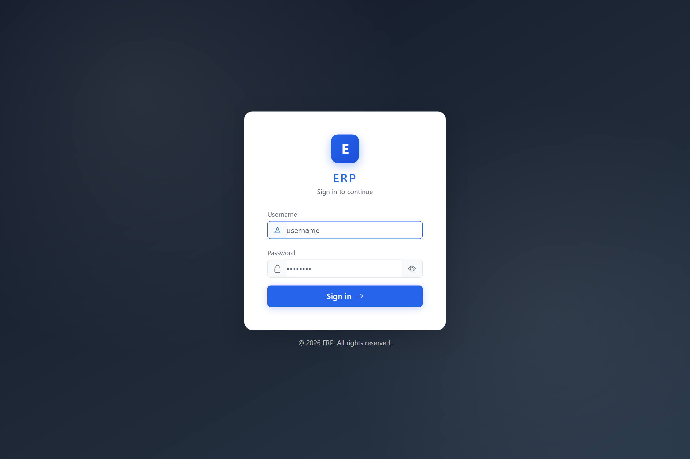
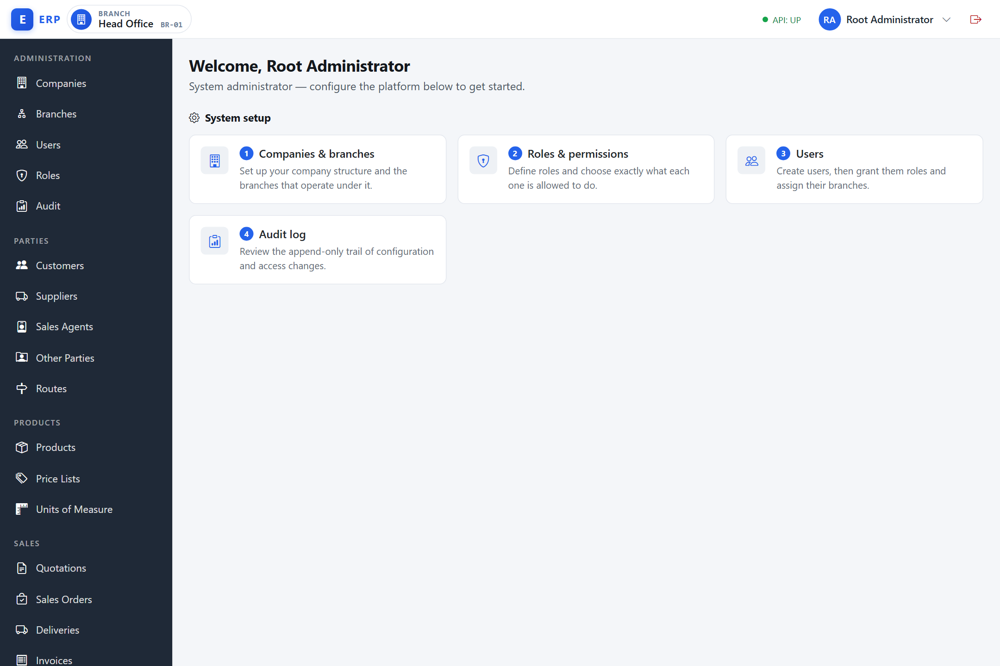

# Getting Started

Welcome to the ERP system. This chapter explains how to sign in, find your way around, and use the common patterns you will meet on every screen.

---

## Signing In

**What signing in is.** Authentication is the process of proving your identity to the system. You present a username and password; the system checks them, issues you a short-lived access token (a cryptographically signed credential, invisible to you), and loads your personal session. Everything you do after this is recorded against your identity.

**Why it exists.** Without authentication, anyone who could reach the URL could read, create, or delete business data. The system needs to know *who* you are before it can decide *what* you are allowed to do.

**When it happens.** Every time you open the application in a new browser tab, after your session has ended (see *How long a session lasts* below), or after you sign out. Refreshing a page you already have open does not ask you to sign in again.

**How it works.** On successful sign-in the system reads your default branch assignment and resolves your effective permissions for that branch. The main menu is built from those permissions — screens you cannot access are never shown.

1. Open your browser and navigate to the URL your administrator gave you (for example, `http://erp.yourcompany.com`). The sign-in page appears automatically. Its card reads **ERP** — *Sign in to continue*.
2. Enter your **Username**. Usernames are not case-sensitive.
3. Enter your **Password**. Click the eye icon at the end of the field to show or hide what you typed.
4. Click **Sign in →**. The button reads *Signing in…* while the system checks your details.

If your details are correct you are taken to the screen you were trying to open, or otherwise to your **home page** (see *The home page* below). The system reads your assigned permissions and builds your personal menu — you will only see the sections you are allowed to use.

### Your sign-in name

On many installations a username has two parts: your name, then **@** and a short name for your business — for example `amina.juma@yourcompany`. Your administrator sees the full name when they create your account and should give it to you exactly.

- On an installation that serves only your business, you can usually type just the first part (`amina.juma`) and the system adds the rest for you.
- On a shared server that hosts several businesses you must type the full name, including the part after **@**.
- If a sign-in fails and you typed a name without **@**, the message adds: *If your sign-in name has a part after "@" (for example name@your-company), type it in full.*

### Sign-in problems

| What you see | What to do |
|---|---|
| "Enter your username and password." | One of the two fields is empty. Fill in both. |
| "Invalid username or password." | Check your username and password. The message is the same whether the username or the password is wrong, and also when your account has been disabled — this is intentional. |
| "Account is locked. Try again later or contact an administrator." | Your account was locked after too many failed attempts. Wait 15 minutes, or ask an administrator to unlock it for you. |
| "This account is not available at the moment. Please contact your administrator." | Your business's account on the server has been suspended. Contact your administrator. |
| "Your subscription has lapsed and access is suspended. Please contact your provider to restore it." | The subscription for your business has been suspended for non-payment. Contact your provider. |
| "Sign-in failed. Please try again." | Something unexpected happened. Try again; if it keeps happening, contact your administrator. |

> **Note.** Your account is automatically locked for 15 minutes after 5 wrong attempts in a row. A successful sign-in resets the counter. A wrong *current* password on the **Change password** screen, and a wrong waiter PIN on the till, count towards the same limit.

### How long a session lasts

You do not need to sign in again during the working day. Behind the scenes the system renews your session quietly every few minutes for as long as you keep using it. Your session ends — and you see *"Your session has expired. Please sign in again."* — when:

- you have not used the system for about a week;
- you sign out;
- an administrator disables your account;
- you change your own password on another device (see below);
- your business's account or subscription is suspended.

After you sign back in you are returned to the page you were on. Any unsaved work on that page is lost.

### Changing your own password

**What it is.** Every signed-in user can change their own password at any time.

1. Click your name or initials in the top-right corner to open the account menu.
2. Click **Change password**. The **Change password** screen opens.
3. Enter your **Current password**.
4. Enter a **New password** and type it again in **Confirm new password**. The hint under the field reads *Use letters and at least one number. Avoid common passwords.*
5. Click **Change password**.

On success a confirmation reads *Password changed — Other devices have been signed out.* and you are taken to your home page. As the note on the screen says, *Changing your password signs you out on every other device* — any other browser or device where you were signed in must sign in again with the new password.

**The password rules.** A password must be at least 8 characters long, contain letters and at least one number, and must not be a commonly used password (such as `password1` or `admin123`). The messages you may see are:

| Message | Meaning |
|---|---|
| "Enter your current password and a new password." | A field is empty. |
| "The new password and its confirmation do not match." | Retype the confirmation. |
| "Choose a new password that is different from your current one." | The new password must be new. |
| "Your current password is not correct." | Retype your current password. Repeated mistakes lock the account. |
| "Password must be at least 8 characters." / "Password must contain letters and at least one number." / "Password is too common; choose a stronger one." | Choose a stronger password. |

### Temporary passwords — the first sign-in

A password that an administrator sets for you — when your account is created, or when they reset a forgotten password — is a **temporary password**. The first time you sign in with it, the system takes you straight to the **Change password** screen and shows the notice *Your administrator set a temporary password for you. Choose your own password to continue.* Every other screen, including the home page, sends you back here until you have chosen your own password.

Type the temporary password as your **Current password**, choose a new one, and click **Change password**. You can still sign out from this screen if you need to.

### Signing out

Click your name or initials in the top-right corner of the screen to open the account menu, then click **Sign out**. (On wider screens a separate **Sign out** icon button is also shown in the top bar, so you can sign out in one click.) You are returned to the sign-in page and your session is ended immediately.

---

## The App Layout

Once signed in you see three main areas.

### Top bar

The horizontal bar across the top of every screen contains:

- **Logo** on the left. Click it to return to your home page.
- **Active branch indicator** — a chip headed **Branch** showing the name of the branch you are currently working in (with its branch code beside the name on wider screens). If you are assigned to more than one branch, click it to switch (see *The Branch Switcher* below); with only one branch the chip cannot be clicked. If you have no assigned branch the chip reads **No branch**.
- **Search box** — *Search… (Ctrl K)*, in the middle of the bar on wider screens. See *Finding a screen quickly* below.
- A small coloured dot showing whether the system service is reachable: **API: UP** in green when healthy, **API: loading** in grey while it checks, and **API: error** in red when the service cannot be reached.
- **Your name / initials** on the right. Click to open the account menu, which shows your display name, your **@username**, a **Root administrator** badge if you are signed in as a system superuser, and the **Change password** and **Sign out** actions. On medium and larger screens a separate **Sign out** icon button also sits in the top bar.

### Sidebar navigation

A dark panel on the left (opened with the menu icon on small screens) lists everything you can open. The first entry is always **Home**. Below it, screens are grouped by business area — **Administration**, **Parties**, **Products**, **Data Tools**, **Sales**, **Inventory**, **Purchasing**, **Accounting**, **Approvals**, **Documents & PDF**, **Notifications**, **Costing**, **Finance / Fixed Assets**, **CRM**, **HR & Payroll**, **Projects**, **Budgeting**, **Manufacturing**, **FX / Currency**, **Analytics** and **Point of Sale**. Click a screen name to open it.

The sidebar is **personalised** — items you do not have permission to see are simply not shown, and a group whose every item is hidden disappears entirely. If you cannot find a screen you expect, you probably lack the required permission. Contact your system administrator.

On a small screen, press **Escape** or click outside the menu to close it.

### Finding a screen quickly

The search box in the top bar finds any screen you are allowed to open without scrolling the menu.

1. Click the box, or press **Ctrl+K** (**Cmd+K** on a Mac) from anywhere.
2. Start typing part of a screen name or what you want to do — for example `invoice`, `cash up`, `low stock` or `expense`. Many screens also answer to everyday words and Swahili terms (for example `matumizi` finds **Cash / Bank Entry**).
3. Up to eight matching screens are listed with their menu group. Use the arrow keys and press **Enter**, or click a result.

Press **Escape** to close the list. If nothing matches you see *No matches for "…"*. The search lists only screens your role can open. (On phones and small tablets the box is hidden; use the sidebar menu instead.)

### Main content area

The large area to the right of the sidebar is where each screen loads. The current screen's address is reflected in the browser address bar.

### Notices at the top of the page

A coloured banner may appear above the screen to tell you about your business's subscription:

| Banner | Meaning |
|---|---|
| *Trial ends on …* / *Subscription due on …* | A reminder, shown from seven days before the date. |
| *Payment overdue. The system becomes read-only on …* | Payment is late. Everything still works until the date shown. |
| *Your subscription is overdue, so the system is read-only. … Payment restores full access.* | You can open and read everything, but saving is refused with the same message until payment is received. |

### The home page

When you sign in — or are redirected after trying to open a screen you cannot access — you land on the **home page** (`/admin/home`). The sidebar's **Home** link and the logo also bring you here.

What you see depends on your account:

- **System administrators (root accounts)** see a **System setup** panel — its heading reads "System setup", under the page subtitle "System administrator — configure the platform below to get started." It presents an ordered set of configuration steps as cards — *1 Companies & branches → 2 Roles & permissions → 3 Users → 4 Audit log* — for standing the system up. Each card links straight to that area.
- **Everyone else** sees **Welcome, \<your name\>** and a personalised **launchpad**: the subtitle reads "Quick links to your most-used screens," and below it a **Quick launch** grid shows one card per screen you hold the permission to open, drawn from a curated set: Dashboard, Sales orders, POS sell, Customers, Purchase orders, Goods receipts, Suppliers, Stock on-hand, Stock count, Stock transfer, Record receipt, Record payment, Enter supplier bill, Post journal and Work orders. A card you can see is always a card you can open. The **Dashboard** card is shown first when you can use the dashboard. If none of the curated screens are open to you, you instead see "Your workspace is ready." with a prompt to use the menu on the left.

The home page never requires a permission and never loads business data, so it is always safe to land on; this is why the system uses it as the redirect target for screens you cannot access.

---

## The Branch Switcher

**What a branch is.** A branch is a physical or logical operating unit within a company — for example, a shop, a warehouse, a regional office, or a cost centre. Every transaction you create is stamped with the branch you were working in at the time.

**Why branch switching exists.** A single user may work across multiple locations. Rather than signing in and out with different accounts, you stay signed in and tell the system which branch to work in. The system then shows you data for that branch and applies the permissions that hold there.

**When it matters.** On sign-in the system activates your **default branch** automatically. If you are assigned to more than one branch, switch before performing a transaction so it is recorded in the correct location.

**How it works.** Switching does not sign you in again. The system remembers your choice for this browser tab and attaches it to everything you do from then on. Your permissions are re-checked for the new branch straight away — they can differ between branches if your roles were granted for particular branches. Switching to a branch of a different company is recorded in the audit trail.

1. Click the branch chip in the top bar. A **Switch branch** list opens, showing only your active, assigned branches. Each row shows the branch **name** with its short branch **code** beside it; your current branch has a tick.
2. Click the branch you want. Clicking the branch you are already in simply closes the list.

> **Note.** The screen you already have open is not reloaded automatically when you switch. Reopen it (or open it again from the menu) to see the new branch's data.

> **Note.** If you have no active branch (for example, your only branch was archived), you will be in a read-only state. Contact your administrator to be assigned to an active branch.

---

## How Permissions Shape What You See

**What permissions and roles are.** A permission is a named capability — for example, `USER.MANAGE` or `GL.POST`. A role is a named bundle of permissions: for instance, the "Accountant" role bundles the GL, AR, AP, and cash permissions that a typical accountant needs. Users are not given permissions directly; they are given roles, and those roles carry the permissions.

**Why this model exists.** Assigning individual permissions to each user does not scale when you have dozens of staff and hundreds of capabilities. Roles let you define a job function once and then grant or revoke it from any number of people in a single action. It also makes auditing straightforward: you can read a role's permission set and know exactly what every holder can do.

**When permissions are checked.** Every time you open a screen or perform an action, the system checks your permissions for your active branch.

**How it works.** Your administrator grants you roles for a company (and optionally for one branch only). Your permissions are everything that all your roles give you in the branch you are working in.

- **Menu items** you lack permission for are hidden entirely — you will not see a greyed-out item, just no item at all.
- If you type the address of a screen you cannot use, you are taken to the home page with the message *You don't have access to that screen — it isn't part of your role. Ask your administrator if you need it.*
- If you are on a screen and try an action you lack permission for, the system declines it without an alarming pop-up — the relevant part of the screen shows a calm "no permission" message instead.
- If a drop-down list on a form depends on a list you are not allowed to read, a small lock note appears under it: *You don't have access to the … list. Ask your administrator if you need it.* — so an empty list is never mistaken for "there are none".

A **root administrator** account (such as `rootadmin`) sees every screen and every action regardless of role. Such accounts are for IT administrators only.

---

## Common UI Patterns

### Resource pickers — choosing a related record by name

Throughout the system, whenever one record links to another (for example, a sales order links to a customer, a journal line links to an account, or a user is assigned to a branch), you choose the related record **by name**. You **never type an internal identifier**. (You do type short codes when you *create* certain records — a company, branch or role code, for example — but never to point at an existing record.)

Pickers come in two forms:

- **Drop-down list** — used for shorter lists. Options usually read **Name (CODE)**. When a list has more than 12 options, a **"Type to filter by name…"** box appears above it — type part of the name or code to narrow the list, then pick the item.
- **Search box** — used for long lists such as products or customers. Type part of the name or code; matches appear underneath (*Searching…* while it looks, *No matches. Try a different name or code.* when nothing is found). Click a match to choose it. The box is then replaced by a green tick and the chosen name, with **change** and **clear** links.

Because existing records are always chosen from a list, you cannot pick a record that does not exist or mistype an identifier. Internal identifiers (the long machine codes the system uses behind the scenes) are not shown anywhere in the interface.

### The Currency Picker — choosing a currency on a form

Wherever a form asks you for a currency — for example when entering a supplier bill, recording a customer receipt, setting an opening balance, raising a credit note, creating a sales order, invoice, quotation, blanket or standing order, ringing up a POS sale, raising a purchase order, setting up pricing tiers or a customer price, entering a product's cost or selling price, an opportunity value, an HR loan, a customer credit limit, or purchase settings — you choose it from a **Currency Picker**, not by typing a 3-letter code.

The Currency Picker is a drop-down that lists currencies as **"CODE — Name"** (for example, `TZS — Tanzanian Shilling`, `USD — US Dollar`):

- It shows **only the currencies enabled for your company**. You cannot choose a currency that has not been enabled.
- It **defaults to your company's default document currency**, so for everyday single-currency work you can simply leave it as-is.
- When more than eight currencies are enabled, a **Filter currency…** box lets you type part of the code or name to narrow it.

The enabled currencies and the default document currency are set by an administrator on the **FX / Currency › Currencies** screen (see the Master Data chapter). The **base currency** — the home currency your accounts are kept in — is fixed for the company and **cannot be changed once any journal entries exist**, so plan it carefully at setup time. If you need a currency that is not in the list, ask your administrator to enable it.

### List screens — search and pagination

Most business list screens (for example **Sales Orders**, **Invoices** or **Customers**) work the same way:

- A **search** or filter bar at the top lets you narrow results by keyword, status, date range, or other criteria relevant to that list.
- A **pager** at the bottom shows numbered pages, the text *Page X of Y (N total)*, and arrow buttons for the first, previous, next and last page. If all results fit on one page the pager hides itself.
- If you belong to more than one company, a **Company** picker at the top chooses whose records are listed.

Short administration lists — **Users**, **Roles**, **Companies** and **Branches** — have no search or pager; they show every record at once.

### Using the system on a phone or tablet

The system is usable on a phone or tablet, not just a desktop browser. On a narrow screen the sidebar becomes the slide-out menu described above, and wide list tables (for example Sales Orders, Purchase Orders, Customers, or Products) scroll sideways within their own frame rather than squeezing every column to fit. The row action in the last column (**Open**, **Edit**, **Ledger**, **Adjust**, and so on) stays pinned to the right edge of that frame as you scroll, so it is always reachable. A soft shadow on the right edge of a table hints that more columns are available if you scroll.

### The four screen states

Every data screen can be in one of four states. The system displays a distinct visual for each:

| State | What you see |
|---|---|
| **Loading** | A spinner while data is being fetched. A thin progress stripe also runs across the top of the screen whenever the system is talking to the server. |
| **Empty** | A clear message that there are no records matching your criteria. This is not an error. |
| **Error** | A message explaining that something went wrong, with a prompt to try again. |
| **No access** | If you open a screen you cannot use, you are taken to the home page with a short message. If you can open a screen but lack permission for a particular *action* on it, that part of the screen shows a calm "no permission" message rather than an alarming pop-up. |

### Confirmations and messages

- After most saves on the administration and set-up screens, a short **confirmation with a tick** appears in the middle of the screen for a moment (for example *User created* or *Branch archived*).
- Elsewhere, a small **notification** appears briefly in the top-right corner (green for success).

### When something goes wrong — errors and conflicts

The system aims to tell you plainly what happened and what to do, rather than showing a raw technical failure:

- **A problem you can fix** — a missing required field, a value out of range, a rule the action breaks, or not enough stock — appears as a red notification in the top-right corner (and, on many forms, as a message beside the form). Read it, correct the issue, and try again.
- **A conflict** — for example, two people edited the same record at the same time — appears the same way, with the message *This record was modified by another transaction. Please reload and try again.* Reopen the record to get the latest version, re-apply your change, and save again.
- **A genuine failure** — the server is unreachable (*Cannot reach the server — check your connection and try again.*) or an unexpected error — appears as a centred **"Something went wrong"** alert that you acknowledge with **OK**.
- A lookup that simply finds nothing — for example scanning a barcode that is not registered — shows a plain "not found" message on the screen itself, not an error alert.
- A session that has ended returns you to the sign-in page with the message "Your session has expired. Please sign in again." (see *How long a session lasts*).

### Typing amounts

You can type amounts with or without thousands separators: `1800`, `1,800`, `68,300.00` and `1 500 000` are all read correctly. An amount the system cannot read safely (for example `1,8`) is refused with *Enter the amount as a number, for example 1800 or 1,800.50.*

### Money and date formats

**What currency-aware money means.** Every monetary value in this system is stored as a pair: an amount and its currency (for example, `TZS 1,234.56` or `USD 200.00`). This matters because a figure of `1500` means something completely different in TZS than in USD.

**Why this design.** The system is built for organisations that may trade in multiple currencies. Attaching the currency to every amount from the start prevents amounts in different currencies being accidentally compared or added together.

- **Money** is shown with two decimal places and thousands separators, for example `1,234.56`. Where a screen can hold more than one currency, the currency code is shown beside the amount or in its own column. When a form needs a currency you choose it from the **Currency Picker** (see above), which is pre-set to your company's default.
- **Dates** are shown as `10-Oct-2026`, and date-times as `10-Oct-2026 06:21`, in your business's time zone (not your computer's). Defaults such as "today" or "first of the month" also follow the business's time zone. When entering dates use the date picker provided.

### Creating, editing, and saving records

The general flow for creating or editing a record is:

1. Click **Create** (or open an existing record). On many list screens the create form opens inline at the top of the list.
2. Fill in the form. Required fields are marked with `*`. The system validates as you go and shows messages if something is wrong.
3. Click **Save** (or the specific action button, for example **Confirm Order** for a sales order).
4. A confirmation appears (see *Confirmations and messages*). If something went wrong, an error message appears in the form or as a notification — read it, correct the issue, and try again.

> **Note — Company and Branch default to where you are working.** Where a create screen has its own **Company** and/or **Branch** picker (for example New Stock Count, New Stock Transfer, or Register New Asset), it opens pre-set to your currently **active** branch and company — the one shown in the top bar. You can still change it before saving if you are creating the record for a different branch.

### Record status and soft-delete

**What soft-delete means.** The system does not permanently erase business records. When you deactivate a user, archive a product, or cancel a transaction, the record's status changes to `INACTIVE`, `ARCHIVED` or `CANCELLED` but the record itself remains in the system and in its history.

**Why this exists.** Business records have legal and operational significance beyond their active life. A cancelled invoice must still be traceable; a former employee's username must still appear in audit logs. Keeping the record preserves that history. It also means mistakes can be corrected by re-enabling a record rather than recreating it.

**How statuses work.** Most master records (users, customers, products, branches) follow the `ACTIVE → INACTIVE / ARCHIVED` lifecycle. An `INACTIVE` or `ARCHIVED` record cannot be used in new transactions and is left out of selection lists. Inactive and archived records stay visible on their own list screens, marked with their status.

A record's status is shown as a small coloured **status tag** — for example a green `ACTIVE` tag and a muted `ARCHIVED` tag — so you can see at a glance where each record stands in a list.

> **Note.** Deactivating a user, archiving a product, or cancelling an order leaves the record in the system in an inactive or historical state. You can always review past records. (The one exception is a *draft* sales invoice, which can be cancelled and discarded before it is finalised — see the Sales chapter.)

---

## Signing In as a Root Administrator

**What a root account is.** `rootadmin` is the system superuser — a special account created once during installation. It bypasses all permission checks and does not need role assignments.

**Why it exists.** Every system needs a recovery mechanism. If all administrator accounts were somehow locked or misconfigured, the root account is the one that can restore access. It is also used to set up the companies, branches and first administrative users before any role grants exist.

**When to use it.** Exclusively for initial set-up and emergency recovery. Every action taken as root is recorded in the audit trail. Normal day-to-day work must use named user accounts with appropriate roles so that audit logs are meaningful and access is limited correctly.

On a server that hosts several businesses, the root account belongs to the service provider's own *platform* organisation, which holds no business data. Its menu is then reduced to the platform screens, Users, Roles and Audit, and a banner explains how to open a customer's data. While a platform operator is working inside a customer's business, a banner reads *Platform operator: you are working inside … Everything you do here is recorded in their audit log.* with a **Return to my organisation** button. These platform screens are for the service provider only.
