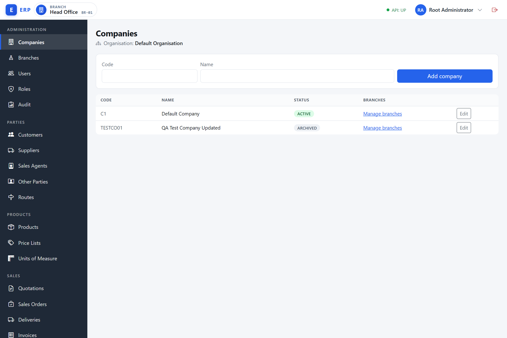
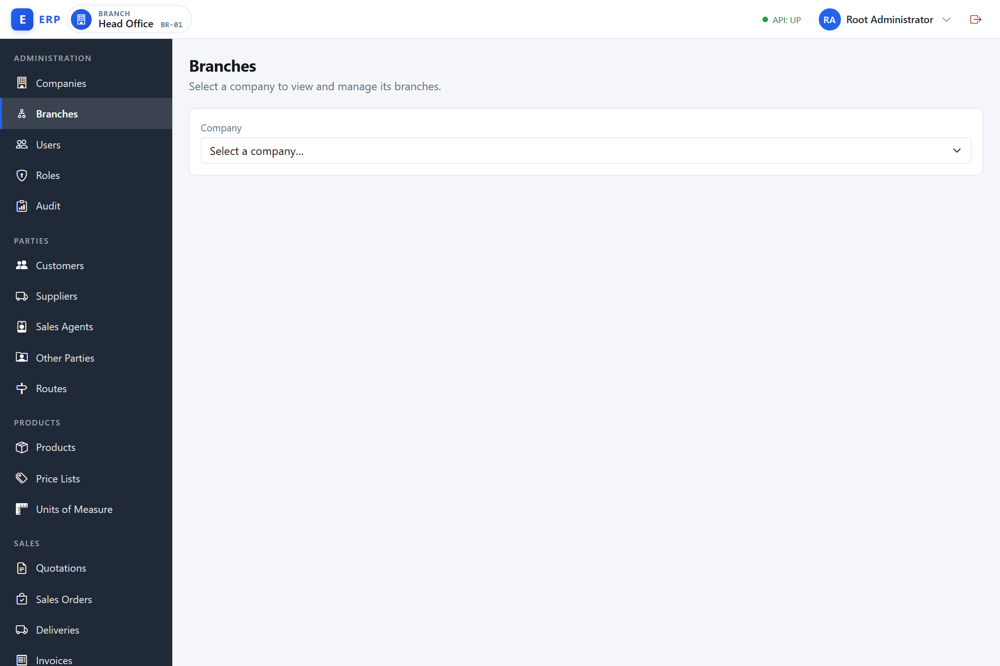
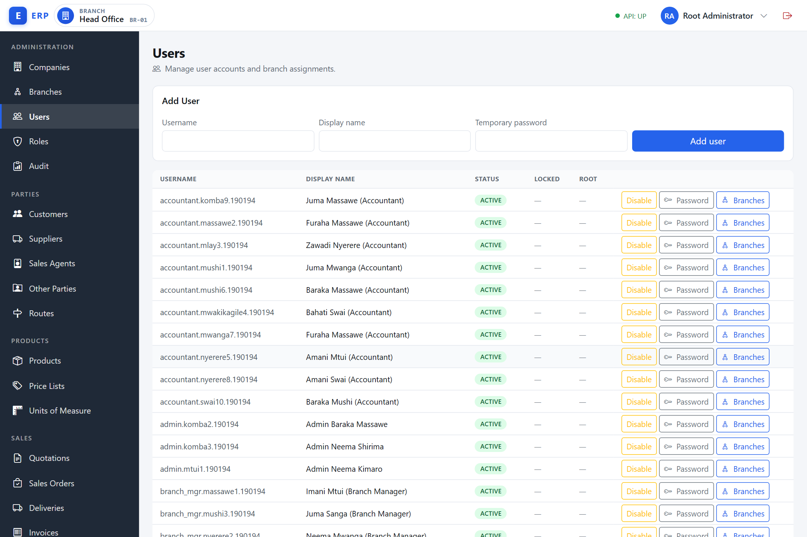
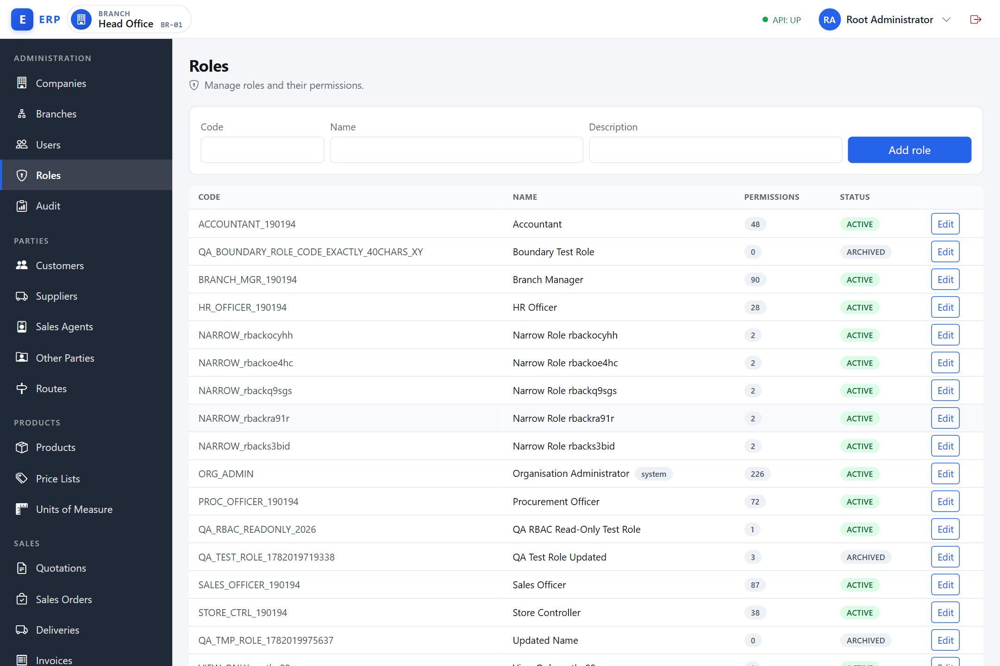
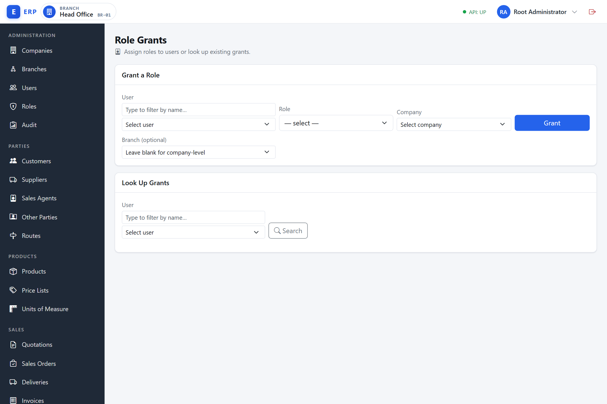
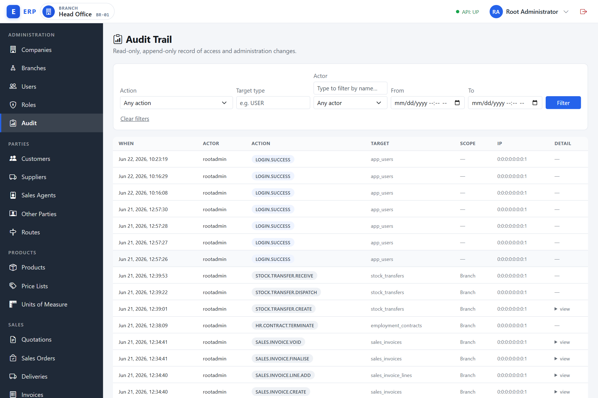

# Administration and Access

This chapter is for administrators — typically users who hold the **ORG_ADMIN** role. It covers how to set up the organisation hierarchy (companies and branches), open a new branch, manage user accounts, define roles and their permissions, assign companies, roles and branches to users, configure company-wide sales settings, and review the audit trail.

> **Note — permissions required.** You need specific permissions for each section below. If a menu item or button is not visible to you, your role does not include that permission. Some buttons on the administration screens are visible to everyone who can open the screen, but the action is refused unless you hold the permission named in that section.

> **Note — the sidebar adapts to your permissions.** Menu items you cannot use are hidden, and a group whose every item is hidden disappears entirely. The **Administration** group holds **Companies**, **Branches**, **Users**, **Roles** and **Audit**.

---

## Organisation, Companies, and Branches

**What the three-level hierarchy is.** The system is structured in three nested levels. An **organisation** is the top-level entity representing your entire business group — the holding entity that owns everything else. A **company** is a distinct legal entity under the organisation (for example, a registered limited company or a subsidiary with its own tax ID). A **branch** is a physical or logical operating unit under a company — a shop, warehouse, restaurant, regional office, or cost centre.

**Why this structure exists.** Different businesses have different legal and operational structures. A retail chain might operate a single registered company with many store branches. A group of businesses might operate several legally distinct companies on one system. Separating these levels allows each company to have its own data, its own base currency, and its own set of branches, while all of them are administered together.

**When each level matters.**
- The organisation is set up when your business is first registered on the system and is resolved automatically — you never type an organisation identifier. (A server may host several separate businesses; each is its own organisation and never sees the others' data. Creating organisations is done by the service provider, not from this chapter.)
- Companies are created by an administrator with `COMPANY.MANAGE` permission, typically during the initial rollout or when a new legal entity is formed.
- Branches are created whenever a new location or operating unit is needed.

**How the levels connect.** Every transaction in the system is tagged with the branch it was performed in. A branch belongs to exactly one company, and from there the company's base currency, fiscal calendar, and legal details apply. A user's session is always working in one active branch; switching branches changes the company as well (the active company is always the company that owns the active branch).

> **Note — plan limits.** Your subscription plan may limit how many companies, branches, users and POS tills you can have. When a limit is reached, creating another one (or re-enabling a disabled user) is refused with a message such as *Your Standard plan allows up to 3 branches, and all of them are in use. Ask your provider to upgrade your plan or raise the limit.*

### Viewing companies

**Required permission:** `COMPANY.VIEW`

Navigate to **Administration › Companies** (`/admin/companies`).

Above the list, the line **Organisation:** shows your organisation's name. The list has the columns **Code**, **Name**, **Status** (`ACTIVE` or `ARCHIVED`) and **Branches** (a **Manage branches** link), plus a last column with **Edit** and **Provision defaults** for holders of `COMPANY.MANAGE`. A root administrator sees every company in the organisation; everyone else sees only the companies they belong to — through company membership, a branch, or a role.

### Creating a company

**What a company record is.** A company record represents one legal entity — a separately registered business with its own identity, tax registration, and (optionally) its own functional currency. Creating a company establishes the container under which that entity's branches, users, and transactions will live.

**Why you would create one.** You create a new company when a new legal entity joins your group. Without at least one company, no branches can exist and no users can be given a working context.

**Required permission:** `COMPANY.MANAGE`

The create form is an inline card at the top of the Companies list.

1. In the create card fill in:
   - **Code** — a short, unique code (up to 20 characters). It cannot be changed after creation.
   - **Name** — the company display name.
2. Click **Add company**.

The new company appears in the list with status **ACTIVE** and the confirmation *Company created*. It is set up automatically with its default reference data — tax rates, chart of accounts, units of measure, sales settings and currencies (base currency TZS, with the East African currencies plus USD and EUR enabled). Add the legal details next with **Edit** (below).

> **Note.** A duplicate code is refused with *Company code already exists: \<CODE\>*.

### Editing a company's details

**When to edit.** A new installation starts with a seeded **Default Company**. When you go live, give it your real trading name and legal details. The details you enter here — VRN, address and contact details — are printed on POS receipts and printed reports.

**Required permission:** `COMPANY.MANAGE`

1. On the Companies list, click **Edit** on the company's row. A details panel opens beneath the row.
2. Change any of: **Name** (required), **Legal name**, **Tax ID (TIN)**, **VRN**, **Contact phone**, **Contact email**, **Time zone**, **Address line 1**, **Address line 2**, **City**, **Region**, **Country**. The note on the panel reads *VRN, address and contact details appear on POS receipts and printed reports.*
3. Click **Save** to keep the changes (the confirmation reads *Company updated*), or **Cancel** to discard them.

The **Code** never changes. There is no Archive control on the Companies list.

### Provisioning a company's default data

**What "Provision defaults" does.** A newly created company is automatically seeded with the baseline reference data every module expects to find — default tax rates, GL accounts, units of measure, enabled currencies, and the like. **Provision defaults** re-runs that same seeding for an existing company, on demand. Anything the company already has is left alone — the action only fills in whatever is missing.

**When to use it.** Use it if a company is missing expected reference data — for example, a company created before automatic provisioning existed, or one you want to heal after noticing a gap (a missing tax rate, an unset default account). It is safe to click on a company that is already fully provisioned; nothing is duplicated.

**Required permission:** `COMPANY.MANAGE`

1. On the Companies list, click **Provision defaults** on the company's row.
2. Confirm the prompt — *"Restore the default setup (tax rates, accounts, units, …) for "\<company name\>"?"*.
3. The button reads **Provisioning…** while it works. While any row is being edited, **Provision defaults** is disabled on every row, and while a provisioning request is running, **Edit** is disabled on every row.
4. On success the confirmation *Default setup restored* appears. On failure, *Could not restore defaults* explains what went wrong.

This action is recorded in the audit trail.

---

### Viewing branches

**Required permission:** `BRANCH.VIEW`

There are two ways to reach a company's branch list:

- **From the sidebar.** Navigate to **Administration › Branches** (`/admin/branches`). Choose the **Company** (options read *Name (CODE)*) to load its branches. If you can act in exactly one company, it is selected for you. If you are not assigned to any company yet you see *You aren't assigned to any company yet. Ask an administrator to assign you to a branch.*
- **From the Companies screen.** Click **Manage branches** on the company's row.

The branch list has the columns **Code**, **Name**, **Default** (a **Default** tag, or a **Make default** button), **Status**, and the row actions **Copy from…**, **Edit** and **Archive**.

### Creating a branch

**What a branch record is.** A branch is the smallest organisational unit in the system. It represents one operating location or division — a physical store, a restaurant, a warehouse, a regional sales office, or an accounting department. Every transaction is tagged to the branch that was active when it was created.

**Why branches exist.** Branches let management analyse stock and revenue by location, control what each staff member can see and do, and make sure accounting entries land in the right place.

**How a branch interacts with users.** A user must be assigned to at least one branch to have an active working context. One of their assigned branches is their **default branch** — the branch that activates automatically on sign-in.

**Required permission:** `BRANCH.MANAGE` (and `PRODUCT.BRANCH.ASSIGN` to copy a menu at the same time)

The create form is an inline card at the top of the branch list.

1. Fill in:
   - **Code** — a unique code within this company.
   - **Name** — the branch display name.
   - **Set as default** — tick to make the new branch the company's default branch. The previous default is cleared automatically.
   - **Start menu & prices from (optional)** — choose an existing branch to give the new branch that branch's menu and branch prices, or leave **— Don't copy —**. The hint reads *Items sold only at some branches are not sold at a new branch until it is ticked there. Copying from a branch starts this one with that branch's items and prices.* (Shown only to holders of `PRODUCT.BRANCH.ASSIGN`.)
2. Click **Add branch**.

The confirmation reads *Branch created*, followed by a summary of the copy when you chose one — for example *Menu & prices: 42 item(s) now sold here, 12 with the other branch's price.* If the branch was created but the copy failed, the message says so and tells you to use **Copy from…** on the branch to try again; the branch itself is kept.

Each new branch is given its own default stock location automatically. There is no time-zone field on the form — branches follow the company's settings.

### Setting the company default branch

**What the company default branch is.** Each company has exactly one branch flagged as its default. It is used where a company-level default branch is needed — for example, for documents that fill in a branch automatically.

1. On the branch list, find the branch you want to make default.
2. Click **Make default** on that row.

The new default shows a **Default** tag instead of a button, and the previous default is cleared automatically.

### Renaming a branch

**When to rename.** A new installation seeds a default branch. Rename it (and any other branch) to match how your locations are actually called. The code is fixed at creation; only the name can change.

**Required permission:** `BRANCH.MANAGE`

1. On the branch list, click **Edit** on the branch's row. The Name cell becomes an editable box.
2. Type the new name.
3. Click **Save** to keep the change (*Branch updated*), or **Cancel** to discard it.

### Archiving a branch

Click **Archive** on the branch's row. There is no confirmation: the status changes to **ARCHIVED** at once and the branch is removed from branch-selection lists. There is no Restore, so archive only branches that have closed for good.

Users whose default branch it was get their earliest remaining branch assignment as their new default. A user who had no other branch is left with no active branch until an administrator assigns one.

> **Note.** The current default branch cannot be archived — its row shows the **Default** tag and no Archive button. Make another branch the default first.

### Copying a menu, prices and kitchen routing between branches

**What "Copy from…" does.** When your branches do not all sell the same items, each item can be restricted to the branches that sell it, and given a different price per branch (see *Different menus and prices per branch* in the Master Data chapter). **Copy from…** fills in a branch's menu, branch prices and — for restaurants — kitchen and bar routing from another branch in one step, instead of ticking items one at a time.

**Required permission:** `PRODUCT.BRANCH.ASSIGN` for the menu and prices; `RESTAURANT.SETUP.MANAGE` for kitchen routing. The button appears on active branches when the company has at least two active branches.

1. On the branch list, click **Copy from…** on the branch you want to fill. A **Copy into \<branch\>** panel opens with the reminder *Only fills what \<branch\> has not set yet — nothing it already has is changed.*
2. In **Copy from**, choose the branch to copy from.
3. Tick what to copy:
   - **Menu & prices** (ticked by default) — every item that is restricted to particular branches, is sold at the source branch, and has not been set at this branch yet becomes sold here, with the source branch's price.
   - **Kitchen routing — only to stations \<branch\> already has** (not ticked by default) — each department this branch does not route yet is sent to this branch's station **of the same name** (for example *Bar* to *Bar*). No station is created, no existing route is moved, and the default station is not changed.
4. Click **Copy**. A summary lists what happened, for example:
   - *Menu & prices: 18 item(s) now sold here, 6 with the other branch's price. 3 item(s) this branch had already set were left as they were.*
   - *Kitchen routing: 4 department(s) routed. This branch has no Bar station, so 2 department(s) still print at its default station.*
5. Click **Close** when done.

The copy only ever fills gaps: an item this branch already has a setting for — sold, not sold, or its own price — is never changed. Items with no branch restrictions need nothing, because they are already sold everywhere. You can run the copy again at any time; a second run copies only what is still missing.

### Opening a new branch — checklist

Work through these steps whenever a new shop, restaurant or warehouse opens.

1. **Create the branch** (*Creating a branch* above). If your branches sell different items or prices, choose **Start menu & prices from** a similar branch.
2. **Check the menu.** Items fall into two groups:
   - **Items with no branch restrictions are sold at every branch automatically**, including the new one, at the company price.
   - **Items restricted to some branches stay hidden at the new branch** — the till does not show them and a sale is refused — until you copy them (**Start menu & prices from** or **Copy from…**), tick **Sold here** for the new branch on the product, or set them with the **Branch menu & prices** bulk sheet (Master Data chapter).
   > **Note.** Nothing warns you if you forget this step. Before the branch's first day of trading, open a few restricted items, or export the **Branch menu & prices** sheet, and check the new branch's column.
3. **Restaurants: set up stations and routing.** In **Point of Sale › Restaurant Setup**, switch to the new branch, add its kitchen and bar stations (and tables), then either route departments there or use **Copy from…** with **Kitchen routing**. Routing can only be copied onto stations that already exist with the same name.
4. **Assign staff** to the new branch and grant their roles (*Assigning Branches to Users* and *Assigning Roles to Users* below).
5. **Create the tills** for the branch (**Point of Sale › POS Tills**, Sales chapter).
6. **Load opening stock** at the branch (Inventory chapter, or the **Stock on-hand levels** bulk sheet).

---

## Users

**What a user account is.** A user account is a named sign-in identity. It consists of a username, a display name (shown in the interface and in audit logs), and a password. A user belongs to the organisation and can work in several companies; their permissions depend on the company and branch they are working in.

**Why user accounts exist.** Shared logins make audit trails meaningless — the log shows "accountant did X" and you cannot know who actually did it. Named individual accounts mean every action is attributable to a real person, accounts can be disabled individually, and each person gets exactly the permissions their job requires.

**When to create a user.** When a new employee joins or a contractor needs access. If you create the user while acting as a non-root administrator, the user is automatically made a member of your active company in the same step. You then still need to assign at least one branch and grant at least one role; a user with no branches and no roles can sign in but sees only the **Home** link and a **No branch** chip. (A root administrator has no single active company, so a user created as root is left with no company membership — assign one first; see [Assigning Companies to Users](#assigning-companies-to-users).)

**How the user lifecycle works.** A user starts `ACTIVE`. An administrator can **Disable** the account (status becomes `INACTIVE`) to prevent sign-in while keeping the account and its history. **Enable** restores it. Root accounts cannot be disabled. After 5 wrong-password attempts the account locks for 15 minutes; an administrator can clear this with **Unlock**. User accounts are never deleted.

**Required permission to view:** `USER.VIEW`
**Required permission to create / disable / enable / unlock / reset password / set a POS PIN:** `USER.MANAGE`

Navigate to **Administration › Users** (`/admin/users`).

### The users list

The list has the columns **Username**, **Display name**, **Status**, **Locked** (a *locked* tag) and **Root** (a *root* tag), sorted by username. Each row has the actions **Disable** / **Enable**, **Unlock** (only when the account is locked), **Password** (an inline set-password form) and **Assignments** (opens the user's Assignments page). Root accounts do not show **Disable**.

A root administrator sees every user in the organisation; everyone else sees only the non-root users who are members of their active company — including anyone they have just created.

> **Note.** The row actions are visible to everyone who can open the list, but they work only for holders of `USER.MANAGE`. If nothing happens when you click one, ask an administrator to check your role.

### Creating a user

The create form is the **Add User** card at the top of the Users list.

1. Fill in:
   - **Username** — letters, digits, dots (`.`), underscores (`_`) and hyphens (`-`) only, up to 80 characters; it is stored in lower case. On most installations the box is followed by a fixed **@yourcompany** part that you cannot change, and the hint reads *Will be created as name@yourcompany — give the new user the full name to sign in with.* Type only the first part; do not type **@** yourself.
   - **Display name** — the name shown in the system (up to 160 characters).
   - **Temporary password** — at least 8 characters, with letters and at least one number; common passwords are refused.
2. Click **Add user**.

The confirmation *User created* shows the full username. The user is **ACTIVE**, with no roles or branches yet — assign them next (see below). Give the user their full username and temporary password: the first time they sign in, they must choose their own password before they can use the system (see *Temporary passwords* in Getting Started).

> **Note.** Usernames are compared without regard to capitals: `Alice.Smith` and `alice.smith` are the same account. A username that already exists is refused with *Username already exists: \<name\>*.

### Disabling and enabling a user

- **Disable** — click **Disable** on the user's row. The user can no longer sign in and any open session ends. The row briefly shows **DISABLED**, and settles to **INACTIVE**. The account and its history are kept.
- **Enable** — click **Enable** to restore the user to **ACTIVE**. Re-enabling counts towards your plan's user limit.

Root accounts cannot be disabled.

### Unlocking a locked account

**What account locking is.** After 5 wrong-password attempts in a row (or 5 wrong waiter PINs at the till), the system locks the account for 15 minutes to slow down guessing. While locked, even the correct password is refused.

**When to unlock manually.** If the user cannot wait 15 minutes, click **Unlock** on their row (the row shows a *locked* tag). The failed-attempt counter is reset and the user can sign in again straight away.

### Resetting a user's password

**When to reset.** When a user forgets their password or you suspect it has been seen by someone else.

1. On the Users list, click **Password** on the user's row.
2. Enter a **New password** that meets the rules (at least 8 characters, letters and at least one number, not a common password).
3. Click **Save** (or **Cancel**).

The confirmation reads *Password updated*. The new password is a **temporary password**: the user signs in with it and is then asked to choose their own. Passwords are never stored in readable form and never appear in audit logs.

> **Note.** You can only reset the password of — or set a PIN for — a user whose permissions do not exceed your own. This stops an administrator from taking over a more powerful account.

### The user Assignments page

Click **Assignments** on a user's row to open their Assignments page. It starts with a **← Back to Users** link and a header showing the username and display name with status, locked and root tags, followed by these cards in order:

1. **POS PIN** (only for holders of `USER.MANAGE`) — see below.
2. **Companies** — see [Assigning Companies to Users](#assigning-companies-to-users).
3. **Branch Assignments** — see [Assigning Branches to Users](#assigning-branches-to-users).
4. **Role Assignments** — see [Assigning Roles to Users](#assigning-roles-to-users).

There is no form for changing a user's display name or contact details.

> **Note — assign a company first.** Company membership is the prerequisite for the branch and role cards. Until the user belongs to at least one company, those cards show a hint to assign a company first, and their company pickers are empty.

### Setting a waiter's POS PIN

**What it is.** In a restaurant, waiters sign in on a shared till by tapping their name and typing a short PIN instead of a full password. The PIN works only for **waiters** — users whose role lets them take restaurant orders but not open a till shift (for example the **WAITER** role). Cashiers and managers always sign in with their password, even if a PIN is set for them.

**Required permission:** `USER.MANAGE`

1. Open the waiter's Assignments page. The **POS PIN** card explains: *A 4-digit PIN lets a waiter sign in on the POS by tapping their name. Cashiers and managers always use their password. Easy PINs (1111, 1234…) are refused.* **Status** shows **PIN set** or **No PIN**.
2. Type four digits in **New PIN**.
3. Click **Set PIN** (it reads **Reset PIN** when a PIN already exists). The confirmation reads *POS PIN set*.

To stop PIN sign-in, click **Remove PIN** (*POS PIN removed*). A PIN that is all one digit or a straight run (such as 1234 or 4321) is refused with *That PIN is too easy to guess. Choose another.* Waiters can also change their own PIN on the till. A wrong PIN at the till counts towards the account lock-out. Setting and removing PINs is recorded in the audit trail; the PIN itself never is.

For a waiter to appear on the till's sign-in tiles they must hold the **WAITER** role and be assigned to that branch.

---

## Roles

**What a role is.** A role is a named, reusable bundle of permissions. For example, the `ACCOUNTANT` role includes permissions such as `GL.POST`, `AR.VIEW` and `AP.BILL.ENTER`. Once defined, the role can be granted to any number of users. If the business needs to change what a custom role can do, the administrator updates it once and the change takes effect for every holder immediately.

**Why roles exist.** Managing permissions per user does not scale: with dozens of staff and more than 260 permission codes, you would face thousands of individual grants. With roles you manage a small set of job functions. Roles also make compliance simpler: you can show an auditor exactly which capabilities any given role confers.

**How a role's permissions take effect.** When a role's permissions are saved, holders see the change on their very next action — there is no need to sign out and back in.

**The effective permission set.** A user may hold several roles. Their permissions at any moment are everything that all their roles give them in the current company and branch. If Role A grants `GL.VIEW` and Role B grants `GL.POST`, a user with both roles has both.

**Required permission to view:** `ROLE.VIEW`
**Required permission to create / edit / set permissions:** `ROLE.ADMIN` (the separate `ROLE.MANAGE` permission governs *granting* existing roles to users — see *Assigning Roles to Users* below)

Navigate to **Administration › Roles** (`/admin/roles`).

### The roles list

The list has the columns **Code**, **Name** (with a grey *system* tag on built-in roles), **Permissions** (the number of permissions), **Status**, and two actions:

- **View permissions** — opens a **Permissions — \<role name\>** window listing the role's permission codes grouped by module (*This role has no permissions.* when empty). Click **Close** to return. Available to everyone who can see the list.
- **Edit** — opens the role's edit page. Shown only to holders of `ROLE.ADMIN`.

### Built-in roles

**What they are.** The system ships with ready-made roles for common job functions, so you can put staff to work without composing a permission set from scratch. They appear in the Roles list from day one, marked *system*. A built-in role cannot be deleted, archived, renamed or changed — view its permissions, but you cannot edit them.

**How they differ from ORG_ADMIN.** `ORG_ADMIN` (*Organisation Administrator*) holds every permission available to your business — it is the full administrator. The operational roles are **least-privilege**: each holds only what its job needs, so a Cashier cannot manage users, a Salesperson cannot void invoices or change pricing settings, and an Accountant cannot close the fiscal year.

**How to use them.** Grant one or more of these roles to a user for a company (see [Assigning Roles to Users](#assigning-roles-to-users)). If none fits a person's responsibilities exactly, create your own **custom** role.

| Code | Name | What it can do |
|------|------|----------------|
| `SALESPERSON` | Salesperson | Quotes, orders, invoices, deliveries and returns; take payments on invoices; issue fiscal receipts; onboard customers. No overrides, voids, or settings. |
| `CASHIER` | Cashier | POS till: open and close a shift, sell, reverse a sale while the shift is open, record till expenses; restaurant orders; customer receipting, end-of-day cash count and petty cash. Does **not** reconcile a till — a manager does that. |
| `FIELD_SALES_AGENT` | Field Sales Agent | Route/van selling: capture orders, invoice and deliver on a route, collect cash receipts, reconcile van stock. |
| `STOREKEEPER` | Storekeeper | Stock control: view, adjust, count, transfer and receive transfers, manage locations, opening stock and the stock bulk sheet; receive goods against a PO or without one; supplier returns; batch/serial/expiry views. Posting a count is for a manager. |
| `ACCOUNTANT` | Accountant | GL journals (not close), AR and AP sub-ledgers, cash & bank, VAT preparation (not filing), WHT, cost tagging and financial reports. |
| `SALES_MANAGER` | Sales Manager | Full sales including overrides, voids, credit override and settings; price lists, mass price change and pricing rules; CRM, agents and routes; sales approvals; restaurant orders and voids; offline-sales review. |
| `BRANCH_MANAGER` | Branch Manager | Broad branch oversight: cross-module views, approvals and sign-offs (POS reconcile, cash count, stock post, PO/requisition approve), tills and offline-sales review, restaurant set-up, kitchen display and voids. Usually granted for one branch. |
| `PROCUREMENT_OFFICER` | Procurement Officer | Requisition, RFQ, purchase order, receive and returns; landed cost; suppliers; product and unit master data. No approve, void, or settings. |
| `PROCUREMENT_MANAGER` | Procurement Manager | Everything the officer has, plus PO/requisition approval, PO/goods-receipt void, and purchase settings. |
| `HR_PAYROLL_MANAGER` | HR and Payroll Manager | Employees, leave and loans; pay components; the full payroll run/approve/post/disburse/reverse cycle; statutory deductions. |
| `FINANCE_DIRECTOR` | Finance Director | Everything the Accountant has, plus GL configuration, period/year close, VAT filing, currencies and FX revaluation, fixed assets, budgeting and approvals policy. Not user or company administration. |
| `PRODUCTION_MANAGER` | Production Manager | Work-order lifecycle, BOMs, material movements and WIP/costing views. |
| `WAITER` | Waiter | Takes restaurant orders, sends them to the kitchen and bar, and prints bills. Takes no payment. Can sign in on the till with a PIN. |
| `KITCHEN` | Kitchen | The Kitchen Display: sees what to make and marks it ready. |

> **Note.** The `SALESPERSON`/`SALES_MANAGER`, `PROCUREMENT_OFFICER`/`PROCUREMENT_MANAGER`, and `ACCOUNTANT`/`FINANCE_DIRECTOR` pairs are split on purpose: the manager/director role adds the approve, void, close and settings capabilities that the day-to-day role deliberately lacks. Give the day-to-day role to front-line staff and the manager role to whoever signs off their work.

### Creating a role

The create card at the top of the Roles list is shown to holders of `ROLE.ADMIN`.

1. Fill in:
   - **Code** — a short identifier (up to 40 characters). It cannot be changed later, and it cannot reuse the code of a built-in role.
   - **Name** — a human-readable label.
   - **Description** — optional notes.
2. Click **Add role**.

The role is created (*Role created*) with no permissions. Set its permissions next. A code that already exists is refused with *Role code already exists: \<CODE\>*. Custom roles belong to your organisation only.

### Editing a role

Click **Edit** on the role's row. The edit page starts with **← Back to Roles** and the heading *\<CODE\> — \<Name\>*, followed by two cards.

**Role Details.** The **Code** is shown but cannot be changed (*Immutable — set at creation.*). Update **Name** or **Description** and click **Save details**. *Saved.* appears beside the button.

**Permissions.** Every permission is listed with its code and a short description, grouped by module (for example **iam**, **sales**, **pos**). A counter shows how many are selected, for example *18 of 260 selected*.

1. Tick the permissions this role should have.
2. Untick any you want to remove.
3. Click **Save permissions**.

Saving **replaces** the role's whole permission set with exactly the ticked boxes, so saving with nothing ticked leaves the role granting no access. Holders see the change on their next action.

> **Note — built-in roles cannot be changed.** Their edit page shows *This is a built-in system role. The code cannot be changed.* Saving details is refused with *System role cannot be modified: \<CODE\>*, and saving permissions with *System role permissions cannot be modified: \<CODE\>*.

> **Note — you can only give what you have.** An administrator who is not a root administrator can only tick permissions they hold themselves. The five permissions that let someone hand out access — `USER.MANAGE`, `USER.COMPANY.MANAGE`, `ROLE.MANAGE`, `ROLE.ADMIN` and `BRANCH.ASSIGN` — can be added only by someone who holds all five. Otherwise the save is refused with *You do not have permission to perform this action.*

### Read-closure advisory

**What it is.** Below the Permissions card, the edit page can show a **Read-closure advisory** panel. It flags screens the role lets a user *open* where the role is still missing a supporting **read** permission the screen needs — for example, a role that can create a sales order but cannot read the customer and product lists. The panel introduces itself with *The following screens will be partially blocked for users who hold only this role. Grant the missing read permissions to resolve each gap.* It is advisory only: it never blocks **Save permissions**.

**Why it exists.** A screen's main action and its drop-down lists are checked separately. Without this advisory, a role missing a list's read permission looks complete to the administrator, but a real user holding only that role finds a drop-down empty or refused. Testing as a root administrator never reveals this, because root holds every permission.

Each gap reads:

> This role can open **\<screen name\>** but is missing `<CODE>`, `<CODE>` — users with only this role will be blocked on that screen.

Tick the listed codes and click **Save permissions** again; the panel refreshes after each save.

### Archiving a role

There is no Archive control in the interface. To retire a custom role, revoke it from every user who holds it.

---

## Assigning Companies to Users

**What company membership is.** Company membership is an explicit record that a user belongs to a specific company. Before a user can be given any branch or role in a company, they must be a member of it. A user can be a member of several companies.

**Why membership comes first.** Tying branch and role assignment to membership makes "which companies is this person part of?" a single, deliberate decision. It also keeps the company pickers on the branch and role cards focused on the companies the user actually belongs to.

**When to assign a company.** A non-root administrator's active company is assigned automatically when they create the user, so you usually need this card only for a user created by a root administrator, or when a user takes on work in an additional company.

**How removal is protected.** You cannot remove a membership while the user still holds any branch assignment or role grant in that company.

**Required permission:** `USER.COMPANY.MANAGE`

> **Note.** The **Companies** card appears on every user's Assignments page, but the assign form and **Remove** buttons are shown only to holders of `USER.COMPANY.MANAGE`.

### Assigning a user to a company

1. Open the user's Assignments page (**Assignments** on the user's row in **Administration › Users**).
2. In the **Companies** card, under **Assign Company**, choose the **Company**.
3. Click **Assign**.

The confirmation reads *Company assigned* and the company appears in the list with the date it was assigned. If the user already belongs to it you see *Already a member of that company.*

### Removing a company membership

Click **Remove** on the company's row.

- If the user still has a branch or role in that company, the removal is refused with *Remove this user's roles and branch assignments in \<Company\> before removing the company membership.* Remove those first (see the sections below).
- Otherwise the membership is removed (*Company membership removed*). The user can be assigned again later.

---

## Assigning Roles to Users

**What a role grant is.** A role grant links a user to a role for a company, and optionally for a single branch. It is an explicit, revocable assignment; a user can hold many grants.

**Why grants are scoped.** A user might be an accountant at the head office and a read-only viewer elsewhere. A company-wide grant gives the role's permissions in every branch of that company. A branch grant gives them only while the user is working in that branch.

**When to grant a role.** After creating a new user, before they can do meaningful work, and whenever someone takes on new responsibilities. Grants take effect on the user's next action — no new sign-in is needed.

**How revocation works.** Revoking a grant removes its permissions immediately; the record is kept for the audit trail.

**Required permission:** `ROLE.MANAGE`

> **Note — company membership is required.** A role can only be granted in a company the user already belongs to (see [Assigning Companies to Users](#assigning-companies-to-users)).

> **Note — you can only grant what you have.** A non-root administrator can grant a role only if they already hold every permission in it. Granting a more powerful role is refused with *You do not have permission to perform this action.*

### Granting a role

1. Open the user's Assignments page and find the **Role Assignments** card.
2. Under **Grant Role**, choose the **Role** (shown by name), the **Company** (only companies the user belongs to are listed), and optionally a **Branch**. Leave **Branch** on **— All branches (company-wide) —** to grant the role in every branch of the company.
3. Click **Grant**.

The confirmation reads *Role granted*. The grant appears in the card's table with the columns **Role**, **Company**, **Branch** (*All branches* for a company-wide grant) and **Granted at**.

### Revoking a role grant

In the **Role Assignments** card, click **Revoke** on the grant's row. The confirmation reads *Role revoked*; the user loses those permissions on their next action.

> **Note — the last administrator.** You cannot revoke `ORG_ADMIN` from the last active administrator of your organisation: *This is the last administrator. Give someone else the administrator role first.*

### The Role Grants screen

A separate **Role Grants** screen (`/admin/role-grants`) does the same job from one place for any user. It is not in the sidebar; open it by typing its address. It has two cards:

- **Grant a Role** — choose the **User**, **Role** (*CODE — Name*), **Company** and optionally **Branch (optional)** (*Leave blank for company-level*), then click **Grant**.
- **Look Up Grants** — choose a user and click **Search** to list their grants (**Role**, **Company**, **Branch**, **Granted at**), each with a **Revoke** button. *No grants found for this user.* means they hold none.

The user list on this screen is available only to holders of `USER.MANAGE`. Revoking a grant that was already revoked is refused with *This role assignment has already been revoked.*

---

## Assigning Branches to Users

**What a branch assignment is.** A branch assignment lets a user switch to a branch and work in it. Without at least one, a user has no active branch after sign-in.

**Why branch assignments are separate from role grants.** Which branches you can work in and what you can do there are two different decisions. A company-wide role applies in every branch, but the user can still only switch to the branches they are assigned to.

**The default branch rule.** Each user has exactly one default branch — the one that becomes active on sign-in. Setting a new default clears the old one. If a user's default branch is removed or archived, the earliest-assigned remaining branch becomes the new default. If none remains, the user has no active branch until an administrator assigns one.

**Required permission to view branch assignments:** `USER.VIEW`
**Required permission to assign / change default / remove:** `BRANCH.ASSIGN`

### Assigning a user to a branch

1. On the user's Assignments page, find the **Branch Assignments** card.
2. Under **Assign Branch**, choose the **Company** (only companies the user belongs to are listed). If the company you want is missing, assign it in the **Companies** card first.
3. Choose the **Branch** (options read *CODE — Name*).
4. Tick **Make default** if this branch should become the user's default.
5. Click **Assign**.

The confirmation reads *Branch assigned*. The table shows **Branch code**, **Branch name**, **Default** (a *default* tag) and **Assigned at**. A branch the user already has is refused with *User is already assigned to that branch.*

### Changing the default branch

Click **Set default** on the row of the branch you want. The previous default is cleared automatically (*Default branch updated*).

### Removing a branch assignment

Click **Remove** on the row (*Branch removed*). If it was the user's default:

- If other branches remain, the earliest-assigned one becomes the new default.
- If none remain, the user has no active branch until one is assigned.

---

**Example — set up a new accountant at the Main Branch**

Amina Juma joins Example Trading Co. as an accountant at the Main Branch. The administrator works as a non-root administrator in Example Trading Co.

**Step 1 — Create the user account**

1. Open **Administration › Users**.
2. In the **Add User** card enter Username `amina.juma` (the form shows it will be created as `amina.juma@exampletrading`), Display name `Amina Juma`, and a temporary password such as `Welcome2026`.
3. Click **Add user**. The row appears as **ACTIVE**, and Amina is already a member of Example Trading Co.

**Step 2 — Assign the Main Branch**

1. Click **Assignments** on Amina's row.
2. In **Branch Assignments**, choose Company `Example Trading Co.`, Branch `BR-01 — Main Branch`, tick **Make default**, and click **Assign**.

**Step 3 — Grant the Accountant role**

1. In **Role Assignments**, choose Role `Accountant`, Company `Example Trading Co.`, and leave Branch on **— All branches (company-wide) —** (or choose the Main Branch to limit her to it).
2. Click **Grant**.

**Step 4 — Check**

1. Open **Administration › Audit** and filter by your own name as **Actor**. You should see `USER.CREATE`, `USER.COMPANY.ASSIGN`, `BRANCH.ASSIGN` and `ROLE.GRANT`.
2. Give Amina her full username `amina.juma@exampletrading` and the temporary password. When she signs in she is asked to choose her own password; then the **Accounting** menu group appears, with screens such as **Chart of Accounts** and **Payables**.

---

## Sales Settings — approval, stock, pricing and till policies

**What this screen is.** Sales Settings holds one set of sales policies per company. It controls:

- whether large **sales orders** need approval before they can be confirmed;
- whether sales that would take **stock negative** are blocked;
- what happens when an item is sold **at or below cost**;
- the largest **discount** a salesperson may give, and what happens above it;
- how long a **till shift** may stay open.

**Why it exists.** These are business decisions, not technical ones, and they differ between companies. Setting them once here means every invoice, sales order and till sale follows the same rules automatically — nobody has to remember them at the counter.

**When to configure it.** During initial set-up for each company, and whenever a policy changes. Every new company already has a settings record with safe defaults (approval off, overselling blocked, no below-cost check, no discount limit, the server's shift limit).

**Required permission:** `SALES.SETTINGS.MANAGE` (the same permission opens the screen and saves it). Without it the menu item is hidden and the screen shows *"You don't have permission to view sales settings."*

Navigate to **Sales › Sales Settings** (`/admin/sales-settings`). Choose the **Company** at the top; every control below belongs to that company. All the controls sit in one card headed **SO Approval**; change what you need and click **Save Settings** at the bottom (*Sales settings saved*).

### Sales-order approval threshold

1. Use the **Enable SO Approval Workflow** switch:
   - **Off** (default) — every sales order confirms immediately, with no approval step.
   - **On** — two more fields appear: **Approval Threshold Amount** and **Currency**.
2. With the workflow on, enter the **Approval Threshold Amount**. An order whose gross total is **below** it confirms straight through; an order **at or above** it is routed to approval when someone clicks **Confirm Order**. Choose the **Currency** the amount is expressed in.
3. Click **Save Settings**.

**What happens next.** The check runs every time someone confirms a sales order for this company. Orders at or above the threshold are handed to the approvals engine (see the Sales chapter); smaller orders are unaffected. An approval policy for sales orders must also exist (**Approvals › Approval Policies**); otherwise a large order is refused with *This order exceeds the approval threshold but no approval policy is configured. Ask an administrator to set one up.*

> **Note.** With the workflow on and the threshold left at `0`, every order needs approval. A negative threshold is refused with *"Threshold amount must be zero or positive."* The threshold is per company — all its branches share it.

### Blocking sales that would take stock negative

**What this control does.** The **Block sales that would take stock negative** switch decides what happens when someone tries to sell more of an item than the branch has:

- **On (Block)** — finalising a walk-in or till invoice, or creating a delivery, is refused when there is not enough stock. The message names the item, for example *Not enough stock of Sugar 1kg to complete this sale — 3 available, 5 requested. Ask a supervisor to enable backorder if this should be allowed.* Stock can never be driven below zero this way.
- **Off (Allow / backorder)** — overselling is allowed: the sale completes and stock goes negative. Use this only if you routinely sell ahead of receiving goods.

The hint reads *"When on, a sale is blocked if there isn't enough stock. Turn off to allow overselling (backorder)."* Services and other non-stock items are never affected.

> **Note.** Blocking is the default for every company, including one whose settings have never been opened.

### Selling at or below cost

The **Selling at or below cost** drop-down decides what happens when an item is priced the same as, or less than, what it cost to buy. The hint under it explains the chosen option:

| Option | What happens |
|---|---|
| **No check** (default) | Sell at any price. Nothing is checked against cost. |
| **Allow, but record it** | The sale goes through and is recorded for review. |
| **Needs supervisor approval** | The sale is stopped until a supervisor with permission to sell below cost approves it. |
| **Never allow** | The sale is always stopped. Nobody can override it. |

A stopped sale shows a message naming the item and *… priced at or below cost, so this sale cannot be completed. Raise the price, or ask a supervisor to review the pricing policy.*

> **Note.** Supervisor approval for a below-cost sale is given on the till. On the web invoice screen a below-cost sale under **Needs supervisor approval** is simply refused — raise the price or ring it on the till.

### Discounts above a limit

Two controls set how much a salesperson may take off a line on their own:

- **Discounts above a limit** — what happens when a line discount is larger than the limit:

  | Option | What happens |
  |---|---|
  | **No limit** (default) | Any discount a salesperson types is accepted. |
  | **Allow, but record it** | A discount over the limit still goes through and is recorded for review. |
  | **Needs supervisor approval** | A discount over the limit is held until a supervisor with permission to approve discounts signs for it. |
  | **Never allow** | A discount over the limit is always refused. Nobody can override it. |

- **Discount a salesperson may give (%)** — shown when the option is not **No limit**. Enter a percentage from 0 to 100 (up to two decimal places), for example `10`. If you leave it empty, no discount at all is allowed on its own — every discount goes to the policy above.

With **Needs supervisor approval**, the salesperson sees **Ask a supervisor** beside the refused line; a supervisor holding `SALES.DISCOUNT.OVERRIDE` signs in to approve it on the spot (see the Sales chapter). Restaurant bill discounts on the till follow the same limit.

### Till shift time limit

**What this control does.** A till stops taking sales on a shift (POS session) that has been open too long. The cashier sees *"This till session has been open too long to take new sales. Close and reconcile it, then open a new session."* — nothing is charged. The limit exists so that each cash count and Z-report covers one trading day. Open restaurant bills are **not** lost: they are not tied to a shift, so after closing the old shift and opening a new one, the bill can be paid as normal.

**The choices** (drop-down **Till shift time limit**):

- **Use the server setting** (the default) — the limit set on the server, normally **36 hours**. The hint shows the actual number.
- **Set my own limit** — enter **Hours a shift may stay open**: a whole number from **12 to 168** (one week).
- **No limit** — a shift can stay open for days. Its cash count and Z-report then cover every day it was open, so differences are harder to trace. Choose this only if the business deliberately does not close shifts daily.

Click **Save Settings**. The new limit applies to the next sale on every till of that company — no till update or restart is needed.

---

## Fiscal / EFD Configuration

**What this is.** In markets that require it (for example Tanzania's TRA), a finalised sales invoice must produce a **fiscal / EFD receipt** — a tax-authority-registered receipt number and verification link. Which fiscal provider is active is a **server setting your IT administrator sets**, not a screen inside the app — but the result is visible on every finalised invoice, so administrators need to understand it.

**Why it is a server setting.** A real fiscal device integration needs credentials and a certified adapter that are configured once per installation. The system deliberately **never invents** a fiscal number: until a real device is connected, it says honestly that none is configured rather than producing a receipt that would look like a filed tax document but is not.

**The provider options.**

- **none** (the default) — no device is connected. Every attempt returns the status **NOT_CONFIGURED**; nothing is invented.
- **simulated** — a demonstration provider that produces a clearly marked fake number, for training and testing only. The system refuses to start in production with this setting.

A real tax-authority connection will be added as a new option when it is certified.

> **Note — shared servers.** A server that hosts several separate businesses does not issue fiscal receipts. Every attempt is recorded as **NOT_CONFIGURED**, and the invoice panel shows *No EFD device is configured for this company yet.*

**Required permissions (operator side).**
- `FISCAL.VIEW` — see the Fiscal Receipt panel on an invoice.
- `FISCAL.MANAGE` — issue or retry a fiscal receipt.

Both are included in ORG_ADMIN, Salesperson, Cashier, Field Sales Agent and Sales Manager.

### Where operators see fiscal status

Fiscalisation happens on a **finalised** sales invoice. Open the invoice at **Sales › Invoices** and scroll to the **Fiscal Receipt** panel (shown only on finalised invoices, and only to holders of `FISCAL.VIEW`).

The panel shows a status tag and, for holders of `FISCAL.MANAGE`, an **Issue EFD receipt** button (labelled **Retry EFD receipt** once an attempt exists):

- **Not issued** — no attempt yet.
- **NOT_CONFIGURED** — no EFD device is configured; the panel reads *"No EFD device is configured for this company yet."* The attempt can be retried once a device is connected.
- **ISSUED** — a real fiscal number and verification link were obtained; both are shown. This is final — a receipt is never re-issued — so no button is offered.
- **FAILED** — a device was tried but failed (offline, rejected, timeout); the reason is shown (or *The last fiscal receipt attempt failed.*) and you can **Retry**.
- **PENDING / VOID** — transitional or closed states, shown as a neutral tag with no button.

> **Note.** NOT_CONFIGURED and FAILED are shown as problems, not silent successes. Clicking **Issue EFD receipt** with no device connected does not produce a receipt — the system tells you so plainly.

---

## Audit Trail

**What the audit trail is.** The audit trail is a chronological, append-only log of significant actions. Each record captures who did it (the actor), what they did (the action), which kind of record was affected (the target), in which company and branch, and when. It cannot be edited, backdated, or deleted through the application.

**Why it exists.** It creates accountability (every user change, permission grant and password reset has a named, timestamped owner), supports security investigations, and gives auditors evidence that access controls were applied.

**What is recorded.** In administration, the audit trail records:

- user changes — `USER.CREATE`, `USER.DISABLE`, `USER.ENABLE`, `USER.UNLOCK`, `USER.PASSWORD_SET`, `USER.UPDATE`, `USER.POS_PIN.SET`, `USER.POS_PIN.CLEAR`;
- access changes — `USER.COMPANY.ASSIGN` / `REMOVE`, `ROLE.GRANT`, `ROLE.REVOKE`, `BRANCH.ASSIGN`, `BRANCH.UNASSIGN`, `BRANCH.SET_DEFAULT`;
- sign-in events — `LOGIN.SUCCESS`, `LOGIN.FAIL`, `ACCOUNT.LOCKED`, supervisor approvals given at a till or screen, and `BRANCH.SWITCH` when someone switches to a branch of another company;
- `COMPANY.PROVISION_DEFAULTS`, and `ROOT.BYPASS` for actions by a root administrator across companies;
- many business actions in the other modules (voids, overrides, price changes, branch menu changes and so on).

Creating or renaming companies and branches, archiving a branch, and creating or editing custom roles are **not** currently written to the audit trail.

**What is never recorded.** Passwords, PINs and session tokens. For profile edits only the fact of the change is recorded, not the old or new values.

**Required permission:** `AUDIT.VIEW`

Navigate to **Administration › Audit** (`/admin/audit`). The screen is headed **Audit Trail** — *Read-only, append-only record of access and administration changes.*

### Reviewing the audit log

The list has the columns **When**, **Actor** (the username, or *system*), **Action** (colour-coded), **Target** (the kind of record), **Scope** (company or branch), **IP**, and **Detail** (a *view* link that expands the extra recorded data). The most recent events are shown first; use the pager to go back in time.

1. Use the filter bar to narrow the results:
   - **Action** — choose one of the common administration actions listed in the drop-down, or *Any action*. Other actions cannot be picked here; leave *Any action* and narrow by the other filters instead.
   - **Target type** — the stored name of the kind of record, typed exactly as shown in the Target column (for example `app_users` for users, `user_role` for role grants, `user_branch` for branch assignments).
   - **Actor** — pick the user (*Any actor* for everyone).
   - **From** and **To** — a date-and-time range.
2. Click **Filter** to apply, or **Clear filters** to reset.

If nothing matches you see *No audit entries match the current filters.*

---

## Key Concepts Reference

### uid vs id — why records have two identifiers

**What they are.** Every record carries two identifiers. The `id` is an internal number used only inside the database — you never see it. The `uid` is a 26-character code such as `01HY7FKMQ5T3V6NP8A2X4BQERD`, used in screen addresses and wherever a record is referred to from outside the database.

**Why two identifiers.** Sequential numbers in addresses would reveal information such as how many orders you have. The `uid` reveals nothing about volume or order and is safe to use in addresses.

**What this means for you.** You never need to know or type a uid. When you pick a user, a branch, or a role by name in a form, the picker stores the uid in the background — the interface always works by name.

### Fiscal period

**What a fiscal period is.** A fiscal period is an accounting time window — typically a calendar month — within a financial year. Transactions are posted to an open period; once a period is closed, its records cannot be altered.

**Why fiscal periods matter.** Financial reports aggregate transactions by period. Closing a period locks the numbers so that reports already issued stay stable.

**When you interact with periods.** Accountants and finance managers work with periods when posting journals, running period-end reports, and closing the year. Transactions from sales, purchases and inventory post automatically to the open period of the company they belong to.
