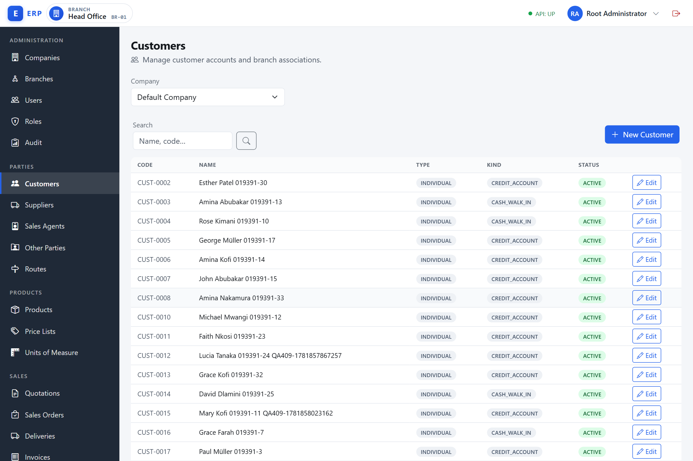
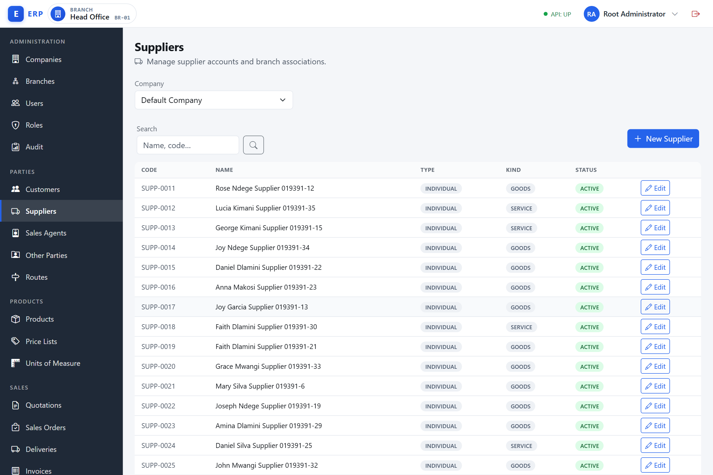
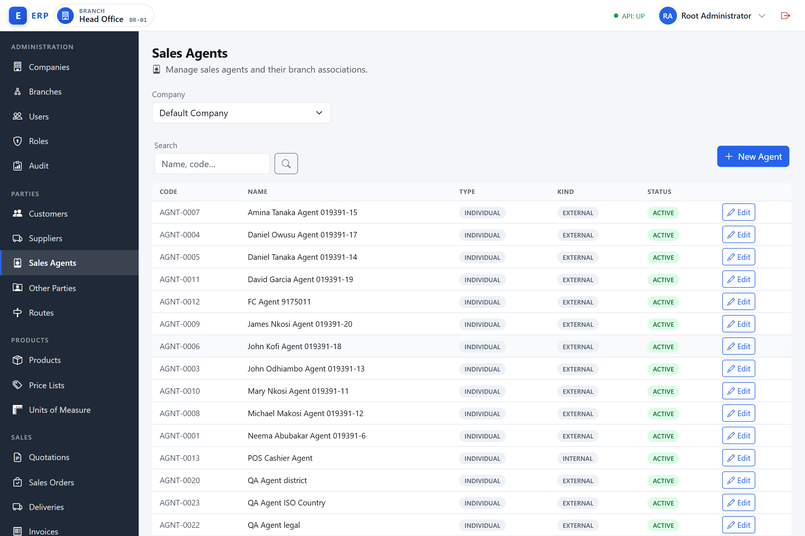
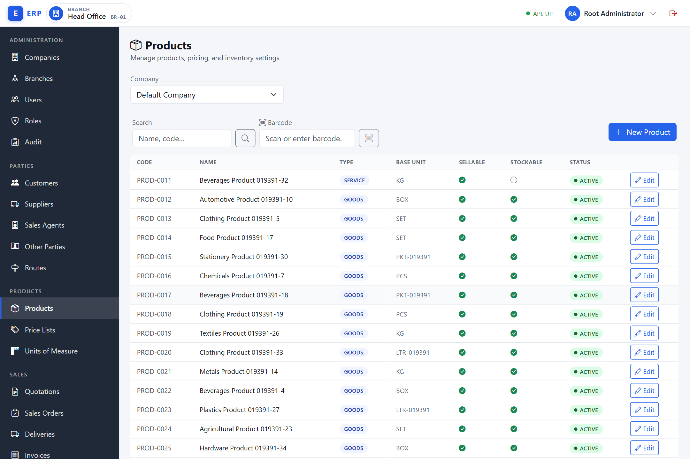
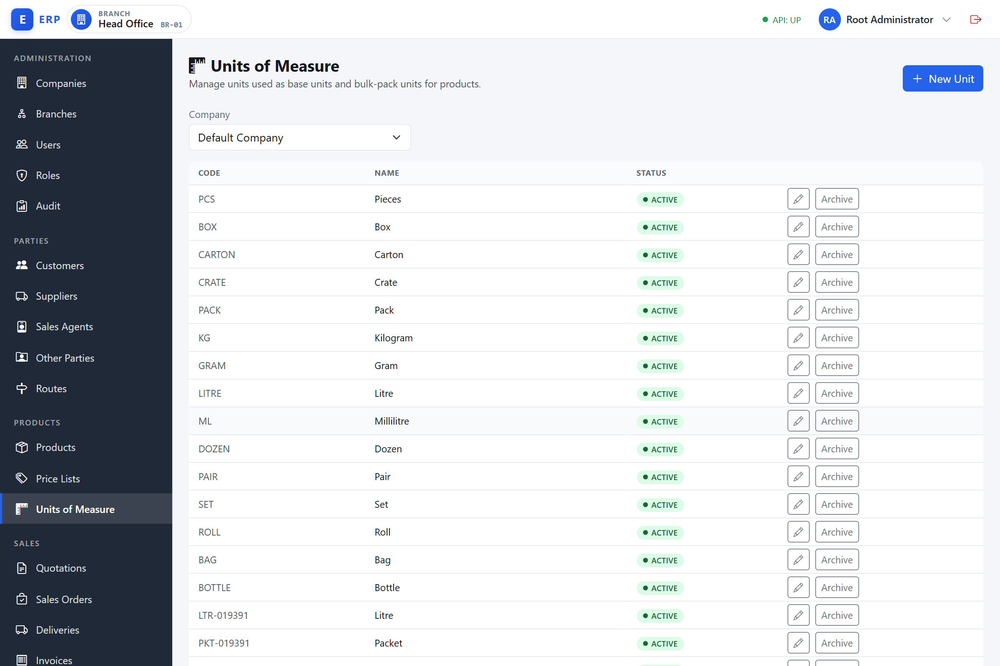
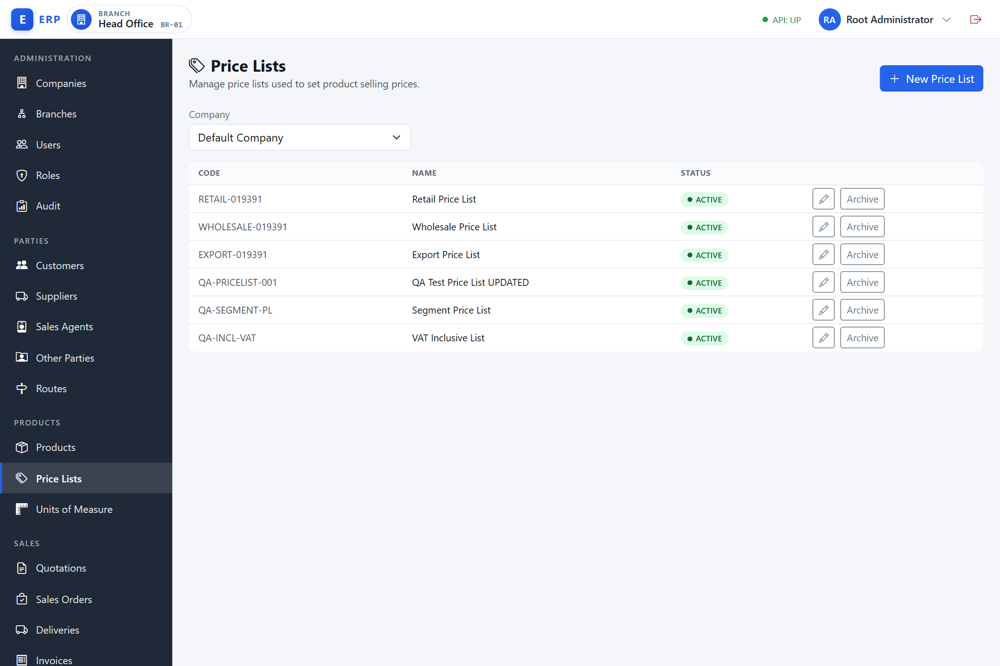
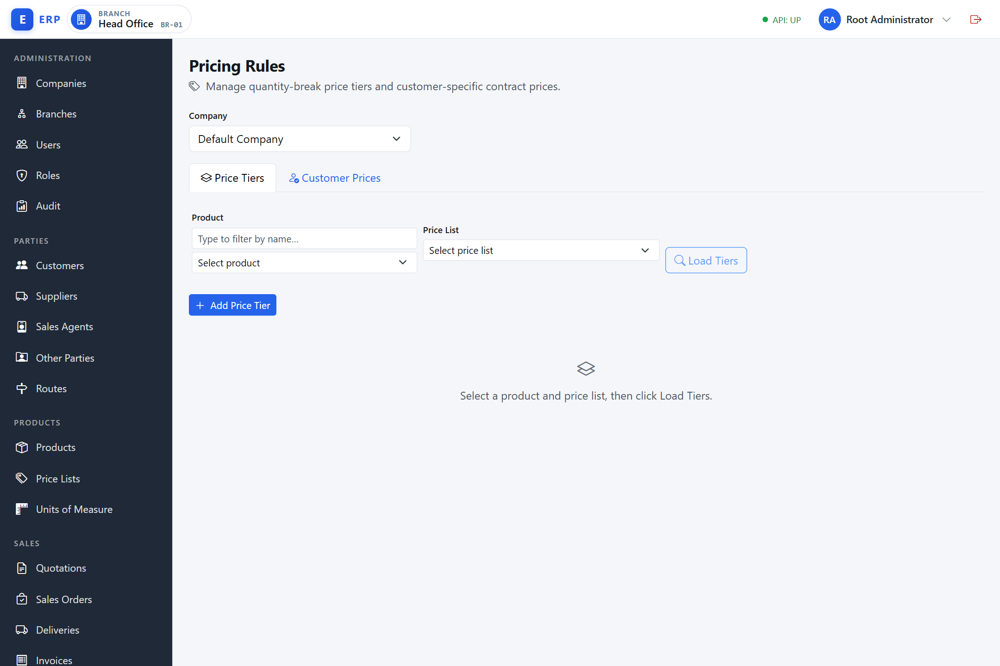
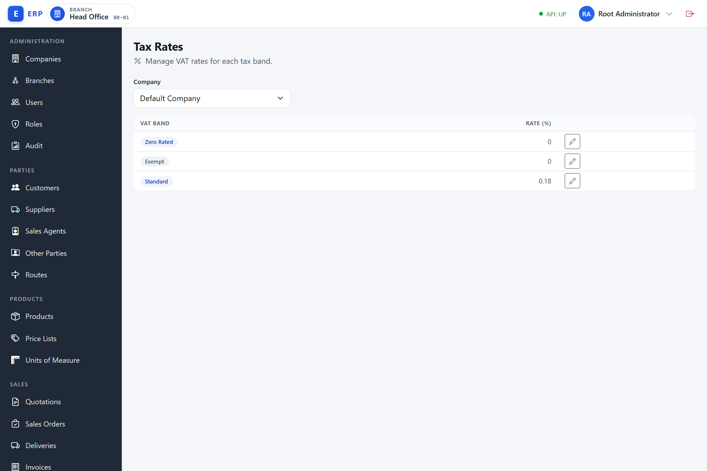
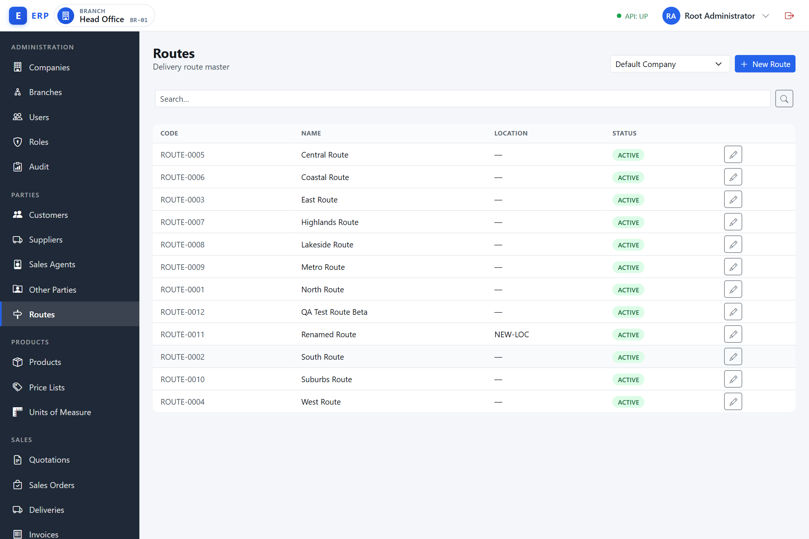

# Master Data

Master data is the reference information shared across the system: the parties you trade with, the products you sell or buy, the prices you charge, the currencies you transact in, the taxes you apply, and the routes your sales team covers. Set this up first; every transaction in Sales, Procurement, Inventory, and Finance depends on it.

Master data screens live in these sidebar groups: **Parties** (Customers, Suppliers, Sales Agents, Other Parties, Routes), **Products** (Products, Price Lists, Units of Measure), **Data Tools** (Bulk Import, Mass Price Change), **Sales** (Tax Rates, Pricing Rules) and **FX / Currency** (Currencies, Exchange Rates). Your access depends on the permissions assigned to your role — the sections below note which permission is required for each area.

> **Note.** If you belong to more than one company, each master-data list shows a **Company** picker at the top; choose the company whose records you want to see. List columns such as Type, Kind and Status show the stored values in capitals — for example `BUSINESS`, `CREDIT_ACCOUNT`, `GOODS`, `ACTIVE`.

---

## Customers

**Navigation:** **Parties › Customers** (`/admin/customers`) | **Permission to view:** `CUSTOMER.VIEW` | **Permission to create / edit:** `CUSTOMER.MANAGE`

A **customer** is any person or organisation that your business sells to. The customer record is the permanent, reusable identity for that buyer: it carries their legal details, contact information, VAT registration, and credit terms, and it is referenced by every sales document you raise against them. Without a customer record you cannot create a quotation, a sales order, or an invoice for that buyer.

**Why it exists.** Storing buyer details once — rather than re-entering them on every sale — gives you consistent names on documents, a single place to update a phone number or credit limit, an audit trail of all transactions with that party, and the foundation for aged-debtor reporting. The customer record is also the control point for credit: a customer classified as a credit-account holder carries a credit limit the sales process can check.

**When it is used.** A customer record is created by a sales administrator or master-data manager before (or during) the first sale to that party. It is used every time a quotation, sales order, or invoice is raised, and every time a payment or receipt is applied to that buyer's account.

**How it works.** A customer is created with status **Active**, assigned a system-generated code (`CUST-0001`, `CUST-0002`, …), and belongs to one company. Every branch of that company can select it in sales flows. Archiving a customer makes it unavailable for new transactions but preserves it in historical records. The record can be restored at any time.

Customers are the parties you sell to. Each customer belongs to one company and carries a system-generated code (`CUST-0001`, `CUST-0002`, …). You never enter or see the internal uid — the system uses that behind the scenes.

### Customer types

Every customer record has two classification fields set at creation time:

| Field | Options | Notes |
|---|---|---|
| **Party type** | Individual, Business | A Business party must have a TIN at creation. |
| **Kind** | Cash / Walk-in, Credit Account | Credit-account customers carry a credit limit and payment terms (set on the detail page). |

**Party type** distinguishes a private individual from a registered legal entity. For a business, a Tax Identification Number (TIN) — the government-issued taxpayer reference — is required at creation because it must appear on formal tax invoices. Individuals are exempt. On the detail/edit page the TIN is no longer blocked for businesses; the label there reads *(recommended for businesses)*.

**Kind** describes the trading relationship. A **Cash / Walk-in** customer pays at the point of sale; no ongoing credit account is maintained. A **Credit Account** customer is extended a line of credit: the business ships goods or delivers services now and expects payment within agreed terms (for example, 30 days). Credit-account customers therefore carry a **credit limit** (the maximum outstanding balance the business will allow) and **payment terms** (the number of days before payment is due). These fields are **not** part of the create form — they appear on the customer detail page when the Kind is set to Credit Account, and are hidden for Cash / Walk-in customers.

Once saved, Party type and Kind can be changed on the detail edit form.

### How to create a customer

The create form is deliberately **minimal** — it captures only the fields needed to identify the party. Everything else (credit terms, contact details, addresses) is added afterwards on the customer detail page.

1. Navigate to **Parties › Customers** (`/admin/customers`).
2. Click **New Customer**. An inline form appears below the toolbar.
3. Enter the **Display name** (required).
4. Select **Party type** (Individual or Business).
5. Select **Kind** (Cash / Walk-in or Credit Account).
6. If **Party type** is **Business**, an identity row appears with a required **TIN** plus optional **Legal name**, **Business reg. no.**, and a **VAT registered** checkbox. If you tick **VAT registered**, a **VRN** field appears — you cannot enter a VRN unless VAT registered is ticked. (For an Individual, only an optional **TIN** is shown.)
7. Click **Create**.

The system assigns a unique code and sets the status to **Active** (*Customer created*). The new row appears in the list immediately. A Business customer without a TIN is refused with *A business party must have a TIN (BR-PARTY-04).*

> **No credit, contact, or address fields at create time.** Selecting **Credit Account** here does **not** reveal credit-limit or payment-terms inputs, and there are no phone, email, or address fields on the create form. To set a credit limit, payment terms, contact details, or addresses, open the new customer's detail page after creating it (see *How to view and edit a customer* below).

### How to search for a customer

On the **Parties › Customers** (`/admin/customers`) list:

- Type in the **Search** box (placeholder **Name, code…**). Typing filters the list automatically after a short pause; pressing Enter or clicking the search button applies it immediately. The search matches on name or code and is case-insensitive.
- The list resets to the first page when you start a new search.
- Click **Clear** (shown once you have typed a search) to return to the full unfiltered list.
- The list shows **Code**, **Name**, **Type**, **Kind** and **Status**, with an **Edit** button on each row. It is paginated; use the pager at the bottom to move between pages. See *List screens — search and pagination* in **Getting Started › Common UI Patterns**.

### How to view and edit a customer

1. Click the **Edit** action on any row in the customer list to open the detail page (`/admin/customers/uid/<uid>`).
2. The URL contains the customer's uid — you do not need to read or type this.
3. The detail page carries the **full** set of customer fields — far more than the create form. In addition to Display name, Legal name, **Party type** (Individual / Business buttons), **Customer kind**, TIN, VAT registered and VRN, and Business reg. no., you can set:
   - **Contact:** Phone, Mobile money no., Email.
   - **Address:** Physical address, Postal address, Region, District.
4. If Customer kind is **Credit Account**, three more fields appear: **Credit limit amount**, **Currency**, and **Payment terms (days)**. If it is **Cash / Walk-in**, these are hidden — switch to Credit Account to reveal them.
5. The credit-limit **Currency** is chosen with the **Currency Picker** (a dropdown of the company's enabled currencies, defaulting to the company default) rather than free-typed — see **Getting Started › Common UI Patterns**.
6. Click **Save changes** to apply.

The header status badge, the Kind tag, and the **Archive** / **Restore** controls sit above the form.

**Account Balance.** Users who can view receivables (`AR.VIEW`) also see an **Account Balance** card on the detail page:

- **Balance owed** — what the customer owes now, in your base currency.
- **Credit limit** and **Credit available** — shown when a credit limit is set. A negative figure is shown in red with *(over the limit)*.
- **Also owed in …** — any balance in another currency, shown separately.
- **Statement** — opens the Customer Statement screen (choose the customer there).

### How to archive and restore a customer

An archived customer remains in the database for historical reporting but is not available for new transactions.

1. Open the customer detail page (`/admin/customers/uid/<uid>`).
2. Click **Archive**. The status badge changes to **Archived**.
3. To reverse, click **Restore**. The status returns to **Active**.

Archiving and restoring are immediate and do not require a reason.

> **Note — a customer who still owes money cannot be archived.** Archiving is refused while the customer has an open balance, for example *This customer cannot be archived while they have an unpaid balance of TZS 1,234.00. Collect it, credit it or write it off first — an archived customer can no longer be picked to record a payment.* If the customer has money held on account, refund or apply it first.

### Branch associations

A **branch association** records which branches of your company deal with a party. It is for your own reference: every branch can select every active customer, whether or not it is associated.

1. Open the customer detail page (`/admin/customers/uid/<uid>`).
2. Scroll to the **Branch Associations** panel and, under **Associate Branch**, select the **Company**, then the **Branch** (shown as `code — name`).
3. Click **Assign**. The branch appears in the table with the date it was assigned (*No branches associated yet.* when there are none).
4. To remove a branch, click **Remove** on its row.

You need the `PARTY.BRANCH.ASSIGN` permission to assign or remove branches. You can only assign branches that belong to the same company as the customer.

---

**Example — Register a new credit-account business customer**

Scenario: Sales admin Fatuma Msongo is on-boarding Karibu Wholesale Ltd, a new B2B buyer on 30-day credit terms.

1. Navigate to **Parties › Customers** (`/admin/customers`). Click **New Customer**.
2. Enter Display name `Karibu Wholesale Ltd`, Party type `Business`, Kind `Credit Account`.
3. In the Business identity row, enter TIN `100-456-789`, Legal name `Karibu Wholesale Limited`. Tick **VAT registered** and enter VRN `40-045678-H`.
4. Click **Create**. The system assigns code `CUST-0012` and status **Active**. (No credit-limit, payment-terms, contact, or address fields appear at this stage.)
5. Click the **Edit** action on the `CUST-0012` row to open `/admin/customers/uid/<uid>`.
6. In the **Details** form, the credit-account fields are now shown. Enter Credit limit amount `5000000`, leave **Currency** at the pre-selected company default (or pick another enabled currency from the **Currency Picker**), and Payment terms (days) `30`. Optionally fill in Phone `+255 22 211 0099`, Email `orders@karibuwholesale.co.tz`, Region `Dar es Salaam`. Click **Save changes**.
7. Optionally, in the **Branch Associations** panel, select Company `Example Trading Co.`, Branch `DSM — Dar es Salaam Branch` and click **Assign** to record that this branch serves the customer.

Karibu Wholesale Ltd is now available as a customer on all sales flows, with a credit limit the system checks on every credit sale.

---

## Suppliers

**Navigation:** **Parties › Suppliers** (`/admin/suppliers`) | **Permission to view:** `SUPPLIER.VIEW` | **Permission to create / edit:** `SUPPLIER.MANAGE`

A **supplier** is any person or organisation that your business purchases from. The supplier record is the permanent identity for that vendor: their legal details, tax registration, contact information, and the kind of goods or services they provide. Without a supplier record you cannot raise a purchase order, record a goods receipt, or register an invoice from that vendor.

**Why it exists.** Centralising supplier details ensures that purchase orders always go to the right party with the right tax and legal details, that every procurement transaction is traceable back to an approved supplier, and that accounts-payable balances can be correctly allocated. It also enables three-way matching: matching a purchase order to a goods receipt to a supplier invoice — the core control that prevents paying for goods you did not order or receive.

**When it is used.** A procurement officer or master-data manager creates the supplier record before (or at the time of) the first purchase from that vendor. It is referenced on every purchase order, goods receipt, and supplier invoice.

**How it works.** Suppliers follow the same lifecycle as customers: created **Active**, assigned a `SUPP-####` code, belonging to one company, optionally associated with branches, and archivable. The key difference from a customer is the **Supplier kind** field — Goods or Service — which indicates the nature of supply. A supplier also carries its own buying terms (payment terms, currency, lead time and withholding tax — see below) but no credit limit.

Supplier codes are prefixed `SUPP-` (for example, `SUPP-0001`).

### How to create a supplier

The supplier create form mirrors the customer one and is equally **minimal**.

1. Navigate to **Parties › Suppliers** (`/admin/suppliers`).
2. Click **New Supplier**.
3. Enter **Display name** (required), **Party type**, and **Kind** (Goods or Service).
4. If Party type is Business, an identity row appears with a required **TIN** plus optional **Legal name**, **Business reg. no.**, and a **VAT registered** checkbox (which reveals a **VRN** field). For an Individual, only an optional **TIN** is shown.
5. Click **Create**.

The same rules apply: TIN required at creation for Business parties, VRN only when **VAT registered** is ticked. Contact details and addresses are added on the supplier detail page after creation, exactly as for customers.

### Supplier buying terms

The supplier detail page (`/admin/suppliers/uid/<uid>`) has these fields in addition to the identity, contact and address fields:

| Field | What it is for |
|---|---|
| **Country (2-letter code)** | For example `TZ`. |
| **Payment terms (days)** | How many days you have to pay this supplier's bills. Supplier bills take their due date from it. Cannot be negative. |
| **Default currency** | The 3-letter code of the currency this supplier usually bills in, typed in (for example `USD`). |
| **Lead time (days)** | How long the supplier usually takes to deliver. |
| **Default withholding tax** | The withholding-tax type normally deducted when you pay this supplier (**None**, or a type shown as *CODE — Name (rate%)*). Shown only to users who can view withholding-tax types. |

Click **Save changes** to keep them (*Supplier saved*). Leaving a field untouched keeps its value.

### Search, edit, archive, restore, and branch associations

These work as described for Customers above, substituting the **Parties › Suppliers** (`/admin/suppliers`) screen and the detail page at `/admin/suppliers/uid/<uid>`, using the `SUPPLIER.MANAGE` / `PARTY.BRANCH.ASSIGN` permissions. The supplier detail page has no Account Balance card (supplier balances are on the Payables screens), and archiving a supplier is not blocked by an open balance.

---

**Example — Register a goods supplier**

Scenario: Procurement officer Hassan Kamau adds Tembo Industries Ltd as a VAT-registered goods supplier.

1. Navigate to **Parties › Suppliers** (`/admin/suppliers`). Click **New Supplier**.
2. Enter Display name `Tembo Industries Ltd`, Party type `Business`, Kind `Goods`.
3. In the Business identity row, enter TIN `100-789-321`. Tick **VAT registered** and enter VRN `40-078901-T`.
4. Click **Create**. System assigns code `SUPP-0008` and status **Active**.
5. Open the supplier from its **Edit** action to add contact details (Phone `+255 27 254 4400`, Region `Arusha`) and any branch associations.

---

## Other Parties

**Navigation:** **Parties › Other Parties** (`/admin/other-parties`) | **Permission to view:** `OTHERPARTY.VIEW` | **Permission to create / edit:** `OTHERPARTY.MANAGE`

An **other party** is any third party that your business has a financial or operational relationship with but that does not fit neatly into the customer or supplier categories. Common examples include landlords (you pay rent to them), utility providers (you pay electricity or water bills), regulatory bodies (you pay licence fees or levies), and freight or clearing companies (you pay logistics costs). Without an other-party record, these payments would have no addressable counterpart in the system.

**Why it exists.** The customer and supplier masters are purpose-built for sales and procurement flows. Forcing every conceivable counterpart into those categories would pollute the selection lists that sales and procurement teams use daily. Other Parties is a catch-all master that keeps the core lists clean while still giving every payable a named, traceable counterpart for accounting and audit purposes.

**When it is used.** A finance administrator or master-data manager creates an other-party record when a new type of expenditure or relationship arises that is not covered by the supplier master — for example, when setting up a monthly rent payment to a landlord for the first time.

**How it works.** Other parties follow the same lifecycle as customers and suppliers: created **Active**, assigned an `OTHR-####` code, scoped to one company, and archivable. The only structural difference is the **Kind / category** field (shown as **Kind** in the list column), which is free text rather than a fixed list. You can type any descriptive label (for example, `Landlord`, `Utility`, `Freight Forwarder`) to classify the party informally.

Other Parties covers any third party that is not a customer, supplier, or agent — for example, landlords, regulatory bodies, utility providers, or freight companies. Other Party codes are prefixed `OTHR-`.

The key difference from customers and suppliers is the **Kind / category** field (the *Kind* column in the list), which is free text (not a fixed list). You can type any label, such as "Landlord", "Utility", or "Freight Forwarder". The field is optional.

All other behaviour — TIN rule for Business parties, VAT/VRN pairing, archive/restore lifecycle, and branch associations — is identical to Customers and Suppliers. The detail page for an other party is at `/admin/other-parties/uid/<uid>`.

---

## Sales Agents

**Navigation:** **Parties › Sales Agents** (`/admin/agents`) | **Permission to view:** `AGENT.VIEW` | **Permission to create / edit:** `AGENT.MANAGE`

A **sales agent** is the person or organisation responsible for bringing in a sale. An agent is credited on sales documents (quotations, orders, invoices) and is the link between a customer and the company's sales team. Agents are referenced by distribution routes, by opportunities in the CRM module, and by sales invoices — where the agent's primary route is automatically carried across to provide a geographic reference for the sale.

**Why it exists.** Tracking which agent made which sale enables commission reporting, performance management, and territory analysis. The agent is also the connection between the geographic route structure and individual sales staff: assigning an agent to a route as its primary agent means that any sale to a customer on that route is automatically tagged with the correct route on the invoice.

**When it is used.** A master-data manager or HR administrator creates an agent record when onboarding a new sales representative (internal) or registering a new external reseller or freelance agent (external). The agent is then assigned to routes and used on sales documents.

**How it works.** The agent has a status lifecycle identical to customers and suppliers (Active → Archived → Active). An important distinction governs the agent's relationship to the system's user accounts:

Sales agents represent the people or organisations that sell on your behalf. Agent codes are prefixed `AGNT-`.

### Agent kinds

| Kind | Meaning | User link |
|---|---|---|
| **Internal** | An employee who is also an app user | Must be linked to an active user in the same company |
| **External** | A third-party agent, not an app user | Must NOT be linked to an app user |

An **Internal** agent is a staff member who logs in to the system. Linking the agent record to a user account enables the system to associate that person's sales activity with their login identity — useful for task lists, permission-gated views, and commission attribution. The linked user must be active and belong to the same company.

An **External** agent is a freelance representative, a distributor, or a third-party reseller who does not have a login to your ERP system. They are tracked as a party for document and reporting purposes only.

### How to create an agent

1. Navigate to **Parties › Sales Agents** (`/admin/agents`).
2. Click **New Agent**.
3. Enter **Display name**, **Party type**, and **Agent kind** (the dropdown options read **External** and **Internal (IAM user)**).
4. If Kind is **Internal (IAM user)**, an **App user** selector appears. Choose the user from the list (each option shows the display name and username). The system stores the link internally — you do not type a user id. An internal agent without a user is refused with *An internal agent must reference an app user (BR-PARTY-10).*
5. If Kind is **External**, the App user selector is hidden.
6. For a **Business** agent, fill in the identity row (TIN required, Legal name, Business reg. no., VAT registered / VRN), exactly as for customers.
7. Click **Create**.

### Switching an agent between Internal and External

On the agent detail page (`/admin/agents/uid/<uid>`), the user selector is labelled **IAM User \* (required for internal agents)**. Changing Kind from Internal to External clears the user link automatically on save. Changing from External to Internal requires you to select a user before saving (*An IAM user must be selected for an internal agent.*). The detail page also carries the contact and address fields and the Branch Associations panel, as for customers.

> **Note — linking staff who sell.** A salesperson whose user account is linked to an internal agent has that agent filled in automatically on new sales orders and invoices. If a user with no linked agent rings a sale without choosing one, the system creates an internal agent for them on their first sale.

### Search, edit, archive, restore, and branch associations

These work as described for Customers, using the **Parties › Sales Agents** (`/admin/agents`) screen and the `AGENT.MANAGE` and `PARTY.BRANCH.ASSIGN` permissions.

---

**Example — Create an external field agent and assign them to a route**

Scenario: Operations manager registers Juma Rashidi as a freelance distribution agent for the Coast route.

1. Navigate to **Parties › Sales Agents** (`/admin/agents`). Click **New Agent**.
2. Enter Display name `Juma Rashidi`, Party type `Individual`, Agent kind `External`.
3. Click **Create**. System assigns code `AGNT-0004`.
4. Open the route at **Parties › Routes** (`/admin/routes`), click the **Edit** (pencil) action on the **Coast Distribution Route** row.
5. In the **Agents** panel, type `Juma` and select `AGNT-0004 — Juma Rashidi`. Tick **Primary**. Click **Assign**.

---

## Products

**Navigation:** **Products › Products** (`/admin/products`) | **Permission to view:** `PRODUCT.VIEW` | **Permission to create / edit:** `PRODUCT.MANAGE`

A **product** is any item or service that your business sells, buys, or manufactures. The product record is the central catalogue entry that links a name and code to its cost, its selling prices, its unit of measurement, and — for stocked goods — its inventory tracking. Every sales line, purchase line, and stock movement references a product record.

**Why it exists.** Without a product catalogue, every transaction would require staff to invent descriptions, prices, and codes on the spot — leading to inconsistency, mispricing, and an inability to report on what was sold or bought. The product master is the single source of truth for what the business trades in: it enforces consistent naming, links prices to agreed price lists, defines the packaging hierarchy (base unit and bulk packs), and controls whether an item appears in sales or procurement flows.

**When it is used.** A catalogue manager or product administrator creates product records before the first transaction involving those items. Products are used on every sales quotation and order (if sellable), every purchase order and goods receipt (if a goods product), every stock movement (if stockable), and every manufacturing or assembly job (if it has a recipe).

**How it works.** A product is created **Active** with a `PROD-####` code (or a custom code you supply) and belongs to one company. It is sold at every branch unless you restrict it to some branches (see *Different menus and prices per branch*). Its lifecycle is Active → Archived → Active. Once created, you can add barcodes for scanning at the point of sale, define bulk-pack conversions (for example, 50 kg bags per carton), set selling prices on each of your price lists, and define a component recipe for manufactured or bundled items. You can also build all of this — identity, pricing, units of measure, opening stock and barcodes, and branch availability — in a single pass on the **Product Master** screen (the **Full product form** button on the products list) instead of visiting each panel separately; see *The Product Master — one screen for the whole product* below.

Products are the items you sell, buy, or manufacture. Each product belongs to one company and carries a system-generated code (for example, `PROD-0001`) unless you supply your own code at creation time.

### Product types

| Field | Options | Rules |
|---|---|---|
| **Type** | Goods, Service | Service products cannot be stockable (the Stockable checkbox is forced off). |
| **Stockable** | Yes / No | Only Goods products can be stockable. |
| **Sellable** | Yes / No | Controls whether the product appears in sales flows. |
| **VAT Status** | Standard, Zero Rated, Exempt | Defaults to Standard. |

**Type** determines the fundamental nature of the item. A **Goods** product is a physical item that can be received into stock, transferred between locations, and dispatched to customers. A **Service** product is an intangible deliverable — consulting, installation, transport — that cannot be stocked or counted in a warehouse. This distinction matters because inventory and stock-movement rules apply only to goods.

**Stockable** controls whether the system maintains an inventory balance for this product. A non-stockable good might be a consumable expensed immediately on purchase; a non-stockable service is an intangible. Only goods can be stockable — the system prevents a service product from being marked stockable because there is nothing physical to count.

> **Note — switching an item to non-stock.** An item that still has stock on hand in any branch cannot be made non-stock (by unticking **Stockable**, or by changing its Type to Service). Saving is refused with *This item still has stock on hand. Adjust its stock to zero before marking it non-stock.* Adjust the stock to zero first (Inventory chapter), then save the change. The same rule applies to the Products bulk import.

**Sellable** controls whether the product appears on sales quotations and orders. An internal intermediate product used only in manufacturing recipes would typically not be sellable.

**VAT Status** determines how value-added tax is calculated on sales lines for this product. **Standard** applies the current standard VAT rate (18%). **Zero-rated** applies 0% — the line is technically within the VAT system but taxed at nil (common for basic food items in some jurisdictions). **Exempt** items are outside the VAT system entirely and produce no VAT entry. These statuses drive the tax lines on invoices and the VAT return.

### Age restriction

A product can carry an **age-restriction classification** that marks it as something which may only be sold to buyers above a certain age — for example, alcohol or tobacco. There are three settings: **None**, **18+**, and **21+**. Every product is **None** by default, so existing products are unaffected and nothing changes until you deliberately mark an item as restricted.

Set it with the **Age restriction** drop-down — options **None**, **18+ (ask for ID)** and **21+ (ask for ID)** — on the product detail page or on the **General** tab of the Product Master, or with the *Age Restriction* column of the Products bulk import.

The classification is purely a label on the product record; on its own it does not block anything. Its effect is felt at the point of sale: when a cashier rings up a product marked **18+** or **21+**, the till prompts the cashier to confirm the buyer's age before the sale can complete (see **Point of Sale** for how this works at the till). Setting a product back to **None** removes the prompt for that item.

### Weighed goods (sell by weight)

Some products are not sold by the piece but **by weight** — loose rice, sugar, produce, or deli goods scooped and weighed on a counter scale. For these, the price is quoted per weight unit (for example, TZS 2,000 per kg) and the sale line carries the **actual weighed amount** (0.813 kg), not a whole-number count. Marking a product as *sold by weight* makes that intent explicit so it is billed as a weight, never rung up as "1 unit".

**The prerequisite: a weight base unit.** A weighed product's **base unit must be a weight unit** — kilograms or grams — because the whole point is to price and record a weight. The seeded units of measure `KG` and `GRAM` are weight units; `EA`/`PCS` and volume units (litre, millilitre) are not. If the product's base unit is not a weight unit, the **Sold by weight** switch is disabled and a hint reads *"Choose a weight base unit (e.g. kg) to sell this by weight."* Pick a weight base unit when you create the product (or change it before turning weighing on).

**Where you set it.** On the product detail page (`/admin/products/uid/<uid>`) there is a **Weighed Goods** card; the same controls also appear on the **Supplier & UoM** tab of the **Product Master** one-screen form. It has one switch and three optional fields:

| Field | What it does |
|---|---|
| **Sold by weight** | Turns weighing on for the product. When on, the sale path requires a weight unit on every line for this product and rejects a by-count unit with a clear *"…is sold by weight — choose a weight unit such as kilograms"* message. |
| **Tare weight** | The container/packaging weight, in the base unit (e.g. `0.050` kg for a tub). This is **configuration for the weighing client** to deduct before it submits the net weight — the server does **not** auto-deduct it, so a net scale label is never double-tared. Optional. |
| **Scale step** | The scale's division — the smallest weight increment it reports, e.g. `0.005` kg. When set, the sold weight is **rounded to the nearest multiple** of this step (see *How rounding shows on the sale* below). Leave blank for no rounding. |
| **Max sale weight** | A safety ceiling, in the base unit (e.g. `25` kg). A weighed line above this weight is **rejected** — it catches a kg/gram fat-finger such as keying `813` (meaning 813 g) against a per-kg product and ringing 813 kg. Optional. |

Fill in the fields you want and click **Save weighing profile**. All three numeric fields are optional — turning **Sold by weight** on with all three blank simply enforces the weight-unit rule with no rounding and no ceiling.

**How rounding shows on the sale.** When a scale step is set, entering a weight that is not an exact multiple rounds it to the nearest division — 0.813 kg at a 0.005 kg step bills as 0.815 kg. So the customer can see the adjustment was deliberate, the sale line records both figures and displays *"entered 0.813 → billed 0.815"* (see **Sales and Point of Sale** for the seller's view). A weight so small it would round down to zero is rejected with *"that weight is too small to sell. The smallest amount is 0.005 Kilogram."* (the unit shown in these messages is the product's unit **name** — `Kilogram` for the seeded `KG` unit — not its short code).

**Example — set up loose rice sold by the kilogram.** A shop sells rice scooped from a sack, priced at TZS 2,000/kg, on a scale that reads to 5 g. Create the product `Loose Rice`, Type `Goods`, Base unit `KG — Kilogram`, Sellable + Stockable, and set a `RETAIL` price of 2,000. Open its detail page, and in the **Weighed Goods** card turn on **Sold by weight**, set Scale step `0.005`, Max sale weight `50`, and (if the scoop tub weighs 10 g) Tare weight `0.010`. Click **Save weighing profile**. From now on a sales line for this product must use kg, its weight rounds to the nearest 5 g, and any line above 50 kg is refused.

### How to create a product

1. Navigate to **Products › Products** (`/admin/products`).
2. Click **New Product**.
3. Optionally enter a **Code** (placeholder *auto*). If you leave it blank the system assigns `PROD-####` (the hint reads *Blank = PROD-####*). If you type a code it is trimmed of spaces and converted to upper case.
4. Enter the **Name** (required). Product names must be unique within the company: a duplicate is refused with *A product with this name already exists in this company: …*.
5. Select **Type** (Goods or Service). If you select Service, the **Stockable** checkbox becomes unavailable (shown as *N/A for service*).
6. Select the **Base unit** from the dropdown by its code and name (for example, `EA — Each`). Only active units of measure are offered. (If no units exist yet, a *Create units first* link appears.)
7. Tick **Sellable** and/or **Stockable** as required.
8. Optionally enter a **Description**, then set the **VAT Status**.
9. Enter the **Cost amount**. The **Currency** beside it is the **Currency Picker** — a dropdown of the company's enabled currencies, pre-set to the company default — not a free-text code (see **Getting Started › Common UI Patterns**).
10. Click **Create**.

The quick form has no age restriction, department, prices or branch settings — add those on the product's detail page, or use the **Full product form** instead. **New Product** and **Full product form** are shown to holders of `PRODUCT.MANAGE`.

### The Product Master — one screen for the whole product

**What it is.** Next to **New Product** on the products list toolbar, a **Full product form** button opens the **Product Master** (`/admin/products/master`, permission `PRODUCT.MANAGE`) — one screen, organised into five tabs, that captures the whole product record in a single save: identity, pricing, supplier and units of measure, opening stock and barcodes, and branch availability.

**Why it exists.** The quick create form above, followed by the separate Barcodes, Bulk Packs, Product prices, and Branch Associations panels on the product detail page, gets you there, but takes several round trips even for a straightforward new item. The Product Master orchestrates the same underlying steps from one screen: it creates the product first, then submits each section you filled in, in turn, against the new product's uid — reporting exactly which parts saved and which need attention if a step fails partway through.

**How it works.** The five tabs are **General**, **Pricing**, **Supplier & UoM**, **Stock & Barcodes**, and **Branches**. Switching tabs does not save anything by itself — nothing is written until you click the save button at the bottom of the screen.

1. Navigate to **Products › Products** (`/admin/products`) and click **Full product form**.
2. If your organisation has more than one company, select the **Company** first (the picker only appears when there is more than one; it is fixed once the product is created).
3. On the **General** tab, enter the identity fields: optionally a **Code** (blank assigns `PROD-####`; not editable once created), the required **Name**, **Type** (Goods or Service — Service forces **Stockable** off), **VAT Status**, **Age restriction** (None / 18+ (ask for ID) / 21+ (ask for ID)), **Description**, **Department / Category**, **Brand / Trade name**, **Manufacturer**, **HS Code**, **Image URL**, the **Sellable** / **Stockable** / **Purchasable** flags, the **Tracking (stockable only)** flags **Lot tracked** / **Serial tracked** / **Expiry tracked** (disabled when **Type** is Service), and **Internal Notes**.
   - **Department / Category** groups items for reports and, in a restaurant, decides where orders print. Choose an existing department from the suggestions or type a new one (*Pick an existing department or type a new one.*; up to 60 characters). It is not linked to HR departments.
   - **Prints at (this branch)** appears only when your active branch has kitchen or bar stations (see *Restaurant Setup* in the Sales chapter). It shows where orders for the item's department print at this branch. For a department that is new to this branch you must choose a station (*A new department: choose where its orders print.*); the setting applies to the whole department, so choosing a different station moves every item in it. Moving a department that already has a station needs `RESTAURANT.SETUP.MANAGE`; otherwise the hint reads *Set for the whole department. A manager can change it in Restaurant Setup.*
   - An item can be lot/batch tracked or serial tracked, not both. Expiry tracking needs lot tracking. Tracking cannot be switched on for an item that already has untracked stock.
4. On the **Pricing** tab, enter the **Cost (buying) price** — an **Amount** and a **Currency** (the **Currency Picker**) — then click **Add price list** for each **Selling price** row and set its **Price list**, **Amount**, **Currency**, and **Effective from** date (today by default). A first selling-price row is pre-added automatically, pre-selected to the company's default price list. Selling prices entered here are prices per base unit. Only active price lists are offered; a row left without an amount or list is ignored.
5. On the **Supplier & UoM** tab (headed *Supplier & Unit of Measure*):
   - select the required **Base unit of measure**;
   - optionally add **Pack / bulk units** — a **Pack unit** and **How many \<base\> make one \<pack\>?**, then click **Add** (the same bulk packs described under *Bulk packs* below);
   - optionally use **Search suppliers** to find and choose a **Preferred supplier**;
   - set the **Stock planning defaults** — **Reorder level**, **Reorder qty**, **Safety stock**, **Min stock**, **Max stock** (not available for a Service). The **Reorder level** is what marks the item **Low** on Stock On-Hand and puts it on the Reorder Report; a level set for a branch (Branches tab) or a stock location overrides it there;
   - turn on **Sold by weight** and fill in **Tare weight**, **Scale step** and **Max sale weight** for a weighed item (see *Weighed goods* above).
6. On the **Stock & Barcodes** tab, add any **Barcodes / Article numbers** — a **Barcode value**, optional **Type** and **Unit**, and a **Primary** checkbox (the first barcode is marked primary automatically; **Set primary** changes it) — and, if the product is stockable goods, an **Opening stock Quantity** and **Note**. Opening stock is put into your current active branch; to load another branch, switch branch first. A barcode's **Unit** must be the base unit or one of the item's pack units.
7. On the **Branches** tab (headed **Branch Availability**) decide where the item is sold — see *Different menus and prices per branch* below. The table has **Branch**, **Sold here**, **Reorder level** (stockable goods only) and **Price here** (*company price* when blank).
8. Click **Create product**.

**Validation.** **Name** and **Base unit of measure** are required — leaving either blank shows an error and switches you to the tab that needs it. Other checks: if you add barcodes, one must be marked primary (*One barcode must be marked as primary.*); amounts must be numbers (*Cost price: Enter the amount as a number, for example 1800 or 1,800.50.*); and a new restaurant department must be given a station (*"\<department\>" is a new department. Choose where its orders print.*).

**Different menus and prices per branch.** When your branches do not all sell the same items, or sell an item at different prices, use **Sold here** and **Price here**:

- An item with no branch settings is **sold at every branch** — including branches you open later — at the company price. Nothing changes until you set something.
- Once an item has branch settings, it is sold **only at the branches where Sold here is ticked**. The till at any other branch does not show it, a scan says *This item is not sold at this branch*, and a sale or restaurant order with it is refused.
- **Price here** replaces the company price at that branch. It is the price of one base unit; a pack is charged at that price times the pack size. A customer's contract price still comes first. VAT works as on your company price list. A price on its own never starts selling an item at a branch where it is not sold.
- On the Product Master **Branches** tab, leaving **Make available in all branches** ticked on a new item (with nothing typed in the branch rows) keeps the item sold everywhere, including future branches. While it is ticked, the **Sold here** switches cannot be changed. Unticking it — or unticking any branch — saves a setting for **every** branch, so the item is then sold only where **Sold here** is ticked. Typing a **Price here** or **Reorder level** while **Make available in all branches** is ticked also saves a setting for every current branch: the item stays sold everywhere today, but a branch opened later will not sell it until you tick it there.
- You can also change one branch at a time on the product's detail page (the **Branch Associations** card), many items at once with the **Branch menu & prices** bulk sheet (see *Bulk Import*), or in OrbixHQ (**Edit item** → *At \<branch\>*). Switching an item off at one branch, or pricing it there, never takes it off your other branches.
- **A new branch does not sell items that already have branch settings** until you tick them there. When you open a branch, use **Start menu & prices from** or **Copy from…** on the Branches screen to copy another branch's menu and prices in one step (Administration chapter, *Opening a new branch*). Nothing warns you if you forget.
- Items created on the till (**Add product**), in OrbixHQ (**New item**), with the quick **New Product** form, or by the Products bulk import without a *Sold At* value have no branch settings, so they are sold everywhere. The Products import's **Sold At** column creates a new item that is sold only at the branches you list.
- Restaurant bills for orders already placed are never blocked by a menu change; offline till sales always post and any price difference is flagged for a manager.

**The save result.** After you click **Create product**, the screen shows a result panel. Its heading reads **All done.**, **Product saved. Some details need attention.**, or — if the product itself could not be created — **Could not save the product.** (with the reason shown above the buttons). The panel lists each section — **Product**, **Selling prices**, **Barcodes**, **Pack units**, **Branch availability**, **Opening stock**, **Weighed goods**, and **Kitchen / bar printing** when you chose a station — each with a tick for a section that saved (or had nothing to save) or a cross with the error for one that failed; sections not reached because the product itself failed show a dash. Click **Retry** next to a failed section (other than **Product** itself) to resubmit just that part. From here, click **Open product** to go to the product's detail page, **Back to list** to return to the product list, or — if anything failed — **Continue editing** to go back to the form.

> **Note.** Barcodes are saved before pack units. If you add a barcode for a pack unit in the same save, the **Barcodes** section may fail; click **Retry** on it once **Pack units** shows a tick.

**Editing.** The product list's **Edit** action opens the product detail page described in the sections below (Barcodes, Bulk packs, Prices, Recipe / Components, Branch Associations), not the Product Master screen.

### How to set a custom code

Type the code in the **Code** field. The system converts it to upper case (so `sku-001` becomes `SKU-001`). Codes must be unique within the company — if you enter a duplicate you will see an error after you submit.

### How to edit a product

1. Click the **Edit** (pencil) action on any product row to open the detail page (`/admin/products/uid/<uid>`).
2. Modify fields as needed. The code is shown in the page header and cannot be changed.
3. Click **Save changes** (*Product saved*).

If you change Type from Goods to Service, the Stockable checkbox is forced off automatically (see the note on switching an item to non-stock above).

**Changing the base unit.** The hint under **Base unit** reads *The smallest unit you sell or count. Stock, cost and every pack size are measured in it.* If you change it, a warning explains that existing stock quantities and costs are kept as plain numbers and are not converted. A product that already has prices cannot change its base unit — remove the prices, change the unit, then enter the prices again. A product sold by weight must keep a weight unit.

The detail page does not show the reorder and stock-planning fields; change them in the Product Master or with the Products bulk import.

### How to archive and restore a product

Open the product detail page (`/admin/products/uid/<uid>`) and click **Archive** (to make it unavailable) or **Restore** (to make it active again). Archived products are excluded from order lines and component pickers.

### How to search for a product

The Products list toolbar has two lookups:

- A **Search** box (placeholder **Name, code…**) that filters the list by name or code as you type, with **Search** and **Clear** buttons.
- A **Barcode** lookup with the icon and placeholder **Scan or enter barcode…**. Scan or type a barcode and click the barcode button: a match opens an info banner showing the product code, name, and type with a **View** button; if nothing matches you see *No product found for that barcode*. Its own **Clear** button removes the banner.

The list shows **Code**, **Name**, **Type**, **Base Unit**, **Sellable**, **Stockable** and **Status**, with an **Edit** button per row. It is paginated — use the pager at the bottom to move between pages.

### Branch associations — where an item is sold and at what price

The **Branch Associations** card on the product detail page sets the item's menu and price one branch at a time (see *Different menus and prices per branch* above). It needs `PRODUCT.BRANCH.ASSIGN`.

- When the item has no branch settings, the card shows *No branches associated yet.* — the item is sold everywhere — and an **Associate Branch** form.
- Once it has settings, the table shows **Branch**, **Sold here** (a switch), **Price here** (blank = *company price*) and **Assigned at**. Change a row and click its **Save** button (*Branch menu saved*).
- **Assign** adds a branch. On an item that had no settings, assigning the first branch also records every other branch as selling it, so assigning one branch never takes the item off the others. To give one branch its own price on such an item, assign that branch first, then edit its row.
- **Remove** switches the branch off (Sold here off); the row stays so you can switch it back on later.

The help under the table reads *An item with no branch settings is sold at every branch. Once set, only the ticked branches sell it, and a price here replaces the company price at that branch (per base unit; packs scale).* Every change is recorded in the audit trail with the before and after values.

### Barcodes

A **barcode** is a scannable value printed on product packaging — EAN-13, UPC, QR code, or a supplier's own code. Registering barcodes against a product enables point-of-sale staff to scan an item and have the system identify it instantly, rather than searching by name or code. One barcode is designated **primary** — it is the default identifier used on documents and the one that scanning resolves to first.

In the **Barcodes** panel on the product detail page:

1. Type the **Barcode value**.
2. In **Rings up as**, choose **Base unit** or one of the product's packs (for example *Crate (24)*). As the help says, *A crate or carton barcode must ring up as that pack* — scanning it then sells one whole pack.
3. Tick **Set as primary** if this is the product's primary barcode.
4. Click **Add Barcode**.
5. To remove a barcode, click **Remove** on the relevant row.

The table shows **Barcode**, **Rings up as** and a **Primary** or **Secondary** tag. A barcode can only ring up as the base unit or a pack unit already set up on the product; add the pack under *Bulk packs* first.

#### Scale labels (weight and price barcodes)

Supermarket scales print their own labels for loose goods sold by weight — for example, a label on a tray of meat that carries the item plus the weighed amount or the calculated price inside the barcode itself. The system can read these labels: when such a label is scanned in the product barcode lookup or at the till, it identifies the product and reads the embedded weight or price out of the barcode automatically, so the cashier does not have to key in the amount.

How a particular store's labels are laid out is set up once by an administrator as a set of **barcode symbology rules** for the company (this requires the `PRODUCT.SYMBOLOGY.MANAGE` permission). These rules are configured in the back office rather than on a screen in the main application; once they are in place, the product **Barcode** lookup and the till accept scale labels with no further setup. If your business does not sell weighed goods, you can ignore this — ordinary EAN-13 and UPC barcodes work without any rules.

### Bulk packs

A **bulk pack** defines how a product is packaged for storage or sale in larger quantities than its base unit. For example, if the base unit is `EA` (Each), a carton might contain 24 units. Bulk packs are used in procurement (ordering by the carton), in warehousing (counting by pallet or crate), and in wholesale sales (pricing by the case). The **factor** is the number of base units in one pack — the conversion ratio that lets the system translate between units.

Bulk packs define how many base units fit into a larger packaging unit (for example, 24 `EA` in a `CTN — Carton`).

1. In the **Bulk Packs** panel, under **Add Bulk Pack**, select the **Pack unit** (the larger packaging unit).
2. Enter **How many \<base\> make one \<pack\>?** — for example `12` for a carton of 12 pieces (not 1/12). The help reads *Count the contents of the pack. A carton of 12 pieces is 12; a box of 48 pieces is 48.*
3. Click **Add Bulk Pack**.
4. To change a pack's size later, click **Edit size** on its row, type the new number and click **Save** (*Pack size updated*).
5. To remove a bulk pack, click **Remove**.

The table shows **Pack unit** and **\<base\> per pack**, with a line such as *1 Carton = 12 Pieces*. The base unit cannot also be a pack, a pack cannot be added twice (change its size instead), and an item measured by weight cannot have a count pack. After saving, the system may warn you if two packs do not nest sensibly (for example a crate that is not a whole number of cartons) — check the sizes.

**A product's allowed units of measure.** A product's base unit (set when it is created) plus any bulk packs added here together form the **complete set of units this product can be transacted in**. Everywhere a line item lets you pick a unit — purchase orders, sales orders, sales invoices, sales quotations, RFQs, blanket and standing orders, purchase requisitions, CRM opportunities, and Point of Sale — the **Unit** field on that line loads only this product's configured units once you select the product, defaults to the base unit, and stays disabled until a product is chosen. You cannot pick a unit that isn't this product's base unit or one of its active bulk packs; the system rejects any other unit rather than silently mis-converting the quantity.

### Product prices

A **product price** is the selling price of this product on a specific price list, for a specific **unit**. A price must be set on a price list before the product can be sold at that list's rate. You can maintain different prices on different lists — for example, a higher retail price and a lower wholesale price for the same product — and, on each list, a separate price for each pack the product is sold in.

The **Prices** table has four columns: **Price list**, **Unit**, **Price** and **VAT** (an *Incl. VAT* or *Excl. VAT* tag taken from the price list). The **Unit** column shows **Base** for a price set against the product's base unit, or the pack's unit name (for example, `Carton`) for a per-pack price.

You can set a selling price for this product on each of your price lists.

1. In the **Prices** panel, under **Set Price**, select the **Price list** by its code and name.
2. Choose the **Unit**. This dropdown defaults to **Base unit** and also lists every **bulk pack** you have configured for the product (see *Bulk packs* above). Pick **Base unit** to price the base unit, or a pack unit to set that pack's own price.
3. Enter the **Amount**. The **Currency** beside it is the **Currency Picker** (the company's enabled currencies, defaulting to the company default) — you pick from the list rather than typing a code (see **Getting Started › Common UI Patterns**).
4. Click **Set Price**.

**You can only price a pack unit that is already a configured bulk pack.** If the unit you want is not in the dropdown, add it in the **Bulk Packs** panel first (with its factor to base), then return here. Trying to price a unit that is not the base unit and not a configured pack is rejected.

**How the base row and pack prices work together.** Setting a **Base unit** price is the normal case and is all most products need: when the product is sold in a pack, the system multiplies the base-unit price by that pack's **factor to base**. So a product priced at 5 per base unit, sold in a `Carton` of factor 24, is offered at 120 for the carton automatically — you do not have to enter it.

**Non-linear pack pricing.** When a pack should *not* simply be the base price times the factor — for example a 1,000 g pack that you sell for less than 1,000 times the per-gram price as a bulk incentive — set a price directly against that pack's unit. That explicit per-unit price is then used as-is for the pack and overrides the factor calculation; the base-unit price still governs every other unit. This lets you price a big pack independently of the per-unit rate.

Each price list holds **one price per unit** for the product: setting a price for a price-list-and-unit combination that already has one overwrites it. Setting a **Base unit** price does not touch any pack price, and vice versa. To remove a price, click **Remove** on its row — this removes only that price list's price for that specific unit (Base or the named pack).

### Product components (recipe)

A **product component** (also called a recipe or bill of materials) records the constituent parts of a composed product — for example, the raw materials needed to assemble a finished good, or the individual items bundled together in a gift set. In the current version, the recipe records the structure only: it does not automatically trigger stock movements or cost calculations. That behaviour is reserved for the manufacturing module.

Components define the ingredients or sub-products that make up this product — used in manufacturing or bundled sales.

1. In the **Recipe / Components** panel, start typing a product name in **Search product**.
2. Select the component product from the results (shown as `code — name`; the choice is confirmed as *Selected: …*). The product itself and archived products are excluded from the list.
3. Enter the **Quantity** (must be greater than zero).
4. Click **Add Component**.
5. To remove a component, click **Remove** on the row.

---

**Example — Set up Sugar (1 kg) with a retail price, a carton bulk pack, and a barcode**

Scenario: Catalogue manager sets up a new FMCG line before the first purchase order.

1. Navigate to **Products › Products** (`/admin/products`). Click **New Product**.
2. Leave Code blank. Enter Name `Sugar 1kg`, Type `Goods`, Base unit `KG — Kilogram`, tick **Sellable** and **Stockable**, VAT Status `Standard`, Cost amount `1800`. Leave **Currency** at the pre-selected company default. Click **Create**. System assigns `PROD-0034`.
3. Click the **Edit** action on `PROD-0034` to open `/admin/products/uid/<uid>`.
4. **Barcodes panel:** Enter `6009876543210`, leave **Rings up as** on **Base unit**, tick **Set as primary**, click **Add Barcode**.
5. **Bulk Packs panel:** Select Pack unit `CTN — Carton` and enter `50` in **How many Kilogram make one Carton?**. Click **Add Bulk Pack**. (Fifty 1 kg bags per carton.)
6. **Prices panel:** Select Price list `RETAIL — Retail Price List`, leave **Unit** at **Base unit**, Amount `2500`, leave **Currency** at the default. Click **Set Price**.
7. **Prices panel:** Select Price list `WHOLESALE — Wholesale Price List`, **Unit** `Base unit`, Amount `2200`, leave **Currency** at the default. Click **Set Price**.
8. **Prices panel (non-linear carton price):** Select Price list `WHOLESALE — Wholesale Price List`, **Unit** `Carton`, Amount `105000`, leave **Currency** at the default. Click **Set Price**. (Fifty 1 kg bags would otherwise resolve to 50 × 2,200 = 110,000; pricing the carton directly at 105,000 gives buyers a bulk discount independent of the per-kilogram wholesale rate.)

The product `PROD-0034 — Sugar 1kg` is now available for sale at the correct retail price, at a discounted wholesale carton price, and will appear in stock movements tracked in kilograms. The Prices table shows three rows: `RETAIL / Base`, `WHOLESALE / Base`, and `WHOLESALE / Carton`.

---

**Example — Set up a product in one pass with the Product Master**

Scenario: Catalogue manager sets up Cooking Oil 5L from scratch using the one-screen template instead of the classic multi-panel flow.

1. Navigate to **Products › Products** (`/admin/products`). Click **Full product form**.
2. **General tab:** leave Code blank, enter Name `Cooking Oil 5L`, Type `Goods`, VAT Status `Standard`, tick **Sellable** and **Stockable**.
3. **Pricing tab:** Cost (buying) price Amount `12000`, Currency left at the company default. On the pre-added Selling price row, leave the Price list at the resolved default and enter Amount `15500`.
4. **Supplier & UoM tab:** Base unit of measure `LTR — Litre`. Under Pack / bulk units, select Pack unit `CTN — Carton`, enter `4` in **How many Litre make one Carton?**, click **Add**.
5. **Stock & Barcodes tab:** enter Barcode value `6009876500001` (kept as primary automatically, being the first row). Opening stock Quantity `200`.
6. **Branches tab:** leave **Make available in all branches** ticked.
7. Click **Create product**.

The save-result panel reads **All done.**, with every section ticked. Because **Make available in all branches** stayed ticked and nothing was typed in the branch rows, the oil has no branch settings and is sold at every branch, including any opened later. Clicking **Open product** opens the new record on the classic detail page, already carrying its retail price, its carton bulk pack, its barcode, and 200 litres of opening stock — all set up from the one screen.

---

## Units of Measure

**Navigation:** **Products › Units of Measure** (`/admin/units`) | **Permission to view:** `UOM.VIEW` | **Permission to create / edit:** `UOM.MANAGE`

A **unit of measure (UoM)** is the label attached to a quantity: it defines what one "unit" of a product means. Examples include `EA` (Each), `KG` (Kilogram), `LTR` (Litre), and `CTN` (Carton). Every product must be assigned a base unit, and every order line, stock movement, and bulk pack references a unit.

**Why it exists.** Without defined units, quantities on documents are ambiguous — does "10" mean ten individual items, ten kilograms, or ten cartons? Consistent units ensure that stock balances are measured correctly, that picking and packing instructions are unambiguous, and that unit conversions (via bulk packs) are mathematically reliable. Centralising units in a master also provides a single pick-list that avoids the "pcs vs piece vs pieces" label drift that arises when staff type units freehand.

**When it is used.** A master-data manager creates units before creating products, because every product requires a base unit. Units are also referenced when defining bulk packs (the larger packaging unit) and on order lines where a specific packaging unit is selected.

**How it works.** Each unit has a short **Code** (used as the label on documents) and a **Name** (the display name). Units can be archived to remove them from selection dropdowns; archived units are excluded from product creation but remain on existing records for historical accuracy.

Behind the scenes each unit also carries a **physical dimension** — *count* (each, piece, carton), *weight* (kilogram, gram), or *volume* (litre, millilitre). The seeded default units are already classified correctly, so you do not set this on screen. The dimension is what lets the system tell a weight unit from a count unit: a product marked *sold by weight* (see *Products › Weighed goods*) must use a **weight** base unit such as `KG`, and the sale path uses the dimension to keep weighed products off by-count units.

Units of measure (UoM) are the quantity labels used on products, bulk packs, and order lines — for example, `EA` (Each), `KG` (Kilogram), `CTN` (Carton).

### How to create a unit

1. Navigate to **Products › Units of Measure** (`/admin/units`).
2. Click **New Unit**.
3. In the **New Unit of Measure** form, enter the **Code** (for example, `CTN`) and the **Name** (for example, `Carton`). Both are required, and both the code and the name must be unique within the company.
4. Click **Create** (*Unit created*).

### How to edit a unit

Click the **Edit** (pencil) icon on a row, change the **Name** (the Code cannot be changed after creation), and click the save icon. Click the cancel icon to discard the change.

### Archive and restore

Click **Archive** to deactivate a unit. Archived units are removed from product and bulk-pack dropdowns — only active units are selectable. Click **Restore** to make the unit active again.

---

## Price Lists

**Navigation:** **Products › Price Lists** (`/admin/price-lists`) | **Permission to view:** `PRICELIST.VIEW` | **Permission to create / edit:** `PRICELIST.MANAGE`

A **price list** is a named set of selling prices. Rather than storing a single price on each product, the system lets you maintain multiple lists — for example, a Retail list, a Wholesale list, and a Distributor list — each with different prices for the same product. One active list is your company's **Default** list: it is the list sales documents and the till price from unless a more specific price applies.

**Why it exists.** Different customer segments — retail walk-ins, wholesale buyers, key distributors — typically receive different pricing. Without named price lists, a business would have to manually enter prices on every order line and hope for consistency. Price lists enforce pricing discipline: the price is looked up, not typed, so discrepancies and pricing errors are structurally prevented.

**When it is used.** A pricing manager or catalogue administrator creates price lists once, then sets prices on each product for each list (on the product detail page, in the Product Master, with **Mass Price Change**, or with the *Product prices & cost* bulk sheet).

**How it works.** A price list has a short **Code** (such as `RETAIL`) and a **Name** (such as `Retail Price List`). The code is fixed at creation and unique within the company; the name can be changed. The list can be archived; archiving does not remove prices already set on products, but an archived list is no longer used for pricing.

**Which price a sale uses.** When a line is added to a quotation, sales order, invoice or till sale, the system looks for a price in this order and uses the first one it finds:

1. the customer's **contract price** for the item (see *Pricing Rules › Customer prices*) — when it is active, valid today and in the document's currency;
2. the customer's own default price list, where one has been set up for the customer;
3. the item's **Price here** at the branch making the sale (see *Different menus and prices per branch*);
4. the item's price on the company's **Default** price list.

If no price is found, the line can still be added if you type a price yourself; otherwise it is refused. Only active lists, and prices inside their effective dates, are used. There is no price-list choice on the sales documents themselves.

### How to create a price list

1. Navigate to **Products › Price Lists** (`/admin/price-lists`).
2. Click **New Price List**.
3. Enter a **Code** (for example, `RETAIL`) and a **Name** (for example, `Retail Price List`). Both are required and the code must be unique within the company.
4. Decide whether the **Prices include VAT** toggle should be on or off (see *VAT-inclusive vs exclusive pricing* below). For a new list it is **pre-checked** — the help text reads *The customer-facing price already includes VAT. New price lists default to this on.* Leave it on for a retail/shelf list where the price you type is the price the customer sees; clear it for a wholesale list quoted as a net price plus VAT.
5. Tick **Make this the default price list** if sales should price from this list. This replaces the current default.
6. Click **Create** (*Price list created*).

### The default price list

The list shows **Code**, **Name**, **VAT**, **Default** and **Status**. The default list carries a green **Default** tag. To change it, click **Set default** on another active list (*Default price list set*); an archived list must be restored first.

Besides pricing sales, the default list is the one the **Product List** and **Stock Value** reports use for selling prices. If no active list is the default, a warning on this screen says so — choose **Set default** on the list you sell from. A second warning appears if more than one active list is marked default.

### VAT-inclusive vs exclusive pricing

Each price list carries a single VAT stance that decides how the prices in it are read at invoicing. You set it with the **Prices include VAT** toggle on the create form and can change it later by editing the list. A **VAT** column on the list shows the current stance at a glance with an **Incl. VAT** or **Excl. VAT** badge.

- **Prices include VAT (inclusive).** The price you enter is the **gross** shelf price — the amount the customer actually pays. When the sale is invoiced, the system splits the VAT back out of that figure so the net and VAT add up to exactly the price you typed, with no rounding drift. This is the natural choice for retail and counter sales where prices are displayed VAT-inclusive on the shelf. New price lists default to this stance.
- **Prices exclude VAT (exclusive).** The price you enter is the **net** amount and VAT is added on top when the sale is invoiced, so the customer pays the price plus VAT. This suits wholesale and B2B lists that are quoted as "price + VAT". This is the long-standing behaviour; existing price lists keep it unless you turn the toggle on.

The stance applies per list, so you can run a retail list (inclusive) and a wholesale list (exclusive) side by side for the same products. VAT-exempt and zero-rated products are unaffected either way — there is no VAT to add or split out.

### Edit, archive, restore

Click the **Edit** (pencil) icon on a row to change the name and the **Incl. VAT** setting (the code cannot be changed after creation). **Archive** and **Restore** work as on all master records.

---

## Pricing Rules

**Navigation:** **Sales › Pricing Rules** (`/admin/pricing-rules`) | **Permission to view:** `SALES.PRICING.RULE.VIEW` | **Permission to create / deactivate:** `SALES.PRICING.RULE.MANAGE`

The standard price list gives every buyer one price per product. **Pricing Rules** lets you record two kinds of exception: a lower unit price for bigger orders (price tiers), and a particular customer's own negotiated price (customer prices). Both live on a single screen with two tabs — **Price Tiers** and **Customer Prices**.

> **Note — price tiers are not used by sales yet.** The **Price Tiers** tab shows the banner *Not applied to sales yet. Quantity-break tiers are saved here, but invoices, orders, quotations and the till do not use them yet. Customer prices (next tab) and each customer's default price list are applied.* You can record tiers now, but a sale is not priced from them.

**Why it exists.** Wholesale and distribution businesses rarely charge one flat price. A buyer who takes ten cartons expects a better rate than one who buys a single unit, and a key account may have a contract price agreed for the year. Capturing these rules as data — rather than relying on staff to remember and key them in by hand — keeps pricing consistent and auditable.

**How it works.** You first pick the **Company** at the top of the screen (the picker only appears when you have more than one). Each rule is then created against a product (and, for tiers, a price list) or a customer. Rules are never deleted: instead you **deactivate** a rule you no longer want, which preserves the history while removing it from future pricing.

### Price tiers (quantity breaks)

A **price tier** sets a special unit price that applies once the order quantity reaches a minimum. For example, you might price a product at its normal rate for one to nine units, but drop the unit price for ten or more. Each tier is recorded against a specific product on a specific price list, so the same product can have different break points on your Retail and Wholesale lists.

To view existing tiers, on the **Price Tiers** tab select a **Product** and a **Price List** from their pickers, then click **Load Tiers**. The table lists **Product**, **Price List**, **Min Qty**, **Unit Price**, **Currency** and **Status**.

To add a tier (you need the manage permission):

1. Click **Add Price Tier**. A **New Price Tier** form appears.
2. Choose the **Product** and **Price List** from their pickers.
3. Enter the **Min Quantity** (the order size at which this price starts to apply) and the **Unit Price**.
4. The **Currency** is chosen with the **Currency Picker** (the company's enabled currencies, defaulting to the company default).
5. Click **Save Tier**.

Each product/price-list combination can have only one **active** tier at a given minimum quantity. If you previously deactivated a tier at that quantity, you are free to create a fresh one at the same quantity — the limit applies only to tiers that are currently active. To retire a tier, click the deactivate (slash-circle) button on its row; its status changes and it no longer affects pricing.

### Customer prices (contract prices)

A **customer price** is a fixed unit price for one product agreed with one specific customer — a contract or negotiated rate that overrides the ordinary price list for that buyer. You can optionally bound it with an **Effective From** and **Effective To** date, so a seasonal or promotional rate switches itself on and off automatically.

A customer price applies only when it is active, today falls inside its dates, and the sale is in the same currency as the price. It is the price of one **base unit**: a pack is charged at that price times the pack size.

To view a customer's prices, switch to the **Customer Prices** tab, select the **Customer** from the picker, and click **Load Prices**. The table shows **Customer**, **Product**, **Unit Price**, **Currency**, **Effective From**, **Effective To** (a dash means open-ended) and **Status**.

To add one (you need the manage permission):

1. Click **Add Customer Price**. A **New Customer Price** form appears.
2. Choose the **Customer** and the **Product** from their pickers.
3. Enter the **Unit Price** and choose the **Currency** with the **Currency Picker**.
4. Optionally set **Effective From** and **Effective To** dates (leave them blank for a price with no time limit).
5. Click **Save Price**.

As with tiers, a customer price is deactivated rather than deleted — click the deactivate button on its row to stop it applying (there is no confirmation). Each customer can have only one customer-price record per product, even a deactivated one, so a second record for the same customer and product is refused.

---

## Currencies and FX Rates

**Navigation:** **FX / Currency › Exchange Rates** (`/admin/fx/rates`) | **Permission to view:** `CURRENCY.VIEW` | **Permission to add rates:** `CURRENCY.MANAGE`

A **currency** is a monetary unit of account — Tanzanian Shillings (TZS), US Dollars (USD), Euros (EUR), Kenyan Shillings (KES), and so on. Every monetary amount in this system is recorded as a pair: a number and a currency code. This means the system is currency-aware from the start, so transactions in foreign currencies are recorded correctly alongside local-currency ones.

**Why currencies are always explicit.** Storing a bare number without a currency — for example, "1,000" with an implied TZS — is a source of silent errors: import prices in USD would be compared directly with local costs in TZS, and reports would add unlike amounts. Every price, cost, credit limit, and invoice total in this system therefore carries its currency code alongside the number.

**The enabled-currency allow-list and default document currency.** Each company has a **base currency** (seeded as **TZS**), a list of **enabled currencies**, and a **default document currency**. Anywhere a form asks for a currency, you choose from a **Currency Picker** that offers only the company's enabled currencies and is pre-set to the default. This is the same picker used for the customer credit-limit currency, product cost and price currencies, and every other currency field across Sales, Procurement, and Finance; it is documented once in **Getting Started › Common UI Patterns**. (The supplier **Default currency** field is the one place where a 3-letter code is still typed.) The enabled list and default are maintained on the **Currencies** screen below. The base currency itself **cannot be changed once journal entries exist**.

An **FX rate** (foreign exchange rate) is the conversion factor between two currencies on a given date. When you receive a supplier invoice in USD, or raise a customer invoice in USD, the system needs to know how many TZS equal one USD on that particular day in order to record the correct local-currency equivalent in the general ledger and for reporting.

**Why FX rates exist.** Without exchange rates, foreign-currency transactions cannot be translated into the company's reporting currency. The rate on the day of the transaction is the authoritative rate for that transaction; a rate entered later cannot retroactively fix a document. Recording each day's rate as an immutable append-only row gives a permanent audit trail that regulators and auditors can verify.

**When they are used.** The finance officer or treasury administrator enters FX rates each day (or each time a foreign-currency transaction is expected). The system uses the most recent effective-dated rate for each currency pair when converting amounts.

**How it works.** Currencies are global reference data — you cannot create or delete them; an administrator instead enables a subset per company (the allow-list above). FX rates are **append-only**: you add a new row for each rate change; you never edit a past rate. If you discover an error, you add a corrected row with the right date and value. The list is sorted newest-first. A rate between two currencies is selected by finding the row with the latest effective date on or before the transaction date.

The seeded base currency is **TZS**. You can enable additional currencies (USD, EUR, KES, and others) for a company and record foreign exchange rates to support transactions in them.

### The Currencies screen — enabling currencies and choosing the default

**Navigation:** **FX / Currency › Currencies** (`/admin/fx/currencies`) | **Permission:** `CURRENCY.MANAGE`

The screen (*Enable or disable currencies and set the default document currency for each company*) lists every currency the system knows, with the columns **Code**, **Name**, **Symbol**, **Status** (**Enabled** or **Disabled** for your company) and **Default**. The default currency's row is highlighted. If you belong to more than one company, choose the company at the top; **Refresh** reloads the list.

- **Enable** — on a disabled currency, makes it available in every Currency Picker for this company (*Currency enabled*).
- **Make Default** — on an enabled currency, makes it the currency new documents start in (*Default set*).
- **Disable** — on an enabled currency, removes it from the pickers (*Currency disabled*). You cannot disable the default currency (*Cannot disable the default currency*) — make another currency the default first — nor the company's base currency.

### Currency list

Currencies are global reference data — you cannot create or delete them. The system-seeded currencies (TZS, USD, EUR, KES, and others) appear in the **From** / **To** dropdowns on this screen. Unlike the filtered **Currency Picker** used elsewhere, these two dropdowns list **all** active currencies (the full global reference set), **not** only the company's enabled allow-list — so you may record a rate for any currency pair. (If the currency list fails to load, each dropdown falls back to a free-text three-letter ISO-code input.) Which currencies a company may use *on documents* — and the default — is still controlled by the admin-managed enabled-currency allow-list described above.

### How to add an FX rate

The on-screen page heading is **Currency Exchange Rates** (subtitle *Effective-dated rates used for multi-currency transactions*).

1. Navigate to **FX / Currency › Exchange Rates** (`/admin/fx/rates`).
2. Click **New Rate** (needs `CURRENCY.MANAGE`). The **New Exchange Rate** form opens.
3. Select the **From Currency** and the **To Currency** from the dropdowns. They must be different.
4. Enter the **Rate** (must be greater than zero). The hint reads *Units of To-currency per 1 unit of From-currency*.
5. Set the **Effective Date** (required; use the date picker).
6. Optionally choose a **Rate Type** from the dropdown (— none —, Spot, Forward, or Official) and a free-text **Source** (for example, `Central Bank`).
7. Click **Save Rate**.

FX rates are **append-only**: you cannot edit a rate in place. To correct a rate, add a new row with the corrected value and the correct effective date. The system uses the latest effective-dated rate for each currency pair when converting amounts.

The rates list shows **From**, **To**, **Rate**, **Effective Date**, **Type**, **Source** and **Active**, sorted newest-first and paginated. The FX / Currency group also holds **Revaluation Runs**, described in the Finance chapter.

---

**Example — Record today's USD buying rate**

Scenario: Finance officer records the Bank of Tanzania mid-rate on 14 June 2026 for USD invoices received from an overseas supplier.

1. Navigate to **FX / Currency › Exchange Rates** (`/admin/fx/rates`). Click **New Rate**.
2. From Currency `USD`, To Currency `TZS`, Rate `2542.50`, Effective Date `2026-06-14`, Rate Type `Spot`, Source `Central Bank`.
3. Click **Save Rate** (*Rate added*). The new rate appears at the top of the list.

Tomorrow, if the rate changes to `2,548.00`, simply click **New Rate** again and submit the new row — the old record is preserved for historical reporting.

---

## Tax Rates

**Navigation:** **Sales › Tax Rates** (`/admin/tax-rates`) | **Permission to view:** `TAXRATE.VIEW` | **Permission to create / edit:** `TAXRATE.MANAGE`

A **tax rate** is the percentage applied to a sale line to calculate value-added tax (VAT). VAT is a consumption tax collected by the business on behalf of the tax authority: the business charges the customer a price plus VAT, then remits the VAT element to the government. Getting the rate right on every transaction is a legal obligation, not an option.

**Why tax rates exist as a configurable master.** The VAT rate in Tanzania (and in many countries) is set by law and can change. Hardcoding 18% into the software would require a code change every time the rate changed. Instead, the system maintains three configurable VAT bands per company — Standard, Zero-rated, and Exempt — each with an editable rate. When the government adjusts the rate, the finance manager updates the single master record and all future transactions use the new rate automatically.

**The three bands explained:**
- **Standard** — the normal VAT rate, currently 18% in Tanzania. Applied to most goods and services. The tax amount on a sale line is the net price multiplied by this rate.
- **Zero-rated** — technically within the VAT system but taxed at 0%. Businesses selling zero-rated goods can still reclaim input VAT on their purchases. Common for staple food items in many jurisdictions.
- **Exempt** — outside the VAT system entirely. No VAT is charged and no VAT can be reclaimed on inputs. Different from zero-rated because exempt status completely removes the item from the VAT computation.

**When it is used.** A finance manager or system administrator reviews and (if required) adjusts the rates when the tax authority changes them. The rates are applied automatically to every sales and purchase line based on the product's VAT status (set on the product record).

**How it works.** The three bands are normally seeded automatically when a company is created, and you can only edit the rate of each one. The updated rate applies to all future transactions that reference that band; past transactions retain the rate that was in effect when they were created. If a company's seeding was skipped or only partially completed — so one or more classifications are missing — you can create the missing band(s) yourself from this screen instead of waiting on a seeder run; see *How to add a tax rate* below. There is no archive or delete on tax rates: once a band exists for a company it is permanent, and you can only ever have one row per classification.

Three VAT bands are seeded per company:

| Band | Default rate |
|---|---|
| Standard | 18% (0.18) |
| Zero-rated | 0% (0.00) |
| Exempt | 0% (0.00) |

### How to edit a tax rate

1. Navigate to **Sales › Tax Rates** (`/admin/tax-rates`). The table shows **VAT Band** and **Rate (%)**.
2. Click the **Edit** (pencil) icon on the relevant band row.
3. Enter the new **Rate** as a percentage (for example, `18` for 18%). The value must be between 0 and 99.99.
4. Click the save icon (*Tax rate updated*).

The rate applies to all future transactions that reference this VAT band on a product.

### How to add a tax rate

If a company is missing one or more of the three VAT classifications, an **Add tax rate** section appears below the table.

1. Navigate to **Sales › Tax Rates** (`/admin/tax-rates`).
2. Under **Add tax rate**, select the **VAT classification** — the dropdown offers only classifications not yet configured for this company (Standard, Zero Rated, Exempt).
3. Enter the **Rate (%)** as a percentage (for example, `18` for 18%). The value must be between 0 and 99.99.
4. Click **Add**.

The new band appears in the table immediately. Once all three classifications are configured, the **Add tax rate** section is replaced by the message *All VAT classifications are configured.* Submitting a rate for a classification that already exists is rejected with *A rate for this classification already exists.* You need the `TAXRATE.MANAGE` permission to add a rate, same as to edit one.

---

## Distribution Routes

**Navigation:** **Parties › Routes** (`/admin/routes`) | **Permission to view:** `ROUTE.VIEW` | **Permission to create / edit / assign branches:** `ROUTE.MANAGE` | **Permission to assign customers and agents:** `ROUTE.ASSIGN`

A **distribution route** (or simply a route) is a named geographic or logical territory that groups a set of customers and assigns the sales agent or agents responsible for serving them. Routes answer the question "which customers does this agent visit, and on which road or region?" They provide an organising layer above individual customers and are the bridge between the customer master, the agent master, and the sales invoice.

**Why routes exist.** In distribution-heavy businesses — FMCG, wholesale, van-sales — a sales team covers fixed territories. Without a route structure, there is no way to know which agent is responsible for which customers, to plan delivery runs efficiently, or to report sales performance by territory. Routes solve these problems by grouping customers under a named area and assigning one or more agents to that area, with a **primary** agent designated as the default for invoices raised against customers on that route.

**When they are used.** A distribution or operations manager creates routes when setting up the company's sales territories, then assigns customers and agents to those routes. Once set up, routes are largely static — they are updated when territory boundaries change, when customers are transferred between routes, or when agents change. On every sales invoice, the system automatically carries across the selling agent's primary route, so invoices are tagged geographically without any manual entry by the sales team.

**How it works.** A route is created with a name and an optional free-text location identifier (describing the geography informally). It is then associated with branches (so branch-level users can see it), with customers (so those customers appear in the route's list for run-planning), and with agents (so the agent is responsible for that route). Only **External** agents can be assigned to routes — internal agents work within the application and do not need a field territory assignment. One agent can be marked **Primary** on a route; this agent's route is the default on invoices, making geographic reporting automatic. The route lifecycle follows the same Active/Archived pattern as other masters.

Routes represent geographic or logical delivery areas used to group customers and assign agents. Each route has a system-generated code, a name, and an optional location identifier.

### How to create a route

1. Navigate to **Parties › Routes** (`/admin/routes`).
2. Click **New Route**.
3. Enter the **Name** (required) and optionally a **Location Identifier**.
4. Click **Save**.

The system assigns a code (`ROUTE-0001`, `ROUTE-0002`, …). Status defaults to Active. The list shows **Code**, **Name**, **Location** and **Status**, and has a **Search…** box.

### How to edit a route

1. Click the **Edit** (pencil) action on any route row to open the detail page (`/admin/routes/uid/<uid>`). The code is shown in the page header.
2. In the **Edit Route** card, change the name or location identifier.
3. Click **Save**.

The **Edit Route** card is shown only to holders of `ROUTE.MANAGE`.

### Archive and restore

Click **Archive** in the **Edit Route** card to deactivate the route. Click **Restore** to reactivate it.

### Assigning customers to a route

1. Open the route detail page (`/admin/routes/uid/<uid>`).
2. In the **Customers** panel, under **Assign Customer**, start typing a customer name in the **Search customers…** box.
3. Select the customer from the results (shown as `code — displayName`).
4. Click **Assign**.
5. To remove a customer from the route, click **Remove** on the row.

Only active customers from the same company appear in the picker. You need the `ROUTE.ASSIGN` permission.

### Assigning agents to a route

1. In the **Agents** panel (tagged *EXTERNAL only*), start typing an agent name in **Search EXTERNAL agents…**.
2. Select the agent from the results. Only **External** agents are available — internal agents cannot be assigned to a route.
3. Tick **Primary** if this agent is the primary agent for this route.
4. Click **Assign**.
5. To remove an agent, click **Remove**.

You need the `ROUTE.ASSIGN` permission.

### Assigning branches to a route

1. In the **Branches** panel, select the **Company** from the first dropdown, then select the **Branch** (shown as `code — name`).
2. Click **Assign**.
3. To remove a branch, click **Remove**.

You need the `ROUTE.MANAGE` permission (not `ROUTE.ASSIGN`) to manage branch assignments on a route.

---

**Example — Set up the Northern Route with customers and an agent**

Scenario: Operations manager creates the Arusha / Moshi distribution route before the first delivery run.

1. Navigate to **Parties › Routes** (`/admin/routes`). Click **New Route**.
2. Enter Name `Northern Route`, Location Identifier `Arusha–Moshi Corridor`. Click **Save**. System assigns code `ROUTE-0003`.
3. Click the **Edit** (pencil) action on the `ROUTE-0003` row to open `/admin/routes/uid/<uid>`.
4. **Branches panel:** Company `Example Trading Co.`, Branch `ARU — Arusha Branch`. Click **Assign**.
5. **Customers panel:** type `Northern`, select `CUST-0007 — Northern Stores Ltd`. Click **Assign**. Repeat for `CUST-0011 — Moshi Distributors`.
6. **Agents panel:** type `Baraka`, select `AGNT-0004 — Baraka Hamisi` (External). Tick **Primary**. Click **Assign**.

The Northern Route is now ready. The delivery team can filter orders and customers by route, and the agent Baraka Hamisi appears as the primary contact on route-based reports.

## Bulk Import — mass create & update from Excel

When you have many products, customers, suppliers, prices, stock levels or branch menus to enter or change at once, the **Bulk Import** tool loads them from a spreadsheet instead of one form at a time. It is a guided wizard: pick what to import, download a spreadsheet, fill it in, then upload it to check and commit.

**Where:** **Data Tools › Bulk Import** (`/admin/bulk-import`).

**Who can use it:** the menu item appears for users who hold at least one import permission. The **Entity type** list then offers only the types you are allowed to import:

| Entity type | Creates / updates | Permission |
|---|---|---|
| **Branch menu & prices** | Which branches sell each item, and each branch's own price | `PRODUCT.BRANCH.ASSIGN` |
| **Customers** | Customer master — name, TIN, VAT registration, contacts, kind, credit limit, payment terms, segment, country, default currency, tax exempt | `CUSTOMER.IMPORT` |
| **Product prices & cost** | The selling price on a chosen price list (base unit or a pack) **and** the unit cost, in one sheet | `PRICE.MASS_UPDATE` |
| **Products** | The product catalogue — code, name, type, sellable/stockable, base unit, cost, VAT status, reorder level and quantity, lead time, purchasable, barcode, department, brand, age restriction, Sold At | `PRODUCT.IMPORT` |
| **Stock on-hand levels** | The quantity on hand at your active branch | `STOCK.IMPORT` |
| **Suppliers** | Supplier master — name, TIN, contacts, kind, payment terms, country, default currency, lead time, minimum order value | `SUPPLIER.IMPORT` |

If you hold none of these, the screen reads *You don't have permission to import any master data. Contact an administrator if you need access.*

### The steps

1. **Choose what to import.** Pick the **Entity type**. Records are always imported into your active company (and, for stock, your active branch).

2. **Download a spreadsheet.** Two buttons:
   - **Download Template** — a blank sheet with just the column headers, for entering brand-new records.
   - **Export current data** — the same sheet **pre-filled** with the records already in the system, so you can edit what is there and upload it back. For **Product prices & cost**, first choose the **Company** and the **Price list to export** — the export button stays disabled until a list is chosen.

3. **Fill it in (in Excel).** The sheet is self-describing:
   - **Required** columns are marked with `*` in the header; a blank required cell is rejected.
   - Columns with a fixed set of values (e.g. *Party Type*, *VAT Status*, *Yes/No*) show a **drop-down** so you pick a valid value.
   - **Number** columns — Cost Amount, Selling Price, Credit Limit, quantities, days — are real numeric cells, so you can use formulas. Codes, barcodes, phone numbers and TINs are kept as text, so long barcodes are not turned into numbers like `6.00232E+12`.
   - A separate **Instructions** sheet lists every column with a note and its allowed values.
   - **Blue "reference" columns** (for example the product name beside a price) are **read-only context** — shown to help you find the right row, but never imported. Edit the white cells; the blue ones are ignored.
   - On an **update**, a **blank optional cell keeps the current value** — you only fill the cells you want to change.
   - A file can hold up to **50,000** rows. A larger file is refused with *The file has more than 50000 rows. Split it into smaller files.*

4. **Upload & validate.** Under **3. Upload & validate**, choose the filled-in `.xlsx` file in **Filled-in spreadsheet (.xlsx)**. The system checks every row as soon as you choose the file — there is no separate validate button. The note under the field confirms which type the file will be imported as. If the file looks like it belongs to another type (for example a customers file while **Products** is selected), the screen says so and offers an **Import it as …** button.

   The **Validation Results** card shows counts (**Total**, **Will create**, **Will update**, **Skipped**, **Errors**) and a table with the columns **Row**, **Outcome**, **Reference** and **Message**. Each row's outcome is:
   - **CREATE** — a new record will be added.
   - **UPDATE** — an existing record will be changed.
   - **SKIP** — nothing to do (for example a row with nothing to change).
   - **ERROR** — the row has a problem; the **Message** explains it in plain language.

5. **Commit.** **Commit Import** stays disabled until *every* row is clean. Fix the flagged rows in the spreadsheet and upload again; when the error count is `0`, click **Commit Import**. The import runs through the same checks, numbering and audit trail as entering the records by hand. Each row is saved on its own: if a row fails at this last moment (for example because someone changed the record meanwhile), the others are still saved and the screen shows **Committed with errors** with the failed rows marked. Click **Import another file** to start again.

> **Note — how rows are matched to existing records.** A row whose **Code** matches an existing record updates it. A row with a blank code is matched too, so re-uploading an exported sheet never creates duplicates: products by name (ignoring capitals and spaces), customers and suppliers by TIN, then by name. If the same name or TIN appears twice in the file, or matches more than one existing record, the row is refused and asks you to put the code in the **Code** column.

> **Note — round-trip editing.** *Export current data → edit in Excel → upload* is the fastest way to change many records at once: the upload updates the rows the sheet contains and leaves everything else untouched.

### Notes on each import type

**Products.** The **Barcode** column sets the item's primary barcode; a barcode already used by another product, or used twice in the file, is refused. **Department** sets the department / category (see the Product Master). **Age Restriction** takes `NONE`, `AGE_18` or `AGE_21`. Changing an existing item to non-stock is refused while it has stock on hand.

The optional **Sold At** column applies to **new items only**: enter the branch code(s) that sell the item, separated by commas (for example `BR-02, BR-03`). The new item is then sold only at those branches. Leave it blank to sell the item at every branch, including branches opened later. An unknown branch code rejects the row (*'Sold At': '…' is not an active branch code of this company.*). On an existing item the column is ignored, and the row message tells you to use the **Branch menu & prices** import instead.

**Product prices & cost.** Choose the **Price List** for each row (a drop-down). The **Unit** column is blank for the base-unit price, or a unit code to set that pack's own price (the pack must already exist on the product). A blank **Selling Price** leaves the price unchanged. Changing the **Cost Amount** also needs product-management permission (`PRODUCT.MANAGE` or `PRODUCT.IMPORT`); the cost is only applied when it actually differs from the current value, so a price-only user can safely re-upload a pre-filled sheet.

**Stock on-hand levels.** As the note on screen says, *Stock is updated at your currently active branch. Enter the level you want on hand in New On-Hand Qty; the system posts the difference from the current level as an adjustment. Switch branch in the top bar first if you need a different one.*

- **Current On-Hand** is a blue reference column. A blank **New On-Hand Qty** leaves the item unchanged; a level that is already right is skipped.
- **Reason** (default `COUNT_CORRECTION`; also `DAMAGE`, `SHRINKAGE`, `EXPIRY`, `RECEIPT_CORRECTION`, `OPENING_STOCK`, `OTHER`) and **Note** are recorded on the adjustment.
- **Unit Cost** values an item that has never been valued (its opening cost). It needs `INVENTORY.OPENING.SET`; otherwise clear the column.
- An item stocked at several locations in the branch is skipped — set it from **Adjust Stock**, choosing the location.
- The export lists every active stockable product.

**Branch menu & prices.** One row per item, with **Product Code**, the blue reference columns **Product Name** and **Company Price**, and then — for every active branch — two columns: **Sold here: \<branch name\> [\<code\>]** and **Price here: \<branch name\> [\<code\>]**.

- **Sold here** takes **Yes** or **No**.
- **Price here** takes a price for one base unit at that branch (packs scale from it), or **CLEAR** to remove the branch's own price so the company price applies again.
- A **blank** cell leaves that branch unchanged.
- A price alone never starts selling an item at a branch — set **Sold here** to **Yes** as well.
- The export is pre-filled with every active item's current Yes/No and branch prices, so the usual way to open or re-price a branch is: **Export current data**, fill in the new branch's two columns, upload, commit.
- Only real differences are written, so re-uploading an untouched export changes nothing (each row shows *Already as in the sheet — nothing to change.*). Every change is recorded in the audit trail.
- This import never creates items. The same rules apply as on the product screens — see *Different menus and prices per branch* under Products.

**Example — raise every RETAIL price and correct two costs**

1. Go to **Data Tools › Bulk Import**, choose **Product prices & cost**.
2. Under *Download a spreadsheet*, pick the **RETAIL** price list and click **Export current data**.
3. In Excel, edit the **Selling Price** column (the figures are real numbers, so a quick formula works), and correct the **Cost Amount** on the two products whose cost changed. Leave every other cell as exported.
4. Save, return to the wizard, and choose the file under **Upload & validate**. Review the results — each edited row shows **UPDATE**; untouched rows show **SKIP**.
5. When **Errors** is `0`, click **Commit Import**. The new prices and costs are live immediately.

**Example — open a new branch's menu from a spreadsheet**

1. Create the branch (Administration › Branches), for example `Airport Branch [BR-04]`.
2. Go to **Data Tools › Bulk Import**, choose **Branch menu & prices** and click **Export current data**.
3. In Excel, in **Sold here: Airport Branch [BR-04]**, type **Yes** for each item the new branch sells. Where the airport charges more, type the price in **Price here: Airport Branch [BR-04]** — for example `4500` for Coffee Latte. Leave the other branches' columns as they are.
4. Upload the file, check the results (each changed item shows **UPDATE**), and click **Commit Import**.

---

## Mass Price Change

**Navigation:** **Data Tools › Mass Price Change** (`/admin/mass-price-change`) | **Permission:** `PRICE.MASS_UPDATE`

**What it is.** Mass Price Change applies one rule to every price on a price list at once — for example "raise all retail prices by 10%" — without exporting a spreadsheet.

**Why it exists.** Supplier increases, inflation and currency moves usually affect a whole list. Changing hundreds of prices one at a time is slow and error-prone; a single rule with a preview is fast and consistent.

**How to use it.**

1. Open **Data Tools › Mass Price Change**. If you belong to more than one company, choose the **Company**.
2. In the **Change Rule** card, choose the **Price List** (active lists only).
3. Choose the **Change Type**:
   - **Percentage change (%)** — enter a **Percentage**, for example `10` for +10% or `-5` for −5%.
   - **Fixed amount change** — enter an **Amount** to add to every price (negative to reduce), for example `500` or `-500`.
   - **Set to a fixed value** — enter the **New Price** every row will get.
4. Optionally change **Round to decimals** (2 when left blank).
5. Click **Preview**. The result card shows *N of M prices will change* and a sample of up to 25 rows (**Product**, **Old Price**, **New Price**, **Currency**).
6. Click **Apply**. **Apply** only unlocks after a preview that matches your current inputs; changing any field locks it again until you preview once more. Confirm the prompt *Apply this price change to N price row(s) in "…"? This cannot be undone.* The confirmation reads *Price change applied — N of M prices changed.*

**What to know.**

- The rule applies to **every** price on the list — base-unit prices and per-pack prices alike. **Set to a fixed value** therefore also sets pack prices to the same figure.
- Rounding is to the nearest value (halves round up). A result below zero becomes zero. Rows that would not change are left alone.
- All the prices change together or none do. Old prices are overwritten (the change is recorded in the audit trail, but no price history is kept on the list).
- Branch prices (**Price here**), customer prices, price tiers and costs are not touched.
