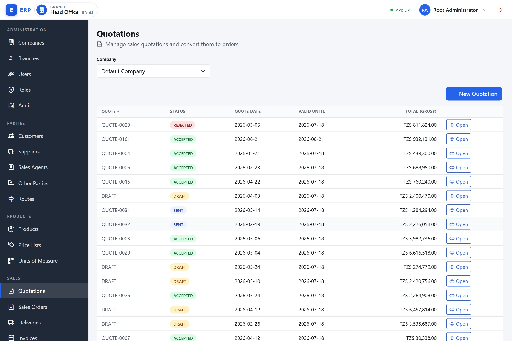
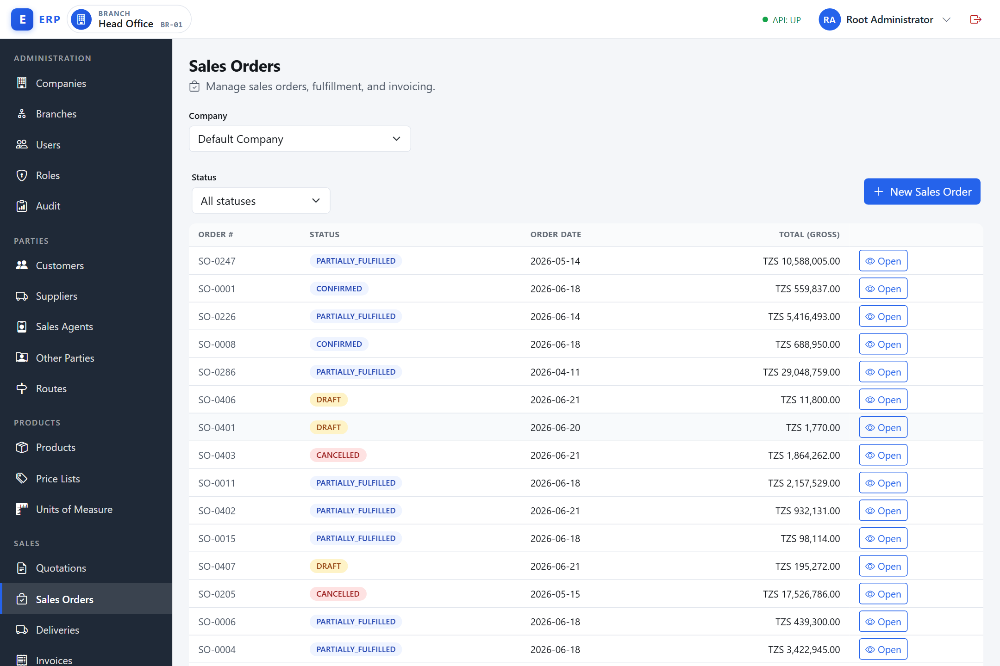
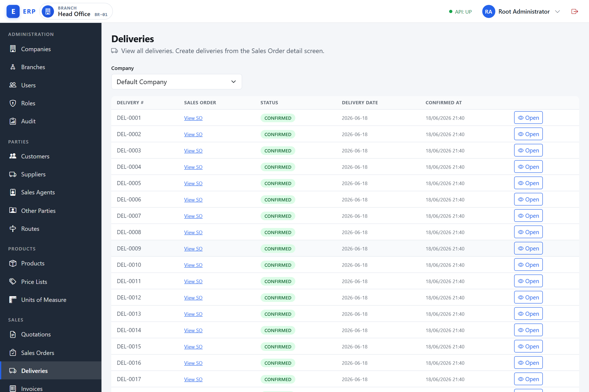
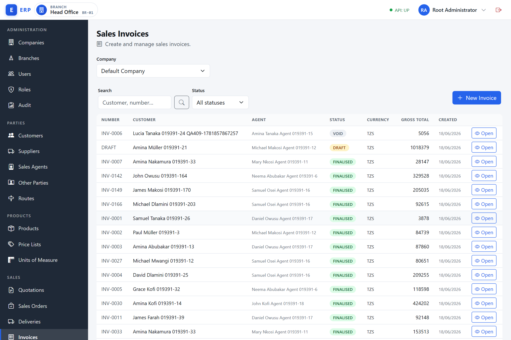
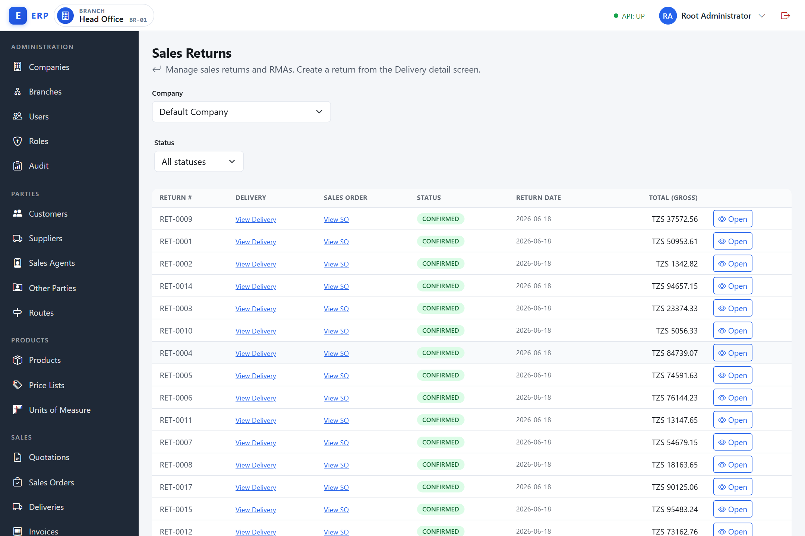
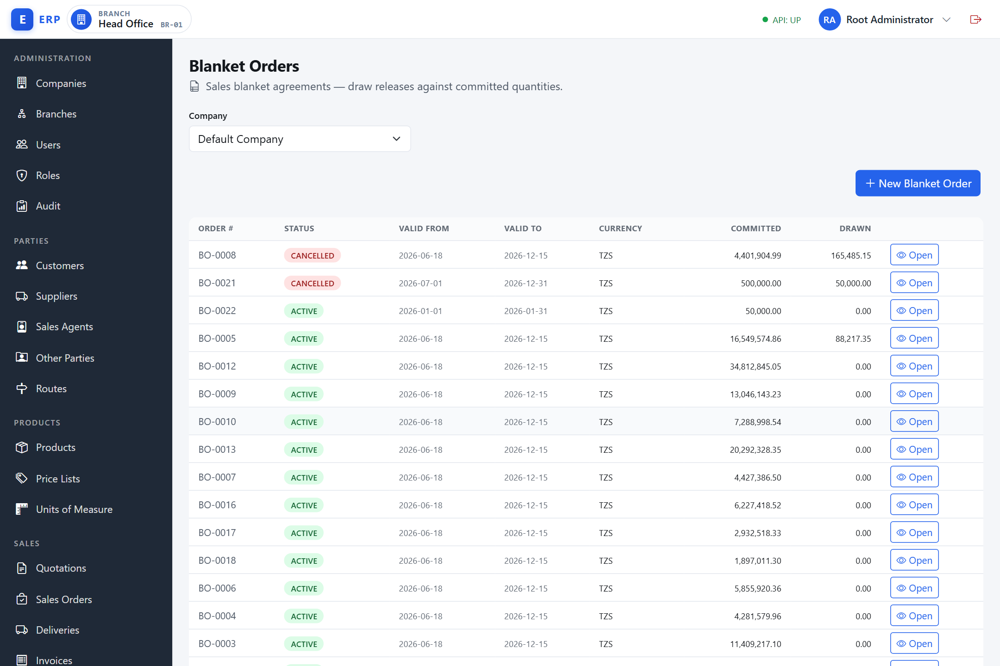
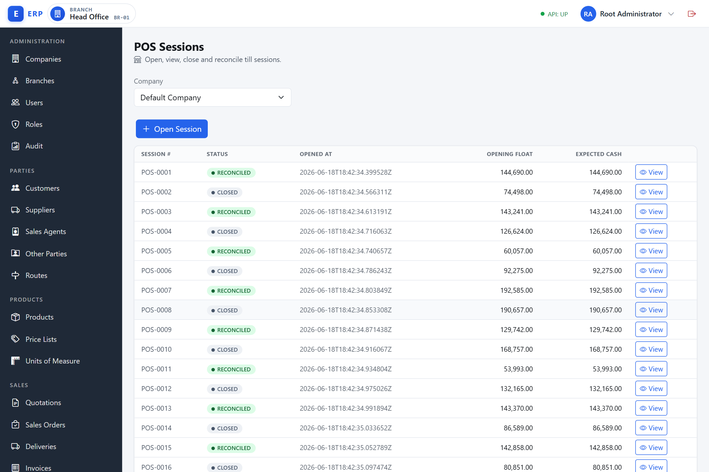
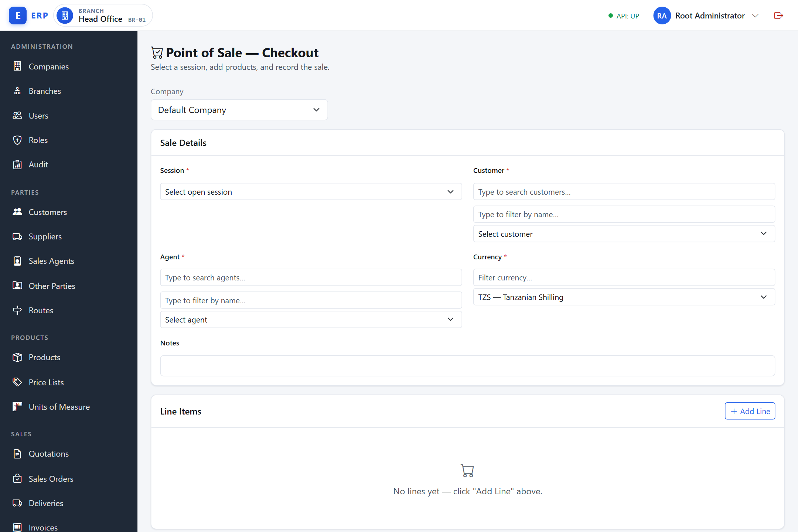

# Sales and Point of Sale

This chapter covers everything from quoting a customer through to collecting payment, including recurring and blanket agreements, advanced pricing, and the Point of Sale cashier workflow.

---

## Overview

The sales module follows the order-to-cash (O2C) path:

```
Quotation → Sales Order → Delivery → Sales Invoice → Payment
```

Walk-in cash sales skip the first three steps and begin directly with a Sales Invoice or a POS sale.

**What "order-to-cash" means.** Order-to-cash is the end-to-end business process that starts the moment a customer expresses intent to buy and ends when the business has received and accounted for the money. Each step in the chain creates a document that serves as a control point: stock is only committed when an order is confirmed, goods only leave the warehouse when a delivery is recorded, and revenue is only recognised when an invoice is finalised. Without this chain, businesses would have no audit trail, no way to match what was promised to what was shipped, and no reliable basis for the accounts receivable ledger.

**Required permissions** — the navigation menu only shows items your role includes. Key permission groups:

| Activity | Permission codes required |
|---|---|
| Quotations | `SALES.QUOTE.VIEW`, `SALES.QUOTE.CREATE`, `SALES.QUOTE.SEND`, `SALES.QUOTE.ACCEPT` |
| Sales Orders | `SALES.ORDER.VIEW`, `SALES.ORDER.CREATE`, `SALES.ORDER.CONFIRM`, `SALES.ORDER.CANCEL` |
| Deliveries | `SALES.DELIVERY.VIEW`, `SALES.DELIVERY.CREATE` |
| Sales Invoices | `SALES.INVOICE.VIEW`, `SALES.INVOICE.CREATE`, `SALES.INVOICE.SETTLE`, `SALES.INVOICE.VOID` |
| Sales Returns | `SALES.RETURN.VIEW`, `SALES.RETURN.CREATE` |
| Blanket Orders | `SALES.BLANKET.VIEW`, `SALES.BLANKET.CREATE`, `SALES.BLANKET.MANAGE` (draw releases, cancel) |
| Standing Orders | `SALES.STANDING.VIEW`, `SALES.STANDING.CREATE`, `SALES.STANDING.MANAGE` (pause, resume, trigger, cancel) |
| Pricing Rules | `SALES.PRICING.RULE.VIEW`, `SALES.PRICING.RULE.MANAGE` |
| Overrides | `SALES.INVOICE.OVERRIDE` (change a line's price), `SALES.DISCOUNT.OVERRIDE` (approve a discount above the limit), `SALES.CREDIT.OVERRIDE` (exceed a credit limit), `SALES.BELOW_COST.OVERRIDE` (approve a below-cost sale) |
| Printing documents (proforma, invoice, delivery note) | `DOCUMENT.RENDER` |
| Sales Settings (approval, stock, below-cost, discount and till-shift policies) | `SALES.SETTINGS.MANAGE` |
| Fiscal (EFD) receipts | `FISCAL.VIEW`, `FISCAL.MANAGE` |
| POS (tills, offline selling) | `POS.TILL.VIEW`, `POS.TILL.MANAGE`, `POS.OFFLINE.REVIEW`, `POS.OFFLINE.SWITCH` |
| POS (cashier) | `POS.SESSION.OPEN`, `POS.SALE.CREATE`, `POS.SESSION.VIEW`, `POS.EXPENSE.RECORD` |
| POS (reverse / age override) | `POS.SALE.VOID`, `POS.SALE.AGE_OVERRIDE` |
| POS (close/reconcile, cash-up report) | `POS.SESSION.CLOSE`, `POS.SESSION.RECONCILE`, `POS.CASHUP.VIEW` |
| Restaurant | `RESTAURANT.ORDER.MANAGE`, `RESTAURANT.ORDER.VOID`, `RESTAURANT.SETUP.MANAGE`, `RESTAURANT.KITCHEN.MANAGE` |

Contact your administrator if an expected menu item is missing.

**Working on the list screens.** If you belong to more than one company, each sales list shows a **Company** picker. On **Quotations**, **Sales Orders** and **Invoices** the create form opens inline at the top of the list; after **Create** the new draft appears in the list with a confirmation (for example *Quotation created*), and you click **Open** on its row to add lines. Date fields such as Quote Date and Order Date start empty and must be filled in.

**Concurrent edits.** If two people act on the same document at the same time (for example, both try to confirm the same order), the second action is rejected with a conflict message asking you to reload and retry, rather than failing silently or corrupting the record. Reload the screen to see the current state and act again.

---

## 1. Quotations

Navigate to **Sales › Quotations** (`/admin/quotations`).



**What a quotation is.** A quotation (also called a quote or a sales proposal) is a formal written offer that the business sends to a customer. It states the products, quantities, unit prices, any discounts, and a validity period — that is, the date by which the customer must respond if the offered price is to be honoured.

**Why quotations exist.** Without a quotation, pricing agreements between a salesperson and a customer exist only verbally. A quotation creates a timestamped, auditable record of what was offered at what price, protects the business from disputes, and gives management visibility of the sales pipeline (how many offers are outstanding, what value, and when they expire). It also means that once a customer accepts, the system can convert the offer into a Sales Order automatically, carrying the agreed prices across without any re-entry.

**When a quotation is used.** A quotation is raised when a customer asks "what will it cost me?" before committing to buy — typically by a salesperson or sales assistant. It sits at the very beginning of the O2C chain: nothing is reserved from stock and no financial entry is made; the quotation is a promise, not a transaction.

**How a quotation flows.** A quotation begins as a `DRAFT` (editable, no number yet). When it is sent to the customer the status moves to `SENT` and a `QUOTE-####` number is assigned. If the customer accepts, the quotation moves to `ACCEPTED` and a Sales Order is created automatically with the same lines and agreed prices. If the customer declines it is `REJECTED`. Once the Valid Until date has passed, the quotation can no longer be accepted.

The **Quotations** list shows **Quote #** (*DRAFT* until sent), **Status**, **Quote Date**, **Valid Until** and **Total (gross)**, with an **Open** button per row.

### 1.1 Create a quotation

1. Navigate to **Sales › Quotations** (`/admin/quotations`).
2. Click **New Quotation**.
3. In the **Customer** field, type part of the customer name or code and select the correct entry from the list (active customers only).
4. Choose the **Currency** from the Currency Picker (see *Common UI Patterns* in chapter 00 — only the company's enabled currencies are offered, defaulting to the company default).
5. Set **Quote Date** and **Valid Until** (the date the offer expires; it must be on or after the Quote Date).
6. Optionally choose an **Agent (optional)** and add **Notes**.
7. Click **Create Quotation**. The quotation is saved in **DRAFT** status. A quote number is assigned later when you send it.

**Required fields:** Customer, Currency, Quote Date, Valid Until.

### 1.2 Add lines to a quotation

1. Open the draft quotation (navigate to **Sales › Quotations** then click the **Open** action on the quotation row, or go to `/admin/quotations/uid/{uid}`).
2. In the **Lines** section, search for the product by name or code and select it.
3. Choose a **Unit**, enter **Quantity**, optionally enter a **Price Override** (otherwise the list price is used), and optionally enter a **Disc %** (line discount as a percentage — the quotation and Sales Order line forms only offer a percentage discount, not a fixed amount). Under the price, a hint shows the price the system found for this customer and unit — *List price … — leave blank to use it.*, or *No price set for this product yet.*
4. Click the **+** (Add line) button. The system calculates net amount, VAT, and gross.

**Unit choices are product-scoped.** The **Unit** dropdown is disabled until a product is selected. Once a product is chosen, it lists only that product's configured units — its base unit plus any active bulk-pack units (e.g. CARTON) — never the full company unit list, and it defaults to the base unit. This applies to every line form in this chapter (quotations, sales orders, invoices, blanket orders, standing orders, and POS sales): you can no longer select a unit that is not configured on the product, which previously could silently mis-record the quantity.

**Prices are per the selected unit.** Each product can carry a distinct price for each of its units — a price per PCS and a separate price per CARTON, for example. When you choose the **Unit**, the price the system resolves (and the amount shown in the line's **Unit Price** column) is the price for **that** unit, not the base-unit price multiplied out. So a line of 5 CARTON is priced at the carton price × 5, not the piece price × 5. If you type a **Price Override**, enter it as the price for the unit you selected. Switching the unit re-prices the line, so pick the unit first, then confirm or override the price.

Repeat for each product. You can also add **Service** products; these are priced the same way but do not affect stock.

To remove a line, click the delete icon on the line row. Lines can only be changed while the quotation is in DRAFT.

### 1.3 Send a quotation

When the quotation is ready to share with the customer:

1. Open the draft quotation.
2. Click **Send to Customer**.
3. The status changes to **SENT** and a quote number (QUOTE-####) is assigned.

**Prerequisites:** The quotation must have at least one line (the button is disabled until it has), and the Valid Until date must be today or in the future (*Valid-until date is in the past; cannot send.*). Sending needs `SALES.QUOTE.SEND`.

**Printing a proforma.** Once a quotation has been sent, holders of `DOCUMENT.RENDER` see **Print Proforma**, which downloads the quotation as a proforma invoice PDF (`proforma-QUOTE-####.pdf`) to send to the customer.

### 1.4 Accept or reject a quotation

When the customer responds:

- **Accept** — click **Accept & Convert to Order** on the sent quotation. A **Sales Order** is created automatically with the same lines and discounts, the quotation status changes to **ACCEPTED**, and you are taken straight to the new order (*Quotation accepted — Sales Order created*). The quotation then shows a **View Sales Order** link.
- **Reject** — click **Reject** (there is no confirmation). The quotation status changes to **REJECTED**.

Both actions require the `SALES.QUOTE.ACCEPT` permission. If the Valid Until date has already passed, acceptance is refused with *This quotation expired on … and can no longer be accepted.* — the quotation stays **SENT**; reject it and raise a new one if the customer still wants to buy.

### 1.5 Quotation statuses

| Status | Meaning |
|---|---|
| DRAFT | Being prepared; lines can be added or removed |
| SENT | Sent to customer; awaiting response |
| ACCEPTED | Customer accepted; Sales Order created |
| REJECTED | Customer declined |

---

**Example — Quotation for Karibu Supermarkets:**

Salesperson Ali opens **Sales › Quotations** (`/admin/quotations`) and clicks **New Quotation**. He types "Karibu" in the Customer field and selects **Karibu Supermarkets Ltd**. He sets Quote Date to **2026-06-14** and Valid Until to **2026-07-14**, then saves. The quotation is created in DRAFT with no number yet.

Ali adds two lines:
- Product **Unga wa Ngano 2kg**, Unit **CARTON (12 pcs)**, Qty **50**, Line Discount **0%** — system prices at TZS 18,000 per carton = TZS 900,000 net.
- Product **Mafuta ya Kupikia 1L**, Unit **CARTON (12 pcs)**, Qty **30**, Line Discount **5%** — list price TZS 22,000; after 5% = TZS 20,900 per carton = TZS 627,000 net.

VAT at 18% is added by the system: total gross = TZS 1,535,400 + VAT. Ali clicks **Send to Customer** — status becomes SENT and the number **QUOTE-0047** is assigned.

Karibu calls back and accepts. Ali clicks **Accept & Convert to Order**. The system creates **Sales Order SO-0112** from the same lines and opens it. Quotation status is now ACCEPTED.

---

## 2. Sales Orders

Navigate to **Sales › Sales Orders** (`/admin/sales-orders`).



**What a Sales Order is.** A Sales Order (SO) is the internal document that records a customer's confirmed purchase intent. It lists the products, quantities, agreed prices, and any discounts. Unlike a quotation (which is an offer), a Sales Order is a commitment: the business has agreed to supply, and the customer has agreed to buy.

**Why Sales Orders exist.** The Sales Order is the control centre of the fulfilment process. Two things happen that do not happen at the quotation stage: first, confirming the order **reserves stock** so those goods cannot be sold to someone else; second, the order creates the traceability link between the customer's request, the delivery that ships the goods, and the invoice that bills them. Without Sales Orders, a warehouse would not know what to pick, finance would have no basis for revenue recognition, and there would be no way to track partial deliveries or backorders systematically.

**When a Sales Order is used.** A Sales Order is created either automatically (when a customer accepts a quotation) or directly (when a salesperson or order-desk clerk enters it fresh — for example, a telephone order that was never quoted). It is used any time a customer is buying goods that need to be fulfilled from stock and billed after delivery, as opposed to a walk-in cash purchase which goes straight to an invoice.

**How a Sales Order flows.** An SO begins as `DRAFT` (a `SO-####` number is assigned immediately at creation, even in draft). When the user confirms it, the status moves to `CONFIRMED` and stock is soft-reserved. As deliveries are made against the order the status tracks fulfilment progress (`PARTIALLY_FULFILLED` → `FULFILLED`). Once everything is delivered, invoicing moves it on to `PARTIALLY_INVOICED` and finally `CLOSED`. Cancelling an order before anything is fully delivered releases the reservations.

**The Sales Orders list** shows **Order #**, **Customer**, **Agent**, **Branch**, **Status**, **Approval** (*Awaiting approval*, *Approved*, *Rejected*, …), **Order Date** and **Total (gross)**. The **Status** filter narrows the page currently shown; page through for more.

**Stock reservation explained.** When you confirm a Sales Order, the system writes a "soft reservation" against each product in the warehouse. The reserved quantity is not physically moved — the goods stay on the shelf — but they are marked as committed. This means the available-to-promise figure (what can still be sold to other customers) is reduced immediately. A reservation prevents double-selling: two salespeople cannot independently confirm orders for the same last 10 units. When a delivery is made, the reservation for the delivered quantity is released (because the goods have actually left) and the on-hand balance is reduced instead.

### 2.1 Create a standalone Sales Order

1. Navigate to **Sales › Sales Orders** (`/admin/sales-orders`).
2. Click **New Sales Order**.
3. Pick the **Customer** by name.
4. Choose the **Currency** from the Currency Picker (see *Common UI Patterns* in chapter 00 — the list is limited to the company's enabled currencies and defaults to the company default).
5. Set **Order Date**. The **Agent** field is pre-filled with **your own agent** (if your user is linked to a sales agent) — you can leave it, clear it, or type another agent's name to change it. Optionally add **Notes**.
6. Click **Create Order**. The order is created in **DRAFT**.

> **Agent pre-fill.** The Agent box shows *your* linked agent as soon as you open the form so a route agent does not have to search for themselves every time. It is only a convenience default — the field stays fully editable, and if your user has no linked agent (for example a root/admin login) the box simply opens empty.

### 2.2 Add lines to a Sales Order

The same process as adding quotation lines, including the **Unit** dropdown being scoped to the selected product's configured units (see section 1.2). Lines can only be added, edited, or removed while the order is in DRAFT and not in the approval process.

The lines table shows **Ordered**, **Reserved**, **Fulfilled**, **Invoiced** and **Open (backorder)** quantities for each line, with **Unit Price** (and its incl./excl. VAT tag), **Disc %**, **Net** and **Gross**. The order header shows the customer, sales agent, branch, currency, dates, notes and — for an order made from a quotation — a **From quotation** link.

### 2.3 Confirm an order

Confirming an order reserves the ordered quantity of every line.

1. Open the draft order at **Sales › Sales Orders** then click the **Open** action on the order row (or navigate to `/admin/sales-orders/uid/{uid}`).
2. The order must have at least one line (the button is disabled until it has).
3. Click **Confirm Order**. The **Confirm Order?** dialog explains that confirming will reserve stock for all order lines, and that **if insufficient stock is available the order will confirm with a backorder**.
4. Click **Yes, Confirm** (*Order confirmed — stock reserved*).
5. The status changes to **CONFIRMED** and each line's **Reserved** quantity equals its ordered quantity. Confirming does not check stock on hand: shortages show up when you deliver. The **Open (backorder)** column shows what is still to be delivered.

This requires the `SALES.ORDER.CONFIRM` permission. A user who can create orders but not confirm them will not see this button.

**Approval threshold (large orders).** Your company can require manager approval for high-value orders. When the SO-approval workflow is switched on (see *Sales Settings* below) and the order's gross total is **at or above the configured threshold**, clicking **Confirm Order** does not confirm it. Instead the system automatically **submits the order for approval** and refuses the confirmation with *"This order exceeds the approval threshold and has been submitted for approval. It can be confirmed once it is approved."* The order stays in **DRAFT**, but it is now **awaiting approval** (*Awaiting approval before it can be confirmed.*): its lines are frozen and the **Confirm Order** button is disabled. An authorised approver acts on it from **Approvals › My Inbox**. Once it is **approved**, come back and click **Confirm Order** again to reserve stock as normal; the lines stay frozen. If the approval is **rejected** or withdrawn, the order shows *This order's approval is closed. Cancel it and raise a new order to submit for approval again.* Orders below the threshold (or when the workflow is off) confirm immediately with no approval step.

> You can also submit a draft order for approval yourself, before trying to confirm it: an order that has never been submitted shows a **Submit for Approval** button on its detail page. This routes it through the same inbox.

**Configuring the threshold (Sales Settings).** A user with `SALES.SETTINGS.MANAGE` sets this up under **Sales › Sales Settings** (`/admin/sales-settings`). Pick the **Company**, tick **Enable SO Approval Workflow**, enter the **Approval Threshold Amount** (sales orders above this value require approval) and its **Currency**, then click **Save Settings**. Leaving the workflow disabled means no order is ever auto-held at confirm.

**Credit-control hard block.** When the customer is a **Credit Account** customer, confirming the order runs a credit-control check. Confirmation is blocked (the order stays in DRAFT and the system returns a clear conflict message) if **any one** of these three independent conditions is true:

- the customer's **credit status** is `ON_HOLD` or `STOPPED`;
- the customer is on a **manual hold** (a credit-control staff override — the hold reason, if recorded, is shown in the message); or
- the order's gross total, added to the customer's current outstanding balance, would **exceed their credit limit**.

The message begins *This sales order is on hold due to a credit control restriction.* and adds the reason — the account is stopped or on hold, a manual credit hold is active (with its reason), or confirming would exceed the credit limit. The block is overridable only by a user holding the `SALES.CREDIT.OVERRIDE` permission; every override is recorded in the audit trail. **Cash / walk-in customers are exempt** — this check never applies to them.

**Credit limit and other currencies.** The limit is checked in your base currency. The customer's balance counts each foreign-currency item at the rate it was booked at; older foreign-currency items that have no reliable booked rate, and an order or invoice that is itself in a foreign currency, are converted at **today's** exchange rate (the latest rate on or before today). If a currency involved has **no exchange rate at all**, the system cannot work out the exposure, so it treats the limit as exceeded: the order or invoice is blocked with "The credit limit could not be checked because there is no exchange rate for USD. Add a USD rate under Currency rates and try again." A user with `SALES.CREDIT.OVERRIDE` can still proceed, and the audit record notes which rate was missing. The same rule applies to the credit-limit check at invoice finalisation.

> A separate, advisory credit warning may also appear without blocking confirmation; it is informational only and the order still confirms.

### 2.4 Cancel an order

Cancelling an order releases any stock reservations.

1. Open the order.
2. Click **Cancel Order**, enter a **Reason (optional)**, and click **Confirm Cancel** (or **Keep Order**).

Cancellation is allowed only while the order is **DRAFT**, **CONFIRMED** or **PARTIALLY_FULFILLED**. Once everything has been delivered or anything invoiced, cancelling is refused — for example *Cannot cancel a FULFILLED order. All stock has been dispatched. Raise a sales return to reverse it.* The cancel reason is shown on the order.

### 2.5 Set or change the agent

**What the order's agent is.** Every sales order carries a sales agent — the salesperson or route agent credited with the sale — which the invoicing flow depends on. An order can be created without one (Agent is optional in section 2.1), but an invoice generated from an agentless order cannot be finalised.

> **New orders pre-fill your own agent.** When you create a fresh Sales Order the Agent field already shows your linked agent (section 2.1), so a route agent's own orders normally arrive with the correct agent set. Use **Assign Agent / Change Agent** below when an order was created without one, was created by someone with no linked agent (e.g. root), or was credited to the wrong agent.

**Why this action exists.** Before this action, an order created with no agent (or the wrong one) had no way to be corrected in place — every attempt to invoice it would keep failing. **Assign Agent** / **Change Agent** lets an authorised user fix the agent on an existing order without recreating it.

1. Open the sales order (navigate to `/admin/sales-orders/uid/{uid}`).
2. Click **Assign Agent** if the order has no agent, or **Change Agent** if it already has one — both open the same form.
3. In the **Agent** field, type part of the agent's name or code and select the correct entry from the suggestions list.
4. Click **Save Agent**.

The order's agent is updated immediately and a confirmation is shown.

**When the action is available.** The button is shown only while the order is in a pre-invoice status — **DRAFT**, **CONFIRMED**, **PARTIALLY_FULFILLED**, or **FULFILLED**. Once the order has been invoiced (**PARTIALLY_INVOICED**, **CLOSED**) or is **CANCELLED**, the agent can no longer be changed this way.

**No-agent banner.** An order with no agent shows a warning banner on its detail page: *"No agent assigned. This order cannot be invoiced until a sales agent is assigned."*

**Required permission:** `SALES.ORDER.CREATE` (the same permission used to create and edit draft orders — there is no separate set-agent permission).

### 2.6 Order status lifecycle

| Status | Meaning |
|---|---|
| DRAFT | Being prepared; no stock reserved |
| CONFIRMED | Stock reserved |
| PARTIALLY_FULFILLED | At least one delivery made; not all lines delivered (stays here even if some deliveries are invoiced) |
| FULFILLED | All lines delivered; nothing invoiced yet |
| PARTIALLY_INVOICED | All lines delivered; some of it invoiced |
| CLOSED | Fully delivered and fully invoiced |
| CANCELLED | Cancelled; reservations released |

Voiding a delivery's invoice, or cancelling its draft invoice, moves the order back to the matching status so the delivery can be invoiced again. (The status filter also lists *Invoiced*, which orders do not normally reach.)

### 2.7 Deliveries from the order

The bottom of a confirmed order lists its **Deliveries** (**Delivery #**, **Status**, **Delivery Date**, **Confirmed At**, **Open**) for users who can view deliveries, with a **New Delivery** button (needs `SALES.DELIVERY.CREATE`). See section 3.

**Approval status is separate from order status.** When the approval workflow holds an order (see section 2.3), the order stays in **DRAFT** but its detail page shows an **awaiting approval** state; it is not a distinct row in the table above. The approval outcome (pending, approved, rejected) governs whether **Confirm Order** is available, while the statuses above track fulfilment and invoicing once the order is confirmed.

---

## 3. Deliveries

Navigate to **Sales › Deliveries** (`/admin/deliveries`).



**What a Delivery is.** A Delivery is the document that records goods physically leaving the warehouse and being shipped or handed to the customer. It references the Sales Order it fulfils and specifies the exact quantities dispatched on that date. It is also sometimes called a "dispatch note" or "delivery note."

**Why Deliveries exist.** Without a delivery document there is no system record of when goods actually left — only what was ordered. The Delivery is the trigger for two critical events: it reduces the physical stock balance (goods have left), and it becomes the source document for the customer's invoice (you invoice what you delivered, not what was ordered — because partial deliveries are common). The delivery is also the moment that the cost of those goods is posted to the Profit and Loss account as Cost of Goods Sold (COGS), matching the cost to the revenue period in which the goods are billed.

**When a Delivery is used.** A delivery is created by a warehouse or logistics clerk once goods are ready to ship, always against a confirmed Sales Order. Multiple deliveries can be made against a single order (backorders), and each delivery generates its own invoice.

**How a Delivery flows.** A delivery can only be created against a `CONFIRMED` or `PARTIALLY_FULFILLED` Sales Order. When created it is immediately `CONFIRMED` (there is no separate pick/confirm step in the current version). The delivery is immutable — once confirmed it cannot be edited; corrections are handled through a Sales Return. Stock is reduced at the branch and the SO line counters are updated. An invoice is generated from the delivery as a separate action.

**Full delivery vs partial delivery (backorder).** If you deliver less than the full ordered quantity on any line, the system creates a partial delivery and the order moves to `PARTIALLY_FULFILLED`. The remaining undelivered quantity is the **backorder**. You create a second delivery later for the remaining quantity. Each delivery is independent and can be invoiced separately.

### 3.1 Create a delivery

Deliveries are always created from a Sales Order. The **Deliveries** list (`/admin/deliveries`) is view-only — it has no "New Delivery" button (its subtitle reads *"View all deliveries. Create deliveries from the Sales Order detail screen."*). It shows **Delivery #**, **Sales Order** (a **View SO** link), **Status**, **Delivery Date** and **Confirmed At**.

1. Open a **CONFIRMED** (or **PARTIALLY_FULFILLED**) Sales Order and click its **Create Delivery** action (needs `SALES.DELIVERY.CREATE`). This opens the delivery form for that order.
2. The form's **Lines to Deliver** table lists all open (undelivered) lines with the remaining **Open Qty (in unit)** pre-filled in **Deliver Qty (in unit)**. For a pack line the form shows how many base units one pack holds.
3. Untick a line's **Include** checkbox to leave it out, or lower its **Deliver Qty** if you are making a **partial delivery** (backorder). The quantity cannot exceed the open balance.
4. Set **Delivery Date** (required) and optionally enter **Notes**.
5. Click **Create Delivery**. The new delivery opens.

Deliveries are created immediately in **CONFIRMED** status and cannot be undone. Each delivery is assigned a `DEL-####` number. The delivery page shows each line's **Delivered Qty**, **Invoiced Qty**, **Returned Qty** and **Issue Value** (the stock cost), a link back to the **Sales Order**, and any **Returns Against This Delivery**. **Print PDF** (needs `DOCUMENT.RENDER`) downloads the delivery note.

**Not enough stock (negative-stock block).** Creating a delivery issues stock from the branch, so when your company blocks sales that would take stock negative (the default — see *Sales Settings* in chapter 01), **Create Delivery** is refused when a delivered line would take that product's available stock below zero. You get a plain message naming the product with how much is available versus requested, and no delivery is created. Lower the **Deliver Qty** (which leaves the rest as a backorder — section 3.2), receive or transfer more stock in first, or have a user with `SALES.SETTINGS.MANAGE` turn the setting off to allow the shortfall.

### 3.2 Partial delivery (backorder)

Enter a quantity less than the open balance on any line to create a partial delivery. The Sales Order status moves to **PARTIALLY_FULFILLED**. Create another delivery later for the remaining quantity.

### 3.3 Generate an invoice from a delivery

Once goods are delivered, you can invoice the customer for that delivery:

1. Open the delivery (navigate to **Sales › Deliveries** and click the **Open** action on the delivery row, or go to `/admin/deliveries/uid/{uid}`).
2. Click **Invoice this Delivery** (needs `SALES.DELIVERY.CREATE`).
3. A draft **Sales Invoice** is created with the delivered lines (*Invoice created*), and the button is replaced by **View Invoice** — click it to open the draft. Line and order discounts from the source order are shared out in proportion to the delivered quantity, and pack lines are billed in their own unit.

**Prerequisite: the source order must have an agent.** Invoice this Delivery reads the agent from the underlying Sales Order. If that order has no agent, the action is refused with *"The sales order has no agent assigned."* Open the Sales Order and use **Assign Agent** (section 2.5) to set one, then retry.

Proceed to section 4 to finalise the invoice.

---

## 4. Sales Invoices

Navigate to **Sales › Invoices** (`/admin/sales-invoices`).



**What a Sales Invoice is.** A Sales Invoice is the formal billing document sent to the customer. It is the legal record of the sale: it states what was sold, at what price, the VAT due, and the amount the customer owes. Once finalised, a sales invoice is immutable — it cannot be edited, only voided (which raises a reversing credit note).

**Why Sales Invoices exist.** The invoice is the document that creates the customer's obligation to pay. In accounting terms, finalising an invoice posts the revenue to the General Ledger (DR Accounts Receivable or Cash / CR Sales Revenue and VAT Payable). For credit customers it opens an AR (Accounts Receivable) item — a record of the amount owed — which is then tracked and aged until payment is received. Without invoices, the business has no formal claim on the customer and no basis for its revenue figures or tax filings.

**Direct invoices vs SO-sourced invoices.** There are two origins for a sales invoice:

- **`DIRECT` (walk-in):** created manually for a cash customer who is buying on the spot with no prior order. Stock is issued and revenue posted at the moment of finalisation.
- **`SALES_ORDER`-sourced:** created from a Delivery (section 3.3). These invoices post revenue only — stock was already issued when the delivery was confirmed. This distinction prevents the same goods from being costed twice.

**Why the origin matters.** If a `SALES_ORDER`-sourced invoice also issued stock, the Cost of Goods Sold would be posted twice: once at delivery and once at invoicing. The system prevents this by tracking the origin on every invoice and skipping the stock-issue step for SO-sourced invoices. A walk-in invoice (DIRECT) has no prior delivery, so it must issue stock at finalisation — that is the only point at which goods leave.

**The VAT calculation.** The system calculates VAT per line using each product's VAT status (Standard 18%, Zero-Rated 0%, or Exempt 0%) and the VAT stance of the price — VAT is either added on top of a net price or split out of a VAT-inclusive price (see *"incl. VAT" vs "excl. VAT"* in section 4.2). The VAT rate is snapshotted onto the line at sale time so a later rate change cannot silently alter a historical invoice. The invoice prints a VAT analysis breaking down the tax by rate band.

**Price snapshots.** When you add a product line to an invoice (or any sales document), the system reads the current price from the price list and records it permanently on that line. If the price list is updated tomorrow, the historical invoice is unaffected — it retains the price that applied at sale time. This is called a "price snapshot" and is mandatory for any document that is legally an audit record.

### 4.1 Create a direct (walk-in) invoice

1. Navigate to **Sales › Invoices** (`/admin/sales-invoices`).
2. Click **New Invoice**.
3. Pick the **Customer** by name.
4. Choose the **Currency** from the Currency Picker (see *Common UI Patterns* in chapter 00 — enabled currencies only, defaulting to the company default).
5. The **Sales agent** field (*Search agent…*) is pre-filled with **your own agent** if your user is linked to one — leave it, clear it, or choose another agent. As the hint says, *Leave blank to record the sale under your own sales agent.* A user with no linked agent gets one created automatically on their first sale; a root administrator's sales are credited to the company's **Counter** agent.
6. Optionally pick a **Route (optional)**; the default, **— Auto from agent's primary route —**, uses the agent's primary route.
7. Click **Create Invoice**. A draft invoice is created and listed (*Invoice created*); click **Open** on its row.

**The Invoices list** has a **Search** box (*Customer, number…*), a **Status** filter (*All statuses*, *Draft*, *Finalised*, *Void*) and **From** / **To** dates (the date the invoice was created). It shows **Number**, **Customer**, **Agent**, **Status**, **Currency**, **Gross Total** and **Created**.

**The invoice page** shows the customer, agent, route, notes, who finalised it and when, and — once posted — a **GL Entry › View Journal** link to its accounting entry.

### 4.2 Add lines to an invoice

The invoice line form has **Product**, **Unit** (only the product's own units — see section 1.2), **Quantity**, **Price Override**, **Disc. amount** and **Disc. %**. Under the price, a hint shows the price found for this customer and unit (*List price … — leave blank to use it.*); if there is none, it reads *No price set for this product yet — enter a unit price to bill it.* Click **Add Line**. Lines can only be added, changed or removed while the invoice is in DRAFT.

**Changing a line.** On a draft, click the pencil on a line (*Change quantity or discount*) to change its quantity or discount in place. Type the discount as an amount or as a percentage such as `10%`. Quantities on an invoice raised from a delivery follow the delivery and cannot be changed here.

**Discounts above the company limit.** If Sales Settings limits discounts and a line's discount is over the limit, the line is refused and an **Ask a supervisor** button appears. A supervisor holding `SALES.DISCOUNT.OVERRIDE` signs in in the **Supervisor approval for this discount** window; the line is then added and shows *Discount approved by \<name\>*. Under **Never allow**, a discount over the limit is simply refused; under **Allow, but record it**, it goes through and is recorded for review.

The lines table shows each line's VAT status and rate (for example *STANDARD 18%*) and marks an overridden price with an *Overridden* tag.

**"incl. VAT" vs "excl. VAT" on a line.** Each line shows a small tag beside its **Unit Price** reading either **incl. VAT** or **excl. VAT**. It tells you how the unit price relates to VAT, and it simply reflects the VAT stance of the price list the line's price came from (set once per list — see *Price Lists › VAT-inclusive vs exclusive pricing* in chapter 02, Master Data):

- **incl. VAT** — the unit price shown is the customer-facing **gross** price, with VAT already inside it. The system splits the net and the VAT back out of that figure (shown in the line's **Net** and **VAT Amt** columns) so the customer pays exactly the price shown, to the shilling. This is the natural fit for retail/shelf pricing.
- **excl. VAT** — the unit price shown is the **net** price, and VAT is added on top, so the customer pays the price plus VAT. This is the usual wholesale/B2B "price + VAT" convention.

The tag is a read-only indicator — you never set it on the line, and it does not change which product or price you picked, only how the VAT is derived from that price. The same tag appears on quotation and sales-order lines. Zero-rated and exempt products still show a tag but attract no VAT either way.

#### Weighed-goods lines (sell by weight)

When a product is configured as **sold by weight** (loose rice, sugar, produce — see *Master Data › Products › Weighed goods*), the line behaves the same as any other, with three differences you will notice:

- **You must use a weight unit.** The **Unit** dropdown for a weighed product offers only its weight units (kilograms, grams). If a by-count unit is somehow submitted, the line is refused with *"<Product> is sold by weight — choose a weight unit such as kilograms, not Pieces."* Enter the weighed amount as the **Quantity** — for example `0.813` for 813 grams on a per-kg product. (In these messages the trailing unit is the unit's full **name** — `Pieces`, `Kilogram` — not its short code; the exact by-count name shown is whichever unit was attempted.)
- **The weight is rounded to the scale step.** If the product declares a scale division (say 0.005 kg), the quantity you enter is rounded to the nearest division when the line is saved. Entering `0.813` kg records a **billed** quantity of `0.815` kg. The line shows both so the rounding is transparent: under the quantity it reads **entered 0.813 → billed 0.815**. The amount is always computed from the billed (rounded) weight × the per-unit price.
- **Guards catch scale mistakes.** A weight so small it would round down to nothing is refused (*"that weight is too small to sell. The smallest amount is 0.005 Kilogram"*), and a weight above the product's **max sale weight** — the classic kg/gram fat-finger, keying `813` instead of `0.813` — is refused with *"813 Kilogram is above the maximum sale weight of 50 Kilogram. Please check the weight."* Nothing is saved; correct the quantity and re-add the line.

Everything else — VAT, discounts, the incl./excl. VAT tag, price snapshots — works exactly as for a by-count line.


#### Override a line's unit price

Sometimes the price the system resolved from the price list is not the price you want to bill — a one-off negotiated rate, a price-match, or a correction. On a **DRAFT** invoice you can override any line's unit price in place (this needs the `SALES.INVOICE.OVERRIDE` permission — users without it do not see the control):

1. In the **Lines** table, click the **pencil** (Override price) icon next to the line's unit price. A small input replaces the price.
2. Type the new unit price and click the **save** (check) button. Click the **✕** to cancel and keep the original price.

The override is applied to that line only, and the line's net, VAT, and gross recalculate immediately. Two rules apply:

- **The price must be greater than zero.** A zero or negative override is refused with *"Enter a valid unit price greater than zero."* — you cannot give the goods away or drive the line total negative through this field. (The server enforces the same rule with its own message, *"The override price must be greater than zero."*, for direct API callers.)
- **A wildly-off price asks for confirmation (soft guard).** If the price you enter is more than about **10×** or less than about **0.1×** the line's list price, a confirmation pops up — *"This is about 12× the list price (2,000). Apply anyway?"* — before it is applied. This is a fat-finger guard, **not** a hard block: any positive price is allowed once you confirm. Confirm to apply, or cancel to keep editing. When the list price is unknown or the entered price is within the normal range, no confirmation appears.

### 4.3 Record a payment

Payments can be recorded on a draft invoice before it is finalised.

1. In the **Record Payment** panel (shown on a DRAFT invoice), choose the **Tender type**: Cash or Mobile Money.
2. Enter the **Amount**, and optionally a **Reference** (for example, the mobile-money transaction reference).
3. Click **Record**.

Recording payments requires the `SALES.INVOICE.SETTLE` permission. The panel shows **Gross**, **Paid** and **Remaining**, and lists each payment with its **Tender**, **Amount**, **Change**, **Reference** and **Received** time. A payment recorded by mistake can be removed with its delete button while the invoice is a draft.

For **cash / walk-in customers** the payments must **cover** the invoice gross before you can finalise. Cash may be more than the total — the difference is recorded as **Change**. Mobile-money payments cannot be more than what is owed. Credit customers may leave a balance that becomes an open AR item.

### 4.4 Finalise an invoice

1. Open the draft invoice.
2. Click **Finalise** (needs `SALES.INVOICE.CREATE`; disabled until the invoice has lines).
3. The status changes to **FINALISED** and an invoice number is assigned.

Once finalised (or voided), **Print PDF** (needs `DOCUMENT.RENDER`) downloads the invoice as `invoice-INV-####.pdf`.

After finalisation:
- For DIRECT invoices, stock is issued from the branch.
- For invoices from a delivery, revenue is posted (stock was already issued at delivery).
- For credit customers, an AR open item is created for any unpaid balance.

**Paid-in-full rule:** walk-in (cash) customers must be fully paid before finalisation is allowed. Otherwise you see *The total payments received do not cover the invoice amount. Required: …, received: ….*

**Rounding follows the invoice's currency.** Line amounts, VAT and totals are rounded to the decimal places of the invoice's own currency: whole shillings for a TZS invoice, cents for a USD, EUR or KES invoice (18% VAT on USD 12.00 is USD 2.16). The same applies to quotations, sales orders and POS sales. The accounting entry is always posted in the base currency, each amount converted at the invoice's exchange rate.

**Credit limit:** if a credit customer's outstanding balance plus the **unpaid part** of this invoice would exceed their credit limit, finalisation is blocked unless you hold the `SALES.CREDIT.OVERRIDE` permission. A fully paid invoice is never blocked. The message shows the figures, for example *This customer's credit limit is TZS 5,000,000. With this invoice they would owe TZS 5,400,000, which is TZS 400,000 over the limit. Take a payment of at least TZS 400,000 first, or ask someone allowed to override the credit limit.* (For SO-sourced sales, the broader credit-control block — covering credit status, manual hold, and the limit — already runs earlier, at Sales Order confirm; see section 2.3.)

**Not enough stock (negative-stock block).** When your company blocks sales that would take stock negative (the default — see *Sales Settings* in chapter 01), finalising a walk-in **DIRECT** or **POS** invoice is refused when a line would take that product's available stock below zero. The message names the product, for example *"Not enough stock of Sugar 1kg to complete this sale — 3 available, 5 requested. Ask a supervisor to enable backorder if this should be allowed."* (quantities are in base units). Nothing is posted; the invoice stays in DRAFT. To clear it you can lower the quantity, receive or transfer more stock in first, or — if selling ahead of stock is deliberate — have a user with `SALES.SETTINGS.MANAGE` turn the setting off, which lets the sale go through and stock go negative (backorder). Invoices raised from a delivery are not checked here (their stock was checked at the delivery), and **the same block applies when you create a Delivery** (section 3.1).

**Selling at or below cost.** If Sales Settings has a below-cost policy of **Needs supervisor approval** or **Never allow**, finalising a walk-in invoice that contains an item priced at or below its cost is refused (*… priced at or below cost, so this sale cannot be completed. Raise the price, or ask a supervisor to review the pricing policy.*). Supervisor approval for a below-cost sale is given on the till; on this screen, raise the price.

#### Cancelling a draft invoice

A draft invoice that is not needed can be discarded. Click **Cancel draft** (needs `SALES.INVOICE.CREATE`) and confirm *Cancel this draft invoice? Its lines and any tenders on it are discarded.* The draft is removed (the action is recorded in the audit trail) and you return to the list (*Draft cancelled*). A draft raised from a delivery gives its quantities back to the delivery, so it can be invoiced again. A finalised invoice cannot be cancelled — void it instead.

### 4.5 Void an invoice

**What voiding means.** Voiding a finalised invoice reverses its financial effect: the revenue and VAT are reversed and stock issued by the invoice comes back. For a credit customer, a credit note cancels what they owed. The original invoice number is retained on the record (voiding is not deletion — the document remains as evidence that the transaction happened and was corrected). Use voiding only when an invoice was issued in error; for goods returned by the customer use a Sales Return (section 5) instead.

1. Open the finalised invoice (navigate to **Sales › Invoices**, open it from its row action, or go to `/admin/sales-invoices/uid/{uid}`).
2. Click **Void Invoice** — or **Void & refund** when payments were taken on the invoice. For a refund the form warns: *The whole sale is cancelled and every payment taken on it is refunded to the customer. Stock comes back and the sale is reversed in the ledger. This cannot be undone.*
3. Enter the **Reason** (required) and click **Confirm Void** (or **Confirm void & refund**).
4. The invoice status changes to **VOID**.

Voiding needs `SALES.INVOICE.VOID`. Voiding an invoice raised from a delivery frees the delivered quantities so they can be invoiced again. A void is refused when:

- customer receipts have already been allocated to the invoice — raise a credit note instead;
- the invoice is a till sale whose session is still open — reverse it on the till instead;
- items of the sale were already returned at the till — return the remaining items on the till instead.

### 4.6 Issue a fiscal (EFD) receipt

**What a fiscal receipt is.** In Tanzania (and similar tax regimes) a taxable sale must be recorded on an approved fiscal device — an EFD (Electronic Fiscal Device) or VFD (Virtual Fiscal Device) — which returns a government **fiscal receipt number** and a **verification URL** the customer can use to confirm the receipt with the revenue authority. This ERP sends each finalised invoice to the company's configured fiscal provider and stores the result on the invoice.

**Where it appears.** A **Fiscal Receipt** panel is shown on the invoice detail page (`/admin/sales-invoices/uid/{uid}`) **only once the invoice is FINALISED** and only to users with the `FISCAL.VIEW` permission. It is the same panel for every finalised invoice regardless of origin — a walk-in DIRECT invoice, an invoice raised from a delivery, or a POS counter sale (open the sale's invoice via **View Invoice** — see section 9.4).

**To issue (or retry) the receipt:**

1. Open the **FINALISED** invoice.
2. In the **Fiscal Receipt** panel, read the current status tag (see the table below). If no receipt exists yet it reads **Not issued**.
3. Click **Issue EFD receipt** (the button reads **Retry EFD receipt** if a previous attempt exists). This needs the `FISCAL.MANAGE` permission — view-only users see the status but no button.
4. On success the status becomes **ISSUED** and the panel shows the **Fiscal number** and, where the provider returns one, a **Verification** link (opens the authority's verification page in a new tab). Hand or print this to the customer.

**Receipt states:**

| Status | Meaning / what to do |
|---|---|
| Not issued | No attempt yet — click **Issue EFD receipt**. |
| PENDING | Submitted to the device; awaiting its response. |
| ISSUED | Success — fiscal number and verification URL are shown. This is final; a receipt is never re-issued. |
| FAILED | The device rejected or could not be reached; the reason is shown. Fix the cause and click **Retry EFD receipt**. |
| NOT_CONFIGURED | No EFD/VFD device is set up for this company yet — the panel says so. Ask your administrator to configure the fiscal provider, then retry. |
| VOID | The fiscal record was cancelled; no button is offered. |

**Gotchas.**
- The receipt can only be issued **after** the invoice is finalised — there is no fiscal button on a DRAFT invoice.
- **ISSUED is permanent** and a **VOID** invoice cannot be fiscalised, so no button is offered in either case.
- Issuing is safe to retry: repeated clicks will not produce two fiscal numbers for the same invoice.

### 4.7 Invoice status reference

| Status | Meaning |
|---|---|
| DRAFT | Being prepared; lines and payments editable; can be cancelled |
| FINALISED | Issued; posted to AR and GL; immutable |
| VOID | Reversed; number retained |

---

**Example — Full O2C: Karibu Supermarkets (credit account):**

Continuing from section 1's example, Sales Order **SO-0112** was created from the accepted quotation. The warehouse confirms goods are ready.

1. **Confirm SO:** Ali opens **Sales › Sales Orders** (`/admin/sales-orders`), clicks the **Open** action on the SO-0112 row, clicks **Confirm Order**, and clicks **Yes, Confirm** in the dialog. Karibu is within its credit limit and not on hold, so the credit-control check passes. Status becomes CONFIRMED; stock reserved — 50 cartons Unga + 30 cartons Mafuta.

2. **Deliver:** From the confirmed **SO-0112** detail page, Ali clicks **Create Delivery**. The delivery form opens with both lines pre-filled at their full open quantity. He keeps both lines included (50 + 30 cartons), sets Delivery Date 2026-06-15, and clicks **Create Delivery**. Delivery **DEL-0089** is created; SO status → FULFILLED.

3. **Invoice from delivery:** Ali opens DEL-0089 at `/admin/deliveries/uid/{uid}` and clicks **Invoice this Delivery**. A DRAFT invoice is created. Since Karibu is a CREDIT_ACCOUNT customer, Ali clicks **Finalise** without adding a payment — the unpaid balance of TZS 1,535,400 (plus 18% VAT = TZS 1,811,772 gross) becomes an open AR item. Invoice number **INV-0203** is assigned.

**Example — Walk-in direct invoice (cash customer):**

Cashier Fatuma opens **Sales › Invoices** (`/admin/sales-invoices`) and clicks **New Invoice**. She picks customer **Amina Hassan (walk-in)**. She adds one line: **Sukari 1kg**, Unit **KG**, Qty **5**, price TZS 2,200/kg = TZS 11,000 net; VAT 18% = TZS 1,980; gross = TZS 12,980. In the **Record Payment** panel she sets Tender type **Cash**, Amount **TZS 12,980**, and clicks **Record**. She clicks **Finalise** — status becomes FINALISED, invoice number **INV-0204** is assigned, stock is issued, and the cash is recorded.

---

## 5. Sales Returns (RMA)

Navigate to **Sales › Sales Returns** (`/admin/sales-returns`).



**What a Sales Return is.** A Sales Return (also called an RMA — Return Merchandise Authorisation) is the document that records goods coming back from the customer. It is always tied to a specific delivery so the system knows exactly which shipment is being reversed.

**Why Sales Returns exist.** When a customer returns goods — because they are damaged, wrong, or surplus — several things need to happen simultaneously: the stock must come back into the warehouse, the customer's account must be credited (so they do not owe money for goods they no longer have), the revenue must be reversed, and the cost of those goods must be put back. Doing these four things as separate manual steps would be error-prone and would leave the accounts temporarily out of balance. A Sales Return handles all four together: on creation, stock is returned to the branch, revenue and VAT are reversed, and a credit note is raised automatically on the customer's account. The credit note is not tied to a particular invoice — it sits on the account as credit, which your accountant applies to an open invoice or refunds (Finance chapter).

**When a Sales Return is used.** A Sales Return is created by a warehouse clerk or sales supervisor when goods arrive back from the customer. It can only reference a previous delivery — you cannot return more than was delivered on that delivery, and returns against the same delivery can be processed in multiple batches up to the full delivered quantity.

**How a Sales Return flows.** A Sales Return is created and immediately `CONFIRMED` in a single step. There is no draft stage. The return number (`RET-####`) is assigned at creation. A credit note is raised in the same transaction.

**What a credit note is.** A credit note is the financial document that reduces what the customer owes. If an invoice says "you owe us TZS 100,000," a credit note for TZS 20,000 on the same account means the customer's balance is reduced to TZS 80,000. Credit notes are raised automatically by the system on a Sales Return (for the returned goods) and on a void (for a fully reversed invoice); they cannot be raised manually through the sales return screen.

### 5.1 Create a return

The **Sales Returns** list (`/admin/sales-returns`) is view-only — it has no "New Return" button (its subtitle reads *"Manage sales returns and RMAs. Create a return from the Delivery detail screen."*). It shows **Return #**, **Delivery**, **Sales Order**, **Status**, **Return Date** and **Total (gross)**. There are two ways to reach the create form:

- Open the relevant CONFIRMED delivery and click **Create Return** (needs `SALES.RETURN.CREATE`; the delivery is pre-loaded), or
- Go directly to `/admin/sales-returns/create`, select the **Delivery** from the picker, then click **Load** to pull in its lines.

1. With the delivery loaded, the form shows the delivered lines with **Delivered (base units)**, **Already Returned (base units)** and **Returnable (base units)**.
2. Enter the **Return Qty (base units)** for each line being returned. Quantities are entered in base units even for pack lines — for a carton of 12, returning one carton means entering `12`. The quantity cannot exceed the returnable balance. Lines already fully returned read *Fully returned*.
3. Check the **Return Date** (today by default) and optionally enter a **Reason**.
4. Click **Confirm Return**. The new return opens.

Returns are created directly in **CONFIRMED** status. Stock is returned to the branch and a credit note is raised automatically. The return page shows the delivery and sales order it came from, the returned lines with **Net**, **VAT** and **Gross**, and a banner *Credit note raised: View Credit Note* linking to the credit note in Receivables.

**How the credit is worked out.** The credit note gives back the same share of the order line's net and VAT as the share of goods returned — returning 2 of 5 credits 2/5 of what the customer was charged for that line, discounts and VAT-inclusive prices included. Amounts are rounded in the order's currency (whole shillings for TZS, cents for USD).

### 5.2 Returnable quantity

Each return reduces the returnable balance for that delivery line. You can process multiple returns against the same delivery line until the full delivered quantity has been returned.

---

**Example — Partial sales return (Karibu Supermarkets):**

Two days after delivery, Karibu reports 5 cartons of Mafuta ya Kupikia arrived leaking. The stock controller opens delivery **DEL-0089** and clicks **Create Return** (which pre-loads that delivery). She enters **Return Qty (base units) = 60** on the Mafuta line (5 cartons × 12 bottles), sets return date **2026-06-17**, reason **"Damaged packaging — leaking oil"**, and clicks **Confirm Return**. Return **RET-0031** is created in CONFIRMED status. Five cartons of Mafuta stock are returned to the warehouse and a credit note for TZS 104,500 (5 × TZS 20,900) plus VAT is raised on Karibu's account, ready for the accountant to apply against INV-0203.

---

## 6. Blanket Orders

Navigate to **Sales › Blanket Orders** (`/admin/blanket-orders`).



**What a Blanket Order is.** A Blanket Order is a framework supply agreement with a customer that fixes the unit price for a product and commits to a total quantity over a defined validity window. Instead of raising a new Sales Order with price negotiations each time the customer buys, both parties agree upfront: "you will buy up to 1,000 bags at TZS 6,500 each over the next six months." Each actual purchase draws down against this agreement — these draws are called **releases** or **call-offs**.

**Why Blanket Orders exist.** Regular customers who buy in predictable volumes benefit from negotiated prices locked in for a period, while the business gains revenue predictability and avoids repeated pricing discussions. Without a blanket order, each purchase is independent — a busy sales desk might accidentally apply inconsistent prices to the same customer, or forget what was agreed. The blanket order is the single source of truth for the agreed terms. It also automatically prevents over-delivery: the system tracks how much has been called off against the committed quantity and refuses to draw more than the total commitment.

**When a Blanket Order is used.** A blanket order is created by a sales manager when a long-term supply contract is signed with a customer. Once active, the sales team creates call-off Sales Orders against it whenever the customer exercises part of their commitment.

**How a Blanket Order flows.** A blanket order is `ACTIVE` from creation. Call-offs (draw-downs) produce ordinary Sales Orders that flow through the normal O2C chain (confirm → deliver → invoice). The blanket itself tracks the remaining committed quantity on each product line. Once every line is fully drawn, nothing more can be drawn; after the **Valid To** date a draw is refused (*This blanket order has expired.*). The status stays `ACTIVE` in both cases — it changes only when a manager cancels the agreement (`CANCELLED`). The blanket document itself posts no stock and no GL entries — only the resulting Sales Orders do.

The list shows **Order #** (`BO-####`), **Status**, **Valid From**, **Valid To**, **Currency**, **Committed** and **Drawn**. The blanket page shows the agreement's dates, committed and drawn amounts, notes, and each line's **Committed**, **Drawn**, **Remaining** and **Unit Price**.

### 6.1 Create a blanket order

1. Navigate to **Sales › Blanket Orders** (`/admin/blanket-orders`) and click **New Blanket Order**, or go directly to `/admin/blanket-orders/create`.
2. Select the **Company** and **Branch**.
3. Pick the **Customer** by name.
4. Choose the **Currency** from the Currency Picker (see *Common UI Patterns* in chapter 00 — enabled currencies only, defaulting to the company default), then set **Valid From** and **Valid To** dates.
5. In **Agreement Lines**, add one or more lines: for each, pick the product by name, choose a unit (limited to that product's configured units — see section 1.2), enter the **Committed Qty** and **Unit Price**, and click **Add**.
6. Optionally add notes (up to 500 characters).
7. Click **Create Blanket Order**. The new agreement opens.

The blanket order is created with status **ACTIVE** and assigned a `BO-####` number. **Valid From** must be before **Valid To**, and at least one line is needed.

### 6.2 Create a release (draw-down)

When the customer calls off part of their commitment:

1. Open the blanket order (navigate to `/admin/blanket-orders/uid/{uid}`).
2. Click **Draw Release** (visible while the blanket is ACTIVE, to holders of `SALES.BLANKET.MANAGE`).
3. The form asks for a **Branch ID** and an **Agent**; fill both in (the form requires them).
4. The lines with quantity remaining are listed, ticked, with the full **Remaining Qty** as the **Draw Qty**. Untick lines you do not want and lower the **Draw Qty** as needed (it cannot exceed what remains).
5. Click **Create Release**. The banner *Release created. Open sales order* links to the new order.

A **DRAFT Sales Order** is created at the blanket's unit prices and linked to the blanket; the remaining quantity on each drawn line decreases. The order is dated today, raised at the branch you are working in, and credited to your own sales agent — whatever was typed in the Branch ID and Agent boxes. Open it, check the branch and agent (use **Assign Agent** to change the agent), then confirm it as usual.

### 6.3 Cancel a blanket order

Open the blanket order and click **Cancel** (needs `SALES.BLANKET.MANAGE`). The prompt *Cancel this blanket order?* explains that *Any sales orders already drawn will not be affected.* Click **Confirm Cancel** (or **Keep Agreement**). The status changes to **CANCELLED**.

### 6.4 Blanket order statuses

| Status | Meaning |
|---|---|
| ACTIVE | Agreement in force; releases can be drawn while quantity remains and the agreement has not expired |
| CANCELLED | Cancelled; no further releases |

---

**Example — Blanket supply agreement:**

Duka Kuu Ltd signs a 6-month supply deal for 1,000 bags of Mchele wa Zambia at TZS 6,500/bag. The sales manager opens **Sales › Blanket Orders** (`/admin/blanket-orders`), creates a new blanket for **Duka Kuu Ltd**, Valid From **2026-07-01** to **2026-12-31**, adds one line: **Mchele wa Zambia 10kg**, Unit **BAG**, Qty **1,000**, Unit Price **6,500**. Order is saved as ACTIVE.

In July, Duka Kuu calls off 200 bags. The sales manager opens the blanket, clicks **Draw Release**, draws 200 bags → Sales Order **SO-0145** is created. Remaining committed quantity on the blanket is now 800 bags.

---

## 7. Standing Orders (Recurring)

Navigate to **Sales › Standing Orders** (`/admin/standing-orders`).

**What a Standing Order is.** A Standing Order (also called a recurring order or repeat order) is a template that tells the system to generate a new Sales Order automatically on a regular schedule — weekly, bi-weekly, or monthly. It holds the customer, the products, the quantities, and the prices for a typical delivery cycle.

**Why Standing Orders exist.** Some customers receive the same goods on the same schedule every week or month — a hotel that takes 50 loaves of bread every Monday, or a distributor that replenishes the same five products on the first of each month. Without standing orders, the sales desk must manually create the same Sales Order repeatedly, risking forgetting, using the wrong quantities, or applying the wrong prices. A standing order removes the repetitive work and ensures consistent, timely order creation without manual intervention.

**When a Standing Order is used.** Standing orders are set up by a sales manager or sales administrator for customers with regular, predictable buying patterns. Once active, orders appear automatically as drafts for the sales desk to check and confirm. The standing order can be paused if supply is interrupted and resumed when normal service resumes.

**How a Standing Order flows.** A standing order is `ACTIVE` from creation. The system runs a nightly check and generates a new Sales Order (in `DRAFT` status — a human must confirm it deliberately) for every active standing order whose next run date is today or earlier. After generation, the next run date advances by one period (only one order is generated per night, even if several periods were missed). A standing order can be `PAUSED` (no generation while paused) and `RESUMED`, or permanently `CANCELLED`. After its **End Date** it stops generating, although its status still reads ACTIVE. The generated Sales Orders flow through the normal O2C chain.

The list shows **Order #** (`STD-####`), **Frequency**, **Status**, **Start Date**, **Next Run** and **Currency**.

### 7.1 Create a standing order

1. Navigate to **Sales › Standing Orders** (`/admin/standing-orders`) and click **New Standing Order**, or go directly to `/admin/standing-orders/create`.
2. Pick the **Company**, **Branch** and **Customer**, then choose the **Currency** from the Currency Picker (see *Common UI Patterns* in chapter 00 — enabled currencies only, defaulting to the company default).
3. Choose a **Frequency**: Daily, Weekly, Bi-Weekly, or Monthly (Monthly by default).
4. Set a **Start Date**. Optionally set an **End Date**; leave it blank for open-ended. Optionally add **Notes**.
5. Add lines: pick each product by name; the unit choices are limited to that product's configured units (see section 1.2); enter **Qty** and **Unit Price**. Leave **Qty (Base)** blank.
6. Click **Create Standing Order**.

The standing order is created with status **ACTIVE** and the first **Next Run** date is set.

> **Note — the Qty (Base) column.** The generated order uses the figure in **Qty (Base)** as its quantity, in the line's unit. Leaving it blank makes it equal to **Qty**, which is what you want. If you type a base-unit count there for a pack line (for example `24` for 2 cartons of 12), the generated order would ask for 24 cartons.

> **Note — agents on generated orders.** Orders generated overnight have no sales agent. Open each one and use **Assign Agent** (section 2.5) before it is invoiced. An order generated with **Trigger Now** carries your own agent.

### 7.2 Pause and resume

The standing order page shows its currency, frequency, start and end dates, **Next Run**, notes and line items. Its action buttons need `SALES.STANDING.MANAGE`.

- **Pause** — open the standing order (navigate to `/admin/standing-orders/uid/{uid}`) and click **Pause**. No Sales Orders are generated while the order is paused.
- **Resume** — click **Resume** to make it active again.

### 7.3 Trigger a run manually

While the standing order is ACTIVE, click **Trigger Now** to generate a Sales Order immediately (*Order generated — check Sales Orders for the new order*). The next run date moves on by one period from the date it already had. Find the new draft in **Sales › Sales Orders**.

### 7.4 Cancel a standing order

Click **Cancel** to stop the standing order permanently — it takes effect at once, without a confirmation. The status changes to **CANCELLED** and no further Sales Orders are generated.

### 7.5 Automatic generation

The system checks every night at midnight and generates Sales Orders for all ACTIVE standing orders whose next run date is today or earlier. Each generated order advances the next run date by one period.

### 7.6 Standing order statuses

| Status | Meaning |
|---|---|
| ACTIVE | Generating on schedule |
| PAUSED | Temporarily stopped; can be resumed |
| CANCELLED | Permanently stopped |

---

**Example — Weekly bread delivery for Hoteli ya Pwani:**

Hoteli ya Pwani orders 50 loaves of bread every Monday. The sales rep opens **Sales › Standing Orders** (`/admin/standing-orders`), creates a new standing order for **Hoteli ya Pwani**, Frequency **Weekly**, Start Date **2026-06-16**, no end date. Line: **Mkate Mzima**, Unit **PCS**, Qty **50**, Unit Price **TZS 800**. The system auto-generates **Sales Order SO-0151** on Monday 16 June, then **SO-0158** on 23 June, and so on every week without manual action.

---

## 8. Pricing Rules

Navigate to **Sales › Pricing Rules** (`/admin/pricing-rules`).

**What pricing rules are.** Pricing rules are pre-configured exceptions to the standard price list: a privately negotiated price that applies only to one customer (a **customer price**), and a lower price for bigger quantities (a **price tier**).

**Why pricing rules exist.** Manual price overrides by sales staff are error-prone and hard to trace. A salesperson might give a loyal customer a special price one day and forget it the next. Customer prices record the business's agreements in the system so that the correct price is applied automatically and consistently every time.

> **Note — price tiers are recorded but not yet applied.** The **Price Tiers** tab reads: *Not applied to sales yet. Quantity-break tiers are saved here, but invoices, orders, quotations and the till do not use them yet. Customer prices (next tab) and each customer's default price list are applied.* Until this changes, give volume discounts with a line discount or a customer price.

**How a line is priced.** When a product line is added to any sales document (quotation, order, invoice, or POS sale), the system uses the first price it finds in this order:

1. **Customer price** — a contract price for this exact customer and product, when it is active, valid today and in the document's currency;
2. **The customer's own price list**, where one has been set up for the customer;
3. **Price here** — the product's own price at the branch making the sale (see *Different menus and prices per branch* in chapter 02);
4. **The company's Default price list**.

If no price is found, the line is refused unless you type a **Price Override** yourself (*This product has no price yet — no price list is configured for this company. Set up a price list, or enter a unit price on the line.*). Once the price is found, the normal totals calculation (net, VAT, gross) runs unchanged.

**VAT stance travels with the resolved price.** Whichever source wins above, the resolved price also carries the VAT-inclusive or -exclusive stance of the price list it came from. That stance is what shows as the **incl. VAT** / **excl. VAT** tag on the sales line (section 4.2): it decides whether VAT is split out of the price or added on top, but it does not change which price wins the resolution. See *Price Lists › VAT-inclusive vs exclusive pricing* in chapter 02 for how the stance is set on a list.

### 8.1 Price tiers (quantity breaks)

**What a price tier is.** A price tier records a volume-break price: a lower unit price for orders of at least a minimum quantity of a product on a given price list — for example TZS 14,500 per bag of cement for 100 bags or more, against a standard TZS 15,200. Tiers are saved for reference; as the note above explains, sales are not yet priced from them.

**To create a tier:**

1. Open **Sales › Pricing Rules** (`/admin/pricing-rules`) and go to the **Price Tiers** tab.
2. Click **Add Price Tier**.
3. Pick the **Product** and **Price List** by name.
4. Enter **Min Quantity** and **Unit Price**, and choose the **Currency** from the Currency Picker (see *Common UI Patterns* in chapter 00 — enabled currencies only, defaulting to the company default).
5. Click **Save Tier**.

The tier status is **ACTIVE**. To deactivate a tier, click the deactivate button on the row (there is no confirmation). You cannot have two active tiers for the same product, price list and minimum quantity; a deactivated tier's quantity can be used again.

### 8.2 Customer prices (contract prices)

**What a customer price is.** A customer price (also called a contract price or a customer-specific price) is a fixed unit price agreed between the business and one specific customer for one specific product. It comes before every other price and applies regardless of quantity, as long as it is active, within its effective dates, and in the same currency as the sale. It is the price of one **base unit**: a pack is charged at that price times the pack size.

**Why customer prices exist.** Key accounts and long-term customers often negotiate individualised prices as part of a supply agreement — prices that are lower than the standard list but not published generally. Storing these as customer prices means the correct price is applied automatically on every transaction for that customer, with no risk of the wrong price being used by a different salesperson who does not know the agreement.

A customer price sets a fixed unit price for a specific product for a specific customer, overriding the standard price list.

**To create a customer price:**

1. Open **Sales › Pricing Rules** (`/admin/pricing-rules`) and go to the **Customer Prices** tab.
2. Click **Add Customer Price**.
3. Pick the **Customer** and **Product** by name.
4. Enter the **Unit Price** and choose the **Currency** from the Currency Picker (see *Common UI Patterns* in chapter 00 — enabled currencies only, defaulting to the company default).
5. Optionally set **Effective From** and **Effective To** dates for a time-limited contract.
6. Click **Save Price**.

Each row has a deactivate button to stop the price applying. Only one customer-price record can exist for each customer and product — even a deactivated one — so a second record for the same pair is refused. To change an agreed price, ask your administrator.

### 8.3 Pricing resolution order

When a sale line is priced the system uses the first price it finds:

1. Customer price (active, valid today, same currency)
2. The customer's own price list
3. The product's **Price here** at the selling branch
4. The company's Default price list
5. No price found — the line needs a typed price, or is refused

Price tiers are not part of this order yet.

---

**Example — Contract price for Karibu Supermarkets:**

Under the **Customer Prices** tab the manager creates: Customer **Karibu Supermarkets Ltd**, Product **Unga wa Ngano 2kg**, Unit Price **TZS 1,460** per piece (negotiated), Currency **TZS**. From the next sale, whenever a TZS sales line is added for this customer and product, TZS 1,460 is applied per piece — TZS 17,520 for a carton of 12 — regardless of the price list.

---

## 9. Point of Sale

Navigate to the **Point of Sale** group in the sidebar. It holds **Point of Sale** (the web checkout), **POS Sessions**, **POS Tills**, **Offline Sales Review**, and the restaurant screens (**Restaurant Orders**, **Kitchen Display**, **Restaurant Setup**, **Restaurant Dashboard**, **Restaurant Reports**).

**What the Point of Sale module is.** Point of Sale (POS) is the in-store, face-to-face selling workflow. Most counters use the **OrbixPOS** till app, which has its own user manual; the web screens described here set up tills, run a simple checkout, and let managers control shifts, cash and offline selling. Everything sold through POS is ultimately a sales invoice — POS wraps the invoice with till management and shift-level cash accountability.

**Why POS exists as a distinct module.** A back-office sales invoice is fine for credit-account customers who receive goods on account and pay later. Counter retail is different: a cashier is processing many small transactions rapidly, cash is flowing in and out of a physical drawer, and at end of day the business needs to check that the cash in the drawer matches what the system says was collected. The till and session layer provides that accountability.

**What a till is.** A till is a cash-register position at a branch (for example, "Counter 1" or "Counter 2"). In the system a till is a named record tied to a branch; the money it takes is booked to the company's default cash account. Several tills can work at the same branch at once. A till must be `ACTIVE` before a session can be opened on it.

**What a session is.** A session (a *shift*) is the till's working period — typically one business day or one shift. Before a cashier can ring sales, they open a session by declaring the opening float (the cash placed in the drawer to make change). During the session every sale, refund and payout is tracked against it. At the end the cashier closes the session by counting the cash in the drawer, and then a manager reconciles it, posting any difference to the accounts.

**What a POS sale is.** A POS sale is a counter transaction. It produces a finalised sales invoice stamped with its session, records the payment, posts revenue and issues stock at once. The invoice number (`INV-####`) is assigned on the spot. No quotation, sales order, or delivery step is involved.

> **Note — stock.** A POS sale reduces stock at finalisation exactly like a walk-in invoice. If your company blocks sales that would take stock negative (Sales Settings), a POS sale is refused when there is not enough stock.

### 9.1 Roles

| Role | POS permissions it carries |
|---|---|
| **Cashier** | Open and close a shift, ring sales, reverse a sale while the shift is open, record till expenses and payouts, view sessions, take restaurant orders. Cannot reconcile. |
| **Branch Manager** | Create and (de)activate tills and switch offline selling, close and **reconcile** sessions, reverse sales and override age checks, view the cash-up report, review offline sales, run the restaurant set-up and kitchen display. Does not open a shift or ring sales itself unless also given the Cashier role. |
| **Sales Manager** | View sessions, the cash-up report and till expenses; review offline sales and switch a till offline. |
| **Waiter** | Take restaurant orders and print bills on the till. Takes no payment. |

Reconciling is deliberately kept away from the person who counted the drawer (segregation of duties). Your administrator assigns roles; contact them if POS is not visible in your menu.

### 9.2 Set up a till

This is a one-time setup task done by a manager with `POS.TILL.MANAGE`.

1. Navigate to **Point of Sale › POS Tills** (`/admin/pos/tills`) — *Manage point-of-sale tills per branch.*
2. Choose the **Branch** whose tills you want to see (and the **Company**, if you belong to more than one). Choose a specific branch; the list is shown one branch at a time.
3. Click **New Till**. In the **New POS Till** card, enter a **Till Name** (e.g. "Counter 1") and pick the **Branch**.
4. Click **Create Till**.

The till is created as **ACTIVE** (*Till created*). The company must have a cash account set up first; otherwise creation is refused with *No cash/bank account is configured for this company. Please create a cash account before setting up a POS till.* Your subscription plan may limit the number of active tills.

The till list shows **Name**, **Branch**, **Status**, **Offline selling**, and the actions:

- **Deactivate** — takes an active till out of use (*Till deactivated*). No session can be opened on it.
- **Activate** — shown on a deactivated till; puts it back into use (*Till activated*). Re-activating counts towards your plan's till limit.
- **Offline selling** — an On/Off switch; see *Offline selling* below. Users without `POS.TILL.MANAGE` see the setting as text.

Neither Deactivate nor Activate asks for confirmation.

### 9.3 Open a session (start of day)

**What opening a session means.** Opening a session declares the start of a cashier's working period on a till. The opening float is the starting cash in the drawer. The system uses it as the baseline for the end-of-day cash count. Only one session can be open on a till at a time.

Navigate to **Point of Sale › POS Sessions** (`/admin/pos/sessions`) — *Open, view, close and reconcile till sessions.* The list opens showing **Open** sessions; use the **Status** filter for **Closed**, **Reconciled** or **All statuses**. The columns are **Session #**, **Status**, **Cashier**, **Opened At**, **Opening Float** and **Expected Cash** (shown once the session is closed), with a **View** button on each row.



1. Choose the **Branch** whose tills you want to open (this does not filter the list of sessions).
2. Click **Open Session** (needs `POS.SESSION.OPEN`).
3. In the **Open New Session** card, pick the **Till** — only active tills of that branch are listed. (*No active tills in this branch. Create a till before opening a session.* means you must add or activate one.)
4. Enter the **Opening Float** — the cash placed in the drawer at the start of the day.
5. Click **Open Session**.

A new session is created as **OPEN** (*Session opened*). A till that already has an open session is refused with *This till already has an OPEN session.*; an inactive till with *This till is INACTIVE and cannot open a session. Activate the till first.*

### 9.4 Ring a sale (web checkout)

**What "ringing a sale" means.** This is the cashier's checkout step: entering the products the customer is buying, taking the cash, and completing the transaction. On completion the system records the payment, finalises the sales invoice, posts revenue and issues stock.

**What the tendered amount is.** The cash the customer hands over — often more than the total. If the total is TZS 13,000 and the customer hands over TZS 20,000, the change is TZS 7,000.



1. Navigate to **Point of Sale › Point of Sale** (`/admin/pos/sell`) — the **Point of Sale — Checkout** screen.
2. Choose the **Branch** (it starts on your active branch) and pick the **Session**. Only open sessions are listed; each reads *Session \<code\> (Till \<number\>)*. If none is open, open one first.
3. Type in **Type to search customers…** and pick the **Customer**.
4. Pick the **Agent** — required on this screen. If no agent is offered, your user is not linked to a sales agent; ask an administrator.
5. Check the **Currency** (pick from the Currency Picker if it is not your company's currency). Optionally add **Notes**.
6. Click **Add Line**. Search for the **Product** (*Search by name, code or barcode…*), choose the **Unit** (only the product's own units are offered), and enter the **Qty**. Optionally enter a line **Discount** as an amount.
   - The **Unit Price** is filled in automatically from the price list for the chosen customer, currency and unit (*Prices are set automatically from the price list.*). It cannot be typed. A line showing **No price** cannot be sold until a price is set for the item.
   - Changing the customer or currency re-prices every line.
7. Add further lines. The footer shows **Subtotal (net)**, **VAT** and **Total (incl. VAT)**.
8. In the **Payment** card, enter the **Tendered Amount**. **Amount Due (incl. VAT)** and **Change** are shown; change turns red if the tendered amount is too little.
9. Click **Complete Sale** (it reads *Processing…* while it works).

A **Sale Recorded** card shows the **Invoice** number and **Total**. Click **View Invoice** to open the invoice, or **New Sale** for the next customer. The web checkout does not print a receipt — print the invoice from the invoice page if needed.

**Fiscal (EFD) receipt for a counter sale.** A completed POS sale produces a normal FINALISED invoice, so the fiscal receipt is issued from that invoice. Click **View Invoice** (or open it later from **Sales › Invoices**) and use the **Fiscal Receipt** panel — see section 4.6.

**Notes:**
- The web checkout takes one cash payment. The till app also takes card, mobile money and split payments.
- If the chosen session has been closed in the meantime, the sale is refused with *This till session is closed, so no more sales can be rung on it. Open a new session to keep selling.*
- If the session has been open longer than the company's **till shift time limit** (36 hours unless changed in **Sales Settings**), the sale is refused with *This till session has been open too long to take new sales. Close and reconcile it, then open a new session.* Nothing is charged: close and reconcile the session, open a new one, and ring the sale again. Open restaurant bills carry over to the new session.
- If a **Complete Sale** click is interrupted and you click again, the system recognises the repeat and returns the original sale instead of ringing it twice.

#### Discounts above the company limit

If Sales Settings limits discounts and requires approval above the limit, a line whose discount is too large shows **Ask a supervisor**. Click it: a **Supervisor approval for this discount** window asks a supervisor (holding `SALES.DISCOUNT.OVERRIDE`) to sign in. Once approved, the line shows *Approved by \<name\>* and the sale can be completed.

#### Splitting payment across tenders

A POS sale can be split across **several tenders** — for example part **cash** and part **card**, or cash plus **mobile money** — as long as together they cover the total. Each tender is recorded as its own payment on the invoice, so the receipt and the books show exactly how the customer paid. Split payments are taken on the OrbixPOS till; the web checkout takes a single cash payment.

#### Age-restricted items

If any product on the sale is **age-restricted** (18+ or 21+ — see *Products › Age restriction* in chapter 02), the sale is **blocked** until age has been dealt with. On the till the cashier confirms that the customer's age was checked. The web checkout has no age prompt, so there an age-restricted item can be sold only by a user holding `POS.SALE.AGE_OVERRIDE`; others are refused.

#### Scale labels (embedded weight or price barcodes)

Deli, butchery and produce items are often weighed on a scale that prints a **scale label** — a barcode carrying the item plus its weight or price. When such a label is scanned on the till, the system identifies the product and works out the quantity (or price) automatically. On the web checkout you type the quantity yourself.

#### Reversing a sale, and returning some items

Both are done on the till (OrbixPOS), not on the web:

- **Reverse** undoes a whole sale rung in error: it reverses revenue and VAT, refunds the cash from the drawer, and returns the goods to stock.
- **Return items** refunds only the chosen items and quantities from a receipt, in cash from the drawer, and returns those goods to stock. The original invoice is not changed; the return is recorded separately and shows in the reports (see section 10).

Both are allowed only while the sale's **till session is still OPEN**, so the cash comes out of the same drawer that took it. They need `POS.SALE.VOID` (or `SALES.INVOICE.VOID`); a cashier without it needs a supervisor to approve on the till. Once any item of a sale has been returned, the whole sale can no longer be reversed. After the session is closed, a mis-rung sale is corrected through a back-office invoice void (section 4.5).

### 9.5 Record a payout

**What a payout is.** Cash that leaves the drawer during the session other than change given to a customer. Recording it keeps the end-of-day count accurate.

| Type | Use it for | Effect in the accounts |
|---|---|---|
| **PAID_OUT** | Cash taken out of the drawer and spent — for example a small purchase paid from the till. | Booked as a till expense (the *Till Expenses* account, 5175 by default). |
| **REFUND** | Cash handed back to a customer. Needs `SALES.INVOICE.VOID`. | Cash only — it does not reverse the sale, its VAT or its stock. To refund a sale properly, reverse it or return its items on the till. |
| **EXPENSE** | A categorised till expense recorded from the till app. | Booked as a till expense. |

1. Open the session (**POS Sessions** → **View** on the open session).
2. Click **Record Payout**.
3. Choose the **Type** (`PAID_OUT` or `REFUND`), enter the **Amount** and a **Reason** (a few words at least).
4. Click **Record** (*Payout recorded*).

All payout types reduce the expected closing cash. Recording a payout needs `POS.SESSION.OPEN`.

> **Note.** A PAID_OUT is booked as an expense. Do not use it for moving cash from the drawer to the safe.

> **Note.** If the till-expense account has not been set up, a payout is refused with *No account has been set up for till expenses, so this cash cannot be recorded and none was taken out. …* Ask your accountant to set it under **Accounting › Posting Accounts**.

### 9.6 X-Read (live totals during the shift)

**What an X-Read is.** A snapshot of running totals for the session without closing it. Unlike a Z-Read (section 9.8), it does not close anything.

The **X-Read (Mid-Shift Snapshot)** card on the session page (marked *Live*) reads *Running totals so far — a mid-shift snapshot, not the final shift figures.* It shows:

| Field | Meaning |
|---|---|
| Cashier, Till, Branch | Who and where. |
| Sales Total | All sales in the session, whatever the payment type (cash, card, mobile money), less any item returns. |
| Payouts | All payouts — PAID_OUT, REFUND (including item-return refunds) and EXPENSE. |
| Expected Cash | Opening float + cash taken (after change) − payouts. Shown only to users who can reconcile, so a cashier counts the drawer without knowing the expected figure. |
| Invoice Count | Number of sales in the session. |

Click **Refresh X-read** (the refresh icon) to reload it. The X-read stays visible after the session is closed until it is reconciled.

### Offline selling (tills that keep selling without the server)

A till can be allowed to keep selling cash, mobile money and card sales while it cannot reach the server — for example when the internet is down. It keeps those sales on the till and sends them when the server is back; the system records each one once, at the price the customer paid and at the time it was sold.

- **Allow it per till.** **Point of Sale › POS Tills**, the **Offline selling** switch (permission `POS.TILL.MANAGE`). The note above the table reads *Allow offline selling: when on, this till keeps selling cash, mobile money and card sales while it cannot reach the server, and sends them when it can. Sales made offline are listed for a manager to review.* Every till starts with it **off**.
- **Switching a till offline by hand** on a slow but working connection needs a manager with `POS.OFFLINE.SWITCH` (Sales and Branch Managers), confirmed by password at the till.

**Reviewing offline sales.** **Point of Sale › Offline Sales Review** (permission `POS.OFFLINE.REVIEW`, held by Sales Managers and Branch Managers) — *Sales made while a till could not reach the server, and anything that needs a manager's attention.* It covers the active branch.

- **Review items.** **Show** **Needs review** (the default) or **Acknowledged**. The columns are **Kind**, **Offline receipt**, **Till**, **Invoice** (a link), **Detail** and **Time**. The kinds are:
  - **Price differed** — sold at a price different from today's;
  - **Stock went below zero**;
  - **Sold below cost** (when the below-cost policy is on);
  - **Closed accounting period** — dated in a period that is already closed;
  - **Held — not posted** — the system held the sale without recording it; **View sale as rung** shows it exactly as the till sent it.
- **Acknowledge** an item once you have looked at it: add an optional **Note** and click **Confirm acknowledge** (*Review item acknowledged*). Acknowledged items show who acknowledged them and when. Nothing on the list blocks the books.
- **Offline periods** lists every time a till went offline: **Till**, **Reason** (*No connection* or *Switched by a manager*), **Switched by**, **Started**, **Ended** (*Still offline* while it lasts) and **Sales**.

The cashier's side is described in the OrbixPOS user manual, chapter *Selling Offline*.

### 9.7 Close a session (end of shift)

**What closing a session means.** The cashier counts the cash in the drawer and enters the counted amount. The system compares it with the expected cash and calculates the variance. The session becomes `CLOSED`; the variance is posted to the accounts at reconciliation.

1. Open the session.
2. Click **Close Session** (needs `POS.SESSION.CLOSE` — Cashiers and Branch Managers).
3. Enter the **Counted Cash** — the amount physically in the drawer — and optional **Notes**.
4. Click **Close Session** (*Session closed*).

The session becomes **CLOSED** and the **Session Overview** shows **Counted Cash**, **Expected Cash** and the **Variance**, coloured green when zero, blue when over and red when short:

```
Variance = Counted Cash − Expected Cash
```

- **Positive variance** (over): more cash in the drawer than expected.
- **Negative variance** (short): less cash than expected.
- **Zero variance**: the drawer balances exactly.

### 9.8 Reconcile a session (Z-Read)

**What reconciliation is.** The final accounting step for a session. A manager reviews the closed session and posts the cash variance, if any, to the accounts. After reconciliation the session is locked. The result is the **Z-Read**.

**What the posting means.** If the drawer is over, the excess is a gain: Cash is debited and the *Cash Over (Till Surplus)* account (4900 by default) is credited. If the drawer is short, the *Cash Short / Till Shortage* expense account (5170 by default) is debited and Cash is credited. A zero variance posts nothing. The entry is dated on the day the session was closed. Your accountant can change these accounts under **Accounting › Posting Accounts**.

1. Open a **CLOSED** session.
2. Click **Reconcile** (needs `POS.SESSION.RECONCILE` — Branch Managers).
3. Optionally add **Notes** in the **Reconcile Session** card.
4. Click **Reconcile** (*Session reconciled*).

The session becomes **RECONCILED**. The **Z-Read (Final Shift Report)** card, marked *Final*, shows **Cashier**, **Till**, **Branch**, **Opening Float**, **Sales Total**, **Payouts**, **Expected Cash**, **Counted Cash**, **Variance** and **Invoice Count**. The journal itself can be found under **Accounting › Journal Entries**. The till app's printed Z-report also lists sales by category, by kitchen/bar station and by team member.

If the variance cannot be posted (for example the accounting period is closed), reconciliation is refused with *This till could not be reconciled because the cash difference could not be recorded in the accounts. Ask your accountant to check the accounts setup for this date, then try again.*

### 9.9 Cash variance explained

**What cash variance is.** The difference between the cash that should be in the drawer (expected cash, calculated by the system) and the cash that is actually there (counted by the cashier). Small differences occur in practice through counting or change errors.

```
Expected Cash = Opening Float + cash received (after change) − all payouts
Variance      = Counted Cash − Expected Cash
```

Card and mobile-money takings are not in the drawer, so they are not part of expected cash. Both surpluses and shortages are posted at reconciliation, so the books always reflect the cash actually held.

### 9.10 Session lifecycle

| Status | Meaning |
|---|---|
| OPEN | Sales and payouts can be recorded |
| CLOSED | Session counted; reconciliation pending |
| RECONCILED | Final Z-read produced; variance posted; session locked |

Transitions are one-way: OPEN → CLOSED → RECONCILED. A session cannot be re-opened.

### 9.11 Daily workflow summary

1. **Open** a session on your till with the day's opening float.
2. **Ring sales** as customers arrive.
3. **Record payouts** for any cash spent from the drawer.
4. Check the **X-Read** for running totals.
5. At the end of the shift, **count** the cash in the drawer.
6. **Close** the session by entering the counted amount.
7. A manager **reconciles** the closed session; the system posts any variance.

---

**Example — Walk-in cash sales (a full POS day):**

Cashier Jane starts her shift at the Main Branch. She opens **Point of Sale › POS Sessions** (`/admin/pos/sessions`), clicks **Open Session**, picks till **Counter 1** and enters Opening Float **TZS 100,000**. Session **POS-0041** opens.

During the morning Jane serves three customers at **Point of Sale › Point of Sale** (`/admin/pos/sell`):

1. She picks her open session, customer **Walk-in Customer**, agent **Omar Salim**, currency TZS. She adds **Sugar 1kg** × 2 — the price list fills in TZS 2,500 each — and **Cooking Oil 1L** × 1 at TZS 8,000. Total TZS 13,000 (VAT inclusive). The customer hands over TZS 20,000 — Change TZS 7,000. **Complete Sale** — invoice **INV-0211**.
2. **Wheat Flour 2kg** × 3 at TZS 3,200 = TZS 9,600. Tendered TZS 10,000, change TZS 400. Invoice INV-0212.
3. **Salt 500g** × 5 at TZS 500 = TZS 2,500, tendered exact. Invoice INV-0213.

At midday Jane buys cleaning supplies for TZS 5,000 from the drawer: she opens the session, clicks **Record Payout**, Type **PAID_OUT**, Amount **TZS 5,000**, Reason "Cleaning supplies". Expected cash is now TZS 100,000 + TZS 25,100 − TZS 5,000 = **TZS 120,100**. (Jane's X-Read shows Sales Total TZS 25,100, Payouts TZS 5,000 and Invoice Count 3; as a cashier she does not see Expected Cash.)

At the end of her shift Jane counts TZS 120,200. She clicks **Close Session** and enters Counted Cash **TZS 120,200** — Variance **+TZS 100** (over).

Manager Rehema opens the session and clicks **Reconcile**. Status → RECONCILED. The Z-Read shows the +TZS 100 variance, and a journal posting DR Cash 100 / CR Cash Over (Till Surplus) 100 appears under **Accounting › Journal Entries**.

---

## 10. Sales analysis reports

### 10.1 Sales Summary (sales by customer, agent, route, branch, day or cashier)

Navigate to **Sales › Sales Summary** (`/admin/reports/sales-summary`). Requires `SALES.INVOICE.VIEW`. In the search box (Ctrl+K) it is also found as "sales by customer", "agent performance", "sales by route", "daily sales" or "cashier sales".

The report opens on the month so far. Pick a **From** and **To** date, a **Group by** option — **Customer (sales by customer)**, **Sales agent (agent performance)**, **Route (sales by route)**, **Branch**, **Day (daily sales)** or **Cashier (who rang the sale)** — and, optionally, a **Branch**, then click **Run report**. Each row is one group, showing **Invoices**, **Qty** (in base units, so a pack of 12 counts as 12), **Gross**, **Discount**, **VAT**, **Net**, and — for users who can see costs (`INVENTORY.VALUATION.VIEW`) — cost of sales, margin and margin %. A TOTAL row sums every group.

- Only **finalised** invoices count; drafts and voided invoices do not. Items returned at the till are **deducted** on the day of the return. Credit notes are not deducted.
- **All amounts are in the company's base currency** (e.g. TZS). An invoice raised in another currency is converted at the exchange rate stamped on it when it was finalised — the same rate its accounting entry used. Each line is converted and rounded on its own, so every grouping adds up to the same total as the Sales Report and the Profitability Report.
- **Cashier** means the user who created the invoice (at a till, the cashier who rang the sale). **Day** uses the company's time zone.
- Cost of sales is what the goods cost at the moment of sale. When an item was sold before its stock had ever been costed, its group's cost and margin show a dash (unknown — not zero), the group is left out of the cost and margin totals, and a yellow banner says how many groups and items are affected.
- **Print / PDF**, **Export Excel** and **Export CSV** additionally require `REPORT.EXPORT`.

### 10.2 Payment Summary (daily cash-up)

Navigate to **Sales › Payment Summary (Cash-up)** (`/admin/reports/payment-summary`). Requires `POS.CASHUP.VIEW` — a managers' permission (Sales Manager, Branch Manager, Accountant, Finance Director). Cashiers do not hold it: the till's X-read and Z-read show their own session, while this report shows every cashier's takings.

The report (**Takings by payment method**) opens on today. Optionally pick a date range, a **Branch** and a **Cashier** (the cashier list shows everyone who took a payment in the period). Each line is one day, cashier and currency, with columns for **Cash**, **Mobile money**, **Card**, **Cheque**, **Total** and the number of payments. There is one TOTAL row per currency — amounts in different currencies are never added together.

- Amounts are what the business kept: tendered amount less change given back. Cash refunded for items returned at the till is subtracted from **Cash** on the day of the return, under the cashier who made the return.
- Payments are counted on the day they were taken, by the person who took them, for sales rung at a till or settled at the counter. A voided sale's payment is not counted.
- Not included: payments received later against credit invoices (Receivables receipts), till payouts and expenses, and the opening float. To balance one drawer, use the session's X-read / Z-read.
- **Print / PDF**, **Export Excel** and **Export CSV** additionally require `REPORT.EXPORT`.

### 10.3 Restaurant Dashboard and Flash Report

Navigate to **Point of Sale › Restaurant Dashboard** (`/admin/restaurant/dashboard`). Requires `SALES.INVOICE.VIEW`. In the search box (Ctrl+K) it is also found as "flash report", "daily summary" or "busy hours".

The screen opens on today. Pick a **From date** and **To date**, or tap **Today**, **Yesterday**, **Last 7 days** or **This month**; then narrow it if you wish:

- **Branch** — left empty, it covers every branch you may see.
- **Waiter** — *All waiters*, or one waiter (shown to users who also manage restaurant orders or setup). With a waiter chosen, counter sales drop out.
- **Item** (type to search) and **Department** (the product's department, or *(no department)*). **Clear item filters** removes both. With an item or department filter, sales, spend per guest, discounts, days, hours, departments, items and voided items count only the matching lines; receipts, orders, guests, payments, complimentary and refunds count the whole bills that contain a match.

Click **Refresh**. A range can be at most one year (*Choose a range of one year or less.*).

- **Key figures** — Sales, Receipts, Average receipt, Table orders paid, Guests, Spend per guest, Discounts, Complimentary, Refunds, Receipts voided, Orders cancelled and Items voided. Each shows how it changed against the same number of days just before (for **Today**, against yesterday), for example *+12% vs before*, marked green when the change is good and red when it is not — for discounts, refunds and voids, *down* is good.
- **Right now** — **Tables open**, **Bills printed, not paid**, and the money **Waiting to be paid**, with a **See pending bills** link. This part always shows the present moment, whatever dates are chosen.
- **Sales by day** (for a range of two days or more), **Busy hours**, **Days of the week** (the average per day, so a month with five Mondays compares fairly), **Departments**, **Best sellers**, **Waiters** and **How bills were paid**.
- **Complimentary** — every bill settled as complimentary, with its receipt, time and who it was given to.

Links under the cards open the matching report in **Restaurant Reports** (10.4) for the month so far.

**Flash Report.** **Flash report PDF** and **Flash report Excel** download the dashboard as a one-page daily summary: every key figure next to the earlier period and the change, then right now, payments, departments, best sellers, waiters and complimentary bills, with any filters stated at the top. Downloading requires `REPORT.EXPORT` as well.

How the figures are counted:

- **Sales** are finalised receipts at their full amount including VAT, after discounts, in the company's base currency, counted at the time they were paid, less items returned at the till (on the day of the return). A receipt voided afterwards is left out of sales and counted under **Receipts voided**.
- **Table orders**, **Guests** and **Waiters** come from restaurant orders paid in the period. Sales rung up without a table order appear in the waiter list as **Counter sales (no table order)**, so the waiter list adds up to total sales.
- **Spend per guest** is what the tables that gave a guest count spent, divided by those guests.
- **Discounts** are everything taken off the bills, including VAT. **Complimentary** is what was settled with the Complimentary payment type. **Refunds** are cash paid back at a till as a refund.
- The waiter is whoever holds the table at payment: whoever opened it, or the waiter it was last moved to.
- Not shown: staff (labour) cost, meal periods (breakfast, lunch, dinner) and menu profitability.

### 10.4 Restaurant Reports

Navigate to **Point of Sale › Restaurant Reports** (`/admin/restaurant/reports`). Requires `SALES.INVOICE.VIEW`; **Export PDF**, **Export Excel** and **Export CSV** additionally require `REPORT.EXPORT`. Choose a report along the top, set the filters, then click **Run report**. Filters:

- **From date** and **To date**;
- **Waiter** (shown to users who also manage restaurant orders or setup);
- **Item** and **Department** (every report except *Payments & completion*);
- **Branch** (optional — empty means every branch you may see).

When an item or department filter is applied, a banner says what is filtered and whether only the matching items are counted or whole bills that include a match are shown.

The first three reports have a **Summary** / **Detail** switch:

| Report | Summary | Detail |
|---|---|---|
| **Sales by waiter** | Per waiter: bills, guests, average bill and amount | The items each waiter sold — code, item, unit, quantity and amount — grouped by waiter with a subtotal |
| **Bills paid** | Per waiter: bills, guests and the amount split by payment type (Cash, Mobile money, Card, Cheque, Complimentary) | Every bill: **Paid**, **Order**, **Table**, **Waiter**, **Cashier**, **Receipt**, **Paid by**, **Items**, **Customer** and **Amount** |
| **Pending bills** | Per waiter: **Open**, **Bill printed**, **Items**, **Printed bills** (amount) and **Waiting since** | Every order not yet paid, with its status and items |

**Pending bills** has no dates: it shows what is unpaid now. An open order has no amount until its bill is printed. In **Bills paid**, a voided receipt is listed in the detail (marked *Void*) but left out of every total; amounts are net of change.

**Sales by hour & day** — sales **By hour of the day** and **By day of the week**, each with **Receipts**, **Sales**, **Average per day** and a column per department. *"Average per day" divides by the number of such days in the period.* Use it to plan staff and offers around busy hours and days.

**Payments & completion** — for the period:

- **How bills were paid**: each payment type, the number of payments, the amount and its share.
- **Orders opened in this period**: how many were paid, cancelled or are still open or unpaid, and the completion rate (paid ÷ opened).
- **Refunds at the till**, **Receipts voided**, **Orders cancelled** and **Items voided**, each with when, who and the reason given.

Amounts in every restaurant report are in the company's base currency and are net of items returned at the till.

### 10.5 Sales Report (sales by product)

Navigate to **Accounting › Sales Report** (`/admin/reports/sales`). Requires `SALES.INVOICE.VIEW`. *Sales by product for a selected period — optionally filtered by agent, route, or supplier.*

1. Set **From date** and **To date** (the month so far by default).
2. Optionally choose an **Agent**, a **Route**, a **Supplier** (the items whose preferred supplier it is) and a **Branch** (*All branches* means every branch you may see).
3. Click **Run report**.

The report starts with your company's name, address, TIN and VRN and a line stating the period and filters. Each row is one product: **Code**, **Description**, **Stock** (on hand now, in the chosen branch or all branches), **Qty** (in the base unit), **Disc**, **VAT**, **Margin** and **Amount** (VAT inclusive, in base currency), with a **Totals** row.

- Only finalised invoices count, by the time they were finalised. Items returned at the till are deducted; credit notes are not.
- The **Margin** column is shown only to users who can see costs (`INVENTORY.VALUATION.VIEW`), on screen and in exports. A product sold before its stock was ever costed shows *not costed* and is left out of the margin total, with a footnote saying how many.
- **Export PDF**, **Export Excel** and **Export CSV** need `REPORT.EXPORT`.

### 10.6 Profitability Report

Navigate to **Accounting › Profitability Report** (`/admin/reports/profitability`). Requires both `SALES.INVOICE.VIEW` and `INVENTORY.VALUATION.VIEW`, so counter staff cannot open it. In the search box it is also found as "profit", "gross profit", "margin" or "cost of sales".

The report opens on the month so far. Change **From**, **To** and **Branch (optional)** in the **Period** card and click **Run report**.

- Summary tiles: **Gross sales**, **VAT**, **Net sales** and **Profit** (marked *partial* when some costs are unknown).
- **By department**: for each department (or *(no department)*) — Gross sales, Discount, Net sales, Net amount, VAT amount, Vatable, Exempt, Zero rated, Cost less VAT, Net contribution, Margin % and Markup %.
- **By item**: Code, Description, Qty sold, Gross sales, VAT, Net sales, Cost of sales and Profit, with a TOTAL row.

As the footnote says, *Gross sales include VAT; net sales are what is left after it. Profit is net sales less what the goods cost you at the time you sold them. A dash means the figure is not known — not zero.* Items returned at the till are deducted, with their cost put back. A warning banner lists items sold before their stock had ever been costed. **Print / PDF**, **Export Excel** and **Export CSV** need `REPORT.EXPORT`.

---

## 11. Restaurant back office

Restaurants take orders, send them to the kitchen and bar, print bills and take payment on the **OrbixPOS** till (see its user manual). The web screens set the restaurant up, show the orders on the floor and run the kitchen display. All three screens work on one branch at a time: if you are assigned to more than one branch, a **Branch** picker at the top chooses it.

| Screen | What it is for | Permission |
|---|---|---|
| **Restaurant Setup** | Kitchen and bar stations, what prints where, item departments, choices and add-ons, tables | `RESTAURANT.SETUP.MANAGE` (Branch Manager) |
| **Restaurant Orders** | The orders open on the floor now | `RESTAURANT.ORDER.MANAGE` |
| **Kitchen Display** | A screen at a station showing what to make | `RESTAURANT.KITCHEN.MANAGE` (Kitchen role, Branch Manager) |

Waiters sign in on the till with the **Waiter** role and a POS PIN (Administration chapter). Discounts on restaurant bills follow the **Discounts above a limit** setting in Sales Settings; a complimentary bill needs a manager (`SALES.DISCOUNT.OVERRIDE`) and is booked as an expense, not as cash.

### 11.1 Restaurant Setup

Navigate to **Point of Sale › Restaurant Setup** (`/admin/restaurant/setup`) — *Tables, kitchen and bar printers, and which items print where.* The page has four cards. Stations, routing and tables belong to the chosen branch; departments and choices & add-ons are shared by the whole company.

#### Kitchen & bar printers (stations)

**What a station is.** A place where orders are prepared — for example *Kitchen* or *Bar*. Each station gets its own slip when an order is sent. One station is the **default**: anything not routed elsewhere prints there.

**How each station prints.** As the card explains:

- **Network printer** (cable or WiFi) — enter its IP address and port (usually 9100). Every till prints to it directly.
- **Printer plugged into a PC by USB** — leave the IP empty. On that PC, open OrbixPOS → Settings, choose the printer for this station and tick *Print ALL slips here*. That PC then prints for every till.
- **No printer** — leave the IP empty and use the **Kitchen Display** on a screen at the station.

To add a station:

1. In **Add a station**, enter the **Name** (e.g. *Kitchen*), the **Printer IP address** (empty for USB or display) and the **Port**.
2. Tick **Default station (prints anything not routed)** if this is the default.
3. Click **Add station** (*Station added*).

The table shows **Station** (with a *Default* tag), **Printer**, **Status** and **Edit**. To change a station, click **Edit**, change the fields (including **Active**) and click **Save station**. A branch's first station becomes its default automatically, and only one station can be the default. Stations are never deleted — untick **Active** to stop using one. If no station is marked default, the first active station (alphabetically) acts as the default.

#### What prints where

**What it is.** Every item has a **department** (the *Department / Category* on the product). Here you route each department to a station — for example *Drinks* to the *Bar*. *Category* and *department* mean the same thing on these screens.

1. For each **Category** in the list, choose where it **Prints at**: a station, or **Default (\<default station\>)**.
2. Click **Save routing** (*Routing saved*).

Saving replaces the branch's whole routing: rows left on Default are no longer routed. When an item is sent from the till, it prints at its department's station; a department that is not routed — or routed to an inactive station — prints at the default station; an item with no department prints at the default station. If the branch has no active stations at all (for example a counter café), items are marked sent but no slip prints. A department called "Kitchen" is not routed anywhere just because of its name — route it here.

The station is recorded on each item when it is sent, so changing the routing later never changes what was already sent.

**Items and their departments.** Holders of `PRODUCT.MANAGE` also see this section, which changes items' departments without opening each product. *An item prints where its department prints. … the department is the same in every branch; where a department prints is set per branch, above.*

- Use **Search items** (*Name or code*) and the **Department** filter (*All departments*, *No department*, or one department). Up to 100 items are shown at a time.
- To change one item: type or choose its **Department** and click **Save** (*Department saved*). Clearing the box removes the department; the item then prints at the default station. If the department is new to this branch, choose a station in **Prints at** first — **Save** stays disabled until you do; the department is routed, then the item is moved into it.
- To move several items: tick them (or **Select all items shown**), type the **Move to department**, choose **New department prints at** if the department is new, and click **Move items**. Confirm the prompt. **Clear** removes the ticks.

You can also set a department's station from the Product Master (**Prints at (this branch)**, chapter 02), and copy routing to another branch with **Copy from…** on the Branches screen (Administration chapter).

#### Choices & add-ons

**What they are.** Choices the till asks for when an item is tapped — for example **Milk** (choose one) or **Extras** (any). An option linked to an item is **charged** (for example "Syrup extra"); an option without an item is a free **instruction** to the kitchen (for example "No sugar"). Choices are shared by every branch of the company.

1. Click **Add a choice**.
2. Enter the **Name** (e.g. *Milk*), and set **Guest must choose at least** (0 = optional) and **At most** (blank = any).
3. Under **Options**, enter each **Option** (e.g. *Oat milk*). To charge for it, choose the item in **Charged as (optional item)**; leave it as *Free instruction* otherwise. Click **Add option** for more.
4. Under **Offered on**, use **Add a menu item** to choose the items that ask this choice.
5. Click **Save choice** (*Choice added*).

The table shows **Choice**, **Rule** (for example *Choose 1* or *Optional — any number*), **Options**, **Items** and **Edit**. To stop using a choice, edit it and untick **In use**. A charged option is added to the bill as its own line, priced, taxed and taken from stock like any item, and follows its main item; a free instruction is added to the item's note for the kitchen.

#### Tables

1. In **Add a table**, enter the **Name** (e.g. *T1*), an optional **Area** (e.g. *Terrace* — the till groups the floor by area), **Seats** and **Order on the floor**.
2. Click **Add table** (*Table added*).

To add many tables at once, use **Add several tables**: enter **Name starts with** (e.g. *T*), **From** and **To**, and click the button (it reads, for example, **Add T1 to T10**). Up to 100 are added at a time, each with 4 seats; names the branch already has are skipped.

The table list shows **Table**, **Area**, **Seats**, **Now** (*Free*, *Occupied* or *Bill printed*), **Status** and **Edit**. Tables are never deleted — untick **In use** to hide one from the till. A table can hold several open orders (separate parties). Takeaway orders need no table.

### 11.2 Restaurant Orders (the floor right now)

Navigate to **Point of Sale › Restaurant Orders** (`/admin/restaurant/orders`) — *Orders on the floor now. They are taken, sent and paid on the till.* The screen lists the branch's open and billed orders, oldest first; click **Refresh** to update it (it does not refresh by itself). *No open orders. Every table is free.* means nothing is waiting.

| Column | Shows |
|---|---|
| **Order** | The order number (click it to see the items) |
| **Where** | *Table …* or *Takeaway*, and the customer name if one was given |
| **Opened** | When, and the waiter who now holds the table |
| **Items** | Number of items (add-ons count as items) |
| **Status** | *Open*, *Open · N not sent*, *Bill printed* or *Bill printed (N×)* |
| **Bill total** | The total on the last printed bill (if items were added after printing, this is the old total until the bill is printed again) |

Each item shows its quantity, course, note and state: *not sent*, *held*, *sent to \<station\>* (with *· ready* once the kitchen marks it), or *voided* with the reason.

**Cancelling an order.** Click **Cancel**, enter a **Reason** and click **Cancel order** (**Keep it** to go back). An order with items already sent to the kitchen or bar needs a reason, and the person cancelling must hold `RESTAURANT.ORDER.VOID` (Sales and Branch Managers) — the web has no manager-approval step. Everything else — opening tables, adding items, sending, moving, splitting, merging, discounts, billing and payment — is done on the till.

> **Note.** When an order is cancelled from this screen, the cancellation appears on the Kitchen Display and on a kitchen PC that prints all slips, but a network kitchen printer receives no cancellation slip. Tell the kitchen.

### 11.3 Kitchen Display

Navigate to **Point of Sale › Kitchen Display** (`/admin/restaurant/kitchen`) on any screen at the station — a PC, tablet or TV. Choose the **Station**. *Tap an item when it is ready, or Done for the whole ticket. Refreshes by itself.* — the screen updates every 10 seconds.

- Each ticket is one order's send round, oldest first: *Table …* or *Takeaway*, the minutes since it was sent (the ticket turns red after 15 minutes), the order number, the round and who sent it. Items are grouped by course, with add-ons and notes.
- **Tap an item** to mark it ready (with its add-ons). **Done** marks the whole ticket ready. **Undo last** brings back the last item you marked.
- Items cancelled after being sent are struck through with a red **VOID** and the reason; tap to clear them.
- When everything is made the screen reads *All caught up — nothing to make.* If the branch has no stations: *No kitchen or bar stations are set up for this branch (Restaurant Setup).*

"Ready" shows on the till and on **Restaurant Orders**, so waiters know what to collect.
