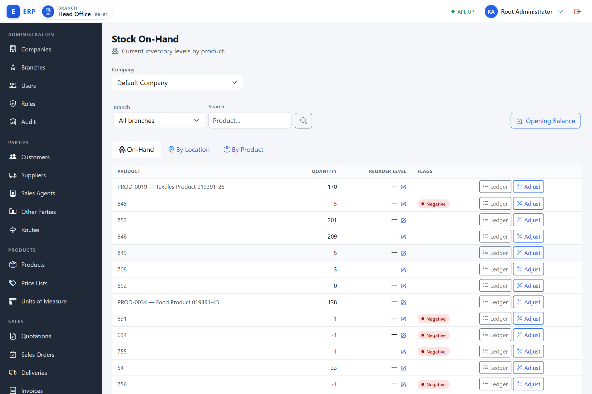
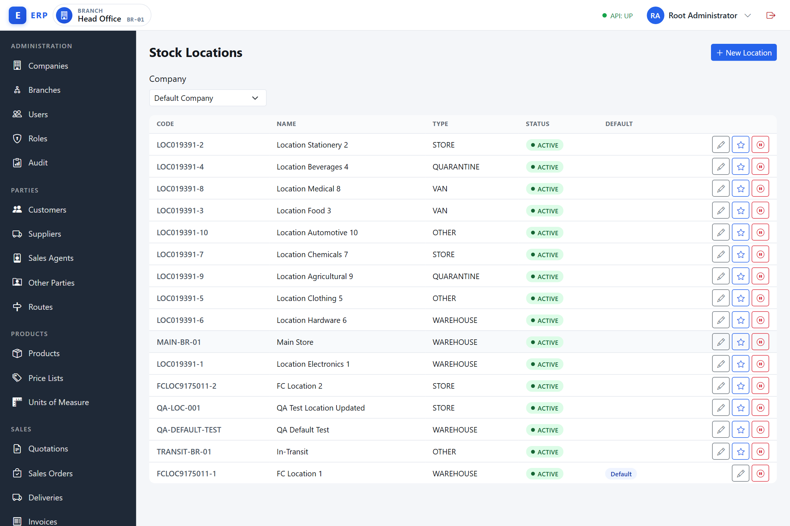
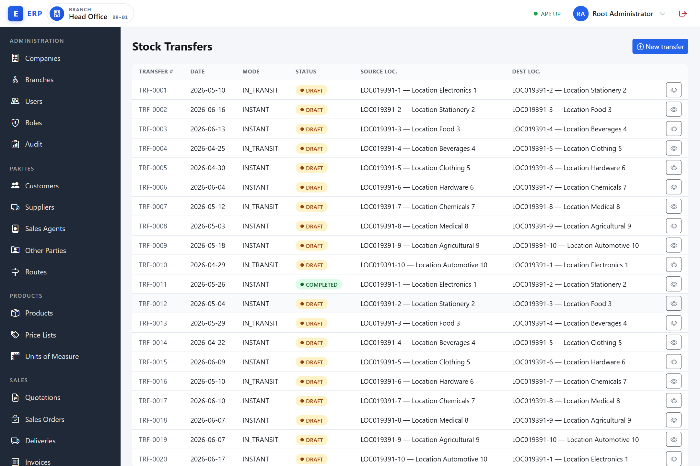
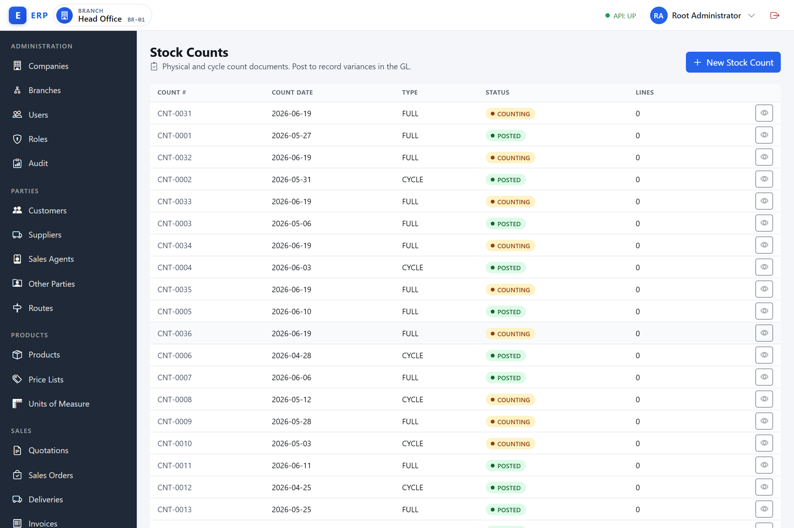
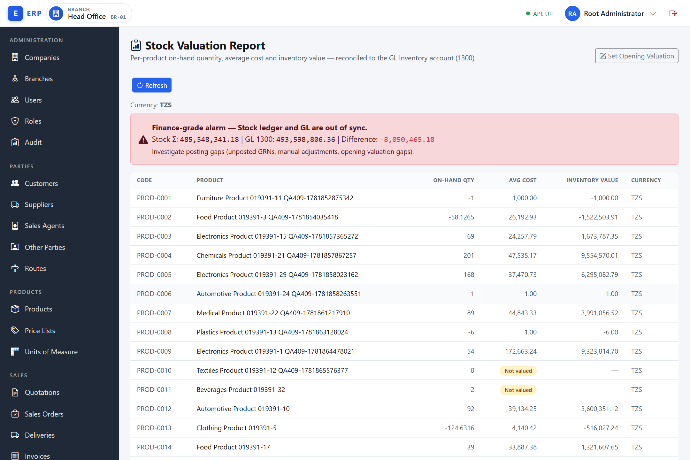
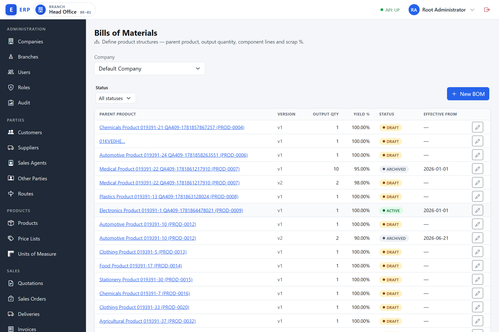
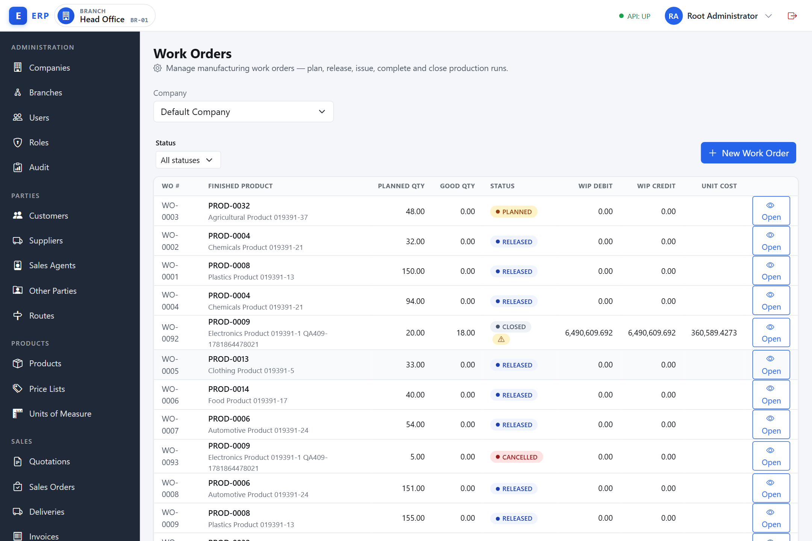

# Inventory and Manufacturing

This chapter covers all inventory screens — including the stock reports under the **Inventory** group — and the manufacturing (Bill of Materials and Work Orders) screens. All screens are available from the **Inventory** and **Manufacturing** groups in the left-hand navigation. Loading or correcting many stock levels at once from a spreadsheet is done with **Data Tools › Bulk Import** (entity type **Stock on-hand levels**) — see chapter 02, *Bulk Import*.

---

## 1. Permissions quick reference

Before starting, confirm that the required permission codes have been granted to your role.

| Task | Permission code required |
|---|---|
| View stock on-hand | `STOCK.VIEW` |
| Item Inquiry | `PRODUCT.VIEW` **and** `STOCK.VIEW` (the cost column also needs `INVENTORY.VALUATION.VIEW`) |
| Record adjustments / set reorder levels | `STOCK.ADJUST` |
| Record opening balances | `STOCK.OPENING` (entering an opening unit cost also needs `INVENTORY.OPENING.SET`) |
| Bulk stock import (set on hand from a spreadsheet) | `STOCK.IMPORT` |
| View stock locations | `STOCK.LOCATION.VIEW` |
| Manage stock locations | `STOCK.LOCATION.MANAGE` |
| View stock transfers | `STOCK.TRANSFER.VIEW` |
| Create / dispatch / cancel transfers | `STOCK.TRANSFER.CREATE` |
| Receive a transfer | `STOCK.TRANSFER.RECEIVE` |
| View stock counts | `STOCK.COUNT.VIEW` |
| Create / enter / cancel stock counts | `STOCK.COUNT.CREATE` |
| Post a stock count | `STOCK.COUNT.POST` |
| View van-stock reconciliations | `STOCK.VAN_RECON.VIEW` |
| Create / enter / reconcile / cancel a van reconciliation | `STOCK.VAN_RECON.MANAGE` |
| View stock batches (by-location / detail) | `STOCK.VIEW` |
| View stock serials (by-location / by-product / lookup) | `STOCK.VIEW` |
| View expiring batches | `INVENTORY.EXPIRY.VIEW` |
| View the Stock Valuation report, both Stock Reports, Product List, Stock Value and Stock Ageing | `INVENTORY.VALUATION.VIEW` |
| Reorder Report | `STOCK.VIEW` |
| Export or print a report or a transfer note | `REPORT.EXPORT` (in addition to the screen's own permission) |
| Set opening valuation | `INVENTORY.OPENING.SET` |
| View / manage Bills of Materials | `BOM.VIEW` / `BOM.MANAGE` |
| View Work Orders / cost report / WIP | `MANUFACTURING.VIEW` |
| Create / edit / cancel Work Orders | `WORKORDER.MANAGE` |
| Release a Work Order | `WORKORDER.RELEASE` |
| Complete / close a Work Order | `WORKORDER.CLOSE` |

Navigation items are hidden when the corresponding permission is absent. Attempting to access a route directly without the permission shows a **Forbidden** message.

---

## 2. Stock on-hand

**What "stock on-hand" means.**
Stock on-hand is the quantity of a product that is physically present and available at a branch right now. It is the central fact the business needs to answer questions like "how many bags of cement do we have?", "can we fulfil this order?", and "are we running low on cooking oil?" The system maintains this number in real time: every goods receipt adds to it, every sale or delivery deducts from it, and every adjustment, transfer, or stock count correction changes it. The on-hand figure is in the product's base unit (e.g. kilogrammes, pieces, bags) and is accurate to three decimal places.

**Why it is maintained as a running balance, not derived from history.**
The system stores both a maintained on-hand balance and an append-only movement ledger. The maintained balance gives an instant O(1) answer to "what do we have right now" — crucial for fast sales processing and re-order decisions. The ledger provides the full history and lets the balance be independently verified (on-hand should always equal the sum of all movements). Both are always in sync: every movement updates both the ledger and the balance in the same database transaction, so they can never diverge.

### 2.1 Viewing the on-hand list

Navigate to **Inventory > Stock On-Hand** (`/admin/stock`).



The table shows every stockable product that has had at least one movement at the active branch. The columns are **Product** (code and name shown together), **Quantity** (on-hand, in the base unit), **Reorder Level**, **Flags**, and an actions column (**Ledger**, and **Adjust** for users with `STOCK.ADJUST`). There is no separate unit-of-measure column. Two derived flags can appear in the **Flags** column:

- **Negative** — the quantity has gone below zero (possible only at a location set to allow negative stock).
- **Low** — the quantity is at or below the reorder level. This flag is blank when no reorder level applies.

**Filtering and pagination.** Type in the **Search** box (product name or code) — the list refreshes after a short pause, or click **Search**. Use the paginator controls (First, Previous, page numbers, Next, Last) to move between pages. The paginator hides itself when there is only one page.

**Toolbar buttons.** **Adjust Stock** opens the adjustment form for any product (section 2.2) and **Opening Balance** opens the opening-balance form (section 2.3). The sidebar entry **Inventory › Adjust Stock** (`/admin/stock/adjust`) opens this same screen with the adjustment form already open.

**Switching views.** The list offers three view modes via the buttons at the top:

- **On-Hand** (default) — one row per product, summed across all locations.
- **By Location** — choose a **Branch** first; one row per location and product with **Qty**, **Avg Cost**, **On-Hand Value** and **Ccy**.
- **By Product** — search a product by code or name to see its **Qty**, **Avg Cost**, **On-Hand Value** and **Ccy** at every location holding it.

In the By Location and By Product views a **Company** selector appears if you work for more than one company.

### 2.2 Recording a manual adjustment

**What a stock adjustment is.**
A stock adjustment is a direct correction to the on-hand quantity of a specific product when the physical stock and the system quantity do not agree for a reason other than a formal stock count. Adjustments are used for damage, spoilage, theft, unexplained shrinkage, or errors discovered after the fact. Every adjustment is permanent, carries a mandatory reason, and is reflected in the movement ledger immediately.

**Why adjustments exist separately from stock counts.**
An adjustment is a single-product, immediate correction — useful for fixing a known discrepancy right away without pausing all other operations. A stock count (section 5) is a systematic, multi-product reconciliation exercise at a location that freezes a snapshot and allows bulk entry across multiple sessions before committing. Use adjustments for one-off corrections; use stock counts for periodic reconciliation.

Use an adjustment to correct a stock quantity that is wrong for any reason other than a planned physical count (which has its own workflow — see section 5).

1. Open the adjustment form in one of three ways: the sidebar entry **Inventory › Adjust Stock**, the **Adjust Stock** button above the on-hand list, or **Adjust** on a product row (which pre-selects that product).
2. Choose how to enter the change:
   - **Adjust by (±)** — type the difference in **Qty (±)**: positive to add, negative to remove.
   - **Set to counted quantity** — the form shows the **Current qty** (with a pack breakdown, for example "3 cartons + 4 pieces", where the item has pack sizes); type the **New counted qty** and the system works out the difference for you.
3. If you opened the form from the toolbar or the sidebar, search the **Product** by name or code.
4. If the item has pack sizes, choose the **Unit** you are counting in (for example a carton of 24); the equivalent in base units is shown beneath.
5. If the item is held at more than one location in the branch, choose the **Location** (each option shows the quantity there).
6. Choose the **Reason** from the dropdown:

| Reason code | When to use |
|---|---|
| `COUNT_CORRECTION` | Correcting after an informal count |
| `DAMAGE` | Goods physically damaged |
| `SHRINKAGE` | Unexplained loss |
| `EXPIRY` | Goods past their expiry date |
| `RECEIPT_CORRECTION` | Correcting a goods-receipt error |
| `OTHER` | Any other reason — add a note |

7. Optionally add a **Note**.
8. Click **Save**.

The system creates a new stock movement (`ADJUSTMENT`) valued at the item's current average cost, posts the value difference to the ledger (Stock Adjustment against Inventory), and reloads the on-hand list. Adjustments are permanent records; they cannot be deleted or edited after posting.

**Validation.** The change must be non-zero and a reason is required. A decrease that would take the location below zero is refused — "Not enough stock to remove … only … on hand at this location, which does not allow negative stock." — unless the location is set to allow negative stock. A role with only `STOCK.VIEW` cannot see the Adjust buttons; a direct API call returns 403.

### 2.3 Recording an opening balance

**What an opening balance is.**
An opening balance is the initial stock quantity entered for a product at a branch that has no prior movement history. It is the "starting point" for that product at that location — the quantity that existed before the system began tracking it. This is a one-time operation; once a product has any movement at a branch, its on-hand can only be changed by the normal transaction flows (receipts, sales, adjustments, etc.).

**When to use it.**
Opening balances are entered at go-live (when migrating from a previous system or manual records), when a new branch is opened, or when a new product is added and stock already exists that needs to be brought onto the books.

An opening balance sets the initial quantity for a product that has never had any movement at this branch. Use this task at go-live or when adding a new branch or product.

1. On the on-hand list, click **Opening Balance**.
2. Search the **Product** by name or code and pick it.
3. Enter the **Quantity** (greater than zero). If the item has pack sizes, choose the **Unit** you counted in; the base-unit equivalent is shown.
4. Users who also hold `INVENTORY.OPENING.SET` see a **Unit cost** field — the cost per unit chosen. Leave it blank to use the product's cost price. (Without that permission the stock is recorded at the product's cost if one exists, or left unvalued for the accountant to value later — section 9.2.)
5. Optionally add a **Note** such as `go-live`.
6. Click **Record**.

**Important.** An opening balance is only for an item with no stock activity yet at the active branch. If the item has already had a sale, receipt, transfer or adjustment there, the system refuses with "This product already has stock activity at this branch …, so an opening balance can no longer be entered. Use Adjust Stock to correct the quantity." (A reservation from a sales order does not count as activity.)

### 2.4 Setting a reorder level

**What a reorder level is.**
A reorder level (also called a reorder point or minimum stock level) is the quantity at which a product should be reordered. When on-hand falls to or below the reorder level, the system flags the product row with the **Low Stock** indicator. This is a monitoring tool — the flag is a signal to the purchasing team to raise a requisition; it does not automatically place an order.

A reorder level triggers the Low Stock flag when the on-hand quantity reaches or falls below it.

1. On the on-hand list, click the inline edit icon in the **Reorder Level** column.
2. Enter a number (zero or more) and click the tick to save. To remove the location's own level, clear the field and save.

The Low flag recalculates immediately after saving.

**Product-level reorder levels.** A reorder level can also be set on the product itself (Product Master, chapter 02). When the stock line has no level of its own, the product's level applies — the column shows it with an asterisk (for example `20*`, "From the product (no level set for this location)"), and it drives the **Low** flag, the Reorder Report and the low-stock notification in exactly the same way.

### 2.5 Viewing movement history

**What the movement ledger is.**
The movement ledger is the append-only record of every quantity change for a product at a branch — every goods receipt, every sale issue, every adjustment, every transfer in or out, every opening balance, every production issue and receipt. It is the audit trail for on-hand. Because movements are append-only (never edited or deleted), the ledger is tamper-evident: the on-hand balance can always be recomputed by summing all movements.

Click **Ledger** on a product row to open the movement ledger panel (its header reads **Ledger — <product>**). Movements are displayed with the columns **Date**, **Type** (Goods Receipt, Sale Issue, Adjustment, Opening Balance, Transfer In/Out, etc.), **Dir** (IN or OUT), **Qty**, **Reason**, **Note** and **Source Doc** (the kind of document that caused it).

The panel has its own paginator. Movements are append-only records; there is no edit or delete. For a printable movement history over a date range, use **Stock Report (Opening & Closing)** in *Detail* mode (section 9.6).

### 2.6 Item Inquiry — look up one item

Navigate to **Inventory > Item Inquiry** (`/admin/stock/item-inquiry`). Requires `PRODUCT.VIEW` **and** `STOCK.VIEW`.

**What it is.** A quick counter lookup: what an item is, what it costs, what you sell it for and how many are left — without opening the product catalogue. It is built for the person serving a customer, so it is a search with a short answer, not a full listing.

**How to use it.**

1. Type in **Item** — an item code, part of the description, or scan a barcode. Results appear as you type (a scanned barcode must be complete to match). Alternatively, choose one item in **Or select an item**.
2. Optionally choose a **Branch**; leave it at **All branches** to see the total across the branches you may see.
3. The results table lists the matching items with **Code**, **Description**, **Department**, **Supplier**, **Unit**, **Available** (quantity on hand in the item's own unit, or "Not stocked" for a service or non-stock item), **Cost**, and **Selling price** (labelled *VAT incl.* or *excl. VAT* according to your default price list). A line above the table states the branch, currency and price list used.
4. Choosing a single item shows a card for it with the same facts; click **Close** to return to the list.

**Things to know.**

- **Cost** is shown only to users who may see cost (`INVENTORY.VALUATION.VIEW`); everyone else sees **Hidden** — never a misleading zero.
- A dash means the figure is not known (the item was never costed or never priced) — it does not mean zero.
- Selling prices come from the company's **default price list**. If none is set, the screen says so and the price column stays blank.
- Only the first screenful of matches is shown; when the list is clipped, the screen asks you to type more of the code or description.

---

## 3. Stock locations

Navigate to **Inventory > Stock Locations** (`/admin/stock/locations`).



**What a stock location is.**
A stock location is a named physical area within a branch where stock is stored and counted. Locations let a business track stock at a finer level than the branch — for example, distinguishing between the main warehouse, the shop floor, a quarantine area for goods awaiting inspection, and a van for a mobile sales team. Every stock movement and stock count is associated with a specific location, so the system can answer not just "how many bags of cement does the Dar es Salaam branch have?" but "how many are in the Warehouse versus the Store?"

**Why locations exist.**
Without locations, the business knows only how much stock is at a branch in aggregate. With locations, it can see where exactly the stock is, which is essential for efficient warehousing, picking, physical counting, and segregating goods that should not be issued until inspected. Locations are also the boundary for stock counts — a count covers one location at a time.

**Finding locations across branches.** The list shows locations for one branch at a time, chosen from the **Branch** filter above the table. It defaults to your active branch (the one set by the branch switcher), and the filter lists **every** branch in the company — not only the branches you are assigned to. If you pick a branch you are not assigned to, the list responds with a **Forbidden** message (the same `STOCK.LOCATION.VIEW` scope that guards the screen). For a branch you *are* assigned to, a location created for it is no longer invisible — it simply appears once you filter to that branch. After you create a new location, the filter switches automatically to the branch it was created for, so the new row is visible immediately without an extra step.

### Location types

| Type | Typical use |
|---|---|
| `WAREHOUSE` | Main storage area |
| `STORE` | Shop floor / retail |
| `VAN` | Mobile / vehicle storage |
| `QUARANTINE` | Held goods pending inspection |
| `OTHER` | Any other purpose |

### 3.1 Creating a location

1. Click **New Location** (the button toggles to **Cancel** while the form is open).
2. Enter a short **Code** (up to 30 characters, unique in the company; codes starting with `TRANSIT-` are reserved for the system) and a **Name** (up to 120 characters).
3. Choose the **Type**.
4. Pick the **Branch** from the picker.
5. If you chose the **VAN** type, an **Agent** picker appears. Optionally select the route agent who runs this van — the hint reads *"Assigns this van to the route agent who runs it."* The assignment is company-scoped and carries onto that van's day-end reconciliation worksheets (section 6). The Agent field is shown only for VAN locations; switching the type away from VAN clears it. An agent can run only one active van at a time.
6. Tick **Set as default** if this should be the primary location for the branch. There can be only one default location per branch — making a new location the default automatically clears the prior one.
7. Click **Create Location**.

New locations are created in **Active** status.

### 3.2 Editing a location

Click the edit icon on a row. You can change the name and location type. The code is not editable after creation. For a **VAN** location, the row also exposes an **Agent** picker so you can assign, reassign, or clear (choose "No agent") the route agent — the current agent is shown in the list's **Agent** column.

### 3.3 Marking as default

In the row's Actions column, click the star icon button (its accessible label is "Set <code> as default") on any active, non-default location. The previous default is cleared automatically.

### 3.4 Deactivating and reactivating

In the row's Actions column, click the pause-circle icon button (accessible label "Deactivate <code>") to set the location to **Inactive**. It no longer appears in pickers used by transfers and counts. Click the play-circle icon button (accessible label "Reactivate <code>") to restore it to Active.

A location that **still holds stock** cannot be deactivated — transfer or adjust it to zero first. The branch **default** location cannot be deactivated either; make another location the default first.

Locations are never hard-deleted. The list always shows every location, both Active and Inactive — there is no status filter, so an Inactive location and its history simply remain visible in the list.

### 3.5 The in-transit location (system)

Every branch has one system location whose code starts with `TRANSIT-` (for example `TRANSIT-DSM`), marked **In transit (system)** in the list. It holds goods that have been dispatched to this branch on an in-transit transfer but not yet received (section 4). You may rename it, but you cannot change its type, make it the default, deactivate it, or pick it as the source or destination of a transfer. Stock sitting in it is not sellable.

---

## 4. Stock transfers

Navigate to **Inventory > Stock Transfers** (`/admin/stock-transfers`).



**What a stock transfer is.**
A stock transfer is a document that moves stock from one physical location to another — either between two locations within the same branch (for example, from the Warehouse to the Store) or between two different branches (for example, from the Arusha branch to the Dar es Salaam branch). A transfer records a physical movement of goods without buying or selling them; it re-attributes stock from one place to another.

**Why transfers do not affect the income statement.**
A transfer does not create a sale (no revenue, no COGS) and is not a purchase (no supplier, no invoice). It is a value-preserving internal movement: the cost of the goods is the same before and after the transfer — it has simply moved to a different location. The goods move at the system average cost, so the total value of inventory does not change; it is only re-attributed between locations and branches.

**When transfers are used.**
Transfers are used when stock needs to be redistributed — to replenish a retail store from a warehouse, to send stock to another branch, to move goods to a van for a field sales team, or to consolidate slow-moving inventory at one location. The `STOCK.TRANSFER.CREATE` permission is required to create, dispatch, complete and cancel; `STOCK.TRANSFER.RECEIVE` is required to receive.

**How transfers flow — two modes.** Both modes work within a branch and between branches; the choice is whether anybody at the destination has to confirm the goods.

- **Instant** — "stock moves straight away, nobody has to confirm". The stock leaves the source and arrives at the destination the moment you complete the transfer. Steps: DRAFT → COMPLETED.
- **In-transit** — "the destination must receive it before the stock lands". You dispatch the stock and someone at the destination receives it before it counts as theirs. Between dispatch and receipt the goods sit in the destination branch's **in-transit location** (section 3.5): they are not sellable at either end, and the Stock Report shows them as "in transit". Steps: DRAFT → DISPATCHED → RECEIVED.

**Who acts where.** Only the source branch can dispatch or complete a transfer, and only the destination branch can receive it — a sender who could also "receive" would make the confirmation prove nothing. If you open a transfer while switched into the wrong branch, the detail page tells you which branch to switch to (for example "Switch to DSM Branch to dispatch this transfer.").

> **Note.** Sending stock somewhere that does not use the system — a roadside kiosk, a van, a customer site? Register it as a branch that nobody logs into, give it one location, and transfer to it in **Instant** mode. The stock moves out of your warehouse and sits under that branch; no one there needs an account, and nothing waits to be confirmed.

### Transfer status lifecycle

```
DRAFT
  |-- (Instant mode)  --> COMPLETED
  |-- (In-transit mode) -> DISPATCHED --> RECEIVED
  \-- (any mode, before dispatch) --> CANCELLED
```

### 4.1 Creating a transfer

1. On the Stock Transfers list click **New transfer** (`/admin/stock-transfers/create`). The **New Stock Transfer** form opens.
2. Under **Transfer Details**, choose the **Transfer Mode** (**In-transit** or **Instant** — the form explains each) and set the **Transfer Date**.
3. Under **Source**, pick the **Source Branch** and **Source Location**.
4. Under **Destination**, pick the **Destination Branch** and **Destination Location**. Source and destination must be different locations.
5. Under **Line Items**, for each product pick the **Product**, choose the **Unit** you are moving it in (for example cartons — the list shows the item's pack sizes, or "Item's own unit"), and enter the **Qty**. Click **Add line** for another product; **Remove** drops a line.
6. Optionally enter a **Unit cost** per line. It is for reference only: it is shown on the transfer and its printout, but the stock is still valued at the system average cost. It is pre-filled with the average cost when you may see costs — change it freely.
7. Optionally add **Notes**, then click **Create Transfer**.

The transfer is created with status **Draft** and a system-generated transfer number. The screen navigates to the transfer detail.

**Validation.** Source and destination locations must differ, and the in-transit location cannot be chosen. At least one line is required; each quantity must be positive. Service (non-stock) items cannot be transferred, and the same product may not appear on two lines — combine them into one. Transfer date is required.

### 4.2 Dispatching an in-transit transfer

On a Draft, In-transit transfer, click **Dispatch** (while switched into the source branch). The status changes to **Dispatched**, the source location's stock decreases immediately and the goods move into the destination branch's in-transit location.

The Dispatch button is only available when the transfer is in Draft status, the mode is In-transit and you are working in the source branch. Dispatching requires the `STOCK.TRANSFER.CREATE` permission.

**Insufficient source stock.** If the source location does not allow negative stock, dispatch is rejected (409 Conflict) when the available quantity at the source is less than the quantity being transferred — the message reports the available and requested quantities and states that the source location does not allow negative stock (it does not name the product, so check the transfer's lines to see which one is short). The transfer stays in Draft so you can correct the lines or top up the source. (A source location whose `allowNegative` flag is set will let the dispatch proceed and the source on-hand can go negative.)

### 4.3 Receiving an in-transit transfer

On a Dispatched transfer, the destination operator — switched into the destination branch — clicks **Receive**. The status changes to **Received**, and the goods leave the in-transit location and land in the destination location.

Receiving requires the `STOCK.TRANSFER.RECEIVE` permission. This allows organisations to separate the dispatcher and receiver roles.

### 4.4 Completing an instant transfer

On a Draft, Instant transfer, click **Complete (Instant)** (while switched into the source branch). The transfer completes in a single step; both locations update simultaneously. As with dispatch, completion is rejected (409 Conflict) if the source location does not allow negative stock and the available quantity is less than the quantity being transferred.

### 4.5 Cancelling a transfer

On a Draft transfer, click **Cancel**. The status changes to **Cancelled** and no stock movement is recorded. Only Draft transfers can be cancelled.

### 4.6 Viewing the transfer list and detail

The list shows **Transfer #**, **Date**, **Mode**, **Status** and **Route** (source branch and location → destination branch and location). Narrow it with the filters above the table:

- **Branch** — **This branch (in or out)** (the default), **Incoming to this branch**, **Outgoing from this branch**, or **All branches**.
- **Status** — Any, or one status.
- **From** / **To** — transfer date range.
- **Transfer #** — search by number. **Clear** resets the filters.

To open the detail view, click the **View** action (eye icon) in the row's Actions column — there is no row-click. The detail shows the route, mode, date, dispatched/received times and notes, and the **Line Items**: **Code**, **Product**, **Unit**, **Qty**, and the value of each line at the **Price** the system holds (its average cost) with the line **Value** and **Currency**. When unit costs were typed on the transfer, the table shows both **System price / System value** and **Entered price / Entered value** — the entered figures are for reference only; stock is valued at the system price. Lines with no cost on record show a dash and are left out of the total, and the screen says how many.

### 4.7 Printing a transfer note

Users with `REPORT.EXPORT` see **Print / PDF** and **Excel** at the top of the transfer detail. The transfer note carries your logo, the route, each line with its unit price and value, and who printed it — hand it to the driver and have the receiving branch sign it.

---

**Example — In-transit dispatch from Arusha Warehouse to DSM Store:**

Storekeeper Grace Mwenda at Arusha branch needs to send 200 bags of Pembe Flour and 50 cartons of Cooking Oil to the Dar es Salaam main store.

1. Navigate to **Inventory › Stock Transfers** and click **New transfer** (`/admin/stock-transfers/create`).
2. Transfer Mode: **In-transit**; Transfer Date: `2026-06-10`.
3. Source Branch: `Arusha Branch`; Source Location: `Arusha Warehouse`.
4. Destination Branch: `DSM Branch`; Destination Location: `DSM Main Store`.
5. Add lines:
   - Product: `Pembe Flour 2kg (FLR-002)`, Unit: `Bag`, Qty: `200`.
   - Product: `Cooking Oil 3L (OIL-003)`, Unit: `Carton`, Qty: `50`.
6. Click **Create Transfer**. Transfer `TRF-0042` is created with status **Draft**.
7. Grace reviews the lines, clicks **Print / PDF** to give the driver a transfer note, and clicks **Dispatch**. Status becomes **Dispatched**. The Arusha Warehouse stock for both items decreases immediately (200 bags and 50 cartons deducted); the goods now sit in DSM Branch's in-transit location.
8. The following day, DSM storekeeper Omari Njau, switched into DSM Branch, opens **Inventory › Stock Transfers** (`/admin/stock-transfers`), sets the **Branch** filter to **Incoming to this branch**, finds `TRF-0042` with status Dispatched, and clicks the **View** action (eye icon) to open the detail.
9. Omari counts the physical delivery — both lines match — and clicks **Receive**. Status becomes **Received**. DSM Main Store stock increases by 200 bags and 50 cartons.
10. Both storekeepers can now see `TRF-0042` with status **Received** in the transfer list. No cancellation is possible at this stage.

---

## 5. Stock counts

Navigate to **Inventory > Stock Counts** (`/admin/stock-counts`).



**What a stock count is.**
A stock count (also called a physical inventory or stocktake) is a scheduled exercise where a team physically counts the items held at a location and compares the counted quantities to the quantities the system believes are there. Any discrepancy (a "variance") is recorded and — after review — posted as an adjustment to bring the system records into alignment with physical reality.

**Why stock counts are necessary.**
Even in a well-run warehouse, small discrepancies accumulate over time: items get damaged and not immediately reported, products are picked without being scanned, counting errors occur during receipts, or theft occurs. Without periodic counts, these discrepancies compound silently and the business makes decisions (ordering, sales commitments, valuations) based on wrong numbers. A stock count is the mechanism to catch and correct these discrepancies systematically. Unlike ad-hoc adjustments, a count involves a controlled snapshot of the entire location's stock at a point in time, multi-session entry, and formal posting — producing an auditable record of what was found versus what was expected.

**How variances affect the books.**
When a count is posted, each line with a variance is converted into a stock adjustment movement at the current moving-average cost. The value difference is posted to the `STOCK_ADJUSTMENT` expense account (5160) against the `INVENTORY` account (1300). A negative variance (less found than expected) is an expense; a positive variance is a credit to the adjustment account. This ensures the inventory balance on the balance sheet and the GL always stay in sync.

**When it is used.**
Stock counts are run periodically — monthly, quarterly, or annually depending on the business's risk appetite and the volatility of the products. **Full** counts cover all products at a location. **Cycle** counts cover only the products you pick (for example, high-value or fast-moving lines), allowing more frequent reconciliation without counting everything at once. The `STOCK.COUNT.CREATE` permission is needed to create and enter counts; `STOCK.COUNT.POST` (typically held by an accountant or supervisor) is needed to post the variances.

A stock count records what is physically present at a location and reconciles it against the system quantity. Any variance is posted as a stock adjustment and a GL entry.

### Count status lifecycle

```
COUNTING --> POSTED
     \-----> CANCELLED
```

When a count is created the system immediately freezes the on-hand quantities (the snapshot) and moves the document to **Counting** status.

### 5.1 Creating a stock count

1. On the Stock Counts list click **New Stock Count** (`/admin/stock-counts/create`).
2. Select the **Company** and **Branch**. (The Company selector appears only when you have access to more than one company, and the Branch selector only when the chosen company has more than one branch; otherwise the single company/branch is used automatically and no selector is shown.)
3. Pick the **Stock Location** from the picker.
4. Set the **Count Date** (defaults to today).
5. Choose the **Count Type** — the on-screen hint reads *"FULL = entire location. CYCLE = selected products."*:
   - **FULL** — all products held at the location are included.
   - **CYCLE** — a **Products to count** box appears. Search by name, code or barcode and pick each product; the picked items are listed (remove one with its ✕) with a count such as "3 selected. Only items held at this location are counted." A cycle count with no products picked is refused — choose products, or use a FULL count.
6. Optionally add **Notes**, then click **Create Count**.

The count is created with status **Counting** and a system-generated count number. The system records the current on-hand quantity for each product as the **System Qty** snapshot.

### 5.2 Entering counted quantities

Open the count detail. The **Count Lines** table shows each product with its **Unit**, **System Qty** (with a pack breakdown where the item has pack sizes) and **Counted Qty**. For each product line:

1. If the item has pack sizes, you may choose the unit you counted in from the **Unit** dropdown (for example cartons); the equivalent in base units is shown under the quantity.
2. Enter the physically counted quantity in the **Counted Qty** column.
3. Optionally type a reason in the **Reason** box on lines that have a variance (for example `SHRINKAGE`); a line without one posts as `COUNT_CORRECTION`.
4. Click **Save Counted Qtys**.

The document stays in Counting status after saving. You can enter counts in multiple sessions; a line's figure can be corrected by entering it again.

**Selling while you count.** The variance is measured as at the moment each line was counted, not at the moment of posting. If items are sold, received or transferred at the location between counting a line and posting the count, those movements are allowed for — they do not turn into false gains or losses.

### 5.3 Posting a count

Posting creates stock adjustment movements for every line with a variance and generates a single GL variance journal.

1. Open a count in Counting status.
2. Click **Post Count** to reveal the **Post Count & Record Variance** form — "This action is irreversible."
3. Enter the **Posting Date**.
4. Click **Confirm Post**.

Posting requires the `STOCK.COUNT.POST` permission (typically held by an accountant or supervisor). After posting, the document is read-only: the table gains **Variance Qty** (`Counted − System`; positive means more was found than expected), **Unit Cost** and **Variance Value** columns, the header shows **Posted At**, and a **View Variance Journal** link opens the GL entry. The variance is posted to the ledger once.

### 5.4 Cancelling a count

Open a Counting count and click **Cancel Count**. No stock movements or GL entries are created. A Posted count cannot be cancelled. If corrections are needed after posting, create a new count.

---

**Example — Cycle count of sugar and rice with a variance posted:**

Accountant supervisor Boniface Kessy wants to reconcile two fast-moving products at the DSM Main Store.

1. Navigate to **Inventory › Stock Counts** and click **New Stock Count** (`/admin/stock-counts/create`).
2. Company: `Kijenge Trading Ltd`; Branch: `DSM Branch`; Location: `DSM Main Store`; Count Date: `2026-06-12`; Count Type: **CYCLE**. In **Products to count** he picks Sugar and Rice.
3. Click **Create Count**.
4. Count `CNT-0009` is created with status **Counting** and two lines: Sugar (System Qty 850 bags) and Rice (System Qty 240 bags).
5. Storekeeper Omari Njau physically counts the two shelves. He opens `CNT-0009` and enters:
   - Sugar counted: `843` (variance: −7 bags).
   - Rice counted: `245` (variance: +5 bags).
   - In the **Reason** box on the Sugar line he types `SHRINKAGE`. For Rice no reason is needed (positive variance — unrecorded receipt correction).
   Click **Save Counted Qtys**.
6. Boniface reviews the figures and clicks **Post Count**. Posting Date: `2026-06-12`. Confirms. (On a FULL count, lines with no counted quantity entered are treated as no-variance and post nothing.)
7. The system posts two stock adjustment movements:
   - Sugar: −7 bags (ADJUSTMENT, reason SHRINKAGE).
   - Rice: +5 bags (ADJUSTMENT).
   A single GL variance journal posts: DR Inventory Variance / CR Inventory for the sugar loss (valued at moving-average cost); the rice surplus reverses this direction.
8. The count document is now read-only with status **Posted**. On-hand quantities at DSM Main Store are now: Sugar = 843, Rice = 245.

---

## 6. Van-stock reconciliation

Navigate to **Inventory > Van Reconciliations** (`/admin/van-reconciliations`). The screen is headed **Van-Stock Reconciliations**.


**What a van reconciliation is.**
A van-stock reconciliation is the day-end route worksheet for a mobile (van) sales team. At the start of the day a van is loaded with stock (via stock transfers into the van's location); the driver-salesperson sells along the route and returns any unsold stock at the end of the day. The reconciliation is the sheet that answers, product by product, the question: *did the stock that left the van get accounted for by sales plus returns?* For each product it lays out **Loaded − Sold − Returned = Expected** on the van, then compares that Expected figure against the **Physical** count of what is actually still on the van. Any gap is the **Variance**.

**Why it is record-only.**
The reconciliation is a control and monitoring document, not an accounting transaction. It does **not** post any stock movement or GL entry — the underlying stock has already moved through the normal flows (transfers loaded the van, sales issued stock out, transfer-returns brought stock back). Reconciling simply freezes the worksheet as the day's agreed record and flags any variance for a supervisor to investigate (a shortage may mean under-reported cash sales, theft, or a miscount). If a variance needs to correct the books, that is done separately through a stock adjustment (section 2.2) or a stock count (section 5) — the reconciliation itself never touches on-hand.

**The van ↔ agent link.**
A VAN-type stock location can be assigned a **route agent** on the Stock Locations screen (section 3) — the person who runs that van. When a reconciliation is created for a van location, the assigned agent's name is carried onto the worksheet and shown in the list and header, so each day's sheet is attributable to the person responsible for the van. Assigning an agent is optional and applies only to VAN-type locations.

### Reconciliation status lifecycle

```
OPEN --> RECONCILED
     \-> CANCELLED
```

A reconciliation is created **Open** and stays editable until it is either **Reconciled** (frozen as the final record) or **Cancelled**. Reconciled and Cancelled are both terminal — a frozen sheet cannot be reopened; create a new one if corrections are needed.

### 6.1 Creating a reconciliation

1. On the Van-Stock Reconciliations list, click **New Reconciliation** (`/admin/van-reconciliations/new`).
2. Select the **Company** and **Branch**. (The Company selector appears only when you have access to more than one company, and the Branch selector only when the chosen company has more than one branch; otherwise the single company/branch is used automatically.)
3. Pick the **Van Location** from the picker. Only **VAN**-type locations for the branch are listed; each option shows the van's code and, where set, its assigned agent. If the branch has no VAN locations, a "No VAN-type locations found for this branch" hint is shown — create a VAN location first (section 3.1) and, ideally, assign its agent.
4. Set the **Business Date** (defaults to today) — the route day being reconciled.
5. Optionally add **Notes**.
6. Click **Create Reconciliation**.

The reconciliation is created with status **Open** and a system-generated reconciliation number (shown as **Recon #**). The screen opens the worksheet directly.

**How the lines are pre-filled.** On creation the system reads the van's transfer activity for that business date and pre-fills one line per product that moved through the van, with:

- **Loaded** — the total stock transferred *into* the van location that day (the sum of Transfer-In movements).
- **Returned** — the total stock transferred *out of* the van that day (the returns).

Both figures are pre-filled but remain **editable** on the worksheet, so you can correct them if the physical reality differs from the recorded transfers.

**One per van per day.** Only one reconciliation can exist for a given van on a given business date. Attempting to create a second returns "A van reconciliation for this van on this business date already exists" — open the existing one instead.

### 6.2 Entering sold and physical counts

Open an Open reconciliation. The lines grid has one row per product with seven columns: **Product**, **Loaded**, **Sold**, **Returned**, **Expected**, **Physical**, and **Variance**. While the sheet is Open (and you have manage permission), the Loaded, Sold, Returned, and Physical cells are editable; Expected and Variance are computed live and cannot be typed.

1. For each product, enter the **Sold** quantity — the total sold off the van that day. This is the one figure the system cannot derive for you (it is not in the stock ledger), so it must be entered.
2. Enter the **Physical** count — what is actually still on the van at day-end. Leave it blank on any line you have not yet counted.
3. Adjust the pre-filled **Loaded** or **Returned** figures on any line where the recorded transfers do not match reality.
4. Click **Save Lines**.

As you type, the worksheet recomputes each row instantly:

- **Expected = Loaded − Sold − Returned** — how much *should* still be on the van.
- **Variance = Physical − Expected** — the discrepancy. It is only computed once a Physical count is entered; until then the row shows **Not counted**.

The Variance cell is tagged for quick scanning:

| Tag | Meaning |
|---|---|
| **Not counted** | No physical count entered yet — variance not computed. |
| **Balanced** | Physical matches Expected (within rounding) — nothing to explain. |
| **Over** | Physical exceeds Expected — a surplus on the van (e.g. sales were under-reported). Shown in green. |
| **Short** | Physical is less than Expected — a shortage. Shown in red. |

Where a snapshot unit cost is available, the row also shows the variance valued in money (variance quantity × unit cost). This is an indicative figure only — it is never posted to the ledger.

A row of **KPI tiles** above the grid totals Loaded, Sold, Returned, Expected, Physical, and Variance across all lines, giving the day's overall picture at a glance.

**Saving is a patch.** Save Lines records only the rows you actually edited this session; untouched rows keep their existing values. You can save partway through and come back — the sheet stays Open across sessions. You must enter a Sold or Physical value on at least one line before saving.

### 6.3 Reconciling

When the counts are complete and the variances are understood, click **Reconcile**. The status changes to **Reconciled**, the worksheet is frozen (the cells become read-only), and a green confirmation banner notes the reconcile time and restates that this is **record-only — no stock/GL posting**. A Reconciled sheet is the day's final agreed record for that van.

Reconciling requires the `STOCK.VAN_RECON.MANAGE` permission and is only available while the sheet is Open.

### 6.4 Cancelling

To discard a worksheet that was created in error or is no longer needed, click **Cancel** on an Open reconciliation. The status changes to **Cancelled** and the sheet becomes read-only. As with reconcile, no stock or GL entries are ever involved. A Cancelled sheet cannot be reopened — create a new reconciliation if one is still needed for that van and day.

### 6.5 Viewing the reconciliation list

The list shows every reconciliation for your active branch (switch the branch selector to see another branch's vans), with columns **Recon #**, **Van**, **Agent**, **Business Date**, and **Status**. Click the **View** action (eye icon) in a row to open its worksheet. Viewing requires `STOCK.VAN_RECON.VIEW`; the **New Reconciliation** button and all editing actions require `STOCK.VAN_RECON.MANAGE`.

---

## 7. Batches and lot tracking

Navigate to **Inventory > Stock Batches** (`/admin/stock/batches`). Requires the `STOCK.VIEW` permission.

**What a batch (lot) is.**
A batch — also called a lot — is a group of units of the same product that were manufactured or received together and share the same identity attributes, most importantly an expiry date and a manufacture date. For example, a batch of medicines all manufactured on the same day with the same expiry date is one lot. Batch tracking allows the business to know exactly which physical batch a unit came from — critical for food, pharmaceutical, and chemical products where recall or expiry management is required.

**Why batch tracking matters.**
Without lot tracking, if a product recall is announced (for example, a contaminated batch of cooking oil), the business cannot identify which specific units on its shelves belong to the recalled batch. With batch tracking, the system can identify every unit of that batch, where it is held, and how much remains — enabling targeted removal without wasting uninvolved stock. Batch tracking is also necessary for FEFO (First Expired, First Out) stock rotation: the system ensures that stock with the earliest expiry date is issued first, minimising spoilage and waste.

**How batches are created.**
Batches are created automatically by the purchasing flow when lot-tracked products are received via a Goods Receipt — the system assigns a lot number and records the manufacture and expiry dates at that point. You cannot create batches manually on this screen.

**What happens when a Goods Receipt is voided.**
Voiding a Goods Receipt now backs out the batch quantities it created. When a receipt is voided, the system reverses the receipt movement and, for each lot-tracked line, reduces the batch's on-hand by the received quantity at the location it was received into — so a mistaken or reversed receipt no longer leaves a phantom batch on the books. The back-out is deliberately gentle: if the batch has already been partly consumed or the data cannot be matched cleanly, that line is skipped and logged rather than blocking the void. Voiding a receipt for a product with a blank lot number is still reversed (received-with-no-lot is tracked under an "untracked" lot placeholder). See chapter 4 (Purchasing) for how to void a Goods Receipt.

Batches (lots) are created automatically when lot-tracked products are received, and are backed out when that receipt is voided. This screen provides a read-only view; you cannot create or edit batches directly.

### 7.1 Viewing batches by location and product

1. Pick a **Location** from the picker.
2. Pick a **Product** from the picker.
3. The table lists all batches at that location for that product, showing lot number, manufacture date, expiry date, quantity on-hand, and an expiry flag.

### 7.2 Expiring batches report

Click the **Expiring Soon** tab. Set the **Expiring on or before** date (default: 30 days from today). The report lists all batches whose expiry date falls on or before the horizon and whose quantity is greater than zero.

- Batches already past their expiry date are flagged in red.
- Batches expiring before the horizon are flagged as a warning.

The expiring batches tab requires the `INVENTORY.EXPIRY.VIEW` permission.

---

## 8. Serial number tracking

Navigate to **Inventory > Serial Numbers** (`/admin/stock/serials`). Requires the `STOCK.VIEW` permission.

**What serial number tracking is.**
Serial number tracking assigns a unique identifier to each individual unit of a product — for example, every laptop, refrigerator, or generator has its own serial number. Unlike batches (which group many units of the same type), a serial identifies one specific physical item. The system records where each serial is, whether it is in stock, has been issued to a customer, or has been returned, giving full unit-level traceability.

**Why it is used.**
Serial tracking is valuable for high-value items, warranty management, and theft prevention. When a laptop is sold, the system records which serial number left the warehouse and to which customer. If a customer returns a laptop claiming it is faulty, the system confirms whether that serial was genuinely sold to them. Serial numbers also help with insurance claims (proving what was held) and regulatory compliance.

**How serials are managed.**
Serial numbers are created and updated automatically by the purchasing (goods receipt), sales (delivery), and transfer flows. This screen is a read-only view and lookup tool; you cannot create or modify serials directly here.

**What happens when a Goods Receipt is voided.**
Voiding a Goods Receipt now removes the serial numbers it brought into stock. For each serialised line on the voided receipt, the system deletes the serial records it created — but only while they are still **In-Stock**. A serial that has since been **Issued** (sold/delivered) or **Returned** is left untouched, so voiding a receipt can never wipe out the history of a unit that has already moved on. As with batches, any serial that cannot be cleanly matched is skipped and logged rather than blocking the void.

Serial numbers are assigned to individual units of serialised products. This screen is read-only; serials are created and updated by the purchasing, sales, and transfer flows, and In-Stock serials are removed when their originating receipt is voided.

The screen has two view-mode tabs: **By Location** and **Product History**.

### 8.1 Viewing serials by location

1. Select the **By Location** tab.
2. Pick a **Location** and a **Product**.
3. Optionally filter by **Status**: All, IN_STOCK, ISSUED, RETURNED.
4. The table shows serial number, current status, and the related documents.

### 8.2 Viewing serial history by product

Switch to the **Product History** tab. Pick a product to see all of its serials across all statuses and locations.

### 8.3 Looking up a serial number

There is no separate lookup tab. In the **By Location** tab, once a product is selected, a **Lookup by serial #** panel appears above the table. Type the serial number and click **Lookup**. The system returns the current status and related documents, or shows a "Serial number not found for this product" message if the serial does not exist for that product.

---

## 9. Inventory valuation and stock reports

**What inventory valuation is.**
Inventory valuation is the process of assigning a monetary value to the goods held in stock. The business needs to know not just how many units it has but what those units are worth — for the balance sheet (Inventory is an asset), for the cost of goods sold when items are sold (COGS reduces profit), and for management decisions (is this product profitable to sell?). The system uses the **moving-average cost method**: the average unit cost is recalculated each time stock is received, blending the new purchase cost with the existing average. This means all units of a product at a branch carry the same average cost, regardless of when they were purchased.

**How the moving average is maintained.**
When a goods receipt is posted, the system computes the new average as: `(existing stock value + new receipt value) / (existing quantity + received quantity)`. This weighted average is then applied to all units held. When goods are sold, the COGS is the quantity sold multiplied by the current average cost at the moment of the sale. When stock is adjusted, the adjustment value is computed at the current average. This means the Inventory account on the balance sheet always equals the sum of (on-hand quantity × average cost) across all products — a relationship the valuation report verifies.

### 9.1 Valuation report

Navigate to **Inventory > Stock Valuation** (`/admin/stock/valuation`). Requires the `INVENTORY.VALUATION.VIEW` permission.



The screen is headed **Stock Valuation Report**. It is not loaded automatically — the initial screen shows an empty state ("Click Refresh to load the current valuation"). Click **Refresh** to build the report. It then shows every stocked product with **Code**, **Product**, **On-Hand Qty**, **Avg Cost** (or **Not valued** when no cost has been established), **Inventory Value** and **Currency**, with the **Total Inventory Value** at the foot. A reconciliation bar at the top compares the sum of on-hand values (the stock ledger) against the GL inventory account balance:

- **Reconciled to GL** (green) — the stock ledger and GL agree.
- A red **Finance-grade alarm — Stock ledger and GL are out of sync** banner — there is a discrepancy. The stock total, the GL 1300 balance, and the difference amount are shown, and the **GL Reconciliation** card's status tag reads **Out of balance**. Finance review is required.

Users with `REPORT.EXPORT` can **Export PDF**, **Export Excel** or **Export CSV**; users with `INVENTORY.OPENING.SET` see a **Set Opening Valuation** link to the next screen.

### 9.2 Setting an opening valuation

**What opening valuation is.**
Opening valuation is the one-time act of assigning an initial monetary cost to stock that already has a quantity on-hand but no established cost. This occurs at system go-live (when stock was loaded via opening balances before the cost data was entered) or when a new product is added and given an opening balance. Until an average cost is established, the system cannot post COGS for sales of that product — it will issue the stock but leave the cost leg blank, flagging the anomaly.

Navigate to **Inventory > Opening Valuation** (`/admin/stock/valuation/opening`). Requires the `INVENTORY.OPENING.SET` permission.

Use this screen to assign an initial cost to products that have a quantity on-hand but no established average cost. It is a single form, not a per-row entry table.

1. Pick a product from the **Product (unvalued on-hand rows)** dropdown — only products with on-hand quantity but no cost appear in it.
2. Enter the **Opening Unit Cost** for that product.
3. Click **Set Opening Valuation**.

The system posts a GL entry (DR Inventory 1300 / CR Opening Balance Equity 3100), shows the value posted (cost × quantity), and the product's average cost is established. Opening valuation is a one-time operation per on-hand row. Once a row has been valued it no longer appears on this screen; when every row is valued the screen says "All products with on-hand stock have been valued."

### 9.3 Reorder Report

Navigate to **Inventory > Reorder Report** (`/admin/reports/reorder`). Requires `STOCK.VIEW`.

Lists every stock line at or below its reorder level (set per item and location on the Stock On-Hand screen — see 2.4). Optional filters: **Branch** and **Preferred supplier** (type to search); filtering by supplier gives that supplier's order list. Columns: code, description, branch / location, on hand, reorder level, shortfall, **suggested quantity** and preferred supplier.

- The suggested quantity fills the line back up to its maximum level when one is set; otherwise it uses the product's standard reorder quantity; otherwise it is just the shortfall. It is never less than the shortfall.
- Users who also hold `INVENTORY.VALUATION.VIEW` see two more columns — **Last cost** (the unit cost of the latest goods receipt of the item) and **Order value** — plus an estimated order total. Without that permission the cost columns are not shown at all.
- Only active products are listed. The level used is the stock line's own reorder level; where the line has none, the product's reorder level applies (the same rule the **Low** flag and the low-stock notification use — section 2.4).
- Exports additionally require `REPORT.EXPORT`.

### 9.4 Stock Ageing

Navigate to **Inventory > Stock Ageing** (`/admin/reports/stock-ageing`). Requires `INVENTORY.VALUATION.VIEW` (it shows stock value).

Shows, per item, the quantity on hand split into five age bands — **0–30**, **31–60**, **61–90**, **91–180** and **over 180 days** — with the value, and the number of days since the item last sold ("Never" if it has not). Optional filters: **As of** date (defaults to today) and **Branch**. Tick **Only items not sold in 90 days or more** to see slow and dead stock; the totals still cover every item.

**How the age is worked out.** Stock is not labelled with the day it arrived, so the report assumes **first in, first out**: the stock on hand is taken to be the most recently received units. Receipts, opening balances, production, positive adjustments (including count gains and bulk stock imports) and stock transferred in from another branch count as arrivals; moves between your own locations do not change an item's age, and reversals (a voided sale putting stock back) are not new arrivals. Stock is costed at moving average, so each band is valued at the item's average cost — ageing is a view of quantities, and the band values add up exactly to the stock value.

- When the recorded arrivals do not explain all of an item's stock (stock older than the system's records), the unexplained part is put in the **over 180 days** band and marked with an asterisk.
- Items with no cost show a dash for value and are left out of the value totals; items with negative stock have no age and are left out of the list. A banner counts both.
- For a past **As of** date, quantities are rebuilt as of that date but valued at today's average cost.
- Exports additionally require `REPORT.EXPORT`; the PDF prints the first-in, first-out note in its header.

### 9.5 Stock Report (Current Balances)

Navigate to **Inventory > Stock Report (Current Balances)** (`/admin/reports/stock`). Requires `INVENTORY.VALUATION.VIEW`.

**What it is.** A printable snapshot of what you hold right now: one line per product with **Code**, **Description**, **Qty On Hand** (in the base unit), **Buying Price** (the average cost), **Selling Price** (from the default price list) and **Value** (quantity × buying price), with the **Total Value** at the foot. It answers "what is on the shelf today and what is it worth?" in a form you can hand to the owner or the auditor.

**How to use it.** Click **Refresh** to build it (it is not loaded automatically). The heading carries your company letterhead, the branch scope ("All branches", or your own branches if you are limited to some), the currency, and when it was generated. Users with `REPORT.EXPORT` can **Export PDF**, **Export Excel** or **Export CSV**.

- Goods dispatched to a branch on an in-transit transfer but not yet received are included in that branch's quantity and marked beneath it, for example "incl. 50 in transit".
- Need a date range instead of today? The link at the top opens the Stock Report (Opening & Closing).

### 9.6 Stock Report (Opening & Closing)

Navigate to **Inventory > Stock Report (Opening & Closing)** (`/admin/reports/stock-movement`). Requires `INVENTORY.VALUATION.VIEW`. The screen is headed **Stock Movement Report**.

**What it is.** How stock moved over a period: what each item started with, what came in, what went out, and what is left. It is the report to use when the question is "how did we get from last month's stock to this month's?".

**How to use it.**

1. Enter the **From date** and **To date** (both required; the end date may not be before the start).
2. Choose the **Level of detail**:
   - **Summary — one row per product**: **Code**, **Description**, **Unit**, **Opening**, **Purchases**, **Sales**, **Adj / Other** and **Closing**, with totals over all pages. *Closing = Opening + Purchases − Sales + Adjustments / Other* (Adjustments / Other covers transfers, counts, imports, production and project issues).
   - **Detail — every movement**: each receipt, sale, adjustment and transfer with **Date**, **Code**, **Description**, **Unit**, **Type**, **In / Out**, **Qty**, running **Balance**, **Reason** and **Source**, and the closing balance at the foot.
3. Optionally narrow to one **Branch** and/or one **Product**.
4. Click **Run report**. Users with `REPORT.EXPORT` can then **Export PDF**, **Export Excel** or **Export CSV**.

Quantities are in each product's base unit. A goods receipt voided later stays on the day it was received and appears again, as a negative line, on the day it was voided — so a closed month never changes.

### 9.7 Product List

Navigate to **Inventory > Product List** (`/admin/reports/product-list`). Requires `INVENTORY.VALUATION.VIEW`.

**What it is.** A catalogue listing of every product you stock: **Code**, **Description**, **Supplier**, **Qty On Hand**, **Buying Price** and **Selling price** (labelled VAT incl. or excl. VAT according to the default price list). There are no totals — it is a price-and-supplier list, not a valuation.

**How to use it.** Optionally choose a **Branch** and — if you may see suppliers (`SUPPLIER.VIEW`) — a **Supplier**, then click **Run report**. The heading states the branch, supplier, price list and currency used. Users with `REPORT.EXPORT` can **Export PDF**, **Export Excel** or **Export CSV**.

- Selling prices come from the company's **default price list**. If none is set, the screen says so; users who manage price lists get a link to **Price Lists** to choose **Set default**.
- A dash means the figure is unknown (never costed, or not on the default price list) — it does not mean zero.
- Items you no longer sell are not listed here, even if they still hold stock; the Stock Value report shows them.

### 9.8 Stock Value

Navigate to **Inventory > Stock Value** (`/admin/reports/stock-value`). Requires `INVENTORY.VALUATION.VIEW`.

**What it is.** What your stock cost and what it is worth at selling price, item by item, with grand totals: **Code**, **Description**, **Supplier**, **Qty On Hand**, **Buying Price**, **Cost Value**, **Selling price**, **Sale Value**, then a **TOTAL** row (quantity, cost value, sale value) and the **Potential margin on the shelf** (sale value − cost value).

**How to use it.** Optionally choose a **Branch** and a **Supplier** — picking one supplier gives a supplier-wise stock value — then click **Run report**. Users with `REPORT.EXPORT` can **Export PDF**, **Export Excel** or **Export CSV**.

- Items with stock but no buying price, or no selling price, add nothing to the totals; a banner counts them and warns that the totals are lower than the real value.
- Items you no longer sell that still hold stock are included (so the valuation matches your books) and marked **Discontinued**.
- Total quantity adds up base units across different products — read it as a count of pieces, not a single measure.
- If no default price list is set, selling prices and sale values cannot be shown and the screen says so.

---

## 10. Bills of Materials

Navigate to **Manufacturing > Bills of Materials** (`/admin/boms`).



**What a Bill of Materials is.**
A Bill of Materials (BOM) is the formal recipe or formula that defines exactly what components — and in what quantities — are needed to produce one run of a finished product. For example, a BOM for "Ugali Pack 1kg" might specify 1.05 kg of maize flour (the extra 5% is scrap allowance), or a BOM for a piece of furniture might specify 2 pieces of timber, 4 bolts, 1 m² of fabric, and 200 g of adhesive. The BOM is the production blueprint; without it, a work order cannot know what to consume.

**Why BOMs are versioned.**
Products change: a recipe might be reformulated, a component supplier might change, or the manufacturing process might be improved. Each change requires a new BOM version. The system keeps all historical BOM versions so that an old production run can be reproduced exactly as it was originally planned — using the BOM that was active at the time the work order was released — even if the current BOM is different.

**When a BOM is used.**
A BOM is created and maintained by the production or engineering team. It becomes active when activated (with an effective-from date), at which point it can be referenced by Work Orders. Only one BOM can be active at a time per finished product — activating a new version automatically archives the previous one. A BOM must be set up before any Work Order for that finished product can be released.

**How it connects to manufacturing.**
When a Work Order is released, the system pins the BOM version it will use (the active BOM, or the version you name). When components are first issued, that pinned BOM is exploded to its leaf components (recursively resolving any sub-assemblies) and the component lines are created on the work order. Because the version is pinned at release, activating a new BOM version later does not change work orders that are already released or in progress.

A Bill of Materials (BOM) defines what components and quantities are needed to produce a given quantity of a finished product. One BOM can be active at a time for each finished product; creating and activating a new BOM version automatically archives the previous one.

### BOM status lifecycle

```
DRAFT --> (activate) --> ACTIVE --> (archive) --> ARCHIVED
```

Only a DRAFT BOM can be activated. ARCHIVED is a permanent terminal state.

### 10.1 Creating a BOM

1. On the BOM list, click **New BOM**.
2. Pick the **Parent Product** from the picker (its placeholder reads "Select finished product"; search by name or code). The product must be a GOODS type and must be active.
3. Enter the **Output Quantity** (how many units the BOM produces per run) and optionally the **Yield %** (default 100%).
4. Optionally add notes.
5. Click **Create BOM**.

The BOM is created in **Draft** status with the next version number for that finished product (v1 for the first BOM, v2 for the next, etc.).

**Validation.** Output quantity must be positive. Yield must be between 0.0001% and 100%.

### 10.2 Adding components

**What a BOM component is.**
A BOM component is one ingredient or raw material in the recipe. Each component line specifies the product to consume, the quantity required per one run of the BOM output, and an optional scrap percentage (an allowance for material that is consumed but does not make it into the finished good — for example, offcuts when cutting fabric). A component is classified as either **MAKE** (the component is itself manufactured — the system will look for its own BOM) or **BUY** (the component is purchased from a supplier and is a raw material).

Open a Draft BOM detail and click **Add Component**.

1. Pick the **Component Product** from the picker.
2. Enter **Qty Per** (quantity of the component per one run of the BOM output).
3. Optionally enter **Scrap %** (allowance for waste, 0–99.9999%).
4. Optionally enter a **Reference** (for engineering cross-reference).
5. Choose **Sourcing**:
   - **Auto (derive)** — the system determines whether the component is made internally (MAKE) or purchased (BUY) based on whether it has an Active BOM.
   - **MAKE** — the component is itself manufactured.
   - **BUY** — the component is purchased from a supplier.
6. Click **Add**.

Components can be added, edited, or removed only while the BOM is in Draft status.

### 10.3 Editing a BOM header

There is no Edit button. The **BOM Header** form is always shown inline on the BOM detail. On a Draft BOM its Output Qty, Yield %, and Notes fields are editable; on an Active BOM only Notes can be changed (the structural fields are disabled). Make your changes and click **Save Header**.

### 10.4 Activating a BOM

A BOM must have at least one component before it can be activated.

1. Open a Draft BOM.
2. Click **Activate**.
3. Enter an **Effective From** date.
4. Confirm.

Activating a BOM automatically archives the current Active BOM (if any) for the same finished product. Only one BOM can be Active per product at a time.

**Validation.** Effective From date is required. The BOM must have at least one component. A circular BOM (where a component's BOM ultimately references this product back) is rejected.

### 10.5 Archiving a BOM

On an Active BOM, click **Archive**. The **Archive** button is shown only while the BOM is Active — it does not appear on a Draft BOM. The BOM moves to Archived status permanently, and header and component editing controls disappear. (A Draft BOM that is never needed is simply left in Draft; archiving applies to Active BOMs, consistent with the DRAFT → ACTIVE → ARCHIVED lifecycle above.)

---

## 11. Work Orders

Navigate to **Manufacturing > Work Orders** (`/admin/work-orders`).



**What a Work Order is.**
A Work Order (WO) is the production document that authorises the manufacture of a specified quantity of a finished product. It is to manufacturing what a Purchase Order is to procurement: a formal instruction to produce. The work order drives the full production accounting cycle — it specifies what to make, what materials to consume, and how much labour and overhead to apply, and it records the cost of everything consumed in producing the finished goods.

**Why Work Orders are used.**
Without a Work Order, there is no formal record of what was produced, what materials were consumed, or what the finished goods cost. The business could not track whether production is efficient (planned versus actual component usage), could not correctly value the finished goods entering inventory, and could not identify variances between the standard (budgeted) cost and the actual cost. Work Orders also create the link between the BOM (the recipe) and the actual production run — allowing the system to issue the right components out of stock and receive the finished goods back into stock at their true cost.

**How the Work-in-Progress (WIP) account works.**
During production, costs accumulate in a temporary balance sheet account called **Work-in-Progress** (WIP). When components are issued from the storeroom to the production floor, their value moves: DR WIP / CR Inventory (components leave the warehouse, enter the production area). When labour and overhead costs are applied to the order, they also accumulate in WIP: DR WIP / CR the relevant cost account. When production is complete and the finished goods are received back into the warehouse, the accumulated WIP is relieved: DR Inventory (finished goods) / CR WIP. Any residual WIP at close (due to rounding or variance) is cleared to a Manufacturing Variance account. The net effect: raw materials enter, finished goods come out, and WIP returns to zero for a closed order.

**What COGS means in manufacturing context.**
When a manufactured finished good is later sold, the Cost of Goods Sold (COGS) posted by the sale is the moving-average cost of the finished good — which was set when the work order was completed (WIP divided by the good quantity produced). The COGS therefore reflects the actual cost of production, not just the purchase price of raw materials.

**When it is used.**
A Work Order is created by the production planner or manufacturing supervisor when a production run is scheduled. It is released (which pins the BOM), components are issued from stock (which creates the component lines), labour and overhead are applied, the finished goods are completed and received into stock, and the order is closed. The lifecycle covers five states: PLANNED → RELEASED → IN_PROGRESS → COMPLETED → CLOSED.

The Work Orders list shows **WO #**, **Branch**, **Finished Product**, **Planned Qty**, **Good Qty**, **Status**, **WIP Debit**, **WIP Credit** and **Unit Cost**, with a **Status** filter. The detail page opens with a **Summary** (finished product, branch, planned / good / scrap quantities, planned date, WIP debit and credit, labour and overhead applied, computed unit cost, variance), followed by the **Lifecycle Actions** that apply to the order's current status, the **Component Lines** and the **Operations**. An **Incomplete Cost** tag appears next to the status when a component was issued without a known cost.

A Work Order authorises the production of a specified quantity of a finished product and tracks the cost of materials, labour, and overhead consumed.

### Work Order status lifecycle

```
PLANNED --> (release) --> RELEASED --> (first issue) --> IN_PROGRESS
        --> (cancel)  --> CANCELLED
                                  \--> (complete) --> COMPLETED
                                                  \--> (close) --> CLOSED
                                  \--> (cancel)   --> CANCELLED
```

CANCELLED, COMPLETED (after close), and CLOSED are terminal. A COMPLETED Work Order must be closed before any other action.

### 11.1 Creating a Work Order

1. On the Work Orders list, click **New Work Order**.
2. Pick the **Finished Product** from the picker.
3. Pick the **Branch** from the picker.
4. Enter the **Planned Qty**.
5. Optionally pin a specific BOM by typing its UID into the **BOM UID (optional)** field — this is a plain text input (placeholder "pin specific BOM…"), not a picker. If blank, the system uses the product's current Active BOM at release time.
6. Optionally enter a **Planned Date** and **Notes**.
7. Click **Create Work Order**.

The Work Order is created in **Planned** status with a generated Work Order number.

### 11.2 Editing a Work Order

A Work Order can only be edited while in Planned status. There is no Edit button — while the order is Planned, the **Edit Work Order** form is shown inline on the detail page. You can change the Planned Qty, **BOM UID (override)**, Branch, Planned Date, and Notes, then click **Save**.

### 11.3 Adding and removing operations

**What operations are.**
Operations are the discrete steps in the production process — for example, Cutting, Mixing, Assembly, Finishing. Each operation can carry an estimated and actual labour cost and overhead cost, giving the business a breakdown of where production costs are incurred within the work order. Operations are optional; a work order can be costed with a single bulk labour/overhead application if step-level detail is not needed.

Operations represent discrete production steps (e.g. Cutting, Assembly) with associated labour and overhead cost estimates. They can be added to a Work Order at any status before it is Closed or Cancelled.

- **Add operation**: In the **Add Operation** form, enter Seq, Description, Work Centre, and optional Labour Amt / Overhead Amt. Click **Add**.
- **Remove operation**: Click the trash-icon button in the operation row's Actions column. An operation that has already had costs applied to it cannot be removed.

### 11.4 Releasing a Work Order

**What releasing means.**
Releasing a Work Order is the act of committing to produce. At this point the system resolves and pins the BOM version the order will use, so the recipe is frozen for this production run. No stock movement or GL posting happens at release, and no component lines are created yet — they appear when you first issue components. Once released, the work order is ready for component issue. To check what the order will need before you issue, open its bill of materials from the link in the **Component Lines** section.

Releasing a Work Order pins the BOM and sets the status to RELEASED.

1. Open a Planned Work Order.
2. In the **Release Work Order** section, optionally override the BOM by typing its UID into the **BOM UID (optional override)** field — this is a plain text input (placeholder "leave blank for active BOM"), not a picker.
3. Click **Release**.

Status changes to **Released**. The system emits a production event. No stock movements or GL entries are posted yet.

**Validation.** The finished product must have an Active BOM (or a BOM must be pinned). Releasing requires the `WORKORDER.RELEASE` permission.

### 11.5 Issuing components

**What component issue means.**
Issuing components is the physical act of taking raw materials from the stock location and bringing them to the production area. In the system, this deducts the components from inventory and charges them to the Work-in-Progress account. The GL posting is: **DR WIP / CR Inventory** for each component at its current moving-average cost. If any component has no established average cost (it has never been received or opened), the quantity deduction still posts but the WIP cost leg is skipped and the incomplete-cost flag is set on the work order — the production team should investigate and correct the missing cost.

Issuing deducts the component materials from stock (at the branch's default location) and accumulates costs in the Work-in-Progress (WIP) account.

1. Open a Released or In-Progress Work Order.
2. In the **Issue Components** section, enter the **Posting Date**.
3. Click **Issue All Components** to issue the full planned recipe quantity of every component not yet issued.
4. Where component lines are already listed and not yet fully issued, you can instead type an **Actual Qty** per line (it defaults to the remaining planned quantity) and click **Issue Entered Quantities** to post exactly those amounts.

On the first issue the component lines are created from the pinned BOM and the status moves to **In-Progress**. The **Component Lines** table then shows each component's **Planned Qty**, **Issued Qty**, **Issued Value**, **Unit Cost@Issue** ("no cost" where the cost was skipped) and **Status**.

Stock movements of type `PRODUCTION_ISSUE` are posted for each component. GL entries: DR WIP (1320) / CR Inventory (1300).

**Validation.** Posting date is required. If a component's average cost is not yet established, that component is cost-skipped (the quantity still moves but no GL leg is posted). An incomplete-cost indicator appears on the Work Order header when any component was cost-skipped.

### 11.6 Applying labour and overhead costs

**What labour and overhead costs are.**
Labour costs are the wages and salaries paid to the workers who produce the goods. Overhead costs are the indirect production costs that cannot be assigned to a single unit but are incurred as part of running the factory — energy, depreciation of machinery, supervision, etc. Both are debited to WIP when applied to a Work Order: **DR WIP / CR the relevant cost account**. Applying these costs ensures that the finished good's cost reflects all the inputs that went into making it, not just the raw materials.

1. Open a Released or In-Progress Work Order.
2. In the **Apply Labour / Overhead Cost** section, enter a **Labour Amount** and/or an **Overhead Amount** and a **Posting Date**.
3. Optionally link the cost to a specific operation via the Operation picker.
4. Click **Apply Cost**.

GL entries: DR WIP / CR the relevant cost account. An operation can only have costs applied to it once; a second attempt is rejected.

### 11.7 Completing a Work Order

**What completion does.**
Completing a Work Order records that production has finished and the finished goods are ready to move from the production area back into the finished goods warehouse. The system computes the unit cost of the finished good as: total WIP debited divided by the good quantity produced. This computed unit cost is passed to the moving-average recompute for the finished product — so the finished good acquires its average cost through the same engine that handles purchase receipts. The GL posting is: **DR Inventory (finished goods) / CR WIP** for the value relieved. Scrap (units produced but rejected) is recorded informationally; only good quantity enters inventory.

Completing records the finished goods receipt and calculates the unit cost.

1. Open an In-Progress Work Order.
2. In the **Complete Work Order** section, enter **Good Quantity** produced, **Scrap Quantity** (if any), and a **Posting Date**.
3. If the combined good and scrap quantities exceed the planned quantity, tick **Allow overrun**.
4. Click **Complete**.

Status changes to **Completed**. A `PRODUCTION_RECEIPT` stock movement is posted for the finished goods. The computed unit cost is the total WIP debit divided by the good quantity. GL entries: DR Finished Goods / CR WIP.

**Validation.** Good quantity must be positive. If good + scrap exceeds planned quantity and Allow overrun is not ticked, the submission is rejected.

### 11.8 Closing a Work Order

**What closing does.**
Closing a Work Order is the final step that clears any remaining WIP balance. After completion, there may be a small residual WIP balance due to rounding or small variances between the planned and actual costs. Closing posts this residual to the **Manufacturing Variance** account — a P&L account that captures the difference between what production was expected to cost (based on the BOM and standard costs) and what it actually cost. After closing, the WIP balance for this order is zero and the order is read-only.

Closing clears any residual WIP balance (rounding or variance) and marks the order as final.

1. Open a Completed Work Order.
2. In the **Close Work Order** section, enter a **Posting Date**.
3. Click **Close**.

Status changes to **Closed**. Any residual WIP is posted to the Manufacturing Variance account. GL entries: DR or CR Manufacturing Variance / CR or DR WIP (depending on sign).

### 11.9 Cancelling a Work Order

A Work Order can be cancelled from Planned, Released, or In-Progress status.

1. Open the Work Order.
2. In the **Cancel Work Order** section, enter an optional **Reason (optional)**.
3. Click **Cancel**.

If components have already been issued, the system reverses all issue movements and GL entries automatically (`PRODUCTION_ISSUE_REVERSAL`). Applied labour and overhead costs are also reversed. No reversal is needed for Planned Work Orders (nothing has moved).

**Why reversals are at the original issue cost.** The system reverses each component issue at the exact cost it was issued at (read from the original movement record), not at the current average. This ensures the cancellation is symmetric — the books return to their exact pre-issue state with no phantom gain or loss introduced.

A Completed or Closed Work Order cannot be cancelled.

### 11.10 Work Order cost report

From the Work Order detail, click **Cost Report** or navigate directly to `/admin/work-orders/uid/:uid/cost-report`.

The report shows:

| Section | Contents |
|---|---|
| Components | Planned vs actual component lines, quantity, unit cost, total value |
| Labour | Applied labour costs |
| Overhead | Applied overhead costs |
| WIP summary | Total WIP debits, total WIP credits, net WIP balance |
| Unit cost | Computed unit cost (WIP debit / good qty) |
| Variance | Residual variance (cleared at close) |

An incomplete-cost indicator appears when any component was cost-skipped.

---

## 12. WIP reconciliation

Navigate to **Manufacturing > WIP Reconciliation** (`/admin/manufacturing/wip-reconciliation`). Requires the `MANUFACTURING.VIEW` permission.

**What WIP reconciliation is.**
The WIP reconciliation report is the manufacturing equivalent of the inventory valuation report's GL reconciliation bar. It compares the total WIP balance accumulated across all open Work Orders (RELEASED, IN_PROGRESS, and COMPLETED orders that have not yet been closed) against the WIP account balance (account 1320) in the General Ledger. They must agree at all times — if they do not, it means a posting was made to the WIP account that was not recorded on a Work Order, or vice versa, which indicates a data integrity problem requiring investigation.

1. Select the **Company**.
2. The report is not loaded automatically — click **Refresh** to run it. It compares the sum of open Work Order WIP balances (the manufacturing ledger) against the WIP Inventory GL account balance (account 1320).

When the two totals agree, a green **WIP balances reconcile — computed equals expected** banner is shown and the difference row carries a **Reconciled** status tag. When they do not, a red **Finance-grade defect: WIP per work orders does not match the WIP Inventory GL balance** alert is shown and the difference row carries a **Defect** status tag — a finance review is required.

---

## 13. Frequently asked questions

**Can I adjust stock below zero?**
Only at a location set to allow negative stock. Elsewhere, an adjustment, transfer or count that would take a location below zero is refused, with a message saying how much is on hand. Where negative stock is allowed, the row is flagged **Negative** — investigate and correct the root cause.

**What is the difference between an adjustment and a stock count?**
An adjustment corrects a single product's quantity immediately. A stock count covers a whole location (FULL) or a chosen list of products (CYCLE), records the system quantities as a snapshot, lets you enter physical counts across multiple sessions, and only posts variances when you explicitly post the count.

**How do I set many stock levels at once?**
Use **Data Tools › Bulk Import** with the entity type **Stock on-hand levels** (`STOCK.IMPORT`): download the sheet, type the level you want on hand in **New On-Hand Qty**, and upload it. The system posts the difference from the current level as an adjustment at your active branch. See chapter 02, *Bulk Import*.

**Does reconciling a van change my stock or accounts?**
No. A van-stock reconciliation (section 6) is record-only: neither creating, saving, nor reconciling it posts any stock movement or GL entry. It is a control worksheet that documents Loaded − Sold − Returned = Expected versus the physical count on the van, and flags variances for follow-up. If a variance must correct the books, do that separately with a stock adjustment (section 2.2) or a stock count (section 5).

**Where do the Loaded and Returned figures on a van reconciliation come from?**
They are pre-filled from the van's stock transfers for that business date — Loaded is the total transferred into the van, Returned is the total transferred back out. Both remain editable, so you can correct them if the physical reality differs. Sold is the only figure you must enter yourself; the system cannot derive it.

**Can I have more than one active BOM for a product?**
No. Only one BOM can be active at a time per product. Activating a new version automatically archives the previous one. Historical archived versions remain visible.

**Can I cancel a Work Order after it is completed?**
No. Once a Work Order reaches Completed status it can only be Closed. Use the Close action to clear any remaining WIP balance.

**Why does the average cost change when I receive goods?**
The system uses a moving-average cost method. Each time goods are received, the new receipt cost is blended with the existing inventory value to produce a new weighted average: `(old value + receipt value) / (old quantity + received quantity)`. This means all units of a product always carry the same average cost, which changes with each new receipt.

**What happens to COGS if a product has no average cost?**
If a product has never been received and has no established average cost, the system will still issue it out of stock (the quantity deducts) but it will skip the COGS GL leg and flag the anomaly. You should use the Opening Valuation screen to establish the cost before selling costed goods.
