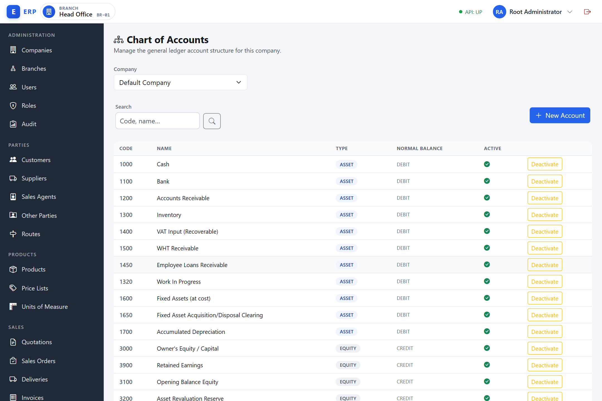
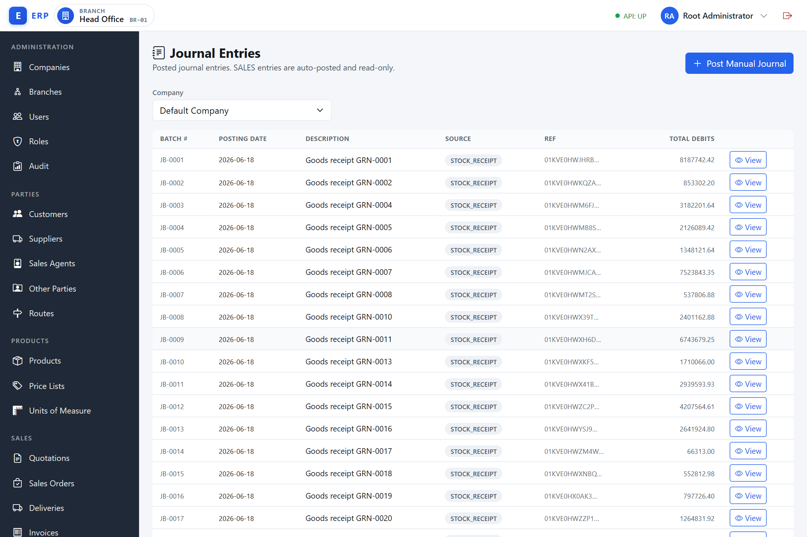
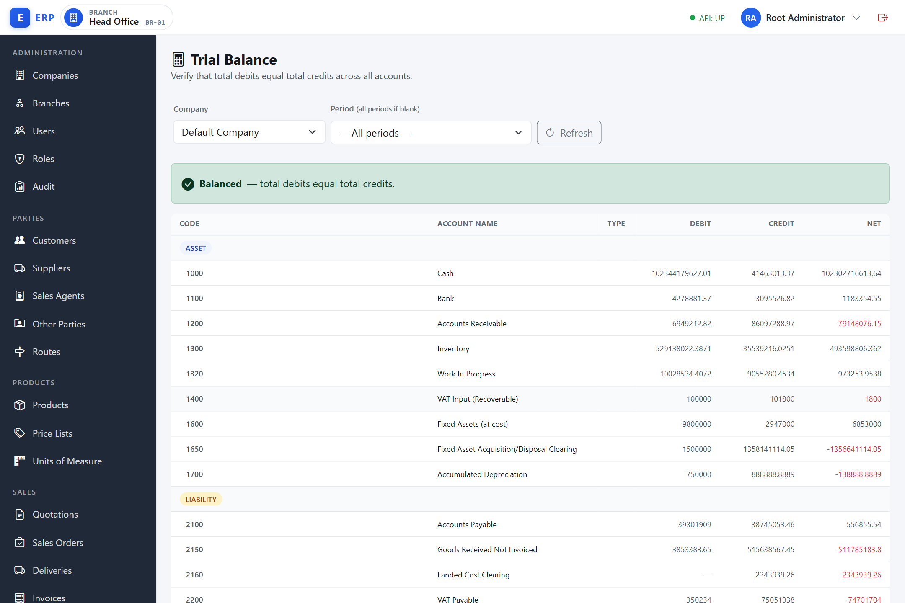
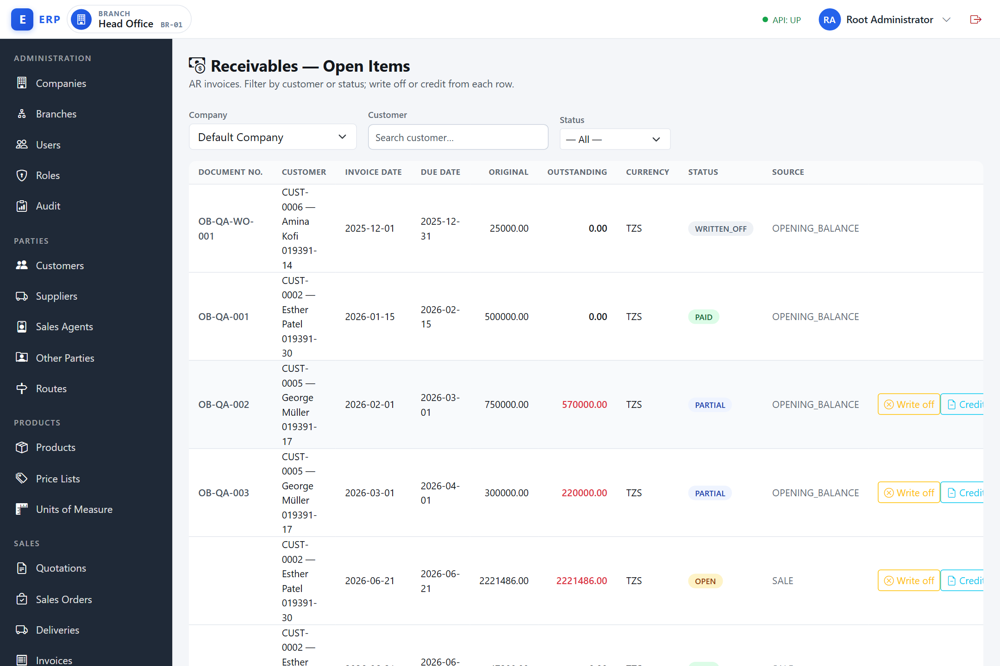
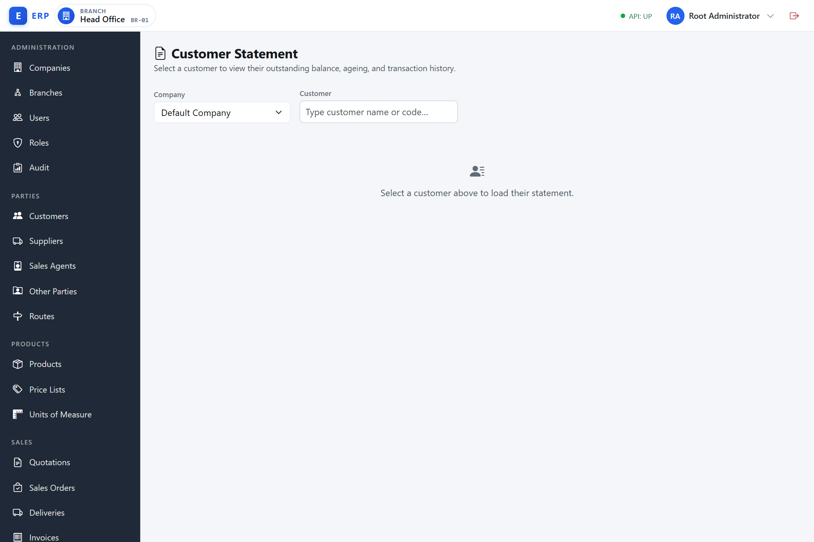
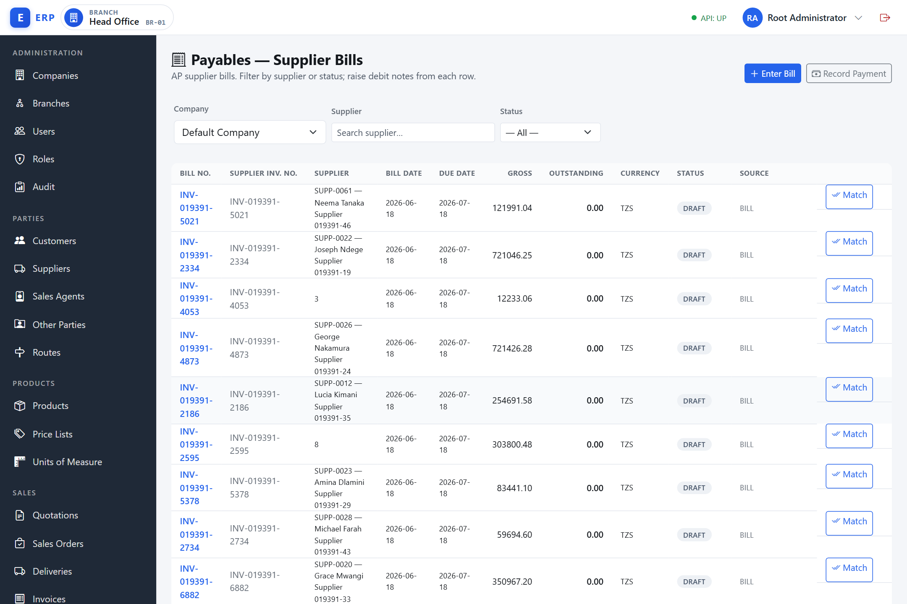
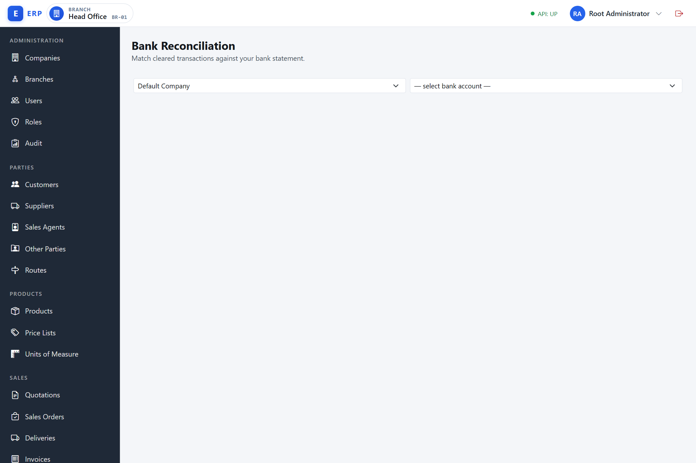
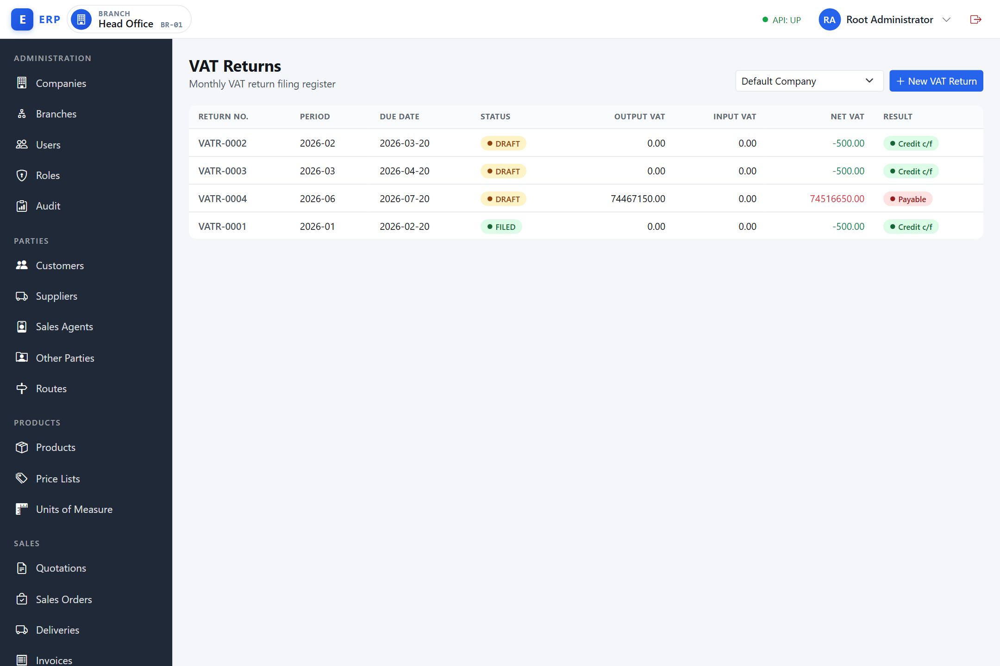
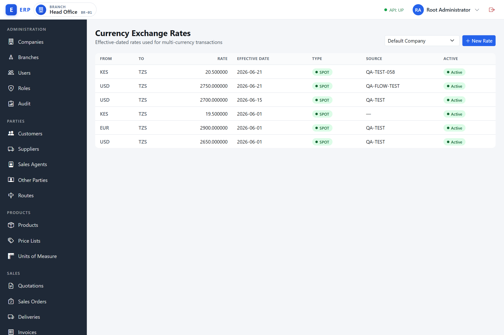

# Finance & Accounting

This chapter covers the finance modules: General Ledger, Accounts Receivable, Accounts Payable, Cash & Bank, and Tax — all under the **Accounting** navigation group — plus cost-centre dimensions (the **Costing** group) and Foreign Exchange (the **FX / Currency** group). The financial statements and reports (Income Statement, Balance Sheet and so on) are in chapter 10. The chapter is written for finance staff — accountants, AP/AR clerks, and treasury officers — who use the system day-to-day.

> **Company selector.** If you work for more than one company, most screens in this chapter show a **Company** selector at the top; pick the company first. With only one company it is hidden.

> **Currency fields.** Most currency fields in this chapter (receipts, opening balances, supplier bills, credit notes, and so on) use the filtered **Currency Picker** — a dropdown limited to the company's enabled currencies and pre-set to the company default, where you do not type a 3-letter currency code. This is documented once in Chapter 0 (Getting Started) → *Common UI Patterns*; this chapter only points to it. Two screens are exceptions: the AP **debit-note** modal has no currency field at all (it follows the bill's currency), and the **FX Exchange Rate** form offers the full seeded currency list (not the enabled-only allow-list) and falls back to typing a 3-letter ISO code if that list fails to load — see *Maintaining Currencies and Rates*.

> **Concurrency and error handling.** If two users edit the same record at once, the second save is rejected with a `409 Conflict` and a retryable "please retry" message — reload and try again. Bad input and data-integrity problems surface as clean `400`/`409`/`415` alerts, not raw server errors. These responses apply across all finance screens and are referenced throughout this chapter.

---

## General Ledger

The **General Ledger (GL)** is the central book of record for your company's finances. Think of it as the master filing system into which every financial event — a sale, a payment, a bank transfer, a year-end adjustment — is eventually recorded as a pair of entries. Every other finance module in this system (AR, AP, Cash & Bank, VAT) feeds its financial effect into the GL. If you want to know "where does the company stand financially right now?", you read the GL; if you want to understand what produced that position, you trace back through the documents that posted to it.

The GL works on the principle of **double-entry bookkeeping**, explained below. Two prerequisites must exist before any posting can happen: a **Chart of Accounts** (the master list of ledger accounts) and at least one open **Fiscal Period** (the calendar gate that controls which dates accept entries).

---

### Chart of Accounts

**What it is.** The Chart of Accounts (CoA) is the master list of all GL accounts for your company. Every financial event in the system is expressed as movements between two or more of these accounts. An account is simply a named bucket that collects amounts of a particular kind — "Cash", "Accounts Receivable", "Sales Revenue", "VAT Payable", etc.

**Why it exists.** Without a structured account list, the books would be an unclassified mass of transactions with no way to produce a trial balance, profit-and-loss statement, or balance sheet. The CoA is the taxonomy that turns a log of transactions into a set of readable financial statements. Each account is assigned one of five **types** (ASSET, LIABILITY, EQUITY, INCOME, EXPENSE), which determines where it appears on financial reports and what its **normal balance** is.

**Understanding account types and normal balances.** The five types map to the two sides of the balance sheet and the profit-and-loss statement:

| Type | What it represents | Normal Balance |
|---|---|---|
| ASSET | Things the company owns or is owed (cash, receivables, inventory) | DEBIT |
| LIABILITY | Amounts the company owes to others (payables, VAT due) | CREDIT |
| EQUITY | The owners' stake in the business (capital, retained earnings) | CREDIT |
| INCOME | Revenue earned | CREDIT |
| EXPENSE | Costs incurred | DEBIT |

A "normal balance" tells you which side — debit or credit — makes the account go up. An ASSET account increases with a debit and decreases with a credit; a LIABILITY account increases with a credit and decreases with a debit. The system derives and stores the normal balance automatically from the account type, so you never need to set it manually.

**Double-entry bookkeeping in plain language.** Every financial event is recorded as at least two entries — one account is debited (left side) and another is credited (right side) — and the total debits across all lines must always equal the total credits. This is the fundamental rule: **debits = credits in every transaction**. The system enforces this; the Post button is disabled until the entry balances. Why? Because a debit to one account must come from somewhere, and a credit to another must go somewhere. Money does not appear or disappear — it moves. A sale, for example, debits Accounts Receivable (the customer owes more) and credits Sales Revenue (income goes up) and VAT Payable (the tax liability goes up). The two sides always balance because they are two perspectives on the same event.

**When it is used.** The CoA is set up before any other finance work begins and is maintained by a user with the `GL.MANAGE` permission whenever a new account category is needed. Once created, accounts are available immediately for posting.

Navigate to **Accounting > Chart of Accounts** (`/admin/gl/accounts`).

The table shows:

| Column | Meaning |
|---|---|
| Code | Unique account code assigned at creation |
| Name | Human-readable account name |
| Type | One of: **ASSET, LIABILITY, EQUITY, INCOME, EXPENSE** |
| Normal Balance | Derived from type — ASSET and EXPENSE accounts carry a **DEBIT** normal balance; LIABILITY, EQUITY, and INCOME accounts carry a **CREDIT** normal balance. Not user-editable. |
| Active | A tick for an active account; inactive accounts are marked as such |

**Control accounts and manual-posting protection.** Some accounts are owned by a sub-ledger and must never be touched by a hand-entered journal. Each account therefore carries two additional, related properties:

- A **control-type classification** — one of `AR`, `AP`, `BANK`, `CASH`, `INVENTORY`, `TAX`, `PAYROLL_CLEARING`, `FX_CLEARING`, or none (an ordinary account). A non-null control type marks the account as owned by a specific sub-ledger (for example, the AR control account is the GL mirror of the receivables sub-ledger).
- An **allow manual posting** flag. When this is off, a manual journal (or a direct cash/bank entry) that targets the account is rejected. Genuine sub-ledger controls — AR, AP, INVENTORY, TAX, PAYROLL_CLEARING, FX_CLEARING — are locked this way so a stray manual entry cannot silently break the sub-ledger reconciliation. **CASH and BANK control accounts are deliberately left postable**, because bank charges, interest, and corrections legitimately need direct cash/bank entries (see Direct Cash/Bank Entries).

The practical effect is that a manual journal line (and a direct cash-entry counter account) targeting a locked control account is refused with a `409 Conflict` and a message naming the account and its control type — see *Posting a Manual Journal* below.

**Required dimensions per account.** An account may also be flagged to require a **cost-centre**, **department**, or **project** dimension on every *manual* journal line that posts to it. A manual line missing a required dimension is rejected, naming the account and the missing slot. System and event-driven postings (sales, AP/AR settlement, inventory, payroll, depreciation, FX, year-end close) are exempt — they do not carry operator dimension context. This per-account control is independent of the company-wide mandatory-dimension setting (see *Cost-Centre Dimensions*).

> The control-type classification, the allow-manual-posting flag, and the per-account required-dimension flags are administered on the account record. The Chart of Accounts list itself shows Code, Name, Type, Normal Balance, and Active.

Use the **Search** box (code or name) and **Search** to find an account; **Clear** resets the list.

**To create an account** (requires permission `GL.MANAGE`):

1. Click **New Account**.
2. Enter a unique **Code** (e.g. `1001`) and **Name** (e.g. Cash at Bank).
3. Choose the account **Type**. The system derives the normal balance automatically.
4. Click **Create**. The new account is immediately available for journal posting and GL config mapping.

> **Note:** The Chart of Accounts list does not expose an edit screen for an existing account's name or type — the only row actions are **Deactivate** and **Reactivate** (below). Editing the name or type of an account already in use is not available in the current UI.

**To deactivate an account** (requires `GL.MANAGE`):

1. Click **Deactivate** on the row.
2. The account becomes inactive and disappears from all posting pickers.
3. An inactive account can be reactivated by clicking **Reactivate** on its row.

> **Note:** Deactivation is soft — the account record is never deleted. No posting can be made to an inactive account (business rule BR-GL-04).

---

### Posting a Manual Journal

**What it is.** A journal entry is the fundamental unit of posting: a dated, described set of two or more lines that debit and credit specific accounts in balanced amounts. A **manual journal** is one that you compose directly, as opposed to a journal that the system creates automatically (for example, when a sale is finalised or a receipt is recorded). Manual journals are used for accounting adjustments, accruals (recording an expense before the invoice arrives), prepayment amortisation, and error corrections.

**Why it exists.** The automated posting paths cover the main transaction types, but accountants always need a mechanism to make entries the system cannot anticipate — month-end accruals, depreciation write-downs, inter-account reclassifications, and period-end corrections. Manual journals provide this escape valve under controlled, permission-gated conditions.

**When it is used.** Typically at month-end by an accountant or finance manager who holds the `GL.POST` permission. Common triggers include: preparing for period close, recording a provision, or correcting a misposting discovered in review.

**How it works.** A manual journal posts directly (there is no draft state). You compose the lines, verify that debits equal credits, and click Post. The system validates the balance, checks that each account is active, enforces the control-account and required-dimension guards (below), and checks that the posting date falls inside an open fiscal period. If everything passes, a batch number (`JB-####`) is assigned, the entry is written to the ledger, and it is immediately immutable. Corrections are made by reversal (see below), never by editing. The journal is then visible in the journal list and feeds the trial balance.

Whatever you do here is always recorded with source type **MANUAL**. This endpoint cannot post a system source type (SALES, AR_RECEIPT, YEAR_END_CLOSE, etc.); those are produced only by their originating modules. Because the entry is MANUAL, the control-account and per-account required-dimension guards always apply to every line:

- **Control-account guard.** A line may not target a locked sub-ledger control account — AR, AP, INVENTORY, TAX, PAYROLL_CLEARING, or FX_CLEARING. Such a line is rejected with a `409 Conflict` naming the account and its control type. (CASH and BANK control accounts remain postable.) The same guard applies whether the account is locked via its **allow manual posting** flag or via its **control-type** classification.
- **Required-dimension guard.** If a target account is flagged to require a cost-centre, department, or project dimension, a manual line missing that dimension is rejected, naming the account and the missing slot.

Navigate to **Accounting > Journal Entries** (`/admin/gl/journals`) and click **Post Manual Journal** (`/admin/gl/journals/post`).

The Journal Entries list shows every posted batch with the columns **Batch #**, **Posting Date**, **Description**, **Source** (MANUAL or a system source such as STOCK_RECEIPT or SALES), **Document** (the source document's own number — for example the sales invoice `INV-0453` or the goods receipt `GRN-0061` — where the system knows it), and **Total Debits**, with a **View** link on each row. SALES and other system entries are auto-posted and read-only; only MANUAL entries you compose here can later be reversed.

**Finding a journal.** Above the table:

- **Search** — a document number (`INV-0453`), a batch number (`JB-0012`) or words from the description or memo.
- **From** / **To** — posting-date range.
- **Source** — **All sources** or one of: Manual, Sales, Sales void, Cost of sales, Goods receipt, Stock adjustment, Opening stock, Opening balance, Customer receipt, Customer credit note, Supplier bill, Supplier payment, Supplier debit note, Cash entry, Cash transfer, VAT return, Landed cost, Purchase return, POS variance, Payroll, Depreciation, FX revaluation, Year-end close.
- **Account** — **All accounts** or one account: only journals with a line on that account are listed.

Click **Search** to apply; **Clear** removes all filters.

**Requirements before posting (requires permission `GL.POST`):**

- At least two active accounts must exist.
- The posting date must fall inside an **OPEN** fiscal period.
- Total debits must equal total credits (the entry must be balanced — business rule BR-GL-01).

**Steps:**

1. Under **Entry Header**, set the **Posting Date** (defaults to today). Verify it falls within an open period.
2. Enter a **Description** summarising the purpose of the entry. Optionally add a **Source Reference** (e.g. a supporting document number such as `DOC-001`).
   - Optionally pick a **Branch**. The journal then shows in that branch's financial statements (the statements run with that branch selected) instead of under *Company-level entries (no branch)*. Leave it at **Company level (no branch)** for entries that belong to the whole company — accruals, year-end adjustments, owner's capital. The picker lists only the branches you are assigned to; posting to any other branch is refused with *"You are not assigned to that branch, so you cannot post to it…"*. The branch you are currently switched into is **not** applied automatically — a journal is company level unless you choose a branch.
3. Each line requires exactly one of a debit or credit amount (not both — business rule BR-GL-08).
   - Use the **Account** dropdown on each line to select an account (shown as `code — name`). Only active accounts are listed. Accounts that a manual journal may not use are shown but greyed out, with the reason after the name — for example *(control account — use Receivables)*, *(control account — use Payables)*, *(control account — use Stock)*, *(control account — posted by sales, purchases and the VAT Return)*, *(control account — posted by payroll runs)*, *(control account — posted by FX revaluation)*, or *(closed to manual journals)* — so you know where that posting belongs instead.
   - Enter the **Debit** or **Credit** amount for that line, and an optional line **Memo**.
4. The form shows running **Debits**, **Credits**, and **Difference** totals and a **Balanced** / **Not balanced** indicator. The **Post Journal** button remains disabled until the difference is exactly zero ("Total debits must equal total credits before you can post.").
5. Click **Post Journal**. A success message shows the generated batch number (`JB-####`). You are redirected to the journal detail page.

**Adding and removing lines:**

- Click **Add Line** to insert another line.
- Click the remove (trash) icon on a line to delete it. The minimum is two lines.

**Validation errors surfaced by the server:**

- Unbalanced entry (BR-GL-01) — total debits do not equal total credits.
- Too few lines (BR-GL-01) — a journal needs at least two lines.
- Line not one-sided (BR-GL-08) — a line carries both a debit and a credit, or neither, or a negative amount.
- Inactive account (BR-GL-04) — choose an active account.
- Wrong company account (BR-GL-05) — the account belongs to a different company.
- Closed period (BR-GL-03) — the posting date is in a closed or missing fiscal period.
- Control account rejected (`409 Conflict`) — the line targets a locked control account (AR, AP, INVENTORY, TAX, PAYROLL_CLEARING, or FX_CLEARING) or an account whose **allow manual posting** flag is off. Choose a non-control account. (CASH/BANK control accounts are exempt.)
- Missing required dimension (`409 Conflict`) — the target account requires a cost-centre, department, or project dimension and the line did not supply it.
- Wrong-base-currency line (BR-GL-06) — journal lines post in the company base currency only.
- Concurrent edit (`409 Conflict`) — another change to the same data landed first; retry the action (see *Concurrency and error handling*).

---

### Reversing a Manual Journal

**What it is.** A reversal is a new journal entry that mirrors an existing one exactly but with every debit and credit swapped. The result is that the two entries cancel each other out on every account, leaving the books as if the original entry had never been made.

**Why it exists.** The GL is **append-only**: once a journal is posted, it cannot be edited or deleted. This is not a limitation — it is a deliberate design principle that protects the integrity of the audit trail. Any change to a posted entry would make it impossible to reconstruct what the books showed at a prior date. Reversal solves the problem by adding a counteracting entry, so the historical record shows both the original entry and the correction, and investigators can see exactly what happened.

**When it is used.** When you discover that a manual journal was posted to the wrong account, with the wrong amount, or in error. The reversal is initiated by the same user who posted (or any user with `GL.POST`), typically at month-end during review.

**How it works.** A reversal is dated on the **reversal date** you choose (it defaults to today — choose the original's date to undo a mistake in the same month), references the original entry via a `Reversal of` link, and posts with source type MANUAL. A **reason is required**; it is kept with the reversal entry for the audit trail. Because it is the exact swap of a balanced entry, the reversal is balanced by construction. It must land in an open fiscal period. The original and the reversal coexist permanently in the ledger. An entry can be reversed only once: a second attempt to reverse the same entry, or an attempt to reverse a reversal entry, is refused with a `409 Conflict` (BR-GL-11).

Corrections to a posted journal are always made by **reversal** — a new entry with every line's debit and credit swapped. The ledger is append-only; the original entry is never modified.

**To reverse a journal (requires `GL.POST`):**

1. Open the journal detail from **Accounting > Journal Entries** (click **View** on the row). The detail page shows the batch number, posting date, source, source reference, a **Balanced** tag, and the **Lines** (**Account Code**, **Account Name**, **Debit**, **Credit**, **Currency**, **Memo**) with totals.
2. If the entry has `Source Type = MANUAL`, is not itself a reversal and has not already been reversed, the **Reverse Entry** button is visible ("Creates an equal and opposite journal entry.").
3. Click **Reverse Entry**. Set the **Reversal date** and type a **Reason** (for example "posted to the wrong account").
4. Click **Post reversal**. The new journal is created with all amounts swapped; it links back to the original and is flagged as a **Reversal entry** on its detail page.

> System-posted entries (source types such as SALES, OPENING\_BALANCE, YEAR\_END\_CLOSE) cannot be reversed on their own. Their detail page says: "This entry was posted automatically from a document and is read-only. To correct it, correct that document (for example void the invoice) — it cannot be reversed on its own." Already-reversed entries and reversal entries cannot be reversed again (`409 Conflict`, BR-GL-11).

---

### Fiscal Periods (Open/Close)

**What they are.** The fiscal calendar divides the financial year into monthly accounting periods. Each period has a start date, an end date, and a status (OPEN or CLOSED). A **fiscal year** groups twelve such periods.

**Why they exist.** Without period gates, journals could be posted with any date — including dates months or years in the past — which would silently change already-reported figures. Closing a period locks it: no new posting can land in a closed period, so the financial statements for that period are frozen once it closes. This is essential for accurate monthly reporting, auditing, and regulatory filing.

**When they are used.** The system opens the fiscal calendar for you: every company always has the current year and the next year open (the check runs when the system starts and every night), so postings never stop on 1 January for want of a period. The finance manager can still open a year by hand — for example a non-calendar financial year at setup. Periods are closed at month-end by a user with the `GL.PERIOD.CLOSE` permission, usually after reconciliations are complete and the month's reports have been approved.

**How they work.** Each fiscal period covers one calendar month. A posting is accepted only when its posting date falls inside an OPEN period. The system derives which period a date belongs to automatically. Closing a period is reversible (a period can be reopened if a late adjustment is needed); closing the entire fiscal year is a separate, more final operation (see Year-End Close below).

Navigate to **Accounting > Fiscal Periods** (`/admin/gl/periods`).

The screen shows two panels:

- **Fiscal Years** — each year with its code, date range and current status (OPEN or CLOSED).
- **Accounting Periods** — the monthly periods, each showing **#** (period number), **Start Date**, **End Date** and **Status**, with **Close** / **Reopen** actions for users with `GL.PERIOD.CLOSE`.

**Opening a new fiscal year (requires `GL.MANAGE`):**

1. Click **Open Fiscal Year**. The **Open New Fiscal Year** form opens.
2. Enter a unique **Year Code** (e.g. `FY2027`), choose the **Start Month**, and enter the **Calendar Year**.
3. Click **Open Year**. Twelve monthly periods are created, all in OPEN status.

A year that would overlap an existing one is refused, naming both years and their dates — two open periods on one date would break every posting.

**Closing a fiscal period (requires `GL.PERIOD.CLOSE`):**

1. On a period row, click **Close**.
2. The period status changes to CLOSED. No further journal postings can be made into a closed period.

**Reopening a period (requires `GL.PERIOD.CLOSE`):**

1. On a CLOSED period row, click **Reopen**.
2. The period returns to OPEN and accepts journal postings again.

> Closing a period is reversible — except that a period inside a **closed** fiscal year stays closed. To change it, reopen the year on the Year-End Close screen, which reverses the closing entry and reopens its periods. Closing a fiscal **year** is a separate, more permanent action (see Year-End Close below).

When a posting is refused because of its date, the message says which: the date has **no fiscal period** at all, or its period is **closed**.

---

### Trial Balance

**What it is.** The Trial Balance is a summary report that lists every GL account with its total debits, total credits, and net balance for a selected period. It is the most direct proof that double-entry has been maintained: if the system's books are correct, the grand total of all debit balances must equal the grand total of all credit balances.

**Why it exists.** The trial balance is the starting point for preparing financial statements (profit-and-loss, balance sheet) and for period-end review. It lets an accountant see every account's movement in one view, spot unexpected balances, and confirm that no unbalanced entries have slipped through.

**When it is used.** Typically at month-end review and before period close, by an accountant or finance manager holding the `GL.VIEW` permission. It can also be run at any time for a diagnostic check.

**How it works.** The system aggregates all journal line amounts by account, grouping them by the account type in canonical order (ASSET, LIABILITY, EQUITY, INCOME, EXPENSE). A balanced set of books shows total debits = total credits in the footer. A non-zero difference is a finance-grade defect requiring investigation.

Navigate to **Accounting > Trial Balance** (`/admin/gl/trial-balance`).

Select your company (if multi-company), then choose what to **Show**:

- **Totals (all or one period)** — optionally pick a **Period** (blank = all periods; each listed as `P<n>: start – end (status)`). The table groups accounts by type in canonical order (ASSET, LIABILITY, EQUITY, INCOME, EXPENSE) and shows each account's **Code**, **Account Name**, **Type**, **Debit**, **Credit** and **Net**, with totals and a **Balanced** / **Unbalanced** tag.
- **As at a date (opening, movement, closing)** — enter **From** (the opening balance is everything before this date), **As at**, and optionally a **Branch** (**All branches** by default). Each account shows **Opening Dr**, **Opening Cr**, the period's **Debit** and **Credit**, and **Closing Dr**, **Closing Cr**, with totals. With a branch chosen, the figures leave out journals posted at company level (without a branch) — the screen says so.

Click **Refresh** to run it. A banner states **Balanced** (total debits equal total credits) or **Out of balance** — "the books do not balance. Investigate before closing." Users with `REPORT.EXPORT` can **Export PDF**, **Export Excel** or **Export CSV**.

Permission required: `GL.VIEW`.

---

### Posting Exceptions — automatic postings the ledger refused

**What it is.** Sales, cost of sales, goods receipts, landed costs, purchase returns, customer receipts, supplier payments, POS variances, payroll and FX revaluations post to the ledger automatically. If the ledger refuses one of those postings — the date falls in a closed period, a posting account is not mapped, a mapped account is inactive — the business document still stands (the sale is still a sale), but its journal is missing. Each such refusal is recorded here instead of being lost, so it can be fixed and posted.

**Why it exists.** A silently dropped posting makes the ledger disagree with the documents — sales on the sales report that never reached revenue, stock received that never reached inventory. This screen makes every gap visible and lets you post it exactly once after fixing the cause.

Navigate to **Accounting > Posting Exceptions** (`/admin/gl/posting-exceptions`). Permission required: `GL.VIEW` to view; `GL.POST` to re-post.

**Filters.** **Source** (All sources, Sales, Sales void, Cost of sales, Goods receipt, Landed cost, Purchase return, Customer receipt, Supplier payment, POS variance, Payroll, FX revaluation), **Posting date from** / **to**, and **Include resolved**. Click **Apply**.

**Sales vs ledger.** For the chosen dates, a small table compares the **Sales invoices** with the **Ledger**: **Sales (net of VAT)** against revenue posted, and **Output VAT** against VAT posted, with the **Difference**. When they agree the screen says "Sales and the ledger agree for these dates." A difference usually means sales listed below are not in the ledger yet, or a void was reversed in a different period. Voided sales are netted out on both sides.

**The exceptions table.** Each refused posting shows **Posting date**, **Source**, **Document**, **Amount**, **Why it failed**, and **Status** — **Open**, or once dealt with **Re-posted** / **Already posted** with a link to the journal.

**To re-post an exception (requires `GL.POST`):**

1. Fix the cause first — for example reopen the period, or map an active account under **Posting Accounts**.
2. Click **Re-post** on the Open row. The **Re-post** panel opens.
3. Optionally enter **Post on date** — leave it empty to post on the original date (useful when the original period is closed for good and the entry should land in the current month).
4. Click **Re-post**. The journal is posted and the row becomes **Re-posted**. The posting is made once: a second attempt is refused, and an exception whose journal turns out to exist already is marked **Already posted**.

---

### GL Posting-Account Config

**What it is.** The GL Config is a mapping table that tells the system which specific account in your Chart of Accounts to use when it needs to post automatically. For example, when a sales invoice is finalised, the system needs to know which account is your "Accounts Receivable" control account and which is your "Sales Revenue" account. GL Config provides those answers.

**Why it exists.** Hardcoding account codes into the system software would force every business to use identical account numbers, which is impractical. GL Config externalises that mapping, letting you point each posting role to whatever account you have created in your CoA. A missing mapping fails the posting loudly (an error is raised) rather than posting to a wrong or null account.

**When it is used.** Set up once during initial configuration by a user with `GL.MANAGE` permission. Revisited when account restructuring changes the CoA.

**How it works.** Each config key represents a posting role. The system resolves the relevant key at the moment it needs to post, reads the mapped active account, and uses it as the debit or credit leg of the automatic journal. If the mapped account is inactive or the mapping is missing, the posting fails and the operator is notified to fix the mapping.

Navigate to **Accounting > Posting Accounts** (`/admin/gl/config`). The page is headed **Posting Accounts**.

Permission required: `GL.MANAGE`.

The table shows each **Config Key** with the mapped **Account Code** and **Account Name**, and an **Edit** button. The keys relevant to the core modules include:

- `ACCOUNTS_RECEIVABLE` — the AR control account
- `SALES_REVENUE` — the revenue account for sales auto-posting
- `VAT_PAYABLE` — the output VAT control account
- `CASH` — the default cash posting account
- `RETAINED_EARNINGS` — required for the year-end close

**To set or change a posting account:**

1. Click **Edit** on the key row (or **Add Posting Account** to map a new key). The inline form opens, titled **Set Posting Account —** followed by the config key.
2. Pick the account from the **Account** dropdown (shown as `code — name (type)`). Only active accounts are listed.
3. Click **Save**. The mapping takes effect immediately.

> All four sales keys (`ACCOUNTS_RECEIVABLE`, `SALES_REVENUE`, `VAT_PAYABLE`, `CASH`) must be configured before sales invoices can be auto-posted to the GL. When an operator's document cannot post because the accounts are not set up, the operator sees a plain message asking them to contact the accountant, and — for automatic postings — the gap appears under **Posting Exceptions**.

---

### Cost-Centre Dimensions

**What they are.** Dimensions (also called **cost centres** or **department codes**) are analysis tags that can be attached to journal lines. They do not change which account a posting hits — the account, amount, and double-entry balance are completely unaffected. Instead, they let you slice the books by a management category: "Which department incurred this expense?", "Which cost centre drove this revenue?".

**Why they exist.** The main GL accounts give a company-level view of the books, but management typically needs to see performance broken down by department, branch, project, or profit centre. Dimensions provide that without multiplying the number of GL accounts (one account per department would make the CoA unmanageable). They are the analytical layer on top of the financial layer.

**When they are used.** Dimension values can be tagged on manual journal lines (per line) through the API, and are inherited automatically from source documents (sales invoices, supplier bills, stock adjustments). Finance or operations staff with `COSTING.MANAGE` permission maintain the dimension value master. Reporting users with `COSTING.VIEW` and `GL.VIEW` run the dimension-sliced trial balance.

> **UI limitation.** The **Post Journal** screen does not expose a cost-centre, department, or project picker on its lines — each line carries only an account, a debit or credit amount, and a memo. Per-line dimension tagging (and therefore posting to an account that requires a dimension) is currently an API/integration capability only; a manual post from the screen to a require-dimension account is rejected with no UI way to supply the value.

**How they work.** The system seeds two built-in dimension types: **Cost Centre** and **Department**. Alongside these, every company has two further, initially-unused dimension **slots** ("Dimension 3" and "Dimension 4") that a user with `COSTING.MANAGE` can manually claim for a custom dimension — see *Adding a Custom Dimension* below. Whichever type a dimension slot holds, you create the actual values under it (e.g. "Sales Dept", "Nairobi Branch"). A dimension type can be made **mandatory** on manual journal entries, in which case every manually posted line must carry a value for that slot — system-automated postings (sales, year-end, etc.) are exempt. The dimension-sliced trial balance groups account balances by dimension value, giving a department-level or cost-centre-level P&L.

Navigate to **Costing > Dimension Types** (`/admin/cost-centre/dimensions`). The screen is headed **Cost Centre Dimensions** and lists each type with **Code**, **Name**, **Slot**, **Status**, **Mandatory**, **Built-in** and an action to toggle the mandatory flag.

**Dimension types** are pre-seeded per company: **Cost Centre** and **Department** are **built-in** (shown with a lock icon in the **Built-in** column) and can never be created, renamed, or deleted. A company also has two spare custom slots — while a slot is free, a user with `COSTING.MANAGE` can claim it with a custom dimension type of their own naming (see below). Every dimension type, built-in or custom, can only have its **mandatory** flag toggled afterwards — there is no rename or delete. Navigate to **Costing > Dimension Values** (`/admin/cost-centre/values`) — or use the **Dimension Values** link on this screen — to manage the actual dimension values.

**Adding a custom dimension (requires `COSTING.MANAGE`):**

**What it is.** A custom dimension is a company-defined dimension type — for example "Project" or "Region" — that claims one of the two spare slots (`DIMENSION_3`, then `DIMENSION_4`) behind the built-in Cost Centre and Department types. A company can have at most two custom dimensions.

1. On the Dimensions screen, while at least one custom slot is free, an **Add Dimension** form is shown above the dimension-types table.
2. Enter a unique **Code** and **Name** for the new dimension type, and an optional **Description**.
3. Click **Add Dimension**. The system assigns the next free slot automatically — you do not choose the slot — and the new type appears in the table, listed with its assigned slot (`DIMENSION_3` or `DIMENSION_4`) in the **Slot** column.

Once both custom slots are in use, the form is replaced by the message "Both custom dimension slots are in use. You can have at most 2 custom dimensions." If another administrator claims the last slot first (a race), submitting from an already-open form is instead rejected with a shorter inline error under the form fields: "You can have at most 2 custom dimensions."

**To create a dimension value (requires `COSTING.MANAGE`):**

1. On **Dimension Values**, select the **Dimension type** (each listed as `name (slot)`).
2. Click **New Value**. The **New Dimension Value** form opens.
3. Enter a unique **Code** and **Name**. Optionally enter **Parent UID (optional — leave blank for root)** — the identifier of an existing value of the same type — to build a hierarchy.
4. Click **Create Value**.

The values table lists **Code**, **Name**, **Slot**, **Status**, **Active** and **Parent** (a link to the parent value). Row actions deactivate or activate a value, or delete it outright — a hard delete that is refused once the value has journal postings. Click a value's name to open it: the detail page has an **Edit** card (change the **Name**, set a new **Parent UID**, or tick **Clear parent (make this a root value)**) and Deactivate / Activate buttons.

**Mandatory enforcement:** if a dimension is set to mandatory, every manually posted journal line must include that dimension slot. System-posted entries (sales, year-end, etc.) are exempt.

**Per-account required dimensions:** independently of the company-wide mandatory setting, an individual Chart-of-Accounts account can be flagged to require a **cost-centre**, **department**, or **project** dimension (see *Chart of Accounts*). A manual journal line posting to such an account is rejected if it omits the required dimension, naming the account and the missing slot. As with the company-wide rule, system and event-driven postings are exempt. This lets you enforce dimension tagging on a specific expense account without making the dimension mandatory across the whole company. Because the Post Journal screen has no line-level dimension picker (see the *UI limitation* note above), such a post can only be supplied through the API.

**Viewing the dimension-sliced trial balance:** Navigate to **Costing > Sliced Trial Balance** (`/admin/cost-centre/report`); the screen is headed **Dimension-Sliced Trial Balance**. Requires both `COSTING.VIEW` and `GL.VIEW`. Under **Report Filters**, select a **Dimension slot** (Cost Centre, Department, Dimension 3, or Dimension 4 — the last two are offered whether or not the company has claimed them as a custom dimension), optionally a **Period** (all-time if blank), tick **Roll up (include descendant values)** to fold child values into their parents, and click **Run**. The result lists each **Value** and **Account** with **Type**, **Debit**, **Credit** and **Net (Dr − Cr)**. (See also chapter 10, *Dimension-Sliced Trial Balance*.)

---

### Year-End Close

**What it is.** The year-end close is an accounting operation performed once at the end of each fiscal year. It posts a special journal entry that transfers the net profit or loss for the year into the **Retained Earnings** account on the balance sheet, and simultaneously zeros out all income and expense accounts so they start the new year at zero. The fiscal year is then locked (CLOSED).

**Why it exists.** Income and expense accounts accumulate balances over the course of a year. At year-end, those balances need to be moved to equity (retained earnings) so that the new year starts fresh. Without this close, the income and expense accounts would carry over prior-year totals and the P&L for the new year would be polluted by prior-year figures. The year-end close is also the event that legally "locks the books" for the year, preventing backdated adjustments to a period whose financial statements have been approved and filed.

**When it is used.** Once per year, after all period 12 journals have been posted and reviewed, by a user with the `GL.YEAR.CLOSE` permission. Prior fiscal years must already be closed (you cannot close year N if year N-1 is still open). You do not need to close the year's periods first — the close closes any that are still open — and it does not matter if you have already closed the last month: the closing entry is still dated the year's last day.

**How it works.** The system reads the net balance of every INCOME and EXPENSE account for the year, builds one balanced closing journal (source type `YEAR_END_CLOSE`, dated the last day of the year), and posts it. Each income account is debited to zero and each expense account is credited to zero; the net difference (profit or loss) is posted to the Retained Earnings equity account as either a credit (profit) or a debit (loss). All periods in the year are then closed, the year status becomes CLOSED, and the following year is made ready for posting if it does not exist yet. The closing journal is visible in the journal list and is permanently linked to the fiscal year record. If the close needs to be undone, a reopen operation (available on the most-recently-closed year only) reverses the closing journal as a new append-only entry and reopens all periods.

Navigate to **Accounting > Year-End Close** (`/admin/gl/year-end`).

Permission required: `GL.YEAR.CLOSE`.

**Prerequisites:**

- The `RETAINED_EARNINGS` GL config key must be mapped to an active EQUITY account.
- All prior fiscal years must already be CLOSED (you cannot close year N if year N-1 is still open — business rule BR-CLOSE-04).
- The year must have at least one fiscal period.

The screen lists each fiscal year with **Year Code**, **Start Date**, **End Date**, **Status**, **Closed At** and a **Closing Journal** link.

**To close a fiscal year:**

1. On the year row showing OPEN, click **Close Year**.
2. Review the **Confirm Year-End Close** panel, which describes the retained-earnings posting that will be made and warns that all periods in the year will be closed.
3. Click **Close Year** in the panel (or **Cancel**). The system:
   - Posts a `YEAR_END_CLOSE` journal zeroing every INCOME and EXPENSE account.
   - Credits (net profit) or debits (net loss) the Retained Earnings account.
   - Closes all periods within the year.
   - Sets the year status to CLOSED and makes sure the next year is open.
4. A success message appears referencing the closing journal number, and the row's **Closing Journal** link opens it.

**To reopen a fiscal year (requires `GL.YEAR.CLOSE`):**

Only the most-recently-closed year may be reopened. Click **Reopen Year** on the CLOSED year row. The system reverses the closing journal (as a new append-only entry) and reopens all periods.

---

## Accounts Receivable

**What it is.** Accounts Receivable (AR) is the module that tracks money owed to your company by customers. When a credit-sale invoice is finalised, the system creates an **AR open item** — a record of the amount the customer owes. Every subsequent receipt, credit note, or write-off against that invoice is tracked here. Together these records form the **AR sub-ledger**: the customer-level detail behind a single GL control account (account 1200 Accounts Receivable).

**Why it exists.** The GL control account tells you the total amount owed to the company, but it does not tell you which customer owes what, how long the balance has been outstanding, or which specific invoice is unpaid. The AR sub-ledger provides that customer-level detail. It also enforces the reconciliation invariant: the sum of all open AR balances in the sub-ledger always equals the balance on account 1200 in the GL. If these two figures disagree, there is a posting error that must be investigated.

**When it is used.** Every time a credit sale is finalised (automatically), or whenever an AR clerk records a receipt, issues a credit note, writes off a bad debt, or loads an opening balance brought forward from a prior system.

**How it works.** Each open item carries an original amount (the full invoice value) and a current outstanding amount (reduced every time a receipt is allocated, a credit note is applied, or a write-off is made). The status (OPEN, PARTIAL, PAID, WRITTEN_OFF) is derived automatically from the outstanding balance. Receipts are posted synchronously to both the AR sub-ledger and the GL in a single operation, so the two are always in agreement.

AR tracks amounts owed to your company by customers. Open items (invoices) are created automatically when a sales invoice is finalised, or manually via the opening-balance screen.

### AR Invoices (Open Items)

**What they are.** An AR invoice (also called an **open item**) is the sub-ledger record of a specific amount a customer owes. For credit sales, open items are created automatically when the sales invoice is finalised. Opening-balance invoices can also be loaded manually to represent debts brought forward from a prior system.

**Why they exist.** The open item is the unit the AR module tracks through its lifecycle — from creation (OPEN) through partial payment (PARTIAL) to full settlement (PAID) or write-off (WRITTEN_OFF). All receipt allocations, credit notes, and write-offs reference the open item and reduce its outstanding balance. Without this per-invoice tracking, you could not determine which specific debts are unpaid, how old they are, or what the ageing exposure looks like.

**When they are used.** Created automatically on credit-sale finalisation, or manually loaded as opening balances. Viewed and managed by AR clerks and finance staff with `AR.VIEW` permission.

Navigate to **Accounting > Receivables** (`/admin/ar/invoices`).

The screen is headed **Receivables — Open Items**. The list shows all AR open items for the company: **Document No.**, **Customer**, **Invoice Date**, **Due Date**, **Original**, **Outstanding**, **Currency**, **Status** and **Source** (SALE, OPENING_BALANCE and so on). Each OPEN or PARTIAL row carries a **Write off** and a **Credit note** action (visible to users who hold the relevant permission).

**Invoice statuses:**

| Status | Meaning |
|---|---|
| OPEN | Unpaid; full outstanding balance remains |
| PARTIAL | A receipt has been applied but a balance remains |
| PAID | Fully settled |
| WRITTEN\_OFF | Outstanding amount written off as uncollectable |

**Filtering:** use the **Customer** search (type part of the name or code and pick from the list; the ✕ clears it) and the **Status** dropdown (— All —, Open, Partial, Paid, Written Off) to narrow the list.

---

### Recording a Receipt

**What it is.** A receipt records money received from a customer. It consists of two parts: the **cash leg** (which GL account the money went into) and the **allocation** (which open invoice or invoices the money is applied against).

**Why it exists.** Receiving money from a customer is a separate event from issuing the invoice, and the two must be matched (allocated) to reduce the outstanding balance. A receipt that is recorded but not allocated to any invoice is held **on account** — the customer has a credit balance but no specific invoice is settled. An automatic oldest-first allocation distributes the receipt across the customer's oldest unpaid invoices first, which is standard practice.

**When it is used.** By an AR clerk when a customer makes a payment — by cash, bank transfer, mobile money, or cheque. Requires the `AR.RECEIPT.RECORD` permission. The receipt triggers a GL posting immediately (DR Cash / CR Accounts Receivable).

**How it works.** The cash leg posts to the GL in the same transaction as the sub-ledger write, and the money is entered in the cash book of the account it was received into, so the control account, the open-item balances and the cash book are always in agreement at every committed moment. Applying money already held on account to an invoice later does NOT create a new GL posting — it is a sub-ledger-only change. The receipt amount and every allocation slice must be **positive**, and a receipt may only be allocated to invoices belonging to the **same customer** — an attempt to allocate against another customer's invoice is rejected with a `409 Conflict`. A receipt whose cheque **bounced**, or that was reversed, no longer counts as money held on account and cannot be re-allocated (record a new receipt when the customer pays).

Navigate to **Accounting > Record Receipt** (`/admin/ar/receipts/record`). Permission required: `AR.RECEIPT.RECORD`.

1. Under **Receipt Details**, type the customer's name or code in **Customer** and pick them.
2. Enter the **Amount**, pick the **Currency** (the Currency Picker — see Chapter 0, *Common UI Patterns*), and set the **Receipt Date**.
3. Choose the **Tender Type**: **Cash**, **Cheque**, **Bank Transfer**, **Mobile Money (M-Pesa, Tigo Pesa, Airtel Money)** or **Card**.
4. In **Received Into**, choose the cash drawer, bank or M-Pesa account the money actually went into (or leave **Company default account**). The receipt is entered in that account's cash book and its GL account is debited.
5. Optionally enter a **Payment Reference** — the M-Pesa code, cheque number or transfer reference. It is kept on the receipt and shown on the cash book.
6. Optionally add **Withholding Tax** (see WHT below).
7. Under **Allocate Against Open Invoices**, the customer's open invoices load (**Document No.**, **Date**, **Due**, **Original**, **Outstanding**, **Status**, **Allocate**):
   - Click **Auto Oldest-first** to distribute the receipt against invoices starting from the oldest outstanding, or type amounts in **Allocate** yourself; **Clear** empties them.
   - The editor shows **Receipt Amount**, **Allocated** and **On-account**, and a status: **Allocations valid**, **Over-allocated — reduce allocations**, or **An allocation exceeds the invoice outstanding**. The **Record Receipt** button stays disabled while an allocation is invalid.
   - If you allocate nothing, a note warns that the whole receipt will be kept on account.
8. Click **Record Receipt**. A confirmation shows the receipt number, amount, the **Unallocated (on-account)** amount, date, tender and reference, with **Record Another** and **View Open Items** buttons. Any unallocated remainder is held **on account** (the receipt shows status UNALLOCATED or PARTIAL) and can be applied to later invoices or refunded (below).

**Receipt statuses:**

| Status | Meaning |
|---|---|
| UNALLOCATED | No invoices have been allocated |
| PARTIAL | Part of the receipt amount is allocated; a balance remains |
| ALLOCATED | The full receipt amount has been applied |

**WHT on receipt:** if your company withholds tax from customer receipts, select the WHT type (kind = `WHT_ON_RECEIPT`) and enter the WHT amount. The GL posts: Cash DR (amount minus WHT), WHT Receivable DR (WHT amount), AR Control CR (full amount).

**Viewing receipts:** Navigate to **Accounting > Receipts** (`/admin/ar/receipts`); the screen is headed **AR Receipts**. The list is paged, can be narrowed with **Filter by Customer**, and shows **Receipt #**, **Date**, **Customer**, **Amount**, **Unallocated** and **Tender**. Open a receipt to see its detail: number, date, amount, **On account (unallocated)**, customer, tender type, reference, and the **Allocations** (each with a link to the invoice and the allocated amount). From the detail page you can apply, refund or reverse the receipt as described below.

#### Applying money held on account to later invoices

When a customer pays in advance, over-pays, or pays before the invoice is raised, the money sits on account. To use it against invoices raised later (requires `AR.RECEIPT.ALLOCATE` or `AR.RECEIPT.RECORD`):

1. Open the receipt from **Accounting > Receipts**.
2. Click **Apply to Invoices** (shown while money is held on account).
3. The customer's open invoices are listed with their outstanding balance. Click **Oldest first**, or type an amount in **Apply** against each invoice.
4. Check the line "Applying … of … on account" and click **Apply**. Each amount must be a number, no more than the invoice's outstanding, and together no more than the money on account.

No new journal is posted — the receipt's money already reduced the AR control account when it was recorded.

#### Refunding a deposit or over-payment

When money held on account must be paid back to the customer — a deposit for an order that was cancelled, an over-payment — refund it from the receipt (requires `AR.REFUND`):

1. Open the receipt and click **Refund** (shown while money is held on account).
2. The panel states how much is on account and that the refund is paid out of the default cash account and recorded in the cash book and the ledger.
3. Enter the **Amount to refund** (above zero and no more than the amount on account) and a **Reason (required)**.
4. Click **Pay refund**. The system posts **DR Accounts Receivable / CR the cash account**, writes the money out of that account's cash book, and reduces the amount on account.

> **Note.** Refunds are made in your base currency; a receipt in a foreign currency cannot be refunded here — record the refund with a journal instead. The system can also refund an **unused credit note**, but there is no button for that on screen yet.

#### Reversing a wrong receipt

If a receipt was recorded in error — the wrong customer, the wrong amount, a duplicate — reverse it (requires `AR.RECEIPT.REVERSE`):

1. Open the receipt and click **Reverse receipt**.
2. The panel explains that this takes the amount back out of the cash book, posts the reversing journal, and makes the invoices it paid owed again — and that it cannot be undone.
3. Enter a **Reason (required)** and click **Reverse receipt**.

The receipt is marked **Reversed** ("This receipt was reversed on … Its invoices are owed again and the money has been taken back out of the cash book."). If the customer did pay, record a new, correct receipt.

#### Bounced cheques

When a customer's cheque comes back unpaid, the bounce reverses the receipt in the same way: the money is taken back out of the cash book, the reversing journal is posted, and the invoices it paid are owed again. The customer statement shows a **Reversal** line. (See *Cheque Register* for how cheques are tracked.)

---

### Credit Notes

**What it is.** A credit note is a document that reduces the amount a customer owes. It is issued when goods are returned, when a billing error has been made, or when a discount is agreed after the fact.

**Why it exists.** Mistakes happen — an invoice may have been overcharged, or goods may be returned after the invoice was raised. Deleting or editing the original invoice would break the audit trail (the ledger is append-only). A credit note is the correct mechanism: it creates a new, countervailing document that reduces the outstanding balance and posts a contra entry to the GL (reversing the relevant portion of revenue and VAT).

**When it is used.** By a user with the `AR.CREDITNOTE` permission, initiated from the invoice list when an overcharge or return is identified.

**How it works (raise then apply).** A credit note has a two-stage lifecycle:

- **Raise** posts the full contra to the GL **once** (DR Sales Revenue, DR VAT Payable, CR Accounts Receivable) at the credit note's exchange rate, and sets an **unapplied amount** equal to the note total. Its status starts at **UNAPPLIED**.
- **Apply** is a sub-ledger move that reduces the chosen invoice's outstanding balance and decrements the note's unapplied amount. Apply posts nothing to the GL except a realized-FX adjustment when the settlement rate differs from the invoice rate. The note's status moves to **PARTIAL** and then **APPLIED** as the unapplied amount falls to zero. A part-applied note can be applied again — to another invoice, or to the same invoice again, in which case the amount is added to the earlier application.

When you raise a credit note directly against an invoice (the usual case from the invoices list), the system raises and immediately applies it in one step, so the invoice outstanding drops right away. Either way the credit note may only be applied to invoices belonging to the **same customer** — a cross-customer application is rejected with a `409 Conflict`. The invoice status updates automatically (OPEN, PARTIAL, or PAID depending on the remaining balance).

A credit note reduces a customer's outstanding balance. It is raised from the invoices list. Permission required: `AR.CREDITNOTE`.

1. On **Accounting > Receivables**, find the target invoice row (OPEN or PARTIAL).
2. Click **Credit note** (visible only when `AR.CREDITNOTE` is held).
3. In the **Raise Credit Note — <document>** dialog, set the **Note Date**, pick the **Currency** (the Currency Picker — see Chapter 0, *Common UI Patterns*), and enter the **Net Amount**, optional **VAT Amount**, and **Reason**.
4. Click **Raise Credit Note**. The invoice outstanding is reduced and the GL contra posting is made.

**Statuses:** UNAPPLIED (raised, nothing applied yet), PARTIAL (some of the note applied; an unapplied balance remains), APPLIED (fully applied).

---

### Write-Offs

**What it is.** A write-off removes an uncollectable balance from AR. When a debt cannot be collected — the customer has gone bankrupt, the debt has been litigated unsuccessfully, or it is simply too old to pursue — the outstanding balance is written off to a Bad Debt Expense account.

**Why it exists.** Carrying uncollectable balances on the books overstates the company's assets (accounts receivable) and makes financial statements misleading. A write-off acknowledges the economic reality: the money is not coming and the loss should be recognised as an expense. The audit trail is preserved — the original invoice and the write-off record coexist permanently.

**When it is used.** By a user with the `AR.WRITEOFF` permission, after management has decided a specific debt is uncollectable. Should not be used as a routine alternative to chasing payments.

**How it works.** The invoice's outstanding amount is set to zero and its status becomes WRITTEN_OFF. The GL posts DR Bad Debt Expense / CR Accounts Receivable for the written-off amount. Both the open item and the write-off record are retained for audit purposes.

A write-off removes an uncollectable balance from AR. Permission required: `AR.WRITEOFF`.

1. On **Accounting > Receivables**, find the OPEN or PARTIAL invoice.
2. Click **Write off**. The **Write Off — <document>** dialog shows the outstanding amount.
3. Set the **Write-off Date** and enter the **Reason**.
4. Click **Confirm Write-off**. The invoice moves to WRITTEN\_OFF status; the outstanding balance is posted to the Bad Debt Expense account.

Invoices already PAID or WRITTEN\_OFF cannot be written off again.

---

### AR Opening Balances

**What it is.** An opening balance is an AR invoice that represents a debt that existed before this system was put into use. When a company migrates from a prior accounting system, the outstanding customer balances that already exist need to be loaded so that the new system shows the correct receivables position from day one.

**Why it exists.** Without loading opening balances, the new system would show zero receivables even though customers actually owe money. Opening balances are treated as ordinary AR open items — they age, can be receipted against, and appear in customer statements — the only difference is their source is `OPENING_BALANCE` rather than `SALE`.

**When it is used.** Once, during system go-live or at the start of a new fiscal year, by a user with the `AR.OPENING.SET` permission.

**How it works.** The opening balance creates an AR invoice (source = OPENING_BALANCE) and posts a GL entry (DR Accounts Receivable / CR Opening Balance Equity) to bring the control account into agreement with the sub-ledger from the first day.

To load balances brought forward from a prior system, navigate to **Accounting > AR Opening Balance** (`/admin/ar/opening-balance`). Permission required: `AR.OPENING.SET`.

1. Pick the **Customer** by name or code.
2. Enter the **Amount**, pick the **Currency** (the Currency Picker — see Chapter 0, *Common UI Patterns*), and set the **Invoice Date**.
3. Optionally set the **Due Date** — leave it blank to use the customer's payment terms (or the invoice date if none are set) — and a **Document No.** (e.g. `MIGR-0001`).
4. Click **Set Opening Balance**. An opening-balance invoice (source = `OPENING_BALANCE`) is created and posted to the AR control account, and the screen confirms the document number. A foreign-currency opening balance is converted to your base currency for the ledger at the rate for the invoice date.

---

### Customer Statements and Ageing

**What they are.** A **customer statement** is a snapshot of a specific customer's full AR position: their outstanding invoices, recent receipts, and ageing breakdown. **Ageing** classifies outstanding balances by how many days they are overdue, providing a practical indicator of collection risk.

**Why they exist.** AR management is not just about recording receipts — it is about proactively chasing overdue debts. The ageing report identifies which customers are overdue and by how much, allowing the AR team to prioritise collection calls. Customer statements can also be shared with customers as a formal record of what they owe and what they have paid.

**When they are used.** By AR clerks and finance managers reviewing collections. The statement can be reviewed internally or shared with a customer to resolve a dispute. Both the Customer Statement and the AR Ageing screen require `AR.STATEMENT.VIEW`.

**How they work.** Ageing is calculated dynamically by comparing each open invoice's due date to the current date. The system places each outstanding amount in the appropriate bucket. The balance lookup shows the net AR balance for a specific customer (open invoices minus any unallocated receipt balance).

**Customer statement:** Navigate to **Accounting > Customer Statement** (`/admin/ar/statement`). Permission required: `AR.STATEMENT.VIEW`. Pick a customer by name to view total outstanding, the **Ageing Analysis**, **Open Items** and **Recent Receipts**; **Refresh** reloads it.

**Ageing buckets:**

| Bucket | Days Overdue |
|---|---|
| Current | 0 or not yet due |
| 1–30 | 1 to 30 days past due date |
| 31–60 | 31 to 60 days past due date |
| 61–90 | 61 to 90 days past due date |
| 90+ | More than 90 days past due date |

**AR Ageing:** Navigate to **Accounting > AR Ageing** (`/admin/ar/ageing`). Permission required: `AR.STATEMENT.VIEW`. The **Customer Ageing Buckets** table lists every customer who owes you, with **Current**, **1–30 days**, **31–60 days**, **61–90 days**, **90+ days**, **Total** and **Ccy**, as at today.

**Customer balance lookup:** on the same screen, use the **Per-Customer Balance Lookup** section to check a specific customer's net balance (outstanding invoices minus unallocated receipts and unapplied credit notes).

The balance is in your **base currency**. A foreign-currency item counts at the rate it was booked at. **Older foreign-currency items with no reliable rate.** Items raised in another currency before multi-currency was switched on were stored with an exchange rate of 1, so their "base" value is really the foreign amount. The system does not add those into a base-currency figure. They are shown underneath, per currency ("Not included above — … USD 30.00"), and the same rule applies to the AR control-account check on the dashboard.

**Printable customer statement (to send to the customer).** Once a customer is picked on **Customer Statement**, a **Printable Statement** box appears. Choose **From** and **To** dates (From defaults to the first of this month, To to today; leave From empty to start from the customer's very first transaction) and click **Export PDF**, **Export Excel** or **Export CSV**. The statement carries your company letterhead (name, address, phone, TIN, VRN), the customer's name and TIN, the period and currency, then:

- **Balance brought forward** — everything the customer owed before the From date.
- Every movement in the period, oldest first: **Invoice** and **Opening balance** lines in the Debit column; **Receipt**, **Credit note** and **Write-off** lines in the Credit column; a **Reversal** line (Debit) when a customer's cheque came back unpaid — so the customer sees both "you paid" and "it bounced".
- A running **Balance** after every line, and a **Closing balance** row with the period's debit and credit totals.
- At the foot: "Amount due from customer" (or "Customer in credit"), and who printed it and when.

**Which currency.** The statement covers every currency the customer actually trades in, one section each — a US-dollar customer gets a USD statement, not an empty TZS one. A customer who has transactions in more than one currency gets one block per currency (the customer's own default currency first, then your base currency), each with its own balance brought forward, closing balance and "amount due" line; the amounts are never added together and there is no grand total. Each **Invoice** line's **Reference** is the sales invoice number.

**Ageing export.** On **AR Ageing**, users with export permission see **Export PDF / Excel / CSV** above the table: one row per customer with the five buckets and their total, and a totals row at the bottom, as at today.

**Invoices in another currency.** Every ageing figure is in the invoice's own currency. A customer who owes you in TZS and in USD appears on **two rows** — one per currency, each with its own **Ccy** — and the two are never added together. On the customer statement the headline **Total Outstanding** is the base-currency amount only, with any foreign-currency balance shown beside it ("and USD 500.00"), and the ageing table gets one line per currency. In the ageing export, a single currency prints exactly as before; when more than one currency is present the document gains a **Currency** column and a total line per currency instead of one grand total. Amounts are not converted to TZS: the system ages what the customer actually owes, in the currency they owe it.

Both exports need the screen's permission (`AR.STATEMENT.VIEW`) **and** `REPORT.EXPORT`. A user without `REPORT.EXPORT` does not see the buttons.

---

## Accounts Payable

**What it is.** Accounts Payable (AP) is the module that tracks money your company owes to suppliers. When a supplier invoice is entered and matched against the purchase order and goods receipt, the system creates a **payable** in the AP sub-ledger. Payments against that payable are recorded here. The AP sub-ledger is the supplier-level detail behind the GL control account 2100 Accounts Payable.

**Why it exists.** Just as AR tracks what customers owe you, AP tracks what you owe suppliers. Without it, the company might pay the same invoice twice, miss a payment, or have no systematic way to match supplier invoices against what was ordered and received. AP also provides the first GL posting for a purchase — unlike the goods receipt (which records a stock movement only), the matched supplier bill is the point at which the purchase cost hits the books.

**When it is used.** By AP clerks when a supplier invoice arrives. The bill is entered, matched, and eventually paid. Requires the AP permissions your administrator grants through roles (`AP.VIEW`, `AP.BILL.ENTER`, `AP.BILL.MATCH`, `AP.PAYMENT.RUN`, `AP.PAYMENT.REVERSE`, `AP.DEBITNOTE`, `AP.OPENING.SET`).

**How it works.** A supplier bill goes through a lifecycle: entered as DRAFT, then matched via a 3-way match (bill vs purchase order vs goods receipt). If it matches within tolerance, it posts immediately to the GL (goods lines DR GRNI, service lines DR the chosen expense or asset account / CR Accounts Payable). If there is a variance, it is held (HELD) for a finance user to review and accept. Payments reduce the outstanding balance and post the cash leg to the GL.

AP tracks amounts your company owes to suppliers. Only users with the appropriate AP permissions can access this module.

### Entering a Supplier Bill

**What it is.** A **supplier bill** (also called an invoice from a supplier) is the formal demand for payment that a supplier sends after goods or services have been delivered. Entering the bill in this system registers it as a payable and triggers the 3-way match.

**Why it exists.** Entering the bill and running the 3-way match is the control that prevents your company from paying for goods it did not order, did not receive, or was charged incorrectly for. The bill is the third leg of the match: purchase order (what you ordered at what price) + goods receipt (what you actually received) + supplier bill (what the supplier says you owe). Discrepancies are surfaced as variances requiring explicit approval, not silently accepted.

**When it is used.** By an AP clerk when a supplier's invoice arrives, after the goods receipt has been entered. Requires `AP.BILL.ENTER` permission.

**How it works (3-way match).** The system compares each bill line against the corresponding purchase order line (price tolerance, default 2%) and the goods receipt line (quantity). If all lines are within tolerance, the bill moves to MATCHED and the GL posts DR Purchases (or the configured purchases account) / CR Accounts Payable. If any line exceeds tolerance, the bill moves to HELD, flagging which lines have a price or quantity variance. A user with `AP.BILL.MATCH` must review and accept each variance before the bill can match and post.

Navigate to **Accounting > Enter Bill** (`/admin/ap/supplier-bills/enter`). Permission required: `AP.BILL.ENTER`. The step-by-step entry, the match result labels and the handling of held lines are described in full in chapter 04, *Supplier Bills and 3-Way Bill Match* (sections 6.1–6.5). In short:

1. Pick the **Supplier**, enter the **Supplier Invoice No.** and **Bill Date**; **Due Date** is optional — left blank, it follows the supplier's payment terms.
2. Enter the header **VAT Amount** (0 if none), pick the **Currency** (the Currency Picker — see Chapter 0, *Common UI Patterns*), and, for a PO-matched bill, choose the **Purchase Order** (optional — leave blank for a service bill). For foreign-currency bills, an exchange rate for the bill date must exist; if it is missing you are told so plainly.
3. Add one or more lines: a free-text **Description**, **Billed Qty**, **Unit Cost** (the **Line Net** is computed), and either the **PO Line** and **Goods Receipt Line** the line is for (goods), or the expense or asset **Account (non-stock)** it should be charged to (services, assets, expenses — control accounts and inactive accounts are refused).
4. Click **Enter Bill & Match**. The system runs a **3-way match** automatically:
   - If every line's price is within tolerance (default 2%) of the order and the quantity billed does not exceed what was received (less anything already billed for that receipt line), the bill moves to **MATCHED** and posts.
   - Otherwise the bill is **HELD**, with a plain note on each held line saying why. A line whose order or receipt link cannot be resolved is held as **not checked** — never passed.

> A bill can only be entered against the supplier's own purchase orders — a PO belonging to a different supplier is rejected.

> **Behind the scenes.** Supplier bill lines can also carry per-line VAT (when a line carries VAT the header VAT becomes the sum of the line VAT amounts). That is available through the API; the Enter Bill screen uses a single header VAT field.

**Accepting a variance (requires `AP.BILL.MATCH`):**

On the match result (straight after entry, or after **Run match** on the bill detail page), each held line shows its variance and a note. Click **Accept variance** to approve the line — or **Post without checking** for a line that was never checked, an override recorded against your name. When all held lines are resolved the bill moves to MATCHED and the GL posts.

**Correcting a held or unposted bill:** open it and use **Run match** (after fixing the order, receipt or exchange rate) or **Delete bill** (to enter the invoice again). See chapter 04, section 6.4.

**Service bills (no PO):** leave the PO field blank, enter free-text line descriptions and choose each line's **Account (non-stock)**.

---

### Viewing and Navigating Bills

Navigate to **Accounting > Payables** (`/admin/ap/supplier-bills`); the screen is headed **Payables — Supplier Bills**. The list shows **Bill No.**, **Supplier Inv. No.**, **Supplier**, **Bill Date**, **Due Date**, **Gross**, **Outstanding**, **Currency**, **Status**, **Checked** (whether every line was checked against the purchase order and the goods receipt) and **Source**. Narrow it with the **Supplier** search, the **Status** filter (Draft, Matched, Held, Approved, Partially Paid, Paid) and the **Only bills not fully checked** tick box (bills where at least one line was never checked against an order and a receipt).

Click a bill number to open its detail screen, which shows the header, lines, journal link and — for held bills — the match tools. The list header carries **Enter Bill** and **Record Payment** buttons. Row actions: **Match** on HELD or DRAFT bills (opens the detail page), **Pay** on payable bills (opens Record Payment for that supplier and bill), and **Debit Note** on MATCHED, APPROVED and PARTIALLY_PAID bills.

A bill for goods received without a purchase order carries a ratification tag — **Awaiting ratification**, **Ratification refused** or **Ratified** — and cannot be paid until a manager has ratified the delivery (chapter 04, section 4.5).

**Bill statuses:**

| Status | Meaning |
|---|---|
| DRAFT | Entered but not yet matched |
| MATCHED | 3-way match passed; GL posted |
| HELD | Match variance requires acceptance |
| APPROVED | Explicitly approved for payment |
| PARTIALLY\_PAID | One or more payments made; balance remains |
| PAID | Fully paid |

---

### Payments

**What they are.** A payment is the settlement of a supplier bill — transferring money from the company's cash or bank account to the supplier. Payments can be made for a single bill or as a **payment run** covering multiple bills for the same supplier.

**Why they exist.** The payment closes out the payable: it reduces the outstanding balance on the bill and posts the cash leg to the GL (DR Accounts Payable / CR Cash/Bank). Without recording the payment, the AP sub-ledger would continue to show amounts owed even after the supplier has been paid, and the bank/cash accounts would not reflect the outflow.

**When they are used.** By a user with `AP.PAYMENT.RUN` permission, typically when the company's payment schedule falls due (weekly or monthly payment runs are common). A payment run is a batch operation that pays all selected outstanding bills for a supplier in one action.

**How they work.** Each payment allocates a specified amount against one or more bills, reducing each bill's outstanding balance. If the payment covers the full outstanding amount, the bill moves to PAID; otherwise it becomes PARTIALLY_PAID. The GL posts immediately in the same transaction as the sub-ledger write (DR Accounts Payable / CR the chosen cash/bank account), keeping the control account and the sub-ledger in agreement.

**Single-bill payment:** On the **Accounting > Payments** list (`/admin/ap/payments`), click **Pay Single Bill**. Permission required: `AP.PAYMENT.RUN`.

1. In **Bill**, search by bill number or supplier invoice number and pick the bill (its status, currency and outstanding amount are shown).
2. Enter the **Amount** (can be partial), **Payment Date**, **Tender Type** (Bank Transfer, Cash, Cheque, Mobile Money, Other) and an optional **Bank Reference**.
3. In **Pay from**, choose the till, M-Pesa or bank account the money left (or leave **Company default account**).
4. Click **Record Payment**. The GL posts DR AP Control / CR the chosen account, and the payment is entered in that account's cash book.

**Payment run (one or more bills):** Navigate to **Accounting > Record Payment** (`/admin/ap/payments/record`), or click **Pay** on a bill.

1. Pick the **Supplier** by name or code.
2. Set the **Payment Date**, **Tender Type** (Cash, Cheque, Bank Transfer, Mobile Money, Other) and an optional **Bank Reference**.
3. In **Pay from**, choose the account the money actually left ("The till, M-Pesa or bank account the money actually left."), or keep the company default.
4. Optionally add **Withholding Tax** — **WHT Type (we withhold from supplier)** and **WHT Amount withheld** (see WHT below).
5. Under **Select Bills to Pay**, the supplier's payable bills (MATCHED, APPROVED, or PARTIALLY\_PAID) load with **Bill No.**, **Supplier Inv. No.**, **Bill Date**, **Due Date**, **Gross**, **Outstanding**, **Pay now** and **Status**:
   - Tick the bills to pay (**Select All** / **Clear** help). Each ticked bill's **Pay now** defaults to its full outstanding; type a smaller amount to **part-pay** it.
   - Or enter the total cheque or transfer in **Amount to allocate oldest first** and click **Allocate oldest first** — the system ticks bills oldest first and fills **Pay now** until the amount is used up, part-paying the last one.
6. Check **Selected Bills** and **Total to pay**, then click **Record Payment** (the button shows the count, e.g. **Record Payment (3 bills)**).

A confirmation lists the payment(s) recorded — number, amount, tender, reference, and the account it was **Paid from** — with **Record Another** and **View Payables** buttons.

**Rules.**

- A payment larger than a bill's outstanding balance is refused.
- A bill for goods received without a purchase order cannot be paid until a manager has ratified the delivery.
- A foreign-currency payment is recorded in the cash book in that account's own currency.

**Viewing payments:** **Accounting > Payments** (`/admin/ap/payments`, headed **AP Payments**) lists **Payment #**, **Date**, **Kind**, **Tender** and **Amount**, with **Filter by Supplier**. Open one to see its details — **Kind**, **Amount**, **Tender**, **Paid From** (account name and number), **Reference**, **GL Entry** — and the **Bill Allocations** (each with a **View Bill** link).

#### Reversing a wrong supplier payment

If a supplier payment was recorded in error — the wrong supplier, the wrong amount, a duplicate — reverse it (requires `AP.PAYMENT.REVERSE`):

1. Open the payment from **Accounting > Payments** and click **Reverse payment**.
2. The panel explains that this puts the amount back into the cash book, posts the reversing journal, and makes the bills it paid owed again — and that it cannot be undone.
3. Enter a **Reason (required)** and click **Reverse payment**.

The payment is marked **Reversed** ("This payment was reversed on … Its bills are owed again and the money is back in the cash book."). If the supplier was in fact paid, record a new, correct payment.

**WHT on payment:** select a WHT type (kind = `WHT_ON_PAYMENT`) and enter the WHT amount. The GL reduces the cash credit by the withheld amount.

---

### Debit Notes

**What it is.** A debit note is a document that reduces the amount owed to a supplier. It is issued when goods are returned to the supplier, when you were overcharged, or when a credit is agreed after the bill has been matched.

**Why it exists.** Just as a customer credit note reduces a receivable, a debit note reduces a payable — symmetrically. The supplier has charged too much or goods have been returned, so the amount owed must be reduced. The debit note is the formal, auditable record of that reduction, posting a contra entry to the GL (DR Accounts Payable / CR Purchases).

**When it is used.** By a user with `AP.DEBITNOTE` permission, when a return or billing dispute is resolved after the bill has been matched.

**How it works (raise then apply).** A debit note mirrors the AR credit note lifecycle exactly:

- **Raise** posts the full contra to the GL **once** (DR Accounts Payable / CR Purchases, plus CR VAT Input where VAT is present) at the note's exchange rate, and sets an **unapplied amount** equal to the note total. Its status starts at **UNAPPLIED**.
- **Apply** is a sub-ledger move that reduces the chosen bill's outstanding balance and decrements the note's unapplied amount, posting only a realized-FX adjustment when the settlement rate differs from the bill rate. The note's status moves to **PARTIAL** and then **APPLIED** as the unapplied amount falls to zero. A part-applied note can be applied again — to another bill, or to the same bill again, in which case the amount is added to the earlier application.

When you raise a debit note directly against a bill (the usual case from the payables list), the system raises and immediately applies it in one step, so the bill outstanding drops right away. If the reduction brings the outstanding to zero, the bill moves to PAID.

A debit note reduces the amount owed to a supplier. Raised from the payables list. Permission required: `AP.DEBITNOTE`.

1. On **Accounting > Payables**, find a MATCHED, APPROVED, or PARTIALLY\_PAID bill.
2. Click **Debit Note**.
3. In the **Raise Debit Note — <bill>** dialog (it shows the bill's outstanding), set the **Note Date** and enter the **Net Amount**, optional **VAT Amount**, and **Reason**.
4. Click **Raise Debit Note**. The bill outstanding is reduced and the GL posts DR AP / CR Purchases.

A debit note only reduces bills of its own supplier, in its own currency. Purchase returns (chapter 04, section 7) raise their debit note automatically.

**Statuses:** UNAPPLIED (raised, nothing applied yet), PARTIAL (some of the note applied; an unapplied balance remains), APPLIED (fully applied).

---

### AP Opening Balances

**What it is.** An AP opening balance is a supplier bill that represents a debt the company already owed when it started using this system — a balance brought forward from a prior system.

**Why it exists.** Without loading opening balances, the AP sub-ledger would show no amounts owed to suppliers on day one, even though real debts exist. Opening balances create proper payable records so that subsequent payments are correctly recorded against them.

**When it is used.** Once, at system go-live, by a user with `AP.OPENING.SET` permission.

Navigate to **Accounting > AP Opening Balance** (`/admin/ap/opening-balance`). Permission required: `AP.OPENING.SET`.

1. Pick the **Supplier** by name or code.
2. Enter the **Gross Amount**, pick the **Currency** (the Currency Picker — see Chapter 0, *Common UI Patterns*), and set the **Bill Date**, **Due Date**, and optional **Supplier Invoice No.** (e.g. `MIGR-SUP-0001`).
3. Click **Set Opening Balance**. An opening-balance supplier bill is created (source = `OPENING_BALANCE`) and the screen confirms its number. A foreign-currency opening balance posts to the ledger in your base currency.

---

### AP Ageing

Navigate to **Accounting > AP Ageing** (`/admin/ap/ageing`). Permission required: `AP.VIEW`.

**What it is.** What you owe every supplier, company-wide, by how long it is past due — the creditors' ageing used to plan payment runs. Each supplier has a row with **Current**, **1–30 days**, **31–60 days**, **61–90 days**, **90+ days**, **Total** and **Ccy**; a supplier you owe in two currencies has one row per currency. Total lines at the foot are given **per currency** (with the number of suppliers), never added across currencies.

**How to use it.** Choose an **As at** date (defaults to today). Unapplied debit notes are netted; payments not yet allocated to a bill are not in these buckets. Users with `REPORT.EXPORT` can **Export PDF**, **Export Excel** or **Export CSV**.

---

### Supplier Statement

**What it is.** The supplier statement shows a specific supplier's full AP position: total outstanding, ageing breakdown, open bills, and a reconciliation between the AP sub-ledger and the GL control account.

**Why it exists.** Supplier statements serve two purposes. First, they help AP staff track what is owed to each supplier and how overdue the balances are (useful before payment runs). Second, the **reconciliation** section compares the AP sub-ledger total against the GL 2100 Accounts Payable balance — a zero difference confirms the books are in agreement; a non-zero difference is a finance-grade discrepancy that must be investigated and corrected before period close.

**When it is used.** By AP clerks and finance managers before payment runs, at month-end, or when resolving a supplier query. Requires `AP.VIEW` permission.

Navigate to **Accounting > Supplier Statement** (`/admin/ap/statement`). Permission required: `AP.VIEW`.

Pick a supplier by name to view:

- **Outstanding balance** — total of unpaid bills.
- **Ageing breakdown** — same bucket structure as AR (Current, 1–30, 31–60, 61–90, 90+).
- **Open bills** — all bills with a remaining balance.
- **Reconciliation** — compares the AP sub-ledger total against the GL AP control account. A zero difference confirms the books are in agreement. A non-zero difference is a finance-grade discrepancy requiring investigation.

**AP Sub-ledger vs GL Control Account.** This box is company-wide, so it shows as soon as the screen opens — before you pick a supplier. It reads **Reconciled** when the supplier balances add up to the GL AP control account, or **Out by TZS X** with which side is higher (the supplier sub-ledger or the GL control account). Click **Re-check** after posting corrections. Permission: `AP.VIEW`. The supplier side is what you owe on open bills, less any payment still held on account, less any **debit note not yet applied** to a bill — a debit note reduces the GL control account in full the moment it is raised, so an unapplied one is credit you already hold against the supplier, not a difference. A payment whose cheque came back unpaid counts again as owed on both sides. The supplier's **Outstanding balance** above is worked out the same way.

Both figures are in your **base currency**; a foreign-currency bill, payment or debit note counts at the rate it was booked at. **Older foreign-currency items with no reliable rate.** Items raised in another currency before multi-currency was switched on were stored with an exchange rate of 1, so their "base" value is really the foreign amount. The system does not add those into a base-currency figure. They are listed as **Unconverted (per currency)** under the reconciliation (and as "Plus, not converted" under the supplier's outstanding balance) and are **excluded from the comparison** — so a difference shown is a real one, and the unconverted list tells you what was left out.

**Printable supplier statement.** Once a supplier is picked, a **Printable Statement** box appears. Choose **From** / **To** (leave From empty to start from the first transaction) and click **Statement PDF / Excel / CSV**. The statement carries your letterhead, the supplier's name, TIN and VRN, the period and currency, then the **Balance brought forward**, every movement in the period with a running balance, and the **Closing balance** (what you owe):

- **Bill** and **Opening balance** lines in the Credit column — only bills that are on the ledger (matched, approved, part-paid or paid). A bill still **HELD** for a price or quantity variance, or still a **DRAFT**, is not on the statement.
- **Payment** and **Debit note** lines in the Debit column. A payment's line says how much of it was WHT withheld and paid to TRA on the supplier's behalf. For a payment run that paid several suppliers at once, only this supplier's share is shown.
- A **Reversal** line (Credit) when a cheque to the supplier came back unpaid.

As with the customer statement, a supplier you deal with in more than one currency gets one section per currency (the supplier's default currency first), never added together.

**Ageing PDF / Excel / CSV** prints this supplier's five ageing buckets and the total outstanding, as at today. Bills in a foreign currency are aged in that currency on their own line (and their own total) — they are never added into the TZS figures.

Both exports need `AP.VIEW` **and** `REPORT.EXPORT`.

---

## Cash & Bank

**What it is.** Cash & Bank is the module that manages the company's named money locations — petty cash boxes, tills, and bank accounts. Each cash/bank account is linked to a specific GL asset account, and every movement through the account (a receipt from a customer, a payment to a supplier, a bank transfer, or a direct entry for interest/charges) is recorded here and posted to the linked GL account in the same operation.

**Why it exists.** Without a dedicated cash/bank module, the company has no structured way to track the balance of individual accounts, match book records against a bank statement, or manage cheques. The key acceptance criterion is the **reconciliation invariant**: a cash/bank account's book balance must always equal its linked GL asset account balance. Because every movement posts synchronously to both the cash module and the GL, they are always in agreement at every committed moment.

**When it is used.** Every time money moves into or out of a named account: on recording a customer receipt, running a supplier payment, making a bank transfer, recording an expense, a bank charge or an interest entry, or performing the monthly bank reconciliation.

**What reaches the cash book.** Each account's cash book (its statement) records every movement, by type:

| Type | What it is |
|---|---|
| AR_RECEIPT | A customer receipt into the account (and, going out, a customer refund or a reversed receipt) |
| AP_PAYMENT | A supplier payment out of the account (and, coming back in, a reversed payment) |
| TRANSFER_IN / TRANSFER_OUT | A cash transfer between two of your accounts |
| DIRECT_ENTRY | An expense or income entered on **Cash / Bank Entry**, a petty-cash top-up paid from this account, or a tax payment |
| SALE_TENDER | Takings from a sale, net of change, into the till or account the tender was paid to |
| SALE_REFUND | The same money going back out when that sale is voided |
| POS_PAYOUT | Cash paid out of a POS till (a payout or till expense) |
| POS_VARIANCE | A till session's counted-versus-expected difference — in for an over, out for a short |

The last four mirror postings the sales and POS screens already make in the ledger, so the cash book of a till that takes sales shows its real takings, payouts and over/short. They are recorded from the date this feature was introduced on your system onwards; older till activity is in the ledger only.

---

### Cash and Bank Accounts

**What they are.** A cash or bank account in this system represents a physical money location (a till, a petty cash box, or a bank account). Each account is linked one-to-one with a GL asset account, so the module balance and the GL balance always track together.

**Why they exist.** Different money locations need to be tracked separately — the head-office petty cash has a different balance from the main bank account, and the company needs to know the balance of each location independently. Linking each account to its own GL asset account (rather than all sharing a single `CASH` mapping) means the books are accurate at the location level, not just in aggregate.

**When they are used.** Created by a user with `CASH.ACCOUNT.MANAGE` permission during system setup or when a new physical account is opened. The default account is used as the cash leg when no specific account is selected on a payment or receipt.

Navigate to **Accounting > Cash & Bank Accounts** (`/admin/cash/accounts`). Permission required: `CASH.VIEW` to view; `CASH.ACCOUNT.MANAGE` to create or set the default.

The list shows all cash and bank accounts for the company: **Code**, **Name**, **Type** (CASH or BANK), **Bank** (bank name and account number), **GL Account**, **Currency**, **Default** and **Active**.

**To create an account (requires `CASH.ACCOUNT.MANAGE`):**

1. Click **New Account**. The **New Cash / Bank Account** form opens.
2. Enter the **Account Name** (e.g. Main Cash Drawer) and select the **Account Type** (CASH or BANK).
   - For **BANK** accounts, also enter the **Bank Name** (required), **Bank Account No.**, and **Bank Branch**.
3. Select the linked **GL Asset Account** (only ASSET-type accounts are listed, as `code — name`).
4. Optionally tick **Set as default account**.
5. Click **Save Account**. The account code is generated automatically.

**To set the default account:** click **Set default** on any non-default row.

---

### Cash Transfers

**What it is.** A cash transfer moves funds from one cash or bank account to another within the company — for example, from the main bank account to the petty cash box, or between two bank accounts.

**Why it exists.** Physically moving cash between accounts needs to be recorded so that the book balances of both accounts update correctly and the GL reflects both the outflow from one account and the inflow to the other. Without recording the transfer, one account would show a higher balance than it actually has and the other would show a lower balance.

**When it is used.** By a user with `CASH.TRANSFER` permission, whenever funds are moved between two accounts. Common at month-end replenishment of petty cash or when consolidating bank account balances.

**How it works.** A transfer records one movement OUT of the source account and one movement IN to the destination account, and posts a single balanced GL journal (DR destination account's GL asset / CR source account's GL asset). The transfer is given a unique reference number (`CBT-####`).

To move funds between two accounts, navigate to **Accounting > Cash Transfer** (`/admin/cash/transfers/record`). Permission required: `CASH.TRANSFER`.

1. Select the **Source Account** and **Destination Account**. Each shows its **Current balance** once chosen, so you can see that the source has the money. Source and destination must differ.
2. Enter the **Amount**, **Transfer Date**, and an optional **Reference**.
3. Click **Record Transfer**. A transfer number (`CBT-####`) is generated. The GL posts a balanced entry covering the two accounts.

View the transfers list at **Accounting > Transfers** (`/admin/cash/transfers`, headed **Cash Transfers**): **Transfer #**, **Date**, **From Account**, **To Account**, **Amount** and **Ref**. Open one to see its detail, including a **View Journal** link.

---

### Direct Cash/Bank Entries

**What they are.** A direct entry records a transaction that moves money into or out of a cash or bank account but does not originate from an AR receipt, AP payment, or inter-account transfer. The most common examples are everyday **expenses** paid in cash or by bank (rent, electricity, water, transport, fuel), bank charges and interest, and direct income receipts that bypass the AR module.

**Why they exist.** Not every cash movement is driven by a sales invoice or supplier bill. Running costs paid on the spot, bank charges, interest, returned cheque fees, and similar items need to be recorded directly. Without direct entries, these amounts would never appear in the books and the cash account statement would not reconcile to the bank statement.

**When they are used.** By a user with `CASH.ENTRY.RECORD` permission, whenever money is paid out for an expense or received for something that has no invoice or bill in the system, or when a bank statement item cannot be matched to an AR receipt or AP payment.

**How they work.** The entry records the direction (OUT or IN), the amount, and a counter GL account (the other side of the double entry — typically an expense, income, or equity account). The GL is posted in the same transaction, so the cash module balance and the linked GL account balance stay in agreement.

Because a direct cash/bank entry is user-driven, its counter account is subject to the **same control-account guard as a manual journal**: a counter GL account that is a locked control account (AR, AP, INVENTORY, TAX, PAYROLL_CLEARING, or FX_CLEARING) or that has its **allow manual posting** flag off is rejected with a `409 Conflict`. Choose a non-control account. CASH and BANK accounts are exempt — that is exactly what this screen is for. The amount must be positive.

Navigate to **Accounting > Cash / Bank Entry** (`/admin/cash/entries/record`); the screen is headed **Record Cash / Bank Entry**. (Typing "expense", "rent" or "electricity" in the menu search also finds it.) Permission required: `CASH.ENTRY.RECORD`.

1. Select the **Cash / Bank Account** (`code — name`).
2. Choose the **Direction**: **OUT (Money paid — expense)** — the default — or **IN (Money received)**.
3. Enter the **Amount** and **Transaction Date**.
4. For money paid out, optionally enter the **Input VAT included (optional)** — the VAT shown on the supplier's tax invoice, included in the amount. Click **18% incl.** to fill in 18/118 of the amount. That VAT is claimed on the VAT return (it goes to VAT Input) and the expense account gets the rest.
5. Select the counter account. For money out the field reads **Expense Account (what was paid for)** and lists EXPENSE accounts first, then EQUITY and INCOME; for money in it reads **Income Account (what the money is for)** and lists INCOME accounts first. Locked control accounts are excluded.
6. Enter an optional **Memo**.
7. Click **Record Entry**. A transaction number is generated and the success banner shows the direction and amount; **Record another** clears the form.

The entry's currency is the account's currency — there is no currency field on this screen.

**Entries already recorded.** Once an account is selected, users with `CASH.VIEW` see **Entries on <account>** beneath the form: **No.**, **Date**, **Direction** (Paid out / Received), **Account**, **Memo** and **Amount**, with a **Refresh** button. The full history is on the **Cash Statement**.

---

### Bank Reconciliation

**What it is.** Bank reconciliation is the process of comparing the company's book records for a bank account against the bank's own statement. The goal is to confirm that every transaction in the books matches a transaction on the bank statement, and that the closing balance agrees.

**Why it exists.** The bank's records and the company's records are maintained independently and can differ for legitimate reasons (outstanding cheques not yet presented, deposits in transit, timing differences) or for error reasons (a transaction recorded in the books but not on the bank statement, or vice versa). Reconciliation surfaces those differences. Completing a reconciliation with a zero difference is a strong control that reduces the risk of fraud and ensures the bank balance on the balance sheet is accurate.

**When it is used.** Monthly, by a user with `CASH.RECONCILE` permission, after the bank statement for the period is received. Only BANK-type accounts can be reconciled (CASH-type accounts do not have a bank statement to match against).

**How it works.** The reconciliation opens with the account's uncleared book transactions. You mark each transaction as cleared when it appears on the bank statement. The system tracks the cleared book balance and computes the difference against the statement closing balance. When all matched transactions are ticked and the difference reaches zero, the reconciliation can be completed. A completed reconciliation is locked and cannot be modified.

Bank reconciliation matches your book records against your bank statement. Navigate to **Accounting > Bank Reconciliation** (`/admin/cash/reconciliations`). Permission required: `CASH.RECONCILE`.

**Opening a reconciliation:**

1. Select the **Bank Account** (only bank accounts can be reconciled).
2. The account's transactions load (**Txn No.**, **Date**, **Direction**, **Amount**, **Type**, **Memo**); those already cleared on an earlier, completed reconciliation are marked as such.
3. Click **Open Reconciliation**.
4. Enter the **Statement Date** and the **Statement Closing Balance** from your bank statement. **Statement Opening Balance** is optional — leave it blank to carry forward the closing balance of the last completed reconciliation (for the first statement, enter the opening balance shown on it).
5. Click **Open**. A reconciliation is opened in **DRAFT** status with its own number.

**Marking transactions cleared:**

1. Tick **Cleared** against each transaction that appears on this bank statement.
2. The summary updates as you tick: **Statement Opening Balance**, **Statement Closing Balance**, **Opening + Cleared This Statement**, and the **Difference** with a **Balanced** / **Out of Balance** tag.
   - Difference = (opening balance + items cleared on this statement) − statement closing balance.

**Completing the reconciliation:**

1. When the difference is exactly zero, **Complete Reconciliation** becomes active (until then the screen explains why it is disabled).
2. Click **Complete Reconciliation**. The reconciliation moves to **COMPLETED** status and is locked. Its closing balance becomes the next statement's opening balance, so each month's reconciliation starts where the last one ended.

A completed reconciliation cannot be modified. The difference must be zero to complete — a non-zero difference means there are unidentified items on either side.

---

### Cheque Register

**What it is.** The cheque register tracks cheques that have been written and issued against a bank account. Each cheque goes through a simple lifecycle: ISSUED (written and handed out), CLEARED (presented to the bank and cleared), or CANCELLED (voided or stopped).

**Why it exists.** Issued cheques that have not yet cleared the bank are "outstanding cheques" — they are not on the bank statement yet but are a real liability. Tracking them in the register means they can be identified during bank reconciliation as legitimate outstanding items rather than unexplained differences. Cancelled cheques provide an audit trail of voided instruments.

**When it is used.** By a user with `CHEQUE.MANAGE` permission whenever a cheque is written. Status is updated when the cheque clears or is cancelled.

Track issued cheques at **Accounting > Cheques** (`/admin/cash/cheques`). Permission required: `CHEQUE.MANAGE`.

**Registering a cheque:**

1. Click **Register Cheque**.
2. Select the **Bank Account** (only bank accounts issue cheques).
3. Enter the **Cheque Number**, **Payee**, **Amount**, **Issue Date**, and **Value Date**.
4. Click **Register**. The cheque is recorded with status **ISSUED**.

The register lists **Cheque No.**, **Payee**, **Amount**, **Issue Date**, **Value Date** and **Status**.

**Cheque lifecycle:**

- ISSUED — cheque has been written and handed out.
- Click **Clear** when the cheque has been presented and cleared the bank → status becomes **CLEARED**.
- Click **Cancel** if the cheque is lost, stopped, or voided → status becomes **CANCELLED**.

CLEARED and CANCELLED are terminal states; no further transitions are possible.

> **Behind the scenes.** The cheque model also supports inbound (customer) cheques with a direction flag and a deposit/bounce flow. A bounce reverses the customer receipt: it posts the reversing journal, takes the money back out of the bank account's cash book, and makes the invoices the receipt paid owed again. These inbound actions are available through the API; the Cheque Register screen above currently registers outbound cheques and exposes only Clear and Cancel.

---

### Cash Account Statement

**What it is.** The cash account statement shows the transaction history of a cash or bank account with a running balance. It also shows a GL reconciliation — a comparison between the account's book balance and the linked GL asset account balance.

**Why it exists.** A running statement lets treasury staff see the account's full activity in date order, trace individual transactions, and confirm that the cash module and the GL are in agreement. A non-zero GL reconciliation difference is a posting anomaly requiring investigation.

**When it is used.** By finance staff with `CASH.VIEW` permission, during daily cash management or at month-end review.

Navigate to **Accounting > Cash Statement** (`/admin/cash/statement`). Permission required: `CASH.VIEW`.

Select an **Account** (listed as `code — name (type)`) to view:

- **Current Book Balance** — the running book balance.
- **Transaction history** — each cash transaction in date order with **Txn No.**, **Date**, **Direction**, **Amount**, **Running Balance**, **Type** (see *What reaches the cash book* above), **Cleared** and **Memo** (IN transactions increase the balance; OUT transactions decrease it).
- **GL Reconciliation** — compares the account's book balance against the linked GL asset account (its code is shown): **In sync**, or **Out of sync** with the difference. A non-zero difference requires investigation.

Click **Refresh** to reload.

**Printing the account statement.** Above the balance, choose **From** and **To** and click **Export PDF**, **Export Excel** or **Export CSV**. The statement carries your letterhead, the account (code, name, bank, branch, account number), the period and currency, the **Balance brought forward** on the From date, every transaction in the period with **Money In**, **Money Out** and a running **Balance**, and a **Closing balance** row. For a period that ended before today, the foot also gives today's book balance, so the two are never confused. Leave both dates empty to print the whole history. Permission: `CASH.VIEW` **and** `REPORT.EXPORT`.

---

### End-of-Day Cash Count

**What it is.** An end-of-day cash count is a reconciliation of a physical **till** (a CASH-type cash/bank account) against its book balance. The cashier counts the drawer note-by-note and coin-by-coin, the system compares that counted total against the amount the books say should be there (the **expected** balance), and any **over** or **short** difference is posted to the ledger.

**Why it exists.** A till's book balance is only as trustworthy as the physical cash behind it. Counting the drawer at the end of the day catches theft, miscounts at the counter, and un-rung sales while they are still traceable. Posting the over/short variance to the GL means the cash account on the balance sheet always matches the money actually in the drawer, and the loss or gain is recognised in the period it happened.

**When it is used.** At the close of each business day (or each shift), by a cashier or supervisor with the `CASH.COUNT.MANAGE` permission. Viewing past counts requires `CASH.COUNT.VIEW`.

**How it works.** A count moves through three states — **OPEN** (started; the expected balance has been captured), **COUNTED** (the denomination breakdown has been entered and the counted total and variance computed), and **RECONCILED** (finalised; any variance posted to the GL and the count locked). Only CASH-type accounts can be counted — a bank account has no physical drawer. When the count is reconciled, an over posts **DR till cash / CR Cash Over (income)** and a short posts **DR Cash Short (expense) / CR till cash**, and a matching cash-book entry is written so the till's cash book and its GL account always move together to the counted figure. A count with **zero variance posts no journal** — nothing needs correcting. A count is locked once reconciled and can never be re-opened or re-counted.

**Viewing counts.** Navigate to **Accounting > Cash Counts** (`/admin/cash/counts`). Because counts are held per till, pick the **Company** (if multi-company) and then the **Till** from the selectors; the table then lists that till's counts with **Count #**, **Till**, **Business Date**, **Expected**, **Counted**, **Variance** (green for over, red for short), and **Status**. Click the eye icon to open a count.

> **Note.** A till that takes sales can be counted: its cash book carries the takings, payouts and over/short (see *What reaches the cash book*), so the expected figure includes them. A count that was started before the cash book carried sales cannot be reconciled — start a new count for that till instead.

**Opening a count (requires `CASH.COUNT.MANAGE`):**

1. From the Cash Counts list, click **New Count** (or go to `/admin/cash/counts/new`).
2. Choose the **company** (if you belong to more than one), the **Till (Cash Account)** — only CASH-type accounts are listed — and the **Business Date** (defaults to today).
3. Click **Open Count**. The system records the till's **expected** book balance as at that date and opens the count in **OPEN** status. You are taken to the count workspace.

> Only one live count per till per day. If an OPEN or COUNTED count already exists for that till and date, opening another is rejected — finish or reconcile the first.

**Entering the count and saving:**

1. In the count workspace, the top shows three figures: **Expected** (the book balance), **Counted** (the live total of what you have entered), and **Variance** with an **Over** / **Short** / **Balanced** tag.
2. In the **denomination grid**, enter the **quantity** of each note and coin you counted (the ladder is 10,000 / 5,000 / 2,000 / 1,000 / 500 / 200 / 100 / 50). The line amount and the running counted total update as you type.
3. Click **Save Count**. The count moves to **COUNTED** and the server records the counted total and the variance. You can re-save as many times as you need while the count is not yet reconciled.

**Reconciling (posting the variance):**

1. Once the count is COUNTED, click **Reconcile**.
2. The count moves to **RECONCILED** and locks. If there is an over or short, the variance is posted to the GL and a **View GL Entry** link appears; a zero-variance count simply locks with no posting.

> The denomination ladder is fixed to the standard TZS notes and coins in this release — a configurable per-currency ladder is a planned follow-up.

---

### Petty Cash

**What it is.** A petty cash fund is a small **imprest float** — a fixed amount of cash held by a named custodian to pay for minor day-to-day expenses (taxi fares, tea, small stationery) that do not justify a cheque or bank payment. This screen tracks each fund's float, its current balance, and every disbursement and replenishment against it.

**Why it exists.** Small cash payments still need a record. Without a petty cash ledger, these amounts leave no trail, the custodian cannot be held accountable for the float, and the balance on hand can drift with no way to check it. Tracking each movement keeps the custodian's cash box auditable and shows at a glance how much of the float has been spent and needs replenishing.

**When it is used.** By a user with the `PETTY_CASH.MANAGE` permission to create funds and record movements; `PETTY_CASH.VIEW` to view. Movements are recorded as they happen — a disbursement when cash is paid out, a replenishment when the float is topped back up.

**How it works.** Each fund has a **float** (the authorised ceiling) and a **balance** (the cash actually on hand, which starts at zero and moves only through recorded transactions). Three transaction types move the balance: a **Disbursement** decreases it (cash paid out), a **Replenishment** increases it (float topped back up), and an **Adjustment** is a signed correction (a positive amount increases the balance, a negative amount decreases it). The system refuses any transaction that would push the balance below zero. The float is informational — it does not hard-block a disbursement, it simply tells you the ceiling the fund should be topped up to.

**Posting to the ledger.** Every petty-cash movement posts to the general ledger in the same step, so the books always show what is in the box:

| Transaction | Ledger entry |
|---|---|
| Disbursement | DR the expense account chosen on the voucher / CR Petty Cash |
| Replenishment | DR Petty Cash / CR the cash or bank account the money came from — and an OUT line in that account's cash book |
| Adjustment (surplus) | DR Petty Cash / CR Cash Over |
| Adjustment (shortage) | DR Cash Short / CR Petty Cash |

All of a company's funds post to one asset account named **Petty Cash**. If the chart of accounts has none, the system creates it on first use (code 1011–1019); it is never an account a till or bank already uses. If the posting date's period is closed, or the accounts are not set up, the whole movement is refused — nothing is half-recorded. Movements recorded before this feature was introduced stay as they were (not posted).

**Viewing funds.** Navigate to **Accounting > Petty Cash** (`/admin/petty-cash/funds`); the screen is headed **Petty Cash Funds**. Pick the **Company** (if multi-company); the table lists each fund's **Code**, **Name**, **Custodian**, **Float**, **Balance**, and **Status** (ACTIVE / INACTIVE / ARCHIVED). Click the eye icon to open a fund.

**Creating a fund (requires `PETTY_CASH.MANAGE`):**

1. From the Petty Cash Funds list, click **New Fund** (or go to `/admin/petty-cash/funds/new`).
2. Enter a unique **Fund Code** (e.g. `PCF-001`) and a **Fund Name** (e.g. "Front Office Petty Cash").
3. Optionally select a **Custodian** (a user in the company) who is responsible for the float.
4. Enter the **Float Amount** (the authorised ceiling) and the **Currency** (typed as a 3-letter code, e.g. `TZS`).
5. Click **Create Fund**. The fund opens with a balance of zero — record a replenishment to put the opening cash in.

> The company must already have at least one branch before a petty cash fund can be created.

**Recording a transaction (requires `PETTY_CASH.MANAGE`):**

On the fund detail screen, use the **Record Transaction** panel:

1. Choose the **Type**: **Disbursement** (cash out), **Replenishment** (cash in), or **Adjustment** (a correction).
2. Enter the **Amount** (must be positive for a disbursement or replenishment; for an adjustment, enter a negative amount to decrease the balance) and the **Date**.
3. For a **Disbursement**, choose the **Expense GL Account** the money was spent on (required — "This expense account is debited and petty cash credited.").
4. For a **Replenishment**, choose where the money was **Paid in from** — a cash or bank account, or leave **— company default cash account —**. The money leaves that account's cash book and goes into petty cash.
5. Optionally add a **Reference** and a **Description**.
6. Click **Record Transaction**. The fund balance updates immediately and the movement appears in the **Transaction Ledger** below, showing **Txn #**, **Date**, **Type**, **Amount**, **Balance After** and **Reference**.

> A transaction that would take the balance below zero is rejected. Transactions can be recorded only against an **ACTIVE** fund.

---

## Tax

**What it is.** The Tax module covers two statutory obligations: the monthly **VAT return** (filed with TRA) and the **WHT (Withholding Tax) register**. Both work from the same underlying transaction data — sales invoices for output VAT, supplier bills and expense entries for input VAT, and AR/AP payment legs for WHT — but they are separate filings with separate regulatory purposes. It also records **paying** what you owe: VAT and WHT payments to TRA are recorded here, and payroll statutory payments (PAYE, NSSF and so on) from the payroll screens (chapter 11).

**Why it exists.** Tanzania (and most countries) requires businesses to collect VAT on sales (output VAT), claim VAT paid on qualifying purchases (input VAT), and remit the net difference to the revenue authority monthly. Without a VAT return module, the company would need to aggregate these figures manually from the GL each month, increasing the risk of error and late filing. The WHT register similarly provides the structured record needed for regulatory compliance.

---

### VAT Returns

**What it is.** A VAT return is a monthly declaration to TRA of your company's output VAT (collected from customers on sales), input VAT (paid to suppliers on qualifying purchases), and the net amount due (output minus input). A positive net is remitted to TRA; a negative net (input exceeds output) is carried forward as a credit.

**Why it exists.** VAT is a pass-through tax: the company collects it from customers on behalf of TRA and may recover it from TRA on qualifying business purchases. Without a monthly return, the company has no formal mechanism to net these obligations, report them to TRA, or settle the balance. The return module automates the computation from the system's existing sales and purchase records, produces the net figure, handles manual adjustments for exceptional items, and locks the return once filed to create an auditable record.

**When it is used.** By a user with `VAT.RETURN.PREPARE` permission each month, after all sales invoices and supplier bills for the period have been entered. The return must be filed with `VAT.RETURN.FILE` permission once ready.

**How it works.** Output VAT (on account 2200 VAT Payable) accumulates continuously as sales are finalised; input VAT (on the VAT_INPUT control account) accumulates as supplier bills are matched. The return computes both figures from the period's documents, and it already nets the corrections the system knows about:

- **Output VAT** = VAT on sales invoices finalised in the period (including any voided later) − VAT on sales voided in the period − VAT on customer credit notes raised in the period (including sales returns).
- **Input VAT** = VAT on supplier bills in the period + input VAT recorded on cash/bank expense entries in the period − VAT on supplier debit notes raised in the period (including purchase returns).

Each figure is converted to TZS exactly as its own ledger posting was, so filing the return clears VAT Payable and VAT Input to zero. Any prior-period credit is carried forward from the last FILED return. Manual adjustments are only for items that are **not** documents in the system, such as bad debt relief or a prior-period correction. Filing locks the return (FILED), posts a settlement journal to clear both control accounts (and each adjustment) to a dedicated VAT_DUE liability, and records the TRA filing reference.

> **Do not key credit-note or debit-note VAT by hand.** Credit notes, supplier debit notes, sales and purchase returns and voided sales recorded in the system are already in the Output VAT and Input VAT figures. Adding a **Credit Note VAT** or **Debit Note VAT** adjustment for them counts them twice. If a DRAFT return already carries such an adjustment for a document in the system, remove it and click **Recompute** before filing.

Navigate to **Accounting > VAT Returns** (`/admin/tax/vat-returns`). Permission required: `VAT.VIEW`.

The list shows all VAT returns for the company with **Return No.**, **Period**, **Due Date**, **Status**, **Output VAT**, **Input VAT**, **Net VAT**, and **Result** (Payable, Credit c/f, or Nil), plus a **New VAT Return** button.

**VAT return statuses:**

| Status | Meaning |
|---|---|
| DRAFT | Being prepared; editable |
| FILED | Submitted to TRA; locked |

**Opening a new VAT return (requires `VAT.RETURN.PREPARE`):**

1. Click **New VAT Return**. The **New VAT Return — Select Period** form opens.
2. Select the **Year** and **Month**.
3. Submit. The system creates a DRAFT return for the period and performs an initial computation. The opening credit (if any) is carried forward from the most recent FILED prior-period return.

**VAT return detail:** click a return row to open its detail. The detail screen shows:

- **Turnover by rate band** — a table with one row per VAT band showing the **Taxable Base** (the net sales value in that band) and the **Output VAT** on it. All three bands are always listed — **Standard** (18%), **Zero-Rated**, and **Exempt** — with zero shown where a band had no sales in the period, so the breakdown is complete and reconciles to the total every month rather than dropping bands that happened to be empty. A **Total** row sums the taxable base to the **Sales Turnover** and the VAT to the **Output VAT**.
- **Sales Turnover** — the period's total net sales, with **of which Zero-Rated Sales** and **of which Exempt Sales** shown beneath it so the non-standard-rated portion of turnover is visible at a glance (both are subsets of Sales Turnover, not additional amounts). **Purchases Turnover** is shown alongside.
- **Input VAT** — VAT paid on purchases.
- **Manual Adjustments** — optional signed adjustment lines (see below).
- **Opening Credit b/f** — carry-forward from the prior FILED return.
- **Net VAT** — output VAT − input VAT + adjustments − opening credit.
- The net label shows **"Payable to TRA"** (net > 0), **"Credit carried forward"** (net < 0), or **"Nil"** (net = 0).

> Zero-rated and exempt sales carry **no** output VAT (their VAT column is nil) but they **do** count toward turnover — which is why they appear as their own bands and as the "of which" lines. This matters for the return: turnover is reported in full even though only the standard band contributes VAT.

**Recomputing a DRAFT return (requires `VAT.RETURN.PREPARE`):**

Click **Recompute** on the detail screen to re-read the current sales and purchase figures. This is useful after new invoices or bills have been entered for the period.

**VAT schedules (sales and purchases listings).** Next to the export buttons, users with `VAT.VIEW` **and** `REPORT.EXPORT` see **Sales schedule** and **Purchases schedule** (Excel), and **Sales CSV** and **Purchases CSV**. These are the per-document listings behind the return that TRA asks for — date, document number, customer or supplier, TIN, VRN, net amount, VAT and, for sales, the EFD/fiscal number. They read exactly the same documents as the return, so the VAT column of the sales schedule adds up to the return's Output VAT and the purchases schedule to its Input VAT:

- **Sales:** invoices finalised in the period (including ones voided later), invoices voided in the period (as negative lines), and customer credit notes dated in the period (negative).
- **Purchases:** matched or approved supplier bills dated in the period, and supplier debit notes dated in the period (negative).

**Printing the return (Export PDF / Excel / CSV).** On the VAT return detail, users with `VAT.VIEW` **and** `REPORT.EXPORT` see three export buttons at the top. The document prints the return face as the screen shows it — supplies by tax band (taxable value and VAT), total sales turnover and output VAT, the zero-rated and exempt "of which" lines, purchases turnover, input VAT, adjustments, credit brought forward, and **Net VAT** (Payable to TRA / Credit carried forward / Nil) — under your company letterhead with its **TIN and VRN**. A filed return prints its filing date and TRA reference; a **DRAFT** prints "DRAFT — not yet filed; figures may still change", so it cannot pass for the filed return. Purchases turnover prints blank (not 0.00) when it was not computed. Any penalty or interest recorded is printed at the foot, marked as not included in Net VAT.

---

### VAT Adjustments

**What they are.** A VAT adjustment is a signed correction line added to a DRAFT VAT return to account for items that do not flow through the standard sales or purchase figures — for example, VAT relief on a bad debt that has been written off, VAT corrections for prior-period errors, or the VAT on a credit or debit note that was issued **outside the system** (on paper, or in another system). Credit notes, supplier debit notes, returns and voids recorded in the system are already in the return (see *VAT Returns* above) and must not be added again as adjustments.

**Why they exist.** Not every VAT correction can be handled by recomputing the sales and purchase figures. TRA rules allow for specific adjustment types (bad debt relief, prior-period corrections, credit/debit note VAT) to be reflected in the return as signed adjustment lines, each with an identifiable reason and narrative.

**When they are used.** By a user with `VAT.ADJUST` permission, on a DRAFT return, when a specific regulatory adjustment is identified before filing.

Adjustments can be added to a DRAFT return to correct prior-period errors or to reflect the VAT on credit/debit notes issued outside the system. Permission required: `VAT.ADJUST`.

**To add an adjustment:**

1. On the DRAFT return detail, click **Add Adjustment**.
2. Choose the **Reason**:
   - Bad Debt Relief
   - Prior Period Correction
   - Credit Note VAT — only for a credit note issued outside the system
   - Debit Note VAT — only for a debit note issued outside the system
   - Other
3. Choose the **Effect** (Increase VAT or Decrease VAT).
4. Enter a positive **Amount** and an optional narrative.
5. Submit. The net VAT recalculates immediately. When the return is filed, each adjustment is posted to the ledger with the settlement journal: Credit Note VAT to VAT Payable, Debit Note VAT to VAT Input, Bad Debt Relief to Bad Debt Expense, and a Prior Period Correction or Other adjustment to VAT Payable (increase) or VAT Input (decrease).

To remove an adjustment, click the remove icon on the adjustment row. Adjustments cannot be added or removed from a FILED return.

---

### Filing a VAT Return

**What it is.** Filing is the act of submitting the prepared VAT return to TRA and locking it in the system. Filing is irreversible — a filed return cannot be edited.

**Why it exists.** Filing separates preparation (a workflow step, editable) from submission (a regulatory commitment, locked). Once filed, the return is a permanent record with a TRA reference number. The GL settlement journal it posts clears the VAT control accounts, so the new period starts with only that period's VAT movements on the accounts.

**When it is used.** By a user with `VAT.RETURN.FILE` permission, after the return has been reviewed, any adjustments added, and the amount payable confirmed. All prior-period returns must be FILED before the current one can be filed.

**How it works.** Filing runs a final recompute, posts the settlement journal (DR VAT_PAYABLE output amount / CR VAT_INPUT input amount / one line per adjustment / net to VAT_DUE), records the TRA filing reference and date, and sets the return status to FILED. VAT_DUE therefore moves by exactly the filed net amount.

Filing locks the return and posts the settlement journal to the GL. Permission required: `VAT.RETURN.FILE`.

**Requirements:**

- The return must be in DRAFT status.
- All prior-period returns for the same company must be FILED (you cannot file period N while period N-1 is still DRAFT).
- The GL config keys `VAT_PAYABLE`, `VAT_INPUT`, and `VAT_DUE` must be mapped to active accounts.

**Steps:**

1. On the DRAFT return detail, click **File Return**.
2. Enter the **TRA Filing Reference** and **Filing Date**.
3. Click **Confirm File**. The system:
   - Runs a final recompute.
   - Posts a settlement journal (DR VAT\_PAYABLE output amount / CR VAT\_INPUT input amount / balancing leg to VAT\_DUE).
   - Sets the return to FILED and records the filing date and reference.
   - Shows a link to the posted journal.

A nil-activity return (output and input both zero) files and locks without posting a journal.

---

### Paying VAT to TRA

**What it is.** Filing a return moves the net VAT you owe onto the **VAT Due** liability. Paying TRA clears it. Recording the payment here books the money out of the bank or cash account and reduces VAT Due by the same amount, so the ledger shows what is still owed.

**When it is used.** After a return showing **Payable to TRA** has been filed, when the payment is made. Requires `VAT.RETURN.FILE`.

1. Open the FILED return. While something is still owed, a **Record payment** button is shown.
2. In **Record VAT payment to TRA**, choose **Paid from** (the cash or bank account), the **Payment date**, the **Amount** (defaults to what is still owed) and the **TRA payment reference**.
3. Click **Record payment**. The return now shows **Paid to TRA** with the amount and reference, and "… still owed" if the payment was partial. You can record further payments until nothing is owed.

The payment posts **DR VAT Due / CR the chosen account** and an OUT line in that account's cash book.

---

### WHT Types and Register

**What WHT is.** Withholding Tax (WHT) is tax that one party deducts from a payment before remitting the balance to the other party. It works in two directions. When your company **pays a supplier**, it may be required by TRA regulations to withhold a percentage of the payment, remit that withheld amount to TRA, and issue the supplier a WHT certificate (`WHT_ON_PAYMENT`). When a customer **pays your company**, the customer may withhold tax from the receipt; you receive less than the invoice amount and are issued a WHT certificate in return — a tax credit you can use against your own tax liability (`WHT_ON_RECEIPT`).

**Why WHT types exist.** Different categories of payment attract different WHT rates under Tanzanian tax law (professional fees, rent, interest, etc.). WHT types let you configure the rate for each category once and select the appropriate type on each payment or receipt, ensuring the correct amount is withheld and the correct GL accounts are used.

**When they are used.** WHT types are maintained by a user with `WHT.MANAGE` permission during initial setup or when a new rate category is needed. WHT is applied optionally on individual AP payments and AR receipts by selecting a WHT type and amount during recording.

**What WHT does to the cash.** The payment **amount** is what the bill is relieved by; the WHT is held back from it. Paying a 400,000 bill with 20,000 WHT clears the whole 400,000 from the supplier's account, but only **380,000** leaves the bank — that is what the cash book and the GL both record, and the other 20,000 sits on WHT payable until you remit it to TRA. A receipt the customer withheld from works the same way in reverse. The WHT must be less than the amount paid, and an amount withheld needs its WHT type. A payment run can deduct WHT only when it pays a single supplier (the certificate is issued to one supplier) — run each supplier separately.

**What the register shows.** The WHT register is the period summary of all WHT certificates — how much was withheld on supplier payments (payable to TRA) and how much was withheld by customers from your receipts (a receivable credit against your tax bill). It is the data source for preparing the WHT remittance to TRA.

**WHT Types:** Navigate to **Accounting > WHT Types** (`/admin/tax/wht-types`); the screen is headed **Withholding Tax Types**. Permission required: `WHT.VIEW` to view; `WHT.MANAGE` to create, edit, and deactivate.

WHT types define the rates at which tax is withheld. Each type has:

- A unique code and name.
- A kind: **WHT\_ON\_PAYMENT** (withheld when paying a supplier) or **WHT\_ON\_RECEIPT** (withheld by the customer from your receipt).
- A rate percentage.

The list shows **Code**, **Name**, **Kind**, **Rate %** and **Active**.

To create a WHT type:

1. Click **New WHT Type**. The **New Withholding Tax Type** form opens.
2. Enter the **Code**, **Name**, **Kind** — **On Payment (we withhold from supplier)** or **On Receipt (customer withholds from us)** — and **Rate %** (0 or greater).
3. Save.

The kind is fixed at creation and cannot be changed. To deactivate a type, click **Deactivate** on its row. An inactive type is excluded from the pickers in the AP payment and AR receipt screens.

**WHT Register:** Navigate to **Accounting > WHT Register** (`/admin/tax/wht-register`). Permission required: `WHT.VIEW`.

The register shows all WHT certificates in a period, grouped into two sections:

- **WHT Payable to TRA** — certificates from supplier payments (`WHT_ON_PAYMENT`), with a **TRA** column showing **Remitted** or **Unpaid**.
- **WHT Receivable** — certificates from customer receipts (`WHT_ON_RECEIPT`).

Each section lists **WHT Certificate No.**, **Party**, **Source Ref**, **Taxable Base**, **WHT Amount** and **Date**, with a total. Select the period under **Select Period** by choosing the **Period type** — **Year & Month** (Year + Month) or **Date Range** (From and To) — then click **Load**.

**Paying withheld tax to TRA (requires `WHT.REMIT`).** When the period has unpaid payable certificates, a **Record payment to TRA** button appears in the WHT Payable section.

1. Click **Record payment to TRA**. The panel states how many unpaid certificates of the period it will pay, and their total.
2. Choose **Paid from** (cash or bank account), the **Payment date**, and the **TRA reference** (required).
3. Click **Record payment**. The system posts **DR WHT Payable / CR the chosen account**, writes the payment into that account's cash book, and marks those certificates **Remitted**.

**Exporting the register.** After loading, users with `WHT.VIEW` **and** `REPORT.EXPORT` see **Export PDF / Excel / CSV**. The export is exactly the period on screen: the WHT Payable section and the WHT Receivable section, each certificate with its date, party, source reference, taxable base and WHT amount, and a subtotal per section, under your company letterhead. There is deliberately no grand total — payable and receivable are different obligations and adding them would mean nothing.

> **Payroll statutory deductions** (PAYE, NSSF, WCF, SDL, HESLB) are paid from the payroll screens — see chapter 11, *Paying payroll statutory deductions*.

---

## Foreign Exchange (FX)

**What it is.** The FX module enables your company to issue sales invoices, enter supplier bills, and record receipts and payments in foreign currencies (USD, EUR, KES, GBP) while keeping the GL in the company's **base currency** (TZS). Every foreign-currency document is converted to TZS at the effective exchange rate on the document date; the GL always carries TZS amounts only.

**Why it exists.** Many businesses transact in foreign currencies — exporting in USD, importing from Europe in EUR — but keep statutory accounts in TZS. Without the FX module, the company would have to manually convert every foreign transaction before posting, with no systematic rate history, no automatic recognition of exchange gains and losses, and no way to revalue open foreign balances at period-end. FX makes multi-currency transacting systematic and auditable while preserving the integrity of the base-currency ledger.

**When it is used.** Any time a sales invoice, supplier bill, receipt, or payment is denominated in a currency other than TZS. The FX module must be configured first (exchange rates entered) before any foreign-currency document can be posted.

**Key concepts:**

- **Base currency.** The currency in which the company keeps its books (TZS by default). All GL postings are in the base currency regardless of the document currency. The base currency is a per-company setting and **cannot be changed once any journal entries exist** for the company.
- **Enabled currencies and default document currency.** Each company (and optionally each branch) has an admin-configured allow-list of **enabled currencies** and a configurable **default document currency**. Document currency fields across finance and sales use the filtered **Currency Picker**, which offers only the company's enabled currencies and pre-selects the default — see Chapter 0, *Common UI Patterns*. The one exception is the FX Exchange Rate form below, whose From/To selects list the full seeded currency set (not the enabled-only allow-list) and fall back to a typed 3-letter ISO code if the list fails to load.
- **Exchange rate.** The conversion rate between a foreign currency and TZS, expressed as "1 unit of foreign currency = X TZS" (e.g. 1 USD = 2,500 TZS). Rates are effective-dated: the system uses the most recent SPOT rate on or before the document date.
- **Realized gain/loss.** When a foreign-currency invoice is settled (received or paid), the TZS equivalent at the settlement rate may differ from the TZS equivalent when the invoice was raised. That difference is a **realized FX gain or loss** — it crystallises at the point of settlement and is posted to the books automatically (no manual action).
- **Unrealized gain/loss.** Open foreign-currency balances (unpaid invoices, unsettled bills) gain or lose TZS value as exchange rates move. At period-end, these open balances are **revalued** to the current spot rate. The resulting unrealized gain or loss is posted as a provisional GL entry and reversed at the start of the next period (because it is provisional — it only becomes realized when the invoice is actually settled).

---

### Maintaining Currencies and Rates

**What it is.** The exchange rate master is a per-company, effective-dated list of rates between each foreign currency and TZS. Rates are entered manually and are append-only — a correction is a new rate row with the correct value, not an edit of the existing row.

**Why it exists.** Without an accurate, dated rate history, the system cannot convert foreign documents at the right rate, cannot compute realized FX on settlement, and cannot revalue open balances at period-end. The effective-dating ensures that a document dated in the past uses the rate that was in effect on that date, not today's rate.

**When it is used.** By a user with `CURRENCY.MANAGE` permission whenever an exchange rate needs to be entered or updated — typically daily or at the start of each period.

Navigate to **FX / Currency > Exchange Rates** (`/admin/fx/rates`). Permission required: `CURRENCY.VIEW` to view; `CURRENCY.MANAGE` to add rates. (Enabling currencies for the company and choosing the default is done on **FX / Currency > Currencies** — see chapter 02, *Currencies and FX Rates*.)

A set of currencies (TZS, USD, EUR, KES, GBP) is seeded at system setup. Which of these a company may actually use on *documents* is governed by its admin-configured **enabled-currency allow-list** (with a default document currency); the Currency Picker on every document offers only the enabled currencies (see Chapter 0, *Common UI Patterns*). The **From / To** selects on this rate-entry form are an exception: they list the full seeded currency set, not the enabled-only allow-list. The rate list shows all effective-dated exchange rates for the company, newest first.

**To add a new rate (requires `CURRENCY.MANAGE`):**

1. Click **New Rate**. The **New Exchange Rate** form opens.
2. Select the **From Currency** and **To Currency** from their dropdowns (each shown as `code — name`). The two must differ; the form does not require the To currency to be the company base currency — to keep the GL in base currency you would normally set To to TZS, but it is not enforced here. (If the currency list fails to load, both fields fall back to a typed 3-letter ISO code.)
3. Enter the **Rate** (expressed as: units of the To-currency per 1 unit of the From-currency), the **Effective Date**, and optionally a **Rate Type** (the dropdown defaults to **— none —**; choose Spot, Forward, or Official) and a **Source**.
4. Click **Save Rate**. The rate is effective from that date for documents and revaluations.

> Rate entry is append-only — there is no edit-in-place. To correct a rate, add a new row with the corrected value and the correct effective date. If a rate for the same currency, date, and type already exists, the entry is rejected. A self-currency rate (From = To) must be exactly 1; any other value is rejected.

The system uses the most recent SPOT rate on or before the document date when converting foreign-currency documents to base TZS.

---

### Foreign-Currency Documents

**What they are.** A foreign-currency document is any sales invoice, supplier bill, receipt, or payment that is denominated in a currency other than TZS.

**Why conversion happens at the document boundary.** The GL is strictly base-currency-only. Every journal line must carry TZS amounts. The conversion from foreign currency to TZS therefore happens at the moment of posting — inside the AR/AP/sales services, before the journal lines are built — not inside the GL engine itself. This design means the GL's double-entry integrity rules (debits = credits in TZS) are never weakened or complicated by multi-currency concerns.

**How it works.** When you enter a sales invoice, supplier bill, or receipt in a foreign currency, the system converts all GL postings to TZS using the effective SPOT rate for the document date. The document stores the face amounts in the foreign currency; all GL ledger entries are in TZS. The conversion rate and the TZS base amount are captured on the document at the point of creation and are immutable — they will not change even if new rates are added later.

When you enter a sales invoice, supplier bill, or receipt in a foreign currency (e.g. USD), the system automatically converts all GL postings to the company base currency (TZS) using the effective SPOT rate for the document date. The document stores the face amounts in the foreign currency; all GL ledger entries are in TZS.

If no rate exists for the document's currency on or before the document date, the posting is rejected with a rate-not-found error.

---

### Period-End Revaluation Run

**What it is.** A revaluation run is a period-end operation that adjusts the TZS value of open foreign-currency balances (unpaid AR invoices and unsettled AP bills) to the current spot rate. The adjustment is posted as an unrealized FX gain or loss, and a corresponding reversal is automatically scheduled for the first day of the next period.

**Why it exists.** If a USD invoice was raised when 1 USD = 2,500 TZS and the rate is now 2,600 TZS at period-end, the receivable on the books (2,500 TZS) is understated — the company could receive 2,600 TZS if paid today. The revaluation corrects the book value to 2,600 TZS and recognises the 100 TZS unrealized gain. This is an **accounting standards requirement** (IFRS/IAS 21): period-end statements must reflect current exchange rates on foreign balances. The gain is labelled "unrealized" because the invoice has not yet been paid — it reverses at the start of the next period so the actual settlement computes the real (realized) gain or loss against the original invoice rate, with no double-counting.

**When it is used.** At period-end, by a user with `FX.REVALUE` permission, after all foreign-currency invoices and bills for the period have been entered and before the period is closed. The run is idempotent — running it twice for the same period produces one run (the second attempt is rejected as already completed).

**How it works.** A preview (dry run) shows you the would-be adjustments without posting anything. Once you confirm, the system posts a single balanced GL journal (DR/CR the relevant control account / CR/DR the UNREALIZED_FX_GAIN or UNREALIZED_FX_LOSS account). If the next fiscal period is already open, the reversal is posted immediately; otherwise the system records the intent and posts the reversal when that period is opened.

At period end, open foreign-currency balances (AR invoices and AP bills not yet settled) must be revalued at the current spot rate. Navigate to **FX / Currency > Revaluation Runs** (`/admin/fx/revaluation-runs`); the screen is headed **FX Revaluation Runs**. Permission required: `FX.EXPOSURE.VIEW` to view runs; `FX.REVALUE` to preview and post.

**Running a preview (dry run):**

1. Select the company and click **Preview / Run Revaluation**. The **Preview Revaluation (Dry Run)** panel opens.
2. Choose the **Fiscal Period** from the picker.
3. Optionally enter a **Spot Rate Date** (defaults to the period end date).
4. Click **Preview**. The system shows **Total Gain**, **Total Loss** and **Net Adjustment**, marked "DRY RUN — not posted", and each open foreign item with **Source**, **Currency**, **Outstanding Txn**, **Carrying Base**, **Spot Rate**, **Revalued Base** and **Adjustment**. No GL is posted.

**Posting the revaluation:**

1. After reviewing the preview, go to **Post this Revaluation Run**.
2. Enter the **Posting Date** and click **Post to GL**.
3. A revaluation run record is created and a balanced unrealized FX journal posts to the GL.
4. If the next fiscal period is already open, the system automatically schedules and posts a reversal on the first day of the next period.
5. If the next period is not yet open, the run status is **POSTED** and the reversal can be triggered manually later (see below).

**Manually reversing a run:**

The runs list shows **Run #**, **Posting Date**, **Spot Rate Date**, **Status**, **Net Adjustment**, **Gain** and **Loss**. On a POSTED run, click **Reverse <run number>**, enter the reversal date, and confirm. The reversal journal posts and the run status moves to **REVERSED**.

**Realized FX gains and losses** are posted automatically when a foreign-currency invoice is settled. The difference between the original invoice rate and the settlement rate is posted to the `REALIZED_FX_GAIN` or `REALIZED_FX_LOSS` accounts configured in GL config. No manual action is needed.
